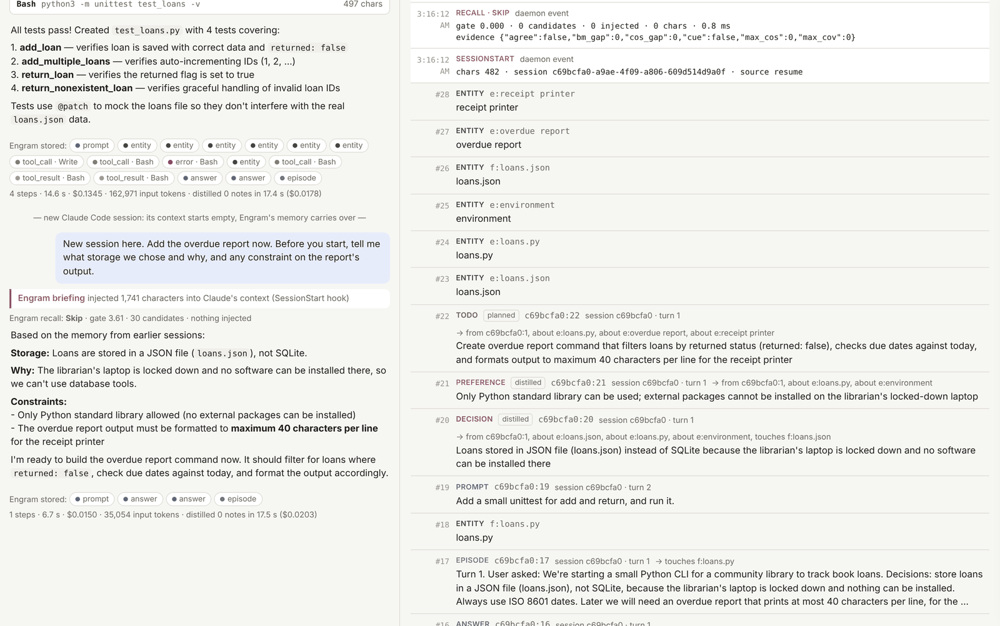

<h1>
  <picture>
    <source media="(prefers-color-scheme: dark)" srcset="docs/assets/brand/chloedb-wordmark-on-dark.svg">
    
  </picture>
</h1>

**Search, data and recommendations in one embedded database.**

ChloeDB keeps full text, structured columns, vectors and graph edges over the same rows, in one file, and answers all of them in one SQL query. Use it inside your app like SQLite, serve it over HTTP, or grow it to a sharded cluster without changing a query.

[Website](https://chloetech-ai.github.io/chloedb/) · [Documentation](https://chloetech-ai.github.io/chloedb/site/docs/) · [Query language](docs/chloedb/query-language.md) · [Benchmarks](https://chloetech-ai.github.io/chloedb/site/benchmarks.html) · [Changelog](CHANGELOG.md)

```sql
SELECT id, title, price, score() FROM products
WHERE MATCH(title, 'wireles~ controller')              -- full text, typo forgiven
  AND price BETWEEN 20 AND 60 AND in_stock              -- columns
ORDER BY rrf(bm25(title, 'wireless controller'),        -- words
             similarity(emb, :query_vector))            -- and meaning
  DESC MAX 2 PER brand LIMIT 10;                        -- at most two per brand
```

A cost-based planner decides, per segment and from exact statistics, how to run each part of that statement.

## Why ChloeDB

- **One engine instead of four.** Other stacks keep a database, a search engine, a vector store and a recommender in step with application code. In ChloeDB they are the same rows and the same query.
- **A file first, a cluster later.** A database is one file with ACID transactions. The same file can be served by `chloedb-server`, copied to replicas, or split over shards behind a coordinator.
- **Measured, not claimed.** Every number in these docs comes from experiments committed to this repository, and the [benchmarks](https://chloetech-ai.github.io/chloedb/site/benchmarks.html) say where ChloeDB loses as well as where it wins.

## Quick start

### Run a server

Install a prebuilt server (macOS 11+, or Linux x86_64 and aarch64 with glibc 2.35+) and start it with a demo catalogue:

```sh
curl -fsSL https://chloetech-ai.github.io/chloedb/install.sh | sh    # into ~/.local/bin
chloedb-server --demo 20000 --db products.chloedb
```

Open http://127.0.0.1:7700 for the command center: your tables, searchable from one box by words or by meaning, saved searches that code and agents call, a SQL workbench, the health of the server or cluster, and an agent that answers questions by writing SQL. The [quickstart](docs/quickstart.md) goes from here to a first search of your own in five minutes, with a server or inside Python.

Or run the container image, which serves `/data/chloedb.chloedb`:

```sh
docker run --user 10001:10001 -p 127.0.0.1:7700:7700 -e CHLOEDB_TOKEN=pick-a-secret -v chloedb:/data \
  ghcr.io/chloetech-ai/chloedb-server:latest
```

Or build it from source (Rust stable and a C compiler; the first build takes several minutes):

```sh
git clone https://github.com/chloetech-ai/chloedb && cd chloedb/chloedb-server
cargo build --release
target/release/chloedb-server --demo 20000 --db products.chloedb
```

Then query it over HTTP:

```sh
curl -s localhost:7700/v1/query -H 'content-type: application/json' -d '{
  "sql": "SELECT id, title, price FROM products WHERE MATCH(body, :q) ORDER BY bm25(body, :q) DESC LIMIT 5",
  "params": {"q": "waterproof tent"}}'
```

More in [the server guide](docs/chloedb/server.md).

### Use it inside your app

| language | install | guide |
|---|---|---|
| Python | `pip install chloedb` | [Python](docs/chloedb/python.md), [DataFrames](docs/chloedb/frames.md), [LangChain, LangGraph and LlamaIndex](docs/guide/frameworks.md) |
| JavaScript (Node, Bun, Deno) | the tarball for your platform from a `chloedb-js-v0.3.3` release | [JavaScript](docs/chloedb/javascript.md) |
| Java and JDBC | `cd chloedb-java && mvn install` (builds from source) | [Java](docs/chloedb/java.md) |
| Rust | the `chloedb` crate in [`chloedb/`](chloedb/), by path | [Design](docs/chloedb/index.md) |

```python
import chloedb

db = chloedb.open("books.chloedb", schema={
    "table": "books", "key": "id",
    "fields": [
        {"name": "id", "type": "keyword"},
        {"name": "title", "type": "text"},
        {"name": "year", "type": "int"},
    ],
})
db.insert({"id": "b1", "title": "The river and the dragon", "year": 1999})
print(db.search("dragon").dicts())
print(db.query("SELECT id, title FROM books WHERE year > :y", y=1990).dicts())
```

The same methods work against a server: replace `chloedb.open(...)` with `chloedb.connect("http://127.0.0.1:7700")`.

## What you can do with it

| | |
|---|---|
| **Full-text search** | BM25, boolean queries, phrases, typos, synonyms and autocomplete, on [ChloeDB's own posting lists](docs/posting-lists.md), with analyzers for [22 languages and any script](docs/chloedb/index.md#text-in-other-languages), Chinese, Japanese, Korean and Thai included. |
| **Substring search** | `LIKE` and `ILIKE` with a wildcard anywhere, answered from a [substring index](docs/chloedb/query-language.md#substrings-like-and-ilike-anywhere-in-a-value): IP addresses, paths and identifiers in logs. |
| **Vector search** | HNSW, IVF or exact search under any filter, hybrid fusion with text, multi-vector MaxSim, learned sparse vectors, and embeddings computed on write or in a query (`embed('model', :q)`). |
| **SQL** | Joins, subqueries, `WITH`, window functions, set operations, `INSERT`, `UPDATE`, `DELETE`, `ALTER TABLE`, and ACID transactions with snapshot isolation. |
| **Graphs** | Edges stored with the rows: reachability, shortest paths and personalised PageRank inside a query ([graphs](docs/chloedb/graphs.md)). |
| **Ranking** | Any expression of scores and columns, rerank phases, rank profiles, LightGBM and XGBoost models, cross-encoders, and `PACK n TOKENS` to fill a model's context budget. |
| **Recommendations** | Sequence models, counted next items and bought-together walks, mixed with business rules in the same query. |
| **Data in and out** | [SQLite](docs/chloedb/sqlite.md) and [Parquet](docs/chloedb/parquet.md) in and out (local files or S3), and [following a Postgres database](docs/chloedb/postgres.md) by logical replication. |
| **Compatible APIs** | HTTP JSON, gRPC, [the OpenSearch API](docs/chloedb/opensearch.md) for apps written for OpenSearch or Elasticsearch, and [MCP](docs/chloedb/server.md#agents-over-mcp) for Claude Code and other agents (table-limited keys: see [server.md](docs/chloedb/server.md#security), which says which routes take them). |
| **A cluster** | Shards behind a coordinator, replicas with automatic failover, and a [Kubernetes operator](docs/chloedb/server.md#on-kubernetes). |
| **Operations** | A command center in every server, Prometheus metrics, query profiles, and an on-call agent that proposes fixes for an admin to approve. |

## Apps built on ChloeDB

- **[ChloeCtx](#chloectx-long-term-memory-for-claude-code)**: long-term memory for Claude Code.
- **[chloedb-crawl](docs/chloedb/crawler.md)**: give it a URL and it turns the site into a table, adding shards as the table grows.
- **[chloedb-sheets](docs/chloedb/sheets.md)**: spreadsheets whose cells are rows, with formulas, charts, pivots and SQL queries of the cluster.
- **[chloedb-netops](docs/chloedb/netops.md)**: a network operations center in tables: the shift's worklist, incidents grouped over the topology with a board per incident, changes, carriers, agents that show their SQL, and a leadership view. Ships with a simulated carrier network.
- **[chloedb-apps](docs/chloedb/apps.md)** (a prototype): describe an app in a sentence, and a model writes it, the engine checks it, and you change it by asking.
- **[chloedb-swarm](chloedb-swarm/README.md)**: simulated users who try ChloeDB through its MCP tools or the command center, and a report of what got in their way.

The crawler and sheets appear as apps in the command center.

## ChloeCtx: long-term memory for Claude Code

Claude Code forgets. A long session is compacted into a summary, and a new session starts with almost nothing. ChloeCtx records everything a session does (prompts, answers, tool calls, errors and summaries) into a ChloeDB file per project, brings back the right pieces when a prompt needs them, and gives the model tools to search its own history.



*The ChloeCtx inspector. Left: a new session is asked what was decided earlier and answers from the briefing ChloeCtx injected. Right: the records the hooks stored and the notes a small model distilled from the first session.*

Install it on macOS or Linux (WSL 2 on Windows). You need Rust (stable), a C compiler and the [Claude Code](https://claude.com/claude-code) CLI, signed in:

```sh
git clone https://github.com/chloetech-ai/chloedb && cd chloedb
./install.sh                          # every Claude Code session on this machine
./install.sh --project ~/code/app     # or just one project
```

The installer builds `chloectx` into `~/.local/bin`, downloads its embedding model (129 MB), connects it to Claude Code and runs `chloectx doctor` to check the result. It takes effect in new Claude Code sessions. To have a coding agent install it for you, ask it to *"clone https://github.com/chloetech-ai/chloedb and set ChloeCtx up for my Claude Code by following its AGENTS.md"*.

Then look at what it stored:

```sh
chloectx ui                                     # the inspector, per project and per session
chloectx search "why did we pick JSON over SQLite"
```

`chloectx blame src/pay.rs:42` says which earlier session decided a line, and every answer ChloeCtx injects keeps a [receipt](docs/chloectx/receipts.md) of what it was built from.

Read more: [install guide](docs/chloectx/setup.md) · [how it works](docs/chloectx/index.md) · [blame and receipts](docs/chloectx/receipts.md) · [results](docs/chloectx/results.md) · [why ChloeCtx](https://chloetech-ai.github.io/chloedb/why/) · [ChloeCtx beside a cluster](docs/chloectx/app.md)

## Results at a glance

| | result | source |
|---|---|---|
| Against 13 search engines and databases, 14 kinds of query, MS MARCO 1M | **First** on places summed over 45 tests (146 points; Solr 286, Elasticsearch 291). Behind on typo search, key lookups and BM25 × recency. | [Benchmarks](https://chloetech-ai.github.io/chloedb/site/benchmarks.html) |
| Warm BM25 top-10 against Tantivy | **1.7–3.2× faster**, and 24 of 28 text and filter comparisons won | [Results](docs/chloedb/results.md#query-latency) |
| Vector top-10 (HNSW, 1,024 dimensions, Quora) | **0.05–0.10 ms** at recall@10 0.99 | [Results](docs/chloedb/results.md#vector-indexes) |
| Filtered vector search, planned | **1.8–6.1× faster** than the best fixed strategy | [Results](docs/chloedb/results.md#filtered-vector-search-and-the-planner) |
| Graph expansion for citation search (arXiv) | nDCG@20 **0.123 → 0.253** over vector search alone | [Graphs](docs/chloedb/graphs.md#does-the-graph-help-search) |
| Claude Code with ChloeCtx, against other memory (4 projects, 208 runs each) | **94%** of follow-up tasks solved, against 86% with mem0, 74% with Claude Code's own memory and 44% with none | [ChloeCtx results](docs/chloectx/results.md#memory-systems-compared) |

[Reproducing the results](docs/reproduce.md) says how each number was produced and on which machine.

## Repository layout

| path | what |
|---|---|
| [`chloedb/`](chloedb/) | the database engine (Rust): storage, indexes, SQL, planner, and the posting-list study |
| [`chloedb-server/`](chloedb-server/) | the server: HTTP JSON and gRPC, coordinator, replication, Kubernetes operator, command center |
| [`chloedb-py/`](chloedb-py/), [`chloedb-js/`](chloedb-js/), [`chloedb-java/`](chloedb-java/) | Python, JavaScript and Java packages |
| [`chloedb-crawl/`](chloedb-crawl/), [`chloedb-sheets/`](chloedb-sheets/), [`chloedb-apps/`](chloedb-apps/) | the crawler, the spreadsheet app and the app engine prototype |
| [`chloectx/`](chloectx/) | ChloeCtx, memory for Claude Code |
| [`examples/parley/`](examples/parley/) | a prototype social network of LLM agents on ChloeDB |
| [`docs/`](docs/README.md) | the documentation and the website |
| [`AGENTS.md`](AGENTS.md) | instructions for coding agents working on this repository |

## Status

ChloeDB is young, at version 0.2, and much of it was measured on one machine (an Apple M2 MacBook Air; the comparisons with other engines ran on DigitalOcean). The file format and the shard protocol have [compatibility rules](docs/compatibility.md), but APIs can still change between releases. One process writes a database at a time, while other processes can read it. Each results page lists its own limitations.

ChloeDB was called Strata, and ChloeCtx was called Engram, until November 2026. The old names (`strata-server`, `STRATA_*` settings, `import strata`, `engram`) still work for a release; [old names](docs/compatibility.md#old-names) lists them.

## Licence

ChloeDB, ChloeCtx and everything else in this repository are licensed under the
[Apache License, Version 2.0](LICENSE). Unless you state otherwise, a
contribution you submit for inclusion is licensed the same way, with no
additional terms or conditions.
