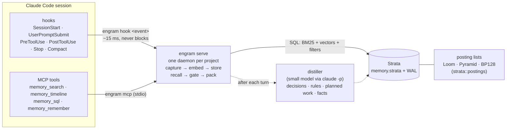

# Engram

**Long-term memory for coding agents, built on Strata, an embedded search database with SQL.**

Claude Code forgets. A long session gets compacted into a summary of about 15,000 characters, and a new session starts with almost nothing. Engram records everything a session does (prompts, answers, tool calls and their results, errors, compaction summaries) into one local file per project. It brings the right pieces back on its own when a prompt needs them, and it gives the model tools to search its own history.

Underneath sits **Strata**, a single-file search database in the spirit of SQLite: ACID transactions, SQL, and every table indexed three ways at once (full text, structured columns and vectors), plus graph edges between rows. Strata's posting lists come from its own study of compressed posting-list formats (the `postings` module), which produced the Loom and Pyramid codecs it uses.

📖 **Full documentation:** [`docs/`](docs/index.md) (also publishable as a GitHub Pages site).

🚀 **Try it:** `git clone https://github.com/rkonow/engram && cd engram && ./install.sh` sets Engram up for every Claude Code session on a Mac or Linux machine ([quick start](#quick-start)). To have a coding agent do it, tell it: *"Clone https://github.com/rkonow/engram and set Engram up for my Claude Code by following its AGENTS.md."* [`AGENTS.md`](AGENTS.md) gives an agent the steps, the checks and what to ask you first.


*The Engram live inspector. Left: a fresh Claude Code session is asked what was decided earlier, and answers from the briefing Engram injected. Right: the records the hooks stored and the decisions, rules and planned work a small model distilled from the first session.*

## Results at a glance

| | Result | Where |
|---|---|---|
| **Claude Code with and without Engram** (2 held-out projects, 200 runs) | **100 of 100** follow-up tasks solved with Engram, **60 of 100** without. The whole gap is on facts said only in conversation: 60/60 against 20/60. Permutation test p < 0.0001 | [Engram results](docs/engram/results.md#claude-code-with-and-without-engram) |
| After a compaction, details the summary dropped | **13 of 15** came back automatically, 14 with one search | [Engram results](docs/engram/results.md#this-repositorys-own-26-hour-session) |
| Live sessions asked about a 26-hour project history | **8 of 8** answered with Engram, **0 of 4** without | [Engram results](docs/engram/results.md#live-claude-code-runs) |
| LongMemEval-S retrieval (115k-token histories) | **R@10 0.90**; the 4,000-character injection holds the evidence for 87% of questions | [Engram results](docs/engram/results.md#retrieval-on-long-conversation-benchmarks) |
| Cost of a prompt hook | **14–26 ms** median from 10k to 1M records, mostly starting the hook process; 5.7 ms recall at a million records | [Engram results](docs/engram/results.md#scale-and-latency) |
| Strata vs Tantivy, warm BM25 top-10 | **1.7–3.2× faster**; conjunctions 2.7–4.1× faster; 24 of 28 text and filter comparisons won | [Strata results](docs/strata/results.md#query-latency) |
| Strata vector top-10 (HNSW, 1,024-d) | **0.05–0.10 ms**, recall@10 0.99 on Quora; SQLite's scan takes 7.7 ms to 0.7 s | [Strata results](docs/strata/results.md#vector-indexes) |
| Filtered vector search planner | **1.8–6.1× faster** than the best fixed strategy, recall@10 0.991–0.998 | [Strata results](docs/strata/results.md#filtered-vector-search-and-the-planner) |
| Graph expansion for citation search (arXiv) | nDCG@20 **0.123 → 0.253** over vector search alone (p < 0.0001) | [Strata graphs](docs/strata/graphs.md#does-the-graph-help-search) |
| Loom posting lists vs partitioned Elias-Fano | same size, **2.4–3.0× faster AND**, 3.8–7.7× faster OR | [Posting lists](docs/posting-lists.md) |

All numbers come from the experiments in this repository; [Reproducing the results](docs/reproduce.md) says how each was produced, and which ones were re-run for this release.

## How it fits together



1. **Store without being asked.** Every hook event becomes records of at most 400 bytes in a Strata table, with secrets redacted. A hook costs about 15 ms on a Mac, most of it process start.
2. **Load without being asked, only when it helps.** A briefing at session start, a knowledge block and gated recall on every prompt, notes before editing a file. Nothing the model can still see is repeated.
3. **Let the model ask precisely.** Hybrid search, a timeline around any record, and read-only SQL over its own memory.

## Strata in one query

```sql
SELECT id, title, score() FROM docs
WHERE MATCH(body, 'vaccine AND (mrna OR "messenger rna") -animal')
  AND year BETWEEN 2019 AND 2021 AND category IN ('c01', 'c02')
ORDER BY 0.2 * bm25(body, :text) + 0.8 * similarity(emb, :q) DESC
LIMIT 10;
```

Boolean full text, structured filters and a weighted hybrid of BM25 and vector similarity, planned together by a cost-based optimizer over one file. Graph traversal joins the same statement:

```sql
SELECT id, hops() FROM papers
WHERE REACHABLE(cites, (SELECT id FROM papers ORDER BY similarity(emb, :q) DESC LIMIT 5), hops => 2, dir => 'both')
  AND year >= 2018
ORDER BY similarity(emb, :q) DESC LIMIT 20;
```

See the [query language reference](docs/strata/query-language.md).

## Quick start

Requirements: macOS or Linux (WSL 2 on Windows), Rust (stable), a C compiler, and the [Claude Code](https://claude.com/claude-code) CLI, logged in (`claude auth status`).

```sh
git clone https://github.com/rkonow/engram && cd engram
./install.sh                          # every Claude Code session on this machine
./install.sh --project ~/code/app     # ... or one project
```

`install.sh` builds Engram, installs it to `~/.local/bin/engram`, downloads the embedding model (129 MB), wires the hooks and the MCP server into Claude Code (`engram install --user`, or `--project`), and runs `engram doctor` to check the result. Each project directory gets its own store under `~/.local/share/engram/projects/`, outside the repository. Run it again after `git pull` to upgrade; `engram uninstall --user` removes it and keeps the stores. [Install on your machine](docs/engram/setup.md) covers the details, remote machines, dev containers and troubleshooting.

An agent can do all of this: [`AGENTS.md`](AGENTS.md) has its instructions, including which steps need you (choosing the scope, and `claude auth login` if the CLI is logged out). Engram takes effect in new Claude Code sessions.

Then browse what it stored, per project and per session:

```sh
engram ui           # the inspector over every local store, at http://127.0.0.1:8765/?token=...
engram doctor       # what is wired where, and whether the daemon and the distiller work
```

Try it by hand:

```sh
engram search "why did we pick JSON over SQLite"
engram sql "SELECT ts, text FROM memory WHERE kind = 'error' ORDER BY ts DESC LIMIT 5"
engram remember decision "Prices are integer cents"
```

Or watch it work in the scripted demo, which chats with Claude Code in a scratch project (from `engram/`):

```sh
demo/run.sh --model <model> --distill-model <small model>     # http://127.0.0.1:8765
demo/run.sh --embedder hash:256 ...                           # without downloading the embedding model
```

Strata on its own:

```sh
cd strata && cargo build --release
target/release/strata db.strata "SELECT category, COUNT(*) FROM docs WHERE MATCH(body, 'india') GROUP BY category ORDER BY 2 DESC LIMIT 5" --plan
```

## Repository layout

| path | what |
|---|---|
| [`engram/`](engram/) | the memory system: hooks client, daemon, MCP server, recall and gate, distiller, live inspector (`demo/`), evaluation harnesses and results |
| [`strata/`](strata/) | the database: storage engine, segments, text / structured / vector / graph indexes, SQL binder, planner and executor, baselines and benchmarks; [`src/postings/`](strata/src/postings/) holds the compressed posting lists and set algorithms, the Pyramid, Loom and Entropic designs, and their testbed (`strata-posting-bench`) |
| [`docs/`](docs/) | this documentation, as Markdown and as a GitHub Pages site |
| [`install.sh`](install.sh) | builds Engram, installs it to `~/.local/bin` and wires it into Claude Code |
| [`AGENTS.md`](AGENTS.md) | instructions for a coding agent setting Engram up or working on this repository (`CLAUDE.md` imports it) |

Each crate also carries its own design document ([Strata](strata/DESIGN.md), [Engram](engram/DESIGN.md)) and full HTML reports with every chart and table ([Strata](strata/report/strata.html), [Strata graphs](strata/report/graph.html), [Engram](engram/report/engram.html), [record structure](engram/report/structure.html), [posting lists](strata/report/postings/report.html), [designs](strata/report/postings/designs.html)).

## Documentation

- [Overview](docs/index.md)
- **Engram:** [install on your machine](docs/engram/setup.md) · [how it works](docs/engram/index.md) · [live inspector](docs/engram/inspector.md) · [results](docs/engram/results.md)
- **Strata:** [design](docs/strata/index.md) · [query language](docs/strata/query-language.md) · [graphs](docs/strata/graphs.md) · [results](docs/strata/results.md)
- [Posting lists](docs/posting-lists.md)
- [Reproducing the results](docs/reproduce.md)

## Status and limits

This is a research prototype, measured carefully but on one machine (an Apple M2 MacBook Air; the model-based runs on an earlier 4-core cloud VM). Strata's SQL covers single-table `SELECT`; writes go through the Rust API. Engram's coding evidence comes from one long session, a handful of live runs and three small A/B projects; the public benchmarks it uses (LongMemEval, LoCoMo) are chat histories, not coding sessions. Each results page lists its own limitations.
