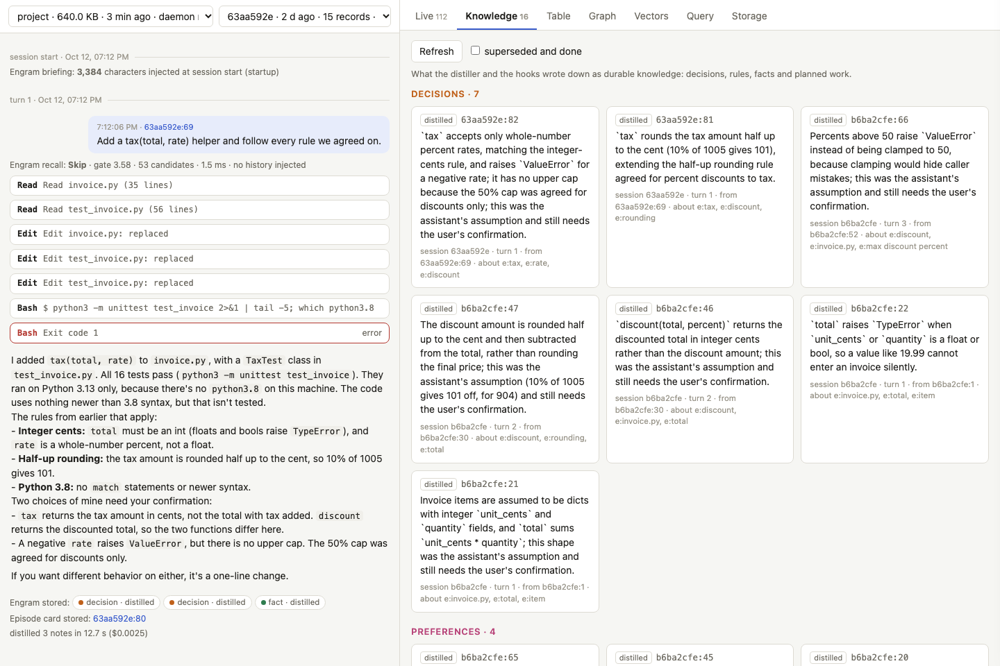

# Install ChloeCtx on your machine

ChloeCtx runs next to your own Claude Code: hooks record each session into a local ChloeDB file per project, and a small MCP server lets the model search that history. This page takes a fresh macOS or Linux machine to a working install in a few minutes, shows how to check it, and covers remote boxes, dev containers and upgrades.

## What you need

| | why | check |
|---|---|---|
| macOS or Linux (Windows through WSL 2) | the daemon talks to the hooks over a Unix socket | `uname -s` |
| Rust, stable | to build ChloeCtx from source (not for [the prebuilt binary](#prebuilt)) | `cargo --version` (install from [rustup.rs](https://rustup.rs)) |
| a C compiler | to build from source: the tokenizer's regex library is C | `cc --version` (`xcode-select --install` on macOS, `build-essential` on Debian/Ubuntu) |
| `curl` | downloads the 129 MB embedding model once | `curl --version` |
| [Claude Code](https://claude.com/claude-code) CLI, **logged in** | the hooks and the MCP server plug into it, and the distiller calls `claude -p` after each turn | `claude auth status` shows `"loggedIn": true` |

Python 3 is only needed for the scripted demo and the evaluation harnesses, not for ChloeCtx itself.

The CLI login matters more than it looks. The distiller runs `claude -p` in the background, so an expired CLI login breaks it even while interactive sessions (or the desktop app) keep working. Recording and recall still work in that state, but nothing new is written down. `chloectx doctor` checks for it.

ChloeCtx makes model calls of its own, through `claude -p` with a small model (`haiku` by default), billed to the CLI's login: one after each turn to write down decisions and rules (about $0.001), and, once a project's store holds 20 records, two more after each prompt of four words or more, in the background, to search memory for it ([query understanding](index.md#query-understanding), about $0.001 a prompt). Neither holds up a turn: what the search finds comes with the turn's next tool result, or at the next prompt. `CHLOECTX_DISTILL=0` turns the first off, `CHLOECTX_DEEP=off` (or `tool`, only when the model asks) the second.

The daemon that makes these calls finds the `claude` CLI where Claude Code's hooks found it, on its own `PATH`, or in the usual install places (`~/.local/bin`, `~/.claude/local`, `/opt/homebrew/bin`, `/usr/local/bin`); `CHLOECTX_CLAUDE` names it outright. `chloectx doctor` shows which one the running daemon uses.

## As a Claude Code plugin

The repository is a Claude Code plugin marketplace, named `chloedb`, with ChloeCtx as its plugin `chloectx`. In Claude Code:

```text
/plugin marketplace add chloetech-ai/chloedb
/plugin install chloectx@chloedb
```

On Claude Code 2.1.275 or later, `/plugin install chloectx --marketplace chloetech-ai/chloedb` does both. From a shell, `claude plugin marketplace add chloetech-ai/chloedb && claude plugin install chloectx@chloedb` installs it for every session, and `--scope local` (in the project's folder) for one project only. The plugin's name comes from the repository's `.claude-plugin/marketplace.json`, not from the address it is added by: `chloetech-ai/strata`, the repository's old address, still redirects and gives the same `chloectx@chloedb`.

It needs no Rust and no clone of your own. Then start a **new** session. Its hooks and its MCP server run a small launcher in the plugin (`scripts/chloectx-launch`), which runs the first `chloectx` it finds: `$CHLOECTX_BIN`, `chloectx` on your `PATH`, or `~/.local/bin/chloectx`. When there is none, it sets ChloeCtx up once, in the background:

1. it downloads the prebuilt `chloectx` of the release that matches the plugin's version (the archive `chloectx-<platform>.tar.gz` of the release `chloedb-server-v<version>`, from [the releases](https://github.com/chloetech-ai/chloedb/releases); the newest release when that one has none), checks its SHA-256 against the release's `.sha256` and refuses one that differs, and installs it as `~/.local/bin/chloectx`, so `chloectx doctor`, `chloectx ui` and the other commands work from a shell too;
2. where there is no prebuilt one (Windows outside WSL 2, Alpine and other musl systems, glibc older than 2.35), or the download failed, it builds it from a checkout with `cargo` (Rust and a C compiler; `install.sh --no-wire` in `$CHLOECTX_SOURCE`, or in the clone of the marketplace), which takes several minutes;
3. it fetches the embedding model (`chloectx fetch-model`, 129 MB, SHA-256 checked).

Until that is done, which is usually well under a minute, the hooks record nothing, and the first session's start says so; the memory tools come with the next session if they were not ready within 25 seconds. The launcher writes what it did to `~/.claude/plugins/data/chloectx-chloedb/setup.log`, and when it cannot set up, the next session's start says why. To watch it, or to try again by hand: `~/.claude/plugins/cache/chloedb/chloectx/<version>/scripts/chloectx-launch setup`. When the plugin is updated (`/plugin update`, or Claude Code's auto-update) to a new version, the launcher replaces a `chloectx` it downloaded with the new version's; one you installed yourself is yours to upgrade.

Claude Code clones the whole repository for the marketplace (about 230 MB). `claude plugin marketplace add chloetech-ai/chloedb --sparse .claude-plugin chloectx/plugin` checks out only the plugin, which leaves no checkout to build from on a machine without a prebuilt `chloectx`.

How it differs from `chloectx install --user`:

| | the plugin | `chloectx install --user` (`./install.sh`) |
|---|---|---|
| hooks | the same eleven events, from the plugin, through its launcher | in `~/.claude/settings.json` |
| MCP server | `plugin:chloectx:chloectx`, tools `mcp__plugin_chloectx_chloectx__*` | `chloectx` at user scope, tools `mcp__chloectx__*` |
| the memory tools' permission | asked the first time each is used (add `mcp__plugin_chloectx_chloectx` to `permissions.allow` to stop asking) | allowed by the install (`mcp__chloectx`) |
| distillation model | `haiku`, unless `CHLOECTX_DISTILL_MODEL` is set (in the settings' `env`, say) | `--distill-model`, written into the settings' `env` |
| upgrade | `/plugin update chloectx@chloedb` | `chloectx upgrade` |
| remove | `/plugin uninstall chloectx@chloedb` (keeps `~/.local/bin/chloectx`, the model and the stores) | `chloectx uninstall --user` (keeps the binary and the stores) |

Both use the same stores, one per project. A project with its own `chloectx install` keeps using that one, and the plugin's hooks step aside there, as the user-level ones do. With both the plugin and `chloectx install --user`, the hooks of the user settings record and the plugin's step aside, but a session has the memory tools twice; `chloectx doctor` warns, and `chloectx uninstall --user` leaves only the plugin. Doctor shows the plugin:

```console
  ok    plugin: chloectx@chloedb 0.3.2, enabled in /home/you/.claude/settings.json (9 hook events, through /home/you/.claude/plugins/cache/chloedb/chloectx/0.3.2/scripts/chloectx-launch)
  ok    MCP server: the plugin's, plugin:chloectx:chloectx (its tools are mcp__plugin_chloectx_chloectx__*)
```

| launcher variable | effect |
|---|---|
| `CHLOECTX_BIN` | the `chloectx` to run, wherever it is |
| `CHLOECTX_PREFIX` | where a downloaded or built `chloectx` goes: `DIR/bin` (default `~/.local`) |
| `CHLOECTX_VERSION` | the release to download, instead of the plugin's version |
| `CHLOECTX_RELEASES_URL` | where the releases are (default `https://github.com/chloetech-ai/chloedb/releases/download`) |
| `CHLOECTX_SOURCE` | a checkout to build from when there is no prebuilt `chloectx` |
| `CHLOECTX_BUILD=0` | never build from source |
| `CHLOECTX_PLUGIN_WAIT` | how long the MCP server waits for the setup, in seconds (default 25) |

## Prebuilt

<!-- since 0.3.2 --> From release 0.3.2, the ChloeDB installer fetches `chloectx` prebuilt (macOS 11 or later, Linux with glibc 2.35 or later), with no Rust and no clone; then fetch the model, wire it into Claude Code and check:

```bash
curl -fsSL https://chloetech-ai.github.io/chloedb/install.sh | sh -s -- --with ctx    # ~/.local/bin/chloectx
~/.local/bin/chloectx fetch-model                    # potion-retrieval-32M, 129 MB, SHA-256 checked
~/.local/bin/chloectx install --project /absolute/path/to/project    # or: install --user, every session
~/.local/bin/chloectx doctor
```

Release 0.3.1 and earlier have no prebuilt `chloectx`: build it from source, below. This installer (the website's `install.sh`) is not the repository's `./install.sh`, which installs ChloeCtx from a checkout and wires it in one step (next section), and takes the same prebuilt binary when it can.

## Install in one command, from source

```bash
git clone https://github.com/chloetech-ai/chloedb && cd chloedb && ./install.sh
```

`install.sh` does five things and can be run again at any time:

1. builds `chloectx` in release mode (a few minutes the first time), or takes the release's prebuilt one (below);
2. copies it to `~/.local/bin/chloectx`, the path the hooks call;
3. stops any running ChloeCtx daemons, so they restart on the new binary;
4. downloads the embedding model (potion-retrieval-32M) unless it is already there;
5. runs `chloectx install --user --distill-model haiku` and then `chloectx doctor`.

| option | effect |
|---|---|
| `--project DIR` | install into one project's `.claude/settings.local.json` and `.mcp.json` instead of every session |
| `--distill-model NAME` | the model that writes down decisions and rules after each turn (default `haiku`; `--distill-model ""` uses the CLI's default model) |
| `--prefix DIR` | install the binary to `DIR/bin` (default `~/.local`) |
| `--no-wire` | install the binary only, and leave Claude Code's settings alone |
| `--no-model` | do not download the embedding model (run `chloectx fetch-model` later) |
| `--prebuilt` | take the release's prebuilt `chloectx`, never build |
| `--source` | build from the checkout, never download the binary |

From the release after 0.3.2, `install.sh` can take the binary that release carries instead of building it. Without `--prebuilt` or `--source`, it takes the prebuilt binary of release `chloedb-server-v<version>` (the version in `chloectx/Cargo.toml`), checked against the release's SHA-256, in two cases: when the checkout is that release's (the tag, with `chloectx/` and `chloedb/` unchanged since), and when there is no Rust on the machine (then it says the checkout may be newer than the release). Otherwise it builds, so a checkout of main, or one you changed, runs what is in it. To install such a release with nothing to compile, clone its tag: `git clone --branch chloedb-server-v<version> https://github.com/chloetech-ai/chloedb`, then `./install.sh` in it. (A checkout of 0.3.2 or earlier has the `install.sh` that always builds.)

A prebuilt binary does not know the checkout it came with, so `chloectx upgrade` asks for it: `CHLOECTX_SOURCE=/path/to/chloedb chloectx upgrade`, or `git pull && ./install.sh` there.

Sessions that were already open pick ChloeCtx up when they restart.

## Or let your agent do it

Tell Claude Code (or another coding agent) in any session:

> Clone https://github.com/chloetech-ai/chloedb and set ChloeCtx up for my Claude Code by following its AGENTS.md.

[`AGENTS.md`](https://github.com/chloetech-ai/chloedb/blob/main/AGENTS.md) tells the agent to check the prerequisites without installing anything unasked, to ask you whether to install for every session or one project, to run `install.sh` and `chloectx doctor`, and to report what failed. Two things stay with you: `claude auth login` if the CLI is logged out (it is interactive), and starting a new session afterwards, because the session that ran the install started before the hooks existed.

## Or step by step

```bash
git clone https://github.com/chloetech-ai/chloedb && cd chloedb/chloectx
cargo build --release --bin chloectx
cargo install --path . --bin chloectx --root ~/.local       # a stable path for the hooks: ~/.local/bin/chloectx
chloectx fetch-model                                        # potion-retrieval-32M, 129 MB, at a pinned revision, SHA-256 checked
chloectx install --user --distill-model haiku               # or: chloectx install --project /path/to/project
chloectx doctor
```

`chloectx install --user` merges eleven hooks and a permission for the memory tools into `~/.claude/settings.json` (saving the previous file next to it as `settings.json.chloectx-<time>.bak`) and registers the MCP server at user scope with `claude mcp add-json`. A project install backs up the project's `.claude/settings.local.json` and `.mcp.json` the same way before it changes them (delete the `.bak` files once you are happy, and do not commit them). Every settings file is written to a file beside it and renamed into place, so an interrupted install leaves the old file whole, and its keys stay in the order they were. A project with its own `chloectx install` keeps using that one; the user-level hooks step aside there, so nothing is recorded twice.

## Check it

```console
$ chloectx doctor
ChloeCtx 0.3.3 for /home/you/code/app
  ok    binary: /home/you/.local/bin/chloectx
  ok    Claude Code CLI: 2.1.299 (Claude Code)
  ok    user hooks: /home/you/.claude/settings.json (9 events, /home/you/.local/bin/chloectx)
  ok    MCP server: user scope in /home/you/.claude.json (/home/you/.local/bin/chloectx mcp)
  ok    embedding model: /home/you/.local/share/chloectx/models/potion-retrieval-32M
  ok    distillation: model haiku (from the user settings), after each turn
  ok    Claude Code login: logged in, so the distiller and query understanding can run
  ok    query understanding: after the prompt, in the background (the default): after each prompt of 4 words or more, once the store holds 20 records, 2 model calls (haiku: one plans the searches, one picks the records); nothing waits for it: what it finds comes with the turn's next tool result or the next prompt, and the end of a turn does not wait (stop_recheck off)
  ok    query understanding cost: nothing measured in this store's last 30 days yet (about $0.001 a search with haiku)
  ok    distillation cost: nothing measured in this store's last 30 days yet (about $0.001 a turn with haiku)
  ok    daemon: a scratch store opened and answered in 368 ms; this project's store will be /home/you/.local/share/chloectx/projects/app-251a5186 once a session runs here
ChloeCtx is ready. Start `claude` in a project; `chloectx ui` shows what it stores.
```

`doctor` checks the current directory's project. Once a session has run there, the last line becomes the store itself (records, sessions, daemon round trip), and a `last distillation` line reports whether the most recent distillation worked. Every failed line says how to fix it, and the command exits non-zero when anything failed.

It also says what ChloeCtx's own model calls do and cost, with the settings the hooks see (the environment, then the `env` of the project's local settings, the project's settings and the user settings, then the store's `config.json`):

- `query understanding` says when it runs: after the prompt, in the background (`async`, the default), at prompt time with the prompt waiting for it (`sync`, a warning), only when the model asks (`tool`), or never (`off`). It names the setting it came from, the model calls each prompt makes, and whether the end of a turn waits for it, which it does only with `stop_recheck` on (a warning: Claude may then run again).
- `query understanding cost` and `distillation cost` are measured from the store's `events.log` over the last 30 days: how many calls, the median time, the dollars in all and per call, and how many failed.
- `Claude Code login` says whether the distiller and query understanding can run: both call `claude -p`, which needs the CLI to be found and logged in.

## Try it for real

A two-minute check that memory carries across sessions. In any project:

1. Start `claude` and state something only a conversation would know, for example: *"Rule from the client: all amounts are integer cents, never floats, because their ledger rejects fractional cents. The server runs Python 3.8, so no match statements."* Let it answer, then exit.
2. Start a **new** session in the same directory and ask: *"Write billing.py with total(items), following every rule the client gave us."*

The new session starts with ChloeCtx's briefing, which lists the rules the distiller wrote down after the first session, and the code should use integer cents and avoid `match`. Then look at what happened:

```bash
chloectx ui                                         # the inspector over every store on this machine
chloectx search "integer cents"                     # hybrid search from the shell
chloectx sql "SELECT kind, tag, text FROM memory WHERE kind IN ('decision', 'preference') ORDER BY seq DESC LIMIT 10"
```

## Explore your stores: `chloectx ui`

```bash
chloectx ui                      # opens the inspector at http://127.0.0.1:8765/?token=...
chloectx ui --no-open --port 9000
chloectx ui --home ~/chloectx-demo/chloectx  # stores kept elsewhere (here: the scripted demo's)
```



`chloectx ui` is the [live inspector](inspector.md) pointed at your own data. The left column picks a store (one per project directory, newest first) and a session, and replays that session from its records: prompts, answers, tool calls (open one to see its stored result), the briefing at session start, every recall decision with its gate score and the records it injected, and the notes the distiller kept, superseded or closed. A session that is still running grows as it goes. The right side has every panel of the inspector, scoped to the chosen store: the live feed of records and daemon events, knowledge, the table, the graph, the vectors, an SQL console and the storage layout.

It is built into the binary (no Python, no checkout needed) and only reads: each store is opened through its project's daemon, as the hooks do, so it is safe to keep open while sessions write. It listens on 127.0.0.1, and every request must carry the random token in the URL it prints, because stores hold transcripts. Links keep the store, session and tab in the address (`?store=…&session=…&tab=knowledge`), so a view can be reopened later.

It is also the quickest way to debug an install. A `DISTILL` event with an error in the live feed means the distiller cannot run `claude -p`; a `RECALL · SKIP` on every prompt with few candidates means the store is still small; no records at all for a session means its hooks did not run.

## Where everything lives

| what | where |
|---|---|
| binary | `~/.local/bin/chloectx` (from `install.sh` or `cargo install --root ~/.local`) |
| hooks | `~/.claude/settings.json` (user install), the project's `.claude/settings.local.json`, or the plugin's `hooks/hooks.json` under `~/.claude/plugins/cache/chloedb/chloectx/<version>/` |
| MCP server | `~/.claude.json` at user scope, the project's `.mcp.json`, or the plugin's `.mcp.json` |
| the plugin's launcher state | `~/.claude/plugins/data/chloectx-chloedb/`: `setup.log`, and `ready` once it has set up |
| stores | `~/.local/share/chloectx/projects/<folder>-<hash>/`, one per project directory (a repository's worktrees share its main checkout's): `memory.strata` and its WAL, `state.json`, `events.log` (recall and distill decisions), `daemon.log`, `project.txt`. A machine that has `~/.local/share/engram` from before the rename, and no `~/.local/share/chloectx`, keeps using the old folder |
| embedding model | `~/.local/share/chloectx/models/potion-retrieval-32M/` (or in the old folder, as the stores) |
| daemon socket | `engram.sock` in the store, or, when that path is too long, `$XDG_RUNTIME_DIR`, `/tmp/engram-<uid>/` or `~/.cache/chloectx/`: the first that is a directory of yours alone (a `/tmp/engram-<uid>` another user made, or a link, is skipped) |
| model calls' working directory | `distill/` in the stores' folder, private to you (the distiller's `claude -p` reads project settings from where it runs) |

Store directories are created readable by their owner only. ChloeCtx redacts secrets before it stores anything ([below](#secrets-and-chloectx-redact)), but a store is still a transcript of your sessions: treat it like your shell history.

### Secrets and `chloectx redact`

Every record is redacted as it is stored, whatever wrote it (the hooks, `ingest-transcript`, `remember`, the distiller, compaction summaries), and again as `chloectx sync` sends or pulls it. So are the prompts kept in `state.json` and the lines of `events.log`. A secret is replaced by a marker that names its kind, and the text around it stays, so `DB_PASSWORD=hunter2` is stored as `DB_PASSWORD=[REDACTED:password]`. What is caught:

- keys and tokens by their shape: Anthropic (`sk-ant-`), OpenAI (`sk-`, `sk-proj-`), GitHub (`ghp_`, `gho_`, `ghu_`, `ghs_`, `ghr_`, `github_pat_`), GitLab (`glpat-`), npm (`npm_`), AWS access key ids (`AKIA`, `ASIA`), Google API keys (`AIza`) and OAuth tokens (`ya29.`), Slack tokens (`xoxb-` and the like) and webhooks, Discord webhooks, Stripe (`sk_live_`, `rk_live_`, `whsec_`), DigitalOcean (`dop_v1_`), Hugging Face (`hf_`), SendGrid, ChloeDB API keys (`sk_<id>_<secret>`) and JWTs;
- PEM private key blocks, also one cut off before its `END` line;
- `Authorization:` headers (`Bearer`, `Basic` and others), `Bearer` tokens, `curl -u user:password`, and the password in a URL (`postgres://app:…@db`);
- values assigned to a name that ends in a word for a secret (token, secret, password, passwd, passphrase, credential, or a key such as `api_key`, `AWS_SECRET_ACCESS_KEY`, `apiKey`): `NAME=value` in an environment dump or a `.env` file, `name: value` in YAML, `"name": "value"` in JSON, `name = "value"` in code.

It is pattern-based, so it is best effort: a password written in prose, or a random string under an unremarkable name, is stored as it is. It leaves alone what only looks random (git hashes, digests, UUIDs) and code that names a secret without holding one (`token = get_token()`, `password: string`, `primary_key`).

A store written before this redaction can hold secrets it would now catch. `chloectx redact`, in the project directory, rewrites them:

```bash
chloectx redact --dry-run   # count what would change; change nothing
chloectx redact             # this project's store
chloectx redact --all       # every store on this machine
```

The project's daemon rewrites each record whose text redaction changes, redacts `state.json` and `events.log` the same way, and, when a sync is set up, sends the rewritten records to the server again so they replace its copies. Then the daemon is stopped and the store's file replaced by a fresh copy of its live rows, because the pages the old versions were on would otherwise stay in the file until later writes reuse them; a hook that comes in those few seconds records nothing. It prints how many records, session states and log lines changed and which kinds of secret it found, never the secrets. What it cannot reach is up to you: backups made with `chloectx backup`, a `memory.strata.before-field-ids` copy left by a format upgrade (it names it), and the server's own backups.

### Forget something: `chloectx forget`

`chloectx forget ID...`, in a project's folder, deletes records of its store for good by id (the ids `chloectx search` and the inspector show, `session:seq`). Each record is deleted and scrubbed from the receipts that showed it, the automatic snapshots that hold it are dropped and the store is compacted; the other records of its turn stay. `memory_forget` is the same for the model.

A fact usually lives in more than one record and more than one store: the prompt that said it, the tool output that showed it, the notes written from it, in every project where it came up. `chloectx forget --everywhere` finds it in every store `chloectx stores` lists:

```bash
chloectx forget --everywhere --dry-run "staging codeword"   # list the matches, change nothing
chloectx forget --everywhere "staging codeword"             # list them, ask, forget
chloectx forget --everywhere --yes a1b2c3d4:42              # by id, in whichever store has it
```

It matches the records whose text or context holds the words given, whatever their case (3 characters or more), or, when every word is a record id, those records. It lists them by store with a snippet of each and asks before it forgets them (`--yes` skips the question; without a terminal and without `--yes` it only lists). Then each store's own forget runs on its matches. A daemon started to look into a store is stopped afterwards. What it cannot reach: named snapshots (it says which), backups made with `chloectx backup`, and the copies on a sync server, from which a pull brings them back ([below](#keep-the-memory-on-a-chloedb-server)).

To back a store up, run `chloectx backup DEST` in the project directory. It copies the store while sessions go on: a consistent checkpoint of `memory.strata` (copying the file itself while the daemon writes can catch it half way through a commit), `state.json`, the config and `events.log`, into a new directory `DEST`. To restore, run `chloectx stop` and copy those files back into the store's directory. A backup is as private as the store.

| variable | effect |
|---|---|
| `CHLOECTX_DISABLE=1` | the hooks do nothing in this session |
| `CHLOECTX_HOME` | where stores (and, by default, models) live; default `$XDG_DATA_HOME/chloectx` or `~/.local/share/chloectx` (`engram` in place of `chloectx` when only that folder exists) |
| `CHLOECTX_MODELS` | where the embedding models live |
| `CHLOECTX_DISTILL_MODEL` | the distiller's model (`install --distill-model` sets it in the settings' `env`) |
| `CHLOECTX_DISTILL=0` | no distillation (read from Claude Code's environment too, whichever process started the daemon) |
| `CHLOECTX_DEEP` | query understanding: `async` (default), `sync`, `tool` or `off` |
| `CHLOECTX_CLAUDE` | the `claude` CLI the model calls run, when it is in none of the places the daemon looks |
| `CHLOECTX_EMBEDDER` | `static` (default), `bert`, or `hash:<dim>` for a model-free hash embedder |

Each of them is still read under its name from before the rename, `ENGRAM_*` (`ENGRAM_DISABLE=1`), when the new one is not set.

## Other environments

### A remote machine over SSH

Install on the remote machine as above; the hooks run wherever `claude` runs. To browse its stores from your laptop, forward the port and open the URL `chloectx ui` prints:

```bash
ssh -L 8765:127.0.0.1:8765 you@devbox
chloectx ui --no-open        # on the devbox; open the printed URL in your laptop's browser
```

`chloectx ui` does not try to open a browser inside an SSH session.

### Dev containers and Codespaces

Run the installer when the container is created, for example in `.devcontainer/devcontainer.json`:

```json
{
  "postCreateCommand": "git clone https://github.com/chloetech-ai/chloedb /tmp/chloedb && /tmp/chloedb/install.sh",
  "containerEnv": { "CHLOECTX_HOME": "/workspaces/.chloectx" },
  "forwardPorts": [8765]
}
```

The image needs Rust and a C compiler (the `ghcr.io/devcontainers/features/rust` feature provides both), and Claude Code must be logged in inside the container. A container's home directory is usually thrown away on rebuild, so point `CHLOECTX_HOME` at a mounted or persistent path (as above) if memory should survive rebuilds. Inside a container, start the inspector with `chloectx ui --no-open` and open the printed URL through the forwarded port.

### Windows

Use WSL 2 and run everything, including Claude Code, inside the Linux distribution. Native Windows is not supported: the daemon uses Unix sockets and `flock`.

### Claude Code on the web

Cloud sessions run in a fresh container each time, so a ChloeCtx store there starts empty and is lost when the container is reclaimed. To keep memory across them, sync it with a ChloeDB server ([below](#keep-the-memory-on-a-chloedb-server)): the environment's setup script installs ChloeCtx and names the server, the environment holds the server's key in a variable, and each session pulls the project's memory when its daemon starts.

### Keep the memory on a ChloeDB server

`chloectx sync` copies each project's memory to a table, `chloectx_memory`, on a ChloeDB server or a cluster's coordinator, and back. The store stays a local file, so hooks and recall never wait on the network:

- the daemon pushes what it recorded every 30 seconds and as it exits, and when it starts it pulls the project's records the store lacks (written on another machine, or by a container that is gone) and embeds them here;
- records are keyed by project and record id, so several projects share the table, and the server can search them too; a project is its git repository (`owner/name` of `origin`), so checkouts in different folders share one memory, and `--rename owner/old=owner/new` lets a checkout of a renamed repository join the new name's (`SELECT content FROM chloectx_memory WHERE project = '/path' ORDER BY bm25(content, '...') DESC LIMIT 10`).

```bash
# the key from stdin, kept owner-only in ChloeCtx's home (sync.token)
printf %s "$KEY" | chloectx sync setup --url https://chloedb.example.com --token-stdin
# or: read it, whenever the daemon syncs, from a variable (a cloud environment's, say)
chloectx sync setup --url https://chloedb.example.com --token-env CHLOEDB_KEY
chloectx sync status        # what was sent and received, what the server holds
chloectx sync push          # now, rather than within 30 s
chloectx sync pull
```

`setup` creates the table, which needs a key with the `admin` scope (`--no-create` skips it; the first push creates it when the key can); after that an API key with the `write` scope is enough. `CHLOECTX_SYNC_URL` and `CHLOECTX_SYNC_TOKEN` override the settings. What is sent is what the store holds, transcripts of your sessions included, redacted again on the way ([secrets](#secrets-and-chloectx-redact)): use a server you control, over HTTPS, with a key (plain `http://` is refused except to this machine, `127.0.0.1` or `localhost`; `CHLOECTX_SYNC_ALLOW_HTTP=1` allows it). Sync only adds records: one retagged or forgotten after it was pushed is not sent again, and a record forgotten here comes back with the next pull while the server holds it (delete its row there too, `DELETE FROM chloectx_memory WHERE id = '<project>:<record id>'`). Two machines writing the same project at once can, rarely, give two records one id (`manual:<seq>` from `chloectx remember`); the server keeps the last one sent.

## Upgrade and remove

```bash
chloectx upgrade --check     # is there a newer version? (fetches the checkout's main branch)
chloectx upgrade             # git pull --ff-only in the checkout it was built from, rebuild, reinstall, doctor
chloectx stop --all          # restart daemons by hand (they start again on demand)
chloectx uninstall --user    # or `chloectx uninstall` in a project; stores are kept
```

The binary knows the commit and the checkout it was built from (`chloectx --version` names the commit). `chloectx doctor` fetches that checkout's upstream branch (waiting at most 3 s; `upgrade --check` waits 20 s) and says how many commits on it change ChloeCtx or ChloeDB since the build, or, when the fetch failed, that it could not check and what the last fetch said (`upgrade --check` then exits 1), and a session that starts while the binary is behind says so once a day, from what the checkout last fetched. `chloectx upgrade` pulls the checkout (fast forward only: it stops when local commits or changes are in the way, and `--no-pull` builds the checkout as it is), stops the daemons of the old build, runs `install.sh --no-wire` into the binary's own prefix, writes the user-level install again (a version may add hook events; the distillation model you chose is kept), and ends with `doctor`. A prebuilt binary, or one built outside a checkout (no `.git`), cannot upgrade itself: `chloectx upgrade` and `doctor` say to run the installer again (`curl -fsSL https://chloetech-ai.github.io/chloedb/install.sh | sh -s -- --with ctx`, which replaces the binary and keeps the stores), or run `git pull && ./install.sh` in a checkout, or point `CHLOECTX_SOURCE` at one.

## Keep the stores tidy: `chloectx stores` and `chloectx prune`

Every directory a session runs in gets its own store, including the throwaway folders tools make under the system's temporary directory, so stores pile up over months. `chloectx stores` lists them all, most recently used first, with the project each records, its size on disk and when it was last used, and marks the ones `prune` would remove:

- the project folder no longer exists, and the store was not used for a week (a folder missing for less, or on a drive that is not mounted, such as `/Volumes/…` or `/media/…`, may have moved and is only marked; `chloectx move OLD NEW` attaches the store to the folder's new place);
- the project is in a temporary folder (`/tmp`, `/var/folders` on macOS) and the store was not used for a day;
- the store names no project (one from before the daemon wrote `project.txt`, whose `daemon.log` does not name it either) and was not used for a month.

`chloectx prune` lists those and asks before it removes them (`--yes` skips the question, `--dry-run` only lists, `--older-than DAYS` adds every store not used for that long). A store whose daemon is running is never removed. Removing a store deletes that project's memory for good. `chloectx doctor` counts the stores and says when ten or more could go.

The repository was called `rkonow/engram` until October 2026. A checkout made before then keeps working, because GitHub redirects the old address: upgrade it with `git pull && ./install.sh` in its folder (still named `engram`), and `git remote set-url origin https://github.com/chloetech-ai/chloedb` points it at the new name.

## ChloeCtx was called Engram

ChloeCtx was called Engram until November 2026. `git pull && ./install.sh` moves an install to the new names, and leaves what it stored where it is:

- The program is `~/.local/bin/chloectx`, and `~/.local/bin/engram` is a link to it for a release, so whatever still calls the old name keeps working.
- `chloectx install` (which `install.sh` runs) replaces the entries the old install wrote into Claude Code's settings: the hooks that called `engram`, the MCP server `engram` and its permission `mcp__engram` (the server is `chloectx` now, and its tools `mcp__chloectx__*`), and `ENGRAM_DISTILL_MODEL`, which becomes `CHLOECTX_DISTILL_MODEL` with the same model. An `engram` server or permission is taken for ChloeCtx's only when the same settings hold the old hooks of the program it runs, since another tool may be called engram. `chloectx uninstall` removes both the old and the new entries. Until you run it again, `chloectx doctor` warns about the old ones.
- The settings are `CHLOECTX_*`, and each `ENGRAM_*` one is still read when the new one is not set.
- The stores and the embedding model stay in `~/.local/share/engram` on a machine that has that folder and no `~/.local/share/chloectx`: `install.sh` moves nothing, and `chloectx doctor` warns which folder is in use. `chloectx upgrade` moves it: with the daemons stopped, it renames `~/.local/share/engram` to `~/.local/share/chloectx` and leaves `engram` as a link to it (not when `CHLOECTX_HOME` is set). A new install uses `~/.local/share/chloectx`. A store's files keep their names (`memory.strata`, `engram.sock`), and a daemon started by the old program keeps serving until it stops, which `install.sh` asks it to do.

Sessions that were already running keep the old tool names until they restart.

## Troubleshooting

| symptom | cause and fix |
|---|---|
| `doctor`: **Claude Code login** fails, a session starts with *ChloeCtx is not writing down decisions or rules*, or `DISTILL` events show *OAuth session expired* | the CLI's own login expired; run `claude auth login`. Recording and recall keep working meanwhile, but turns from that period are not distilled again later. Until a distillation works again, each session's start says so, to you and to the model |
| recalled records or rules that are a harness's markup (`<system-reminder>`, `<wake>`, `<coordinator-relay>`) | stored by an earlier version, which kept the envelopes some harnesses wrap prompts in. Prompts are now stored without them, recall and the briefing pass the old ones over, and a daemon retires the rules it had picked out of them once, when it first starts on the store |
| no records for a session | the session started before ChloeCtx was installed (restart it), `CHLOECTX_DISABLE=1` was set, or the project has its own install that points at a binary that moved (`chloectx doctor` in that directory says which) |
| the model has no `memory_*` tools | the MCP server is not registered or the session predates it: `claude mcp get chloectx`, then restart the session. With the plugin, `/mcp` lists `plugin:chloectx:chloectx`; when it failed to start, the plugin was still setting up (see its `setup.log`), and the next session has the tools |
| a session starts with *ChloeCtx could not set itself up* (the plugin) | the launcher found no `chloectx` and could not download or build one; the message and `~/.claude/plugins/data/chloectx-chloedb/setup.log` say why. Install `chloectx` another way (above), or point `CHLOECTX_BIN` at one, and start a new session |
| `daemon did not answer in time` | read the store's `daemon.log`; a missing embedding model is the usual cause (`chloectx fetch-model`) |
| distillation costs | about $0.001 and 8 s per turn with a small model; `CHLOECTX_DISTILL=0` turns it off |
| `doctor`: **last distillation** failed with something other than the login | the line shows what the CLI wrote on stderr and its exit status (an old CLI that does not know a flag, a crash, a proxy), and doctor makes one small model call to say whether it still fails |
| `doctor`: **daemon's Claude Code CLI** fails | the running daemon was started by a process that has no `claude` on its `PATH`, and it is not in the usual places either: set `CHLOECTX_CLAUDE` to its path, or `chloectx stop` so that the next Claude Code hook starts the daemon |
| a project folder was moved or renamed, and its sessions start with an empty memory | stores are kept by the folder's path: `chloectx move OLD NEW` attaches the old store to the new folder. `stores` marks a store whose folder went missing in the last week, or is on a drive that is not mounted, and `prune` leaves it alone. A `git worktree` is a folder of its own, with a store of its own |
| a project should not be recorded | add `"env": {"CHLOECTX_DISABLE": "1"}` to that project's `.claude/settings.local.json`, or set `CHLOECTX_DISABLE=1` in the shell you start `claude` from |
