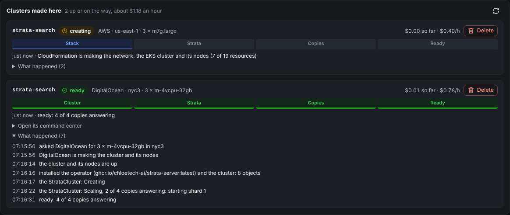
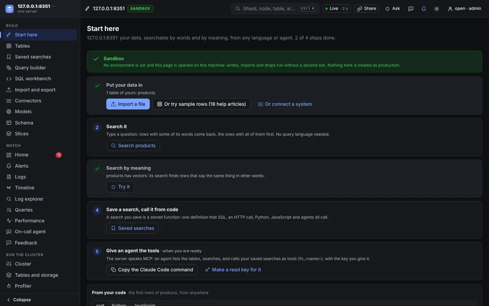
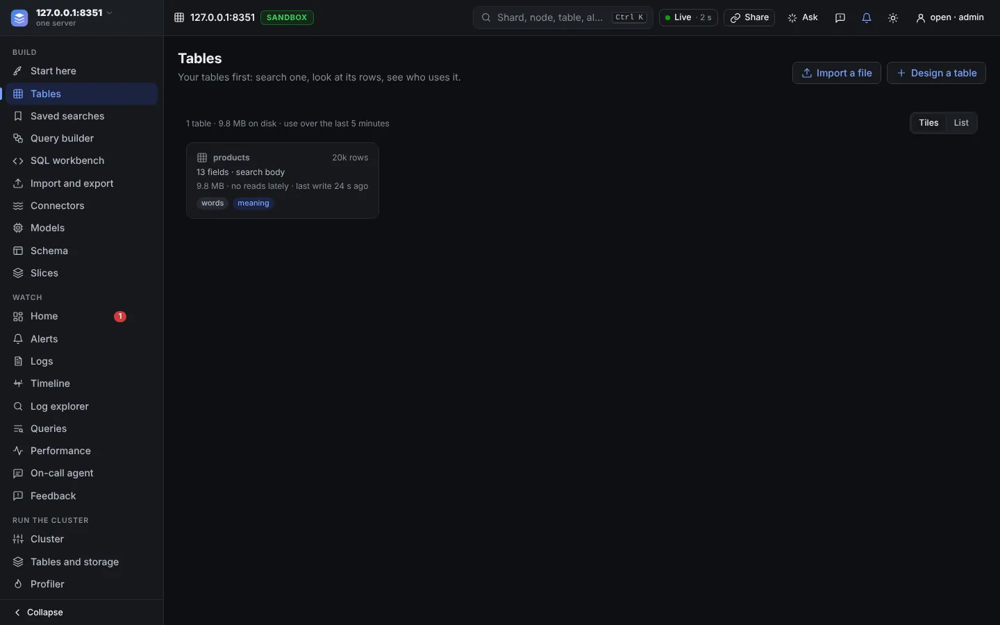
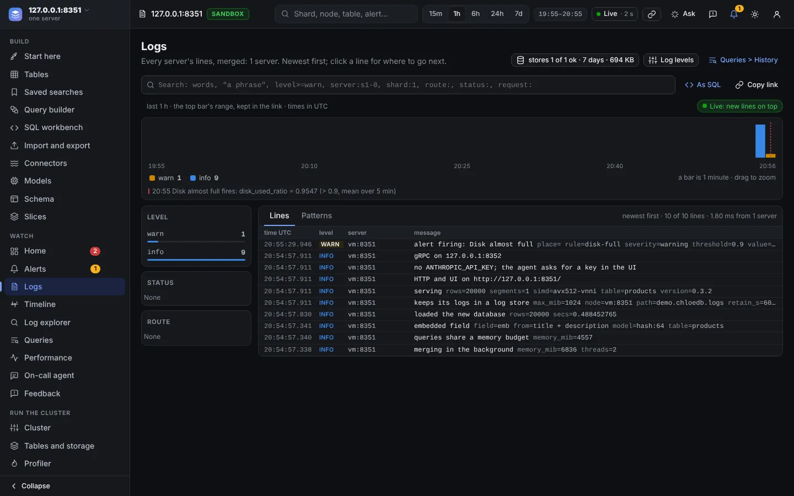
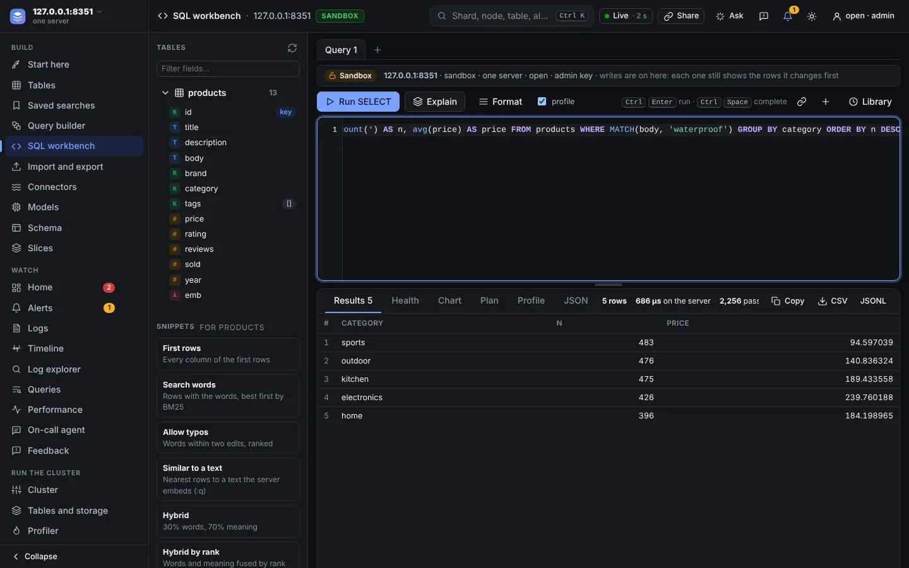
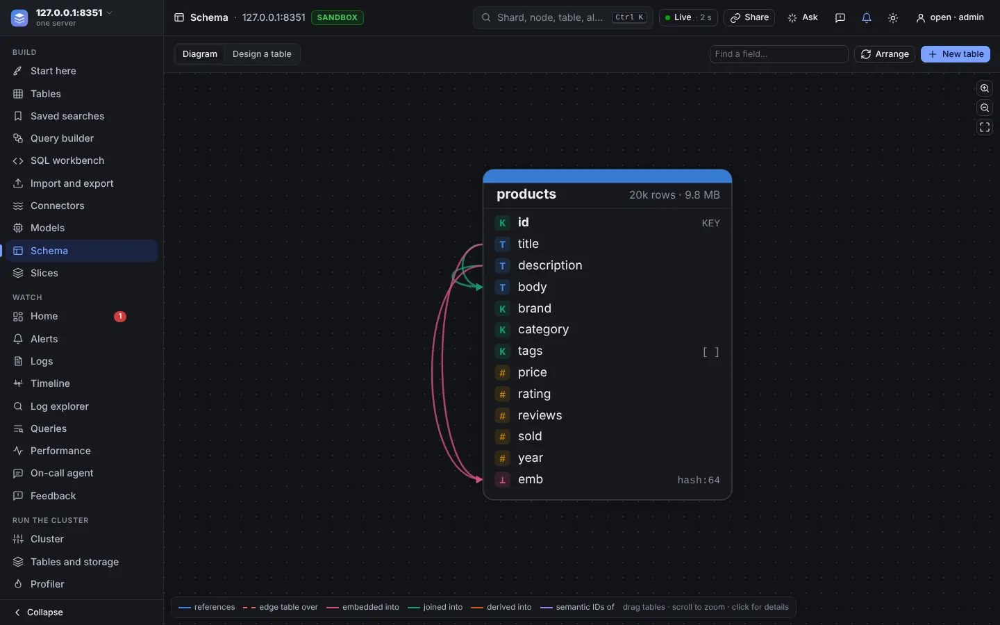
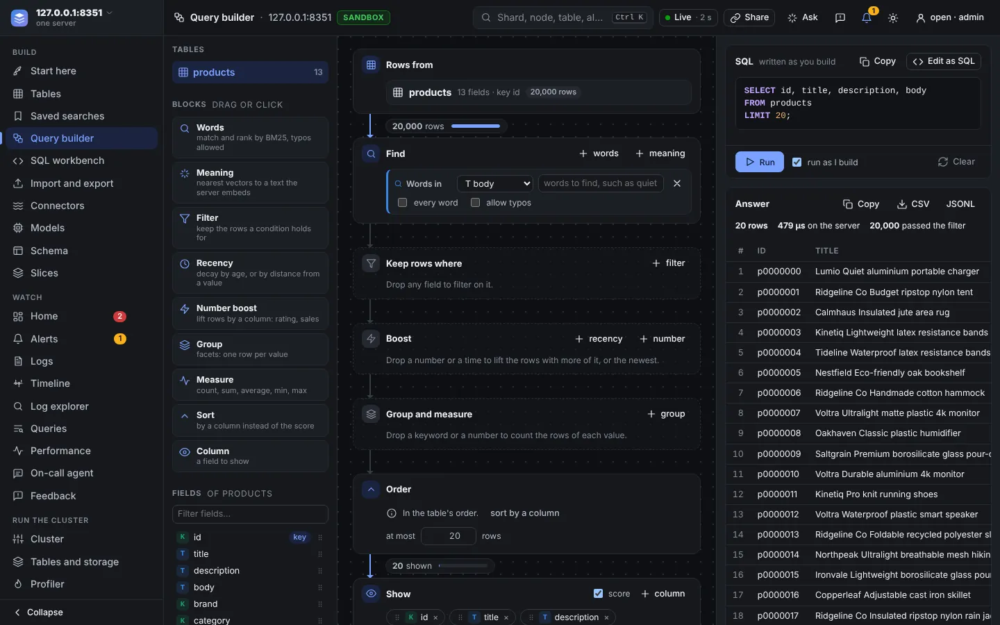
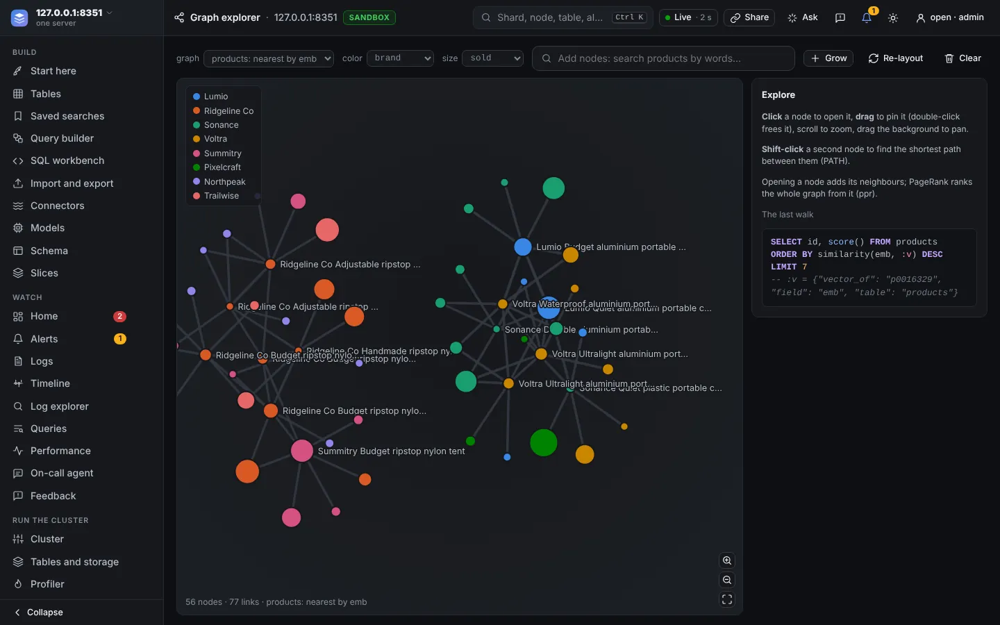
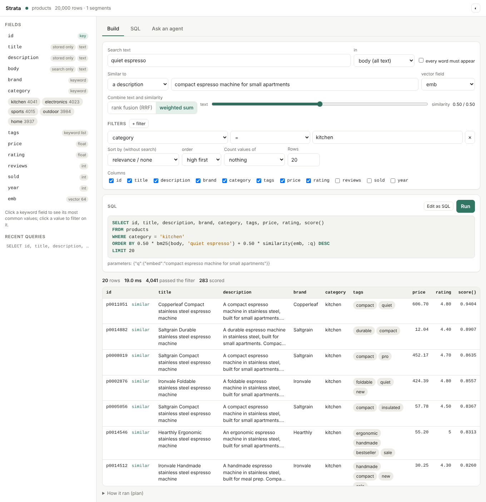
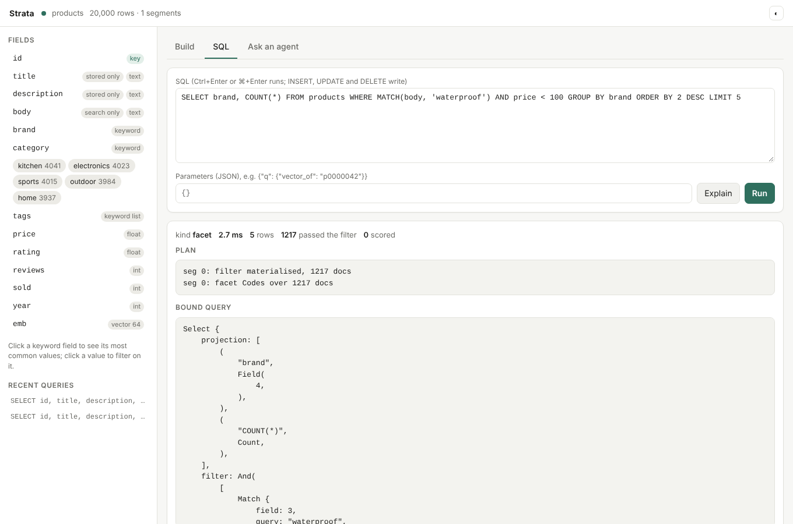

# chloedb-server

`chloedb-server` serves a ChloeDB database over HTTP JSON and gRPC. Every server has a command center in the browser, with a query console and an agent that answers questions by writing SQL. Run several servers as shards behind one more as a coordinator, and the coordinator answers like one database.

New to it? [Build an app](build-an-app.md) goes from an empty server to search, stock, holds, events counted once and a cluster in one page. This page is the reference:

| part | sections |
|---|---|
| Start it | [Run it](#run-it) (every flag), [Schemas](#schemas), [Loading rows](#loading-rows) |
| Models and media | [Embedded vector fields](#embedded-vector-fields), [Media fields](#media-fields), [Semantic IDs](#semantic-ids) |
| The API | [HTTP API](#http-api), [Security](#security), [gRPC](#grpc) |
| A cluster | [Sharding](#sharding-one-coordinator-many-shards), [Replication](#replication-a-primary-and-its-replicas), [On Kubernetes](#on-kubernetes) |
| Running it | [Deadlines, admission and metrics](#deadlines-admission-and-metrics): limits, health, logs, alerts |
| The command center | [The UI](#the-ui), [The agent](#the-agent), [The on-call agent](#the-on-call-agent), [Agents over MCP](#agents-over-mcp) |

**Old names.** ChloeDB was called Strata until November 2026. The names on this page are the new ones, and the old ones (`strata-server`, `STRATA_*` settings, `x-strata-*` headers) still work for a release: [Compatibility](../compatibility.md#old-names) lists them.

## Run it

A prebuilt server needs no Rust, no C compiler and no first build of several minutes. Each server [release](https://github.com/chloetech-ai/chloedb/releases) (tagged `chloedb-server-v<version>`) has one archive a platform: `linux-x86_64` and `linux-aarch64` (glibc 2.35 or later: Debian 12, Ubuntu 22.04 and newer), `macos-arm64` and `macos-x86_64` (macOS 11 or later), each with its `.sha256` beside it.

```sh
v=0.3.3 p=linux-x86_64   # or linux-aarch64, macos-arm64, macos-x86_64
curl -LO https://github.com/chloetech-ai/chloedb/releases/download/chloedb-server-v$v/chloedb-server-$p.tar.gz
tar xzf chloedb-server-$p.tar.gz
chloedb-server-$p/chloedb-server --demo 20000 --db products.chloedb   # a demo catalogue
# open http://127.0.0.1:7700
```

The archive holds `chloedb-server`, and `strata-server`, its old name, beside it; release 0.1.0, from before the rename, was published as `strata-server-v0.1.0`. macOS keeps an archive a browser downloaded from running until `xattr -d com.apple.quarantine chloedb-server-$p/chloedb-server`; `curl` sets no such mark. From source (Rust stable and a C compiler; the first build takes several minutes):

```sh
cd chloedb-server && cargo build --release
target/release/chloedb-server --demo 20000 --db products.chloedb
```

`cargo build --release --no-default-features` builds a server without DataFusion, Parquet and `s3://` paths, from 321 crates rather than 412: joins, groups and sorts then run on ChloeDB's own operators (`CHLOEDB_ENGINE`, below), and `import` and `export` take no Parquet files or `s3://` paths.

Or from the image every merge to main publishes (`linux/amd64` and `linux/arm64`). Beyond the container's own loopback the server needs a token, which the command center then asks for:

```sh
docker run --user 10001:10001 -p 127.0.0.1:7700:7700 -e CHLOEDB_TOKEN=pick-a-secret -v chloedb:/data \
  ghcr.io/chloetech-ai/chloedb-server:latest --db /data/my.chloedb --listen 0.0.0.0:7700
# open http://127.0.0.1:7700; add --demo 20000 for the demo catalogue
```

The image has a user 10001 (`chloedb`) that owns its `/data`: run it as that user, not root, with `--user 10001:10001` as above, and a new volume works. A volume or directory a root image wrote before needs to be given to that user once: `docker run --rm -v chloedb:/data --entrypoint chown ghcr.io/chloetech-ai/chloedb-server:latest -R 10001:10001 /data`. The image's own user stays root for now, so that an operator installed before 0.2.1, which runs new images on volumes a root image wrote and gives its pods no user, keeps working; the operator from 0.2.1 runs the servers, the coordinators and the pre-flight as user 10001 itself, and gives the shards' volumes to its group (`fsGroup`). The benchmark tools (`chloedb-server-bench`, `engine-compare`) are not in the image; `docker build --target bench` builds an image with them.

A `--db` that does not exist is created: with `--schema`'s table, with `--demo`'s, or with neither as a database with no tables yet, which `CREATE TABLE` and the [loads](#loading-rows) fill. Until its first table exists it lists none, and a write that names no table is refused; then that table is the one requests naming none go to, as a database's first table is. (Such a database keeps an empty first table named `_placeholder`, which listings, exports and writes leave alone; an older version of ChloeDB opens the file and lists it.)

`--demo N` creates a product catalogue of *N* rows (titles, descriptions, brands, categories, tags, prices, ratings, sales and a 64-dimension vector) to try things on. Its `emb` field is declared as the `hash:64` model's embedding of the title and description ([below](#embedded-vector-fields)): hashed bags of words, not a learned model, so "similar" means "shares words".

| flag | default | effect |
|---|---|---|
| `--db PATH` | | the database to serve; created if missing, with `--schema` or `--demo`, else with no tables |
| `--schema FILE` | | the schema of a new database: a JSON file, or the JSON itself (below) |
| `--directory` | off | create the new database as a directory of segment files instead of one file |
| `--wal-drop-damaged` | off | open a database whose write-ahead log was damaged after it was durable, dropping the transactions from the damage on (the log is copied to `<log>.damaged` first); without it the server refuses to start on one |
| `--seq-no` | off | number the database's writes, for [conditional writes](#conditional-writes) and `seq_no()`; it cannot be undone, and versions of ChloeDB from before it refuse the database |
| `--replicas URL,URL,…` | | be the [primary](#replication-a-primary-and-its-replicas) of this database: ship its writes to these replicas' gRPC addresses; needs `--seq-no`. With `--replica`: the shard's other copies (its primary and the other replicas), which it ships to once promoted, and the only ones a promotion asked for with a key may name |
| `--replica` | off | be a [replica](#replication-a-primary-and-its-replicas): apply the writes a primary ships here, and refuse writes from clients; needs `--seq-no` and `--grpc` |
| `--promote` | off | start as the primary of a new term, above every term the database knows, shipping to `--replicas` if any: needed to start a database that was a replica, or whose primary another replaced, as a primary ([promotion](#failover)) |
| `--write-acks A` | `all` | with `--replicas`: the copies that hold a write before it is answered: `all`, `majority` or `primary` |
| `--failover-after-ms N` | 0 | in a cluster: a replica that hears nothing from its primary for this long asks its shard's copies to [elect](#failover) it primary, and a primary that does not hear from a majority of its copies for most of it serves no reads (0: failover by hand only) |
| `--ship-log-mb N` | 64 | with `--replicas` or `--replica`: the latest transactions kept in memory to ship; a replica further behind is sent a copy of the primary |
| `--scrub-every-s N` | 86400 | on a database server: how often it reads every segment against its checksum while it serves, at `--scrub-mib-s` (64 MiB/s) at most, to find data [damaged on disk](#replication-a-primary-and-its-replicas) (0: only when asked, `POST /v1/admin/scrub`); the first scrub starts within ten minutes |
| `--merge-nice N` | 10 | on Linux, the nice value (0 to 19) merges run at, so that a merge gets the cores reads and writes leave idle; 0 runs them at the priority of reads and writes |
| `--verify-every-s N` | 600 | with `--replicas`: how often each replica's rows are [compared](#replication-a-primary-and-its-replicas) with the primary's; a replica whose rows differ is sent a copy of the primary (0: only when asked, `POST /v1/admin/verify`) |
| `--verify-checksums` | off | check every segment against its checksum before serving (reads the whole database once); a damaged newest version is skipped for the one before it |
| `--shards URL,URL,…` | | run as a coordinator over these shard servers' gRPC addresses |
| `--coordinator-listen ADDR` | | with `--db`, `--grpc` and `--shards`: also serve a coordinator over `--shards` at this HTTP address, in this server's process, which calls this server's shard in-process ([a coordinator beside a shard](#a-coordinator-beside-each-shard)) |
| `--local-shard URL` | | with `--coordinator-listen`: the URL of `--shards` that is this server's own gRPC address |
| `--peer-url URL` | `$CHLOEDB_PEER_URL`, else `$CHLOEDB_POD_IP` and the `--listen` port, else the `--listen` address | on a coordinator: the address other coordinators reach its HTTP API at; it names itself so to its shards |
| `--contain FILE` | `contain.json` beside `--alerts`; in memory without either | on a coordinator: where its Contain rules and their removals are kept across a restart |
| `--slot-map FILE` | equal runs, epoch 1 | with `--shards`: the [slot map](#slots) to route writes by, which the shards are given |
| `--shard-timeout-ms N` | 0 | with `--shards`: give up on a shard after this many milliseconds (0: at the query's deadline) |
| `--partial` | off | with `--shards`: answer without the shards that have no copy answering, flagged `"partial"`; a request's own `"partial"` overrides it |
| `--listen ADDR` | `127.0.0.1:7700` | HTTP: the API, `/metrics` and the UI |
| `--grpc ADDR` | `127.0.0.1:7701` | gRPC (`off` to disable) |
| `--opensearch-listen ADDR` | off | also answer [OpenSearch's REST API](opensearch.md) here, for applications written for OpenSearch or Elasticsearch; `--opensearch-version V` is the version it reports (`2.11.0`; `7.10.2` for clients of Elasticsearch 7) |
| `--token T` | `$CHLOEDB_TOKEN` | require `Authorization: Bearer T` on the API and on gRPC; needed to listen beyond loopback ([security](#security)) |
| `--no-token` | off | listen beyond loopback without a token anyway |
| `--allow-host NAME` | | also answer HTTP requests for this host name (repeatable) |
| `--tls-cert FILE`, `--tls-key FILE` | | serve HTTP and gRPC over TLS with this PEM certificate chain and key |
| `--header-timeout-secs N` | 30 | the longest a client may take to send a request's headers (or a TLS handshake, 10 s at most), and the longest an idle HTTP/1 connection stays open; then the server closes it |
| `--idle-timeout-secs N` | 300 | the longest any connection, HTTP/2 and gRPC too, stays open with no request under way (an HTTP/2 client that answers the server's pings would otherwise hold its connection for ever); 0: no limit |
| `--body-timeout-secs N` | 30 | the longest a request body may pause; one that has taken longer than this must also have averaged 1 KiB a second, so that a client that trickles a byte at a time is cut off; not on gRPC, whose streams of writes pause between batches; 0: no limit |
| `--write-timeout-secs N` | 60 | the longest a write may wait for the client to read its answer before the server closes the connection; 0: no limit |
| `--max-connections N` | 0 | connections each listener (HTTP, OpenSearch, gRPC) holds open at once; past it new ones wait to be accepted, but for 8 kept for `/livez`, `/readyz` and `/v1/health` (two at once per client address), which answer any other request 503 (0: three quarters of the process's open-file limit, over every listener together, which the server raises to its hard limit, up to 2^20, at start; [connections](#limits)) |
| `--max-connections-per-client N` | 0 | connections one client address may hold of a listener's; a connection past it is closed at once, before any request (the client sees a reset; the server logs it at info, a line a second at most, and counts it in `chloedb_connections_closed_past_share_total`) (0: half of `--max-connections`). Behind a proxy that keeps a few connections to the server the default does; one that opens a connection per client may need more |
| `--stop-grace-ms N` | 20000 | once the server stops taking connections, how long the requests under way have to finish before it stops anyway (a follower's feed ends at once) |
| `--cluster-token T` | `$CHLOEDB_CLUSTER_TOKEN`, else `--token` | the token the servers of a cluster send each other (a coordinator its shards, a primary its replicas); give every server of the cluster the same one. With it, only it makes the calls between servers, and `--token` is an admin's ([security](#security)) |
| `--shard-ca FILE` | | a CA certificate (PEM) a coordinator trusts for `https://` shards, and a primary for `https://` replicas, besides the public roots |
| `--timeout-ms N` | 5000 | default query deadline |
| `--max-timeout-ms N` | 60000 | the longest deadline a request's `timeout_ms` may ask for |
| `--max-concurrent N` | 64 | queries running at once; more wait for a slot until their deadline |
| `--admission-wait-ms N` | 0 | how long a client's query waits for a slot before it is refused with 429 and `Retry-After` ([admission](#deadlines-admission-and-metrics)); 0: until its deadline |
| `--max-result-window N` | 10000 | the most rows a query may reach, OFFSET included ([limits](#limits)), and a [scroll](#reading-past-the-window-scrolls)'s page; 0: no limit |
| `--max-scroll-rows N` | 1000000 | the rows the open [scrolls](#reading-past-the-window-scrolls) of ordered queries, groups and joins hold between them (a plain scan holds none); 0: only plain scans scroll |
| `--answer-cache-mb N` | 64 | memory for answers kept between queries ([answer cache](#limits)); 0: none |
| `--max-groups N` | 65536 | the most groups a GROUP BY may make ([limits](#limits)); 0: no limit |
| `--max-rerank N` | 20 | the most rows a [cross-encoder](query-language.md#cross-encoders-cross_encodermodel-fields-query)'s rerank phase may score, on a database or a coordinator, whether the model runs here or is served elsewhere; 0: no limit |
| `--query-memory-mb N` | a third of the cgroup memory limit, or of RAM | memory the running queries may hold together ([limits](#limits)); 0: no limit |
| `--filter-cache-mb N` | 64 | memory for filters kept between queries, per segment ([limits](#limits)); 0: none kept |
| `--max-queued-writes N` | 1024 | write requests held at once; more are refused with 429 ([limits](#limits)); 0: no limit |
| `--model-calls-per-key-day N` | 10000 | model calls an API key may make a day (UTC) with this server's own credentials: `/v1/agent` and the on-call agent a call a step, `/v1/judge` a call a row, `llm()` a call a question it asks (answers kept in memory are free); past it they answer 429 until the next day. The `--token`, the cluster's token and a caller that brings its own `api_key` are not counted; `GET /v1/admin/model-budget` shows today's counts by key id; 0: no limit |
| `--max-body-mb N` | 256 | the largest body of a write or an import, and of a gRPC message; other requests take up to 16 MiB |
| `--otlp-retain PERIOD` | none (kept for ever) | how long a table [OpenTelemetry logs](#opentelemetry-logs) make keeps its rows (`'30 days'`, `'12h'`); tables already there keep theirs |
| `--model ID` | `claude-haiku-5-5` | the agent's default model |
| `--models DIR` | `$CHLOEDB_MODELS`, else `~/.local/share/chloedb/models` (or `~/.local/share/strata/models`, on a machine that has that folder from before the rename; before 0.3.2, always) | where the models of [embedded vector fields](#embedded-vector-fields), [ranking models](query-language.md#ranking-models-gbdtmodel-features) (`<name>/gbdt.json`) and [cross-encoders](query-language.md#cross-encoders-cross_encodermodel-fields-query) (`<name>/config.json`, `tokenizer.json`, `model.safetensors`) are |
| `--no-backfill` | off | leave the rows stored while their embedded field had no model open without vectors; by default they [get them](#embedded-vector-fields) once the model opens |
| `--no-fetch-models` | off | do not download the [models ChloeDB knows](#embedded-vector-fields) that an embedded field names and `--models` lacks |
| `--copy-from PATH` | | fill the new database (`--db` with `--schema`) with this database's rows, re-embedding the vector fields whose embedding changed |
| `--synonyms FILE` | | the synonym list for `synonyms => 1` searches ([format](query-language.md#typos-and-synonyms)): read at start if it exists, written by `PUT /v1/synonyms` |
| `--backup-dir DIR` | | where `POST /v1/admin/checkpoint` writes checkpoints ([backups](#backups)); created if missing |
| `--cold-store URL` | | keep segments [cold](#cold-segments) on object storage: an `s3://bucket/prefix/` URL, or a directory; the database must be a directory (`--directory`) |
| `--cold-cache-gb N` | `8` | the cold tier's cache of fetched parts, segments' headers and keys apart |
| `--cold-keep-local-gb N` | | keep the newest segments local up to this many GiB and make the older ones cold; without it, none goes cold by itself |
| `--cold-min-segment-mb N` | `16` | segments smaller than this stay local |
| `--cold-cache-dir DIR` | `cold` in the database's directory | the cold tier's cache |
| `--media-fetch LIST` | nothing | what writes to [`media` fields](#media-fields) may fetch, comma-separated: `file:/srv/images` (a directory), `cdn.example.com` (HTTPS), `*.example.com`, `http://host:port` |
| `--media-store DIR` | | where files written as bytes are kept, by hash (`media:<sha256>`); created if missing |
| `--media-max-bytes N` | 52428800 (50 MiB) | the largest file a `media` value may name |
| `--media-timeout-s N` | 30 | how long one fetch may take |
| `--log FILTER` | `$CHLOEDB_LOG`, else `info` | what to [log](#logs): a level (`error`, `warn`, `info`, `debug`, `trace`), or levels per module (`info,chloedb=debug`); `debug` logs every request |
| `--log-format F` | `$CHLOEDB_LOG_FORMAT`, else `text` | log lines as `text` or `json` (one object per line) |
| `--slow-ms N` | 1000 | log queries and writes that take this many milliseconds or more, with their SQL, and keep such queries' [profiles](#what-the-server-is-doing-now) (0: none); `PUT /v1/profile/settings` changes it while the server runs |
| `--log-store PATH` | `DB.logs` beside the database; none on a coordinator | the [log store](#the-log-store-logs-kept-in-chloedb): a ChloeDB database where the server keeps its log lines and queries, searched with SQL; `off` for none |
| `--log-retain PERIOD` | `7 days` | how long the log store keeps a line or a query (`'12h'`, `'2 weeks'`) |
| `--log-store-mb N` | 1024 | the most the log store may take on disk; past it the oldest go |
| `--log-queries N` | 200 | the queries a second the log store keeps of those that ended well and took less than `--slow-ms`; every slow or failed one is kept |
| `--no-read-stats` | off | do not count the documents queries return and the keys reads ask for (the [index inspector](#the-index-inspector)'s reads); its statistics of each table still work |
| `--node-name NAME` | `$CHLOEDB_NODE_NAME`, else `HOST:PORT` (the host name and the HTTP port) | what the log store calls this server, in its `node` column |
| `--app NAME=URL` | `$CHLOEDB_APPS` | an [app](#apps) the command center shows as a view (repeatable, or comma-separated): the server forwards `/v1/apps/NAME/...` to it |
| `--app-token T` | `$CHLOEDB_APP_TOKEN` | the token the server sends its apps (`Authorization: Bearer T`) |
| `--start-apps auto\|off\|NAMES` | `auto` (`$CHLOEDB_START_APPS`) | the [apps the server starts itself](#apps-the-server-starts), as child processes: `auto` starts the crawler, Sheets and ChloeCtx when `chloedb-crawl`, `chloedb-sheets` and `chloectx` are installed beside `chloedb-server`; names (`sheets,chloectx`) start those, looked for on the `PATH` too |

`chloedb-server import`, `chloedb-server fetch-model`, `chloedb-server quantize-model` and `chloedb-server promote` are subcommands: [loading rows](#loading-rows), [embedded vector fields](#embedded-vector-fields) and [promotion](#replication-a-primary-and-its-replicas).

`CHLOEDB_ENGINE` chooses the engine of [joins, groups and sorts over joined or derived rows](query-language.md#subqueries-with-and-joins), over a database's own tables and on a coordinator above its shards' rows. The default, `auto`, uses DataFusion when a query's single-table parts read more than 4,096 rows and ChloeDB's operators below that. The other values are `operators`, `datafusion` and `datafusion-only`. Build with `--no-default-features` to leave DataFusion out of the server.

<!-- since 0.3.2 --> `chloedb-server doctor` checks a machine for the guides and changes nothing: this server's version against the latest release on GitHub (`--offline` skips asking), whether the Python package `chloedb` is ChloeDB or PyPI's placeholder (`--python` picks the interpreter), the models folder and what is in it, whether port 7700 is free (`--port`), and on Linux glibc against what the prebuilt programs and wheels need. Each line is `ok`, `warn` or `FAIL` with the command that fixes it; it exits 1 when a line is `FAIL`.

`chloedb-server upgrade PATH` copies a database written by a version of ChloeDB from before field ids, which this one refuses to serve, into this version's format in its place, and keeps the old one as `PATH.before-field-ids` ([field ids](index.md#wal-memtable-and-snapshots)). Stop the server that has it open first. A database started with `--seq-no` is not copied: create a new one and fill it with `--copy-from`.

## Schemas

A database starts with the table its schema names, or with none, and the schema is set when the database is created (`--schema FILE`, `chloedb-server import --schema FILE`, the query console's schema designer, or `chloedb.Database.create` in [Python](python.md)). [`CREATE TABLE`](query-language.md#tables) and `DROP TABLE` over `POST /v1/sql` add and drop more, [`ALTER TABLE`](query-language.md#changing-a-tables-columns) adds, drops and renames the columns of any table while it serves, and the server serves every table: SQL names its tables, write operations and imports name theirs (`"table"`, `?table=`; the first table when they name none), `GET /v1/tables` lists the schemas and `GET /v1/schema?table=` gives one. [`CREATE RANK PROFILE`](query-language.md#rank-profiles-a-ranking-kept-with-its-table) and `DROP RANK PROFILE` keep rankings with a table the same way. A [primary](#replication-a-primary-and-its-replicas) takes all five and ships them to its replicas as it ships writes, and answers once the copies its acks name hold them. A schema is JSON: the table's name, its key, and its fields by type, with options only where they differ from the defaults.

```json
{
  "table": "docs",
  "key": "id",
  "fields": [
    {"name": "id", "type": "keyword"},
    {"name": "title", "type": "text"},
    {"name": "body", "type": "text"},
    {"name": "tags", "type": "keyword", "multi": true},
    {"name": "published", "type": "int"},
    {"name": "emb", "type": "vector", "embed": {"from": ["title", "body"], "model": "potion-retrieval-32M"}},
    {"name": "splade", "type": "sparse"}
  ]
}
```

| type | holds | used by |
|---|---|---|
| `text` | words, searched by relevance | `MATCH`, `bm25()` |
| `keyword` | exact values: ids, categories, tags | `=`, `IN`, `GROUP BY` (facets) |
| `int`, `float` | numbers | ranges, sorting, sums, boosts |
| `bool` | true or false | conditions (`WHERE done`), `GROUP BY` |
| `timestamp` | a moment in UTC, to the microsecond, as ISO 8601 text (`"2026-10-01T12:30:00Z"`) | ranges, sorting, `MIN`/`MAX`, boosts by age |
| `vector` | a fixed number of floats; with `multi`, a list of them, `[[...], [...]]` | `similarity()`, `distance()`; `maxsim()` |
| `sparse` | learned term weights (SPLADE, BGE-M3), `{"term": weight}` | `similarity()` |
| `media` | an image, audio, video or PDF file by URI, with its hash, type and size ([media fields](#media-fields)) | `=` and `IN` on the hash, `GROUP BY` |
| `edges` | links to other rows by key, a JSON array | [graph queries](graphs.md) |

| option | types | default | what it does |
|---|---|---|---|
| `stored` | all | true; false for vectors and generated text | the value is kept and returned in results |
| `indexed` | all | true | the value can be searched and filtered on |
| `multi` | `keyword`, `int`, `vector` | false | a list of values per row (stored, not the key); a list of vectors, ranked by [`maxsim`](query-language.md#maxsimfield-vectors-several-query-vectors) |
| `keep_f32` | multi `vector` | false | keep the float32 vectors to score with instead of 8-bit codes |
| `pool` | multi `vector` | | merge a row's vectors at least this similar (cosine, such as `0.9`) into their mean at write |
| `pool_factor` | multi `vector` | | cluster a row's vectors into one group for every this many (such as `2`, half as many) by Ward's linkage, and keep each group's mean at write; not with `pool` |
| `positions` | `text` | true | keep word positions, for phrase searches |
| `substring` | `text`, `keyword` (one value, stored) | false | a substring index of the values, from which `LIKE` and `ILIKE` with any pattern are answered ([substrings](query-language.md#substrings-like-and-ilike-anywhere-in-a-value)) |
| `analyzer` | `text` | `"english"` | how text becomes words to search: `"english"` drops stopwords and stems (`running` finds `run`), `"simple"` keeps every word as written, `"standard"` reads text in [any language and script](index.md#text-in-other-languages), `"cjk"` is `standard` with pairs of characters for Chinese and Japanese, and a language (`"french"`, `"arabic"`, `"hindi"`, `"chinese"`, ...) is `standard` with its stemmer; another than `"english"` makes the database format 3 |
| `from` | `text` | | generated: the named fields' text joined, such as a `body` of title and description to search at once |
| `dim` | `vector` | the model's, for a known `embed` model | the number of dimensions |
| `index` | `vector` | `"hnsw"` (m 16, ef_construction 200) | `"flat"` (an exact scan), `{"hnsw": {"m": 32, "ef_construction": 400}}` or `{"ivf": {"nlist": 1024}}` |
| `codes` | `vector` | `"sq8"` (a byte a dimension) | `"binary"`: a bit a dimension, 1/32 of the vectors, rescored; `"rabitq1"`, `"rabitq2"` or `"rabitq4"`: RaBitQ codes of that many bits a dimension, whose error bounds skip rescoring rows that cannot rank ([results](results.md#compressed-vectors)); RaBitQ makes the database format 3 |
| `partition` | one-vector `vector` with `"hnsw"` | | `{"by": "rating", "bounds": [1, 2, 3, 4]}`: one more graph per range of a stored, indexed `int` or `float` column (below 1, 1 to 2, ..., 4 and up), or `{"by": "category"}`: per value of a `keyword` column (a segment's 64 most frequent), walked instead of the field's graph by a search whose `WHERE` limits that column ([partitions](query-language.md#vector-partitions)); makes the database format 3 |
| `kind` | `media` | any | `"image"`, `"audio"`, `"video"` or `"pdf"`: the files the field takes |
| `embed` | `vector` | | `{"from": [fields], "model": name}`: the vectors are that model's embedding of those fields ([below](#embedded-vector-fields)) |
| `not_null` | all but the key | false | a write must give the field a value (`NOT NULL`) |
| `default` | single-valued `text`, `keyword`, `int`, `float`, `bool`, `timestamp`, not the key or generated | | the value a write that leaves the field out gets; `"now"` on a `timestamp` is the time of the write, one time for all the rows of a request, statement or file |

`key` names the primary key, a `keyword` or `int` field; rows are upserted and deleted by it, and a table without one only takes inserts. `"shard_by": "usr"` places the table's rows on [shards](#tables-on-shards) by that field instead of by the key, `"cluster_by": "usr"` keeps each segment's rows sorted by that field, so that a user's history is read in one run, and `"retain": "400 days"` drops rows older than that (by the table's `TIMESTAMP` field, or the one `"retain_by"` names) when segments are flushed and merged ([table options](query-language.md#tables)). `"references": "authors"` on a `keyword` or `int` field records that it holds keys of that table ([references](query-language.md#tables)); a new database's first table can reference only itself. An option a type does not know is an error, so a typo does not pass silently. `GET /v1/schema` returns the first table's schema (`?table=` another's) in this form as `short` (and in the long form ChloeDB stores, as `schema`); `POST /v1/schema/check` validates one and returns both, with the `CREATE TABLE` statement that makes the table as `sql`. The long form is accepted wherever a schema is read. The [query language](query-language.md#columns-and-types) page describes the types further.

## Loading rows

Rows come as JSON Lines (an object per line), a JSON array of objects, or CSV or TSV with a header row. Each column goes to the field of its name; columns the schema has no field for are skipped and reported. A row's values are what a write takes: `true` or `false` for a `bool` (or 1, 0, `"true"`, `"false"`), ISO 8601 text for a `timestamp`, a list for a `multi` field, an array of numbers for a vector, an object of weights for a `sparse` field. In CSV and TSV an empty cell takes the column's `default` when it has one and is null otherwise, a list is `a|b|c` or a JSON array, and vectors, sparse weights and edges are JSON. A field a row leaves out (a key the object lacks, a column the file lacks) gets its `default`, while an explicit null stays null; a field with `not_null` refuses a row that ends up without a value, naming the row. Vectors of [embedded fields](#embedded-vector-fields) that a row leaves out are computed from its other fields.

From the command line, into a database no server has open (an open database is locked):

```sh
chloedb-server import --db books.chloedb --schema books.json books.jsonl more.csv  # --schema only creates
chloedb-server import --db books.chloedb --table reviews reviews.csv                 # another table
```

Into an empty table the rows are bulk-loaded straight into segments, in one commit: a bad row is reported with its line or row number, and nothing is written. Into a table that has rows they are upserted, 10,000 rows a transaction, and so they are into any table of a database that numbers its writes (`--seq-no`): a bulk load writes no log record, so replicas would never get its rows. The format comes from each file's extension (`.jsonl`, `.ndjson`, `.json`, `.csv`, `.tsv`) or `--format`.

A SQLite database's tables import the same way, each into the table of its name, created from SQLite's declarations when missing, and `chloedb-server export` writes a database to a new SQLite file ([SQLite in and out](sqlite.md)):

```sh
chloedb-server import --db shop.chloedb shop.sqlite
chloedb-server export --db shop.chloedb copy.sqlite
```

Parquet files and directories of them (what Spark, DuckDB, polars and pandas write) import into one table each, created from the columns' types when missing, and `export` writes Parquet when the name ends in `.parquet` or `/`; any file may be an `s3://` URL ([Parquet and S3](parquet.md)):

```sh
chloedb-server import --db lake.chloedb s3://lake/raw/events/
chloedb-server export --db lake.chloedb --tables events events.parquet
```

To a running server, `POST /v1/import` with the rows as the body, the format as `?format=` (or the content type) and the table as `?table=` (the first table without it):

```sh
curl -s -X POST 'localhost:7700/v1/import?format=csv' -H 'content-type: text/csv' --data-binary @more.csv
# {"written": 2, "skipped_fields": [], "took_ms": 3.1}
```

The content type must not be `text/plain`, a form or missing (a web page on another site can send those without asking; see [security](#security)): `text/csv`, `text/tab-separated-values`, `application/x-ndjson`, `application/json` or `application/octet-stream` all work. A CSV or TSV header that names a field twice, or names no field of the table, is refused (a file split by `;` reads as one column). A row with more or fewer values than its header is counted in the answer's `ragged_rows` (its missing cells empty, its extra ones left out), and refused with its line by `?strict=true`. The server reads every row once before it writes any, so a bad row writes nothing, then reads them again 1,000 at a time and upserts each thousand through its writer while it reads the next (a coordinator routes them to the shards), so an import holds its body and two thousand rows, not every row. A request may be up to `--max-body-mb` (256 MiB). The UI's **Schema and import** tab uploads a file this way, and [Python](python.md) has `import_file` both in-process and as a client.

A SQLite file goes the same way, as `?format=sqlite` (or the content type `application/vnd.sqlite3`, or no format at all: the server knows the file by its first bytes), and `GET /v1/export` sends the database back as a SQLite file ([over HTTP](sqlite.md#over-http-and-in-the-ui)):

```sh
curl -s -X POST 'localhost:7700/v1/import?format=sqlite&plan=true' -H 'content-type: application/vnd.sqlite3' --data-binary @shop.sqlite   # the plan
curl -s -X POST 'localhost:7700/v1/import?format=sqlite' -H 'content-type: application/vnd.sqlite3' --data-binary @shop.sqlite
curl -s 'localhost:7700/v1/export' -o copy.sqlite
```

The server flushes the memtable into segments on a thread of its own: a write that fills it (10,000 rows and deletes not yet flushed) returns without waiting for the segments to build, and writes go on meanwhile. Once the memtable holds twice that, writes wait for the flush under way. Segments build their vector indexes on every core.

## Embedded vector fields

A `VECTOR` field can say what its vectors are: a model's embedding of other fields.

```json
{"name": "emb_title", "type": "vector", "embed": {"from": ["title"], "model": "potion-retrieval-32M"}},
{"name": "emb_both", "type": "vector", "embed": {"from": ["title", "description"], "model": "potion-retrieval-32M"}}
```

The sources are stored (or generated) `TEXT` or `KEYWORD` fields, and the text embedded is their non-empty values joined by newlines, as for a generated field; or one [`media` field](#media-fields) of kind `image` or `audio`, whose files a model of images and text, or of sound and text, embeds ([vectors of images](#vectors-of-images), [of sound](#vectors-of-sound)). The declaration is kept in the database, returned by `/v1/schema` and shown by the UI ("emb_title ← title") and the agent. When the server starts it opens each field's model from `--models` and logs what each field is. With the model open:

- writes that leave the vector out get it computed: `/v1/write` documents and SQL `INSERT`, and an `UPDATE` that changes a source recomputes it, all before the write queues for the writer (on as many writes at once as there are cores), so the writer never waits for a model (with bge-small on 4 cores, an in-place `UPDATE` beside two clients inserting rows went from 4.7 to 500 a second, and four inserting clients from 10 to 23 rows a second: [results](https://github.com/chloetech-ai/chloedb/tree/main/chloedb-server/results/sql-writes)); a vector a write supplies is kept as given;
- an `UPDATE` that changes a source recomputes the vector; merges do not (they keep the stored vectors);
- a parameter `{"embed": "some text", "field": "emb_title"}` is the text's vector by that field's model, so queries and rows are always embedded alike (`field` defaults to the first embedded field with a model; with no `table`, it is the field of the table the statement queries, refused when it reads two tables with such a field, and only for a statement that queries none the first table that has one, of those the key may read; `{"vector_of": key}` resolves alike); the query console's "Similar to: a description" uses the chosen vector field's model.

#### A vector a token

A multi-vector field (`"multi": true`; `VECTOR(d)[]` in SQL) embedded from text holds a vector for each token of its text, by a model of late interaction, ColBERT, and [`maxsim`](query-language.md#maxsimfield-vectors-several-query-vectors) ranks rows by the sum over the query's tokens of each one's best match in the row:

```json
{"name": "tok", "type": "vector", "dim": 96, "multi": true, "embed": {"from": ["body"], "model": "answerai-colbert-small-v1"}}
```

ChloeDB reads a checkpoint of the colbert-ai library (its `artifact.metadata` beside the BERT's `config.json`, `tokenizer.json` and `model.safetensors`, whose `linear.weight` projects each token) as the library does: a document is `[CLS] [D] text [SEP]`, cut to the model's `doc_maxlen` tokens, and its punctuation gets no vectors; a query is `[CLS] [Q] text [SEP]`, padded with `[MASK]` to `query_maxlen` tokens, each of them a vector. `{"embed": "text", "field": "tok"}` is the query's list of vectors, as `maxsim` takes it. Such a field embeds text, not media; a model of one vector a text is refused for it, and ColBERT for a field of one vector. `pool_factor` and `pool` pool embedded vectors as they pool written ones, when a row's text is embedded. `hash:N` gives a vector a word, for tests.

#### Term weights of a learned sparse model

A [`SPARSE` field](query-language.md#similarityfield-weights-on-a-sparse-field) can be embedded too, by a learned sparse model: the model weighs each document's text once, at write, and the field holds the weights. A query's text is weighed without a model, a lookup of its words' weights in the model's IDF table, so a query costs what a `bm25` costs:

```json
{"name": "sp", "type": "sparse", "embed": {"from": ["title", "body"], "model": "opensearch-sparse-doc-v3"}}
```

In SQL, `sp SPARSE OPTIONS(embed = 'title, body', model = 'opensearch-sparse-doc-v3')`. Writes that leave the field out get its terms, an `UPDATE` that changes a source weighs it again, a row stored while the model was not open gets them when it opens, and `{"embed": "some text", "field": "sp"}` is the query's term weights, as `similarity(sp, :q)` takes them. Fused with BM25 in `rrf(bm25(body, :t), similarity(sp, :q))`, it is the fast way to rank by meaning: on SciFact, NFCorpus and ArguAna it came within 1.2 to 1.8 points of nDCG@10 of granite-embedding-small-english-r2's dense vectors, with queries 50 to 80 times faster (0.2 to 2.6 ms at p50 against 6 to 50 ms, on a 4-core Xeon cloud machine; [the study](https://github.com/chloetech-ai/chloedb/tree/main/research/cpu-encoders)).

The model is a directory of the models directory with `model.onnx` (the document encoder with its pooling, `[batch, vocabulary]` weights out), `tokenizer.json`, `config.json` and `idf.json` (the query side's weights), run by ONNX Runtime: build with `--features onnx`. `research/cpu-encoders/sparse_onnx_export.py` writes one, int8, from OpenSearch's `opensearch-neural-sparse-encoding-doc-v3-distill` (DistilBERT, 67M parameters, English); it is not fetched by name. A model of vectors is refused for a `SPARSE` field, and a sparse model for a `VECTOR` field. A database with such a field is written in [file format 3](index.md#wal-memtable-and-snapshots) with the feature `sparse_embed`, which versions of ChloeDB from before it refuse by name.

Several fields can embed different sources side by side, and a query picks one: `ORDER BY similarity(emb_title, :q)`, or both fused, `rrf(similarity(emb_title, :q), similarity(emb_both, :p))`. Each 512-dimension field costs about 0.5 KB a row as 8-bit codes, plus its HNSW graph.

The model can be computed here (the table below) or sit behind an API, such as `openai/text-embedding-3-small` ([hosted models](#hosted-models)). A field may also name a model the server cannot open (its API key not set, a model directory not there yet): rows written meanwhile are stored without the vector, and text cannot be searched against the field (only rows, with `vector_of`). `/v1/schema` says, for each embedded field, whether its model is open here and why not; `GET /v1/models` lists the models a schema can name and whether each would open on this server.

**Changing a field's model.** A field's vectors are its model's (the field keeps a fingerprint of the weights), so a field does not change model in place. The command center's **Models** page (Data) lists every vector field with its model, how the model makes vectors and how the field is searched (HNSW, flat or IVF; SQ8, binary or RaBitQ codes), and every model here with its size and the fields that use it (fetch one, or make an int8 copy of a static one). **Change** on a field changes it beside the old one, so searches go on:

1. `ALTER TABLE t ADD COLUMN emb_next VECTOR OPTIONS(embed = 'title, body', model = 'potion-retrieval-32M-int8', ...)`, with the model and technique chosen; the server fetches a model it knows and fills in the vectors of the rows already there (the backfill);
2. the same words searched on both fields, side by side, with how many of the top 10 rows they share;
3. `ALTER TABLE t RENAME COLUMN emb TO emb_prev, RENAME COLUMN emb_next TO emb`: queries that name `emb` use the new vectors, and text given for it is embedded by the new model (a query that passes its own vectors must pass the new model's); the same two renames the other way undo it;
4. `ALTER TABLE t DROP COLUMN emb_prev` frees the old vectors (a coordinator refuses `DROP COLUMN`, and keeps the column).

Each step is SQL the page shows before running, and could be run from the workbench.

**Rows stored without vectors get them later.** When a field's model opens (the server started again with the key set, a table created or altered, a model fetched), the server finds the rows of the field that have no vector and fills them in through the writer, 256 rows a write, as any write goes: replicas get them from the primary, and in a cluster each shard fills in its own. A row given a vector meanwhile keeps it, and a row whose text changed meanwhile gets the vector of its new text. A row whose sources are all empty stays without one. `/v1/schema` shows the progress under each embedded field's `backfill` (`{"state": "done", "missing": 600, "embedded": 599}`; `running`; `failed`, with the error, tried again five minutes later when the model failed), and the log says when it starts and ends. `--no-backfill` turns it off. From Rust: `Db::missing_vectors` and `Db::embed_backfill`.

**Models are fetched when a field names them.** A field naming one of the models below that the models directory lacks gets it from Hugging Face when the server starts (or when a table naming it is created), then its rows are filled in as above. `--no-fetch-models` turns that off, for a server without access to huggingface.co; `chloedb-server fetch-model` fetches a model by hand.

| model | what it is | |
|---|---|---|
| `potion-retrieval-32M` | Model2Vec (a static token table, averaged), 512 dimensions; the model ChloeCtx uses | tens of microseconds a row on one core |
| `potion-base-8M` | Model2Vec, 256 dimensions | smallest |
| `potion-retrieval-32M-int8`, `potion-base-8M-int8` | the same models with their tables in int8: 31 MB and 7 MB instead of 123 MB and 29 MB, ranking BEIR's SciFact, NFCorpus and ArguAna within 0.004 nDCG@10 of the originals ([results](../../chloedb/results/static-int8/README.md)) | fetched as the original, then written in int8 on this machine |
| `bge-small-en-v1.5` | BERT encoder, 384 dimensions | build with `--features bert`; milliseconds a row |
| `snowflake-arctic-embed-m-v1.5` | BERT encoder, 768 dimensions | build with `--features bert`; slower, better |
| `siglip-base-patch16-224` | SigLIP base: images and text in one space, 768 dimensions | build with `--features vision`; about 0.5 s an image and 80 ms a text on a 4-vCPU cloud VM |
| `clap-htsat-unfused` | CLAP (HTSAT and RoBERTa): sound and text in one space, 512 dimensions | build with `--features audio`; about 0.27 s for each 10 seconds of sound and 20 ms a text on a 4-vCPU cloud VM |
| `answerai-colbert-small-v1` | ColBERT (BERT, 33M parameters), a 96-dimension vector a token, for a [multi-vector field](#a-vector-a-token) | build with `--features bert` |
| `hash:N` | hashed bag of words, *N* dimensions, 1 to 65,536 (on a multi-vector field, a vector a word) | no files; tests and the demo |
| `ms-marco-MiniLM-L-6-v2` | a [cross-encoder](query-language.md#cross-encoders-cross_encodermodel-fields-query) (BERT, 22M parameters, English), not an embedding model | build with `--features bert` |
| `bge-reranker-base` | a cross-encoder (XLM-RoBERTa, 278M parameters, English and Chinese) | build with `--features bert`; larger and slower |
| `ms-marco-MiniLM-L-6-v2-int8` | `ms-marco-MiniLM-L-6-v2` quantized to int8, its repository's ONNX export for this CPU (ARM64's on ARM, AVX-512 VNNI's on an x86-64 with VNNI, AVX2's on one without) | build with `--features onnx` |
| `gte-reranker-modernbert-base-int8` | a cross-encoder (ModernBERT, 149M parameters, English, 8,192 tokens), its repository's int8 ONNX export | build with `--features onnx` |
| `cohere/rerank-v3.5`, `voyage/rerank-2.5`, `jina/jina-reranker-v2-base-multilingual` | cross-encoders served by Cohere, Voyage AI and Jina AI (any of their models by name), or a server of one's own named by `<models>/<name>/endpoint.json` (TEI, vLLM) | nothing to fetch; the key in `COHERE_API_KEY`, `VOYAGE_API_KEY` or `JINA_API_KEY` ([served elsewhere](query-language.md#cross-encoders-cross_encodermodel-fields-query)) |

On a Mac, build with `--features accelerate` instead of `bert`: the BERT models' matrix products then run in Apple's Accelerate framework.

A model of this list (and the captioners and cross-encoders ChloeDB knows) is fetched from the Hugging Face commit it was pinned at, not from `main`, and each file is checked against the SHA-256 pinned for it (`chloedb/src/model_pins.rs`): a file that differs is refused and not kept, so a model changed upstream under the same name cannot slip in. A table created with its model in the models directory records the SHA-256 of the model's weights file in its schema (`embed.fingerprint`), and refuses to embed with a model of the same name whose weights differ; tables from before, and those whose model was not there when they were created, open their model by name, as before. **Changed:** files came from `resolve/main`, unchecked, and a field recorded the model's name only.

**A static model in int8.** `potion-retrieval-32M-int8` and `potion-base-8M-int8` are fetched as their originals are (the pinned files, checked), then written with their tables in int8, Model2Vec's own format of one scale for the whole table, which the vector's unit length cancels. The conversion gives the same file on every machine, so the fingerprint a table records is the same everywhere. A copy is a model of its own name, whose vectors differ from the original's in the third decimal (mean cosine 0.9994 on SciFact's documents): a table embedded by `potion-retrieval-32M` keeps it, and one that should use the int8 copy names it, `emb VECTOR OPTIONS(embed = 'body', model = 'potion-retrieval-32M-int8')`. `chloedb-server quantize-model DIR` writes any Model2Vec model in int8 (`--to-type F16` for half precision), into `DIR-int8` beside it unless `--to` says where; from Rust, `chloedb::embed::quantize_static`. A model with its table in F16, BF16 or I8, and with Model2Vec's `weights` and `mapping` tensors, is read as it is.

`chloedb-server fetch-model NAME` downloads one of these (or any Hugging Face repository `owner/name` with `config.json`, `tokenizer.json` and `model.safetensors`; CLAP's `pytorch_model.bin`; and `artifact.metadata` too for a name with `colbert` in it, such as `colbert-ir/colbertv2.0`) into the models directory; it also downloads the captioner and the speech model of [text from media](#text-from-media).

### Hosted models

A field can name a model behind an API as `<provider>/<model>`, and ChloeDB calls the provider itself: on every write that leaves the vector out (in batches, before the write queues for the writer, as for a model computed here) and for every `{"embed": "text"}` parameter. Rows go in as plain text and come back by meaning, with no embedding pipeline of your own:

```json
{"name": "emb", "type": "vector", "embed": {"from": ["title", "description"], "model": "openai/text-embedding-3-small"}}
```

| provider | names, for example | the key, in the server's environment | base URL (to point at another server of the API) |
|---|---|---|---|
| OpenAI | `openai/text-embedding-3-small` (1536), `openai/text-embedding-3-large` (3072) | `OPENAI_API_KEY` | `OPENAI_BASE_URL` |
| Cohere | `cohere/embed-v4.0` (1536), `cohere/embed-english-v3.0` (1024), `cohere/embed-multilingual-v3.0` | `COHERE_API_KEY` or `CO_API_KEY` | `COHERE_BASE_URL` |
| Voyage AI | `voyage/voyage-3.5` (1024), `voyage/voyage-3-large`, `voyage/voyage-code-3` | `VOYAGE_API_KEY` | `VOYAGE_BASE_URL` |
| Google Gemini | `gemini/gemini-embedding-001` (3072), `gemini/text-embedding-004` (768) | `GEMINI_API_KEY` or `GOOGLE_API_KEY` | `GEMINI_BASE_URL` |
| Mistral | `mistral/mistral-embed` (1024), `mistral/codestral-embed` | `MISTRAL_API_KEY` | `MISTRAL_BASE_URL` |
| Jina AI | `jina/jina-embeddings-v3` (1024), `jina/jina-embeddings-v4` | `JINA_API_KEY` | `JINA_BASE_URL` |
| Ollama (local) | `ollama/nomic-embed-text` (768), `ollama/mxbai-embed-large` (1024), `ollama/bge-m3` | none | `OLLAMA_HOST` (default `localhost:11434`) |

Any model name after the prefix is sent as it is, so a provider's newer models need no new ChloeDB; a field naming one ChloeDB does not know gives `dim`. Keys are read from the environment when the server opens the model, and never stored in the database or shown in errors: a schema names its model, not its key. Without its key a model does not open, `/v1/schema` says which variable to set, and writes must bring their vectors until it is set. In a cluster, each shard embeds the rows it takes and the coordinator embeds queries, so each needs the key.

What ChloeDB does for each request:

- **Batches** of texts (OpenAI 256 a request, Cohere 96, Gemini 100, Voyage 128, Ollama 32, and by characters too), with up to 4 requests of a model in flight at once across every write and query (2 for Ollama), so a large import runs at the provider's speed and a burst of writes does not trip its rate limit.
- **Retries** on a rate limit (429, waiting as long as `Retry-After` says), a server error (5xx), a timeout or a dropped connection: six times, waiting half a second and doubling. A refused key (401, 403), a wrong answer (vectors of another size, too few) or a request the API calls bad fails at once. A write whose vectors cannot be had fails whole with 503 (`unavailable: model openai/...: ... answered 429 ...`), and nothing of it is written; a query fails alike.
- **Long texts** are cut to what the model takes (about 24,000 characters for OpenAI, 8,000 for Gemini; Cohere, Voyage, Jina and Ollama cut them themselves), and a text the API still calls too long is cut by half and sent again.
- **Documents and queries** are embedded as the API asks: Cohere's `search_document` and `search_query`, Voyage's `document` and `query`, Gemini's `RETRIEVAL_DOCUMENT` and `RETRIEVAL_QUERY`, Jina's `retrieval.passage` and `retrieval.query`, and the prefixes nomic-embed-text, mxbai-embed-large and snowflake-arctic-embed were trained with.
- **Fewer dimensions.** A field of fewer dimensions than the model makes asks for them, from a model that can shorten its vectors (OpenAI's text-embedding-3, Cohere's embed-v4.0, Voyage 3 and 3.5, Gemini, Jina v3 and v4): `{"type": "vector", "dim": 512, "embed": {"model": "openai/text-embedding-3-large", ...}}` keeps 512 numbers a row. A model that cannot is refused for a field of another size.
- **Unit vectors and a query cache.** Every vector is normalized, as ChloeDB's dot product needs; the last 4,096 query texts' vectors are kept, so a repeated search sends nothing.
- **Usage.** `/metrics` counts each field's requests, retries, failures and the tokens the provider says it counted (`chloedb_embed_requests_total`, `chloedb_embed_retries_total`, `chloedb_embed_failures_total`, `chloedb_embed_tokens_total`), and `/v1/schema` shows them under each embedded field's `usage`.

**Other servers of these APIs.** vLLM, Hugging Face Text Embeddings Inference, LM Studio, LiteLLM, Azure OpenAI, Together and Fireworks speak OpenAI's API. Point `openai/<model>` at one with `OPENAI_BASE_URL` (a server named by URL may need no key), or give it a name of its own: a directory under `--models` holding an `endpoint.json`, which the schema then names like any model.

```json
{"api": "openai", "base_url": "http://gpu-box:8080/v1", "model": "BAAI/bge-m3", "dim": 1024,
 "key_env": "CHLOEDB_MODEL_KEY_GPU_BOX", "query_prefix": "", "batch": 64, "concurrency": 8}
```

`api` is `openai`, `cohere`, `voyage`, `gemini`, `jina` or `ollama`. `base_url` gets the API's path added (`/embeddings`); `url` is used as given instead (Azure's `.../deployments/NAME/embeddings?api-version=2024-02-01`, with `"key_header": "api-key"`). The rest are optional: `model` (the API's name; default the directory's), `dim`, `key_env`, `key_header`, `headers` (an object), `document_prefix`, `query_prefix`, `dimensions` (whether the model takes a number of dimensions), `batch`, `batch_chars`, `max_chars`, `concurrency`, `retries` and `timeout_s` (60). `key_env` names the variable the key is read from, and it is a provider's key variable (`OPENAI_API_KEY`, `ANTHROPIC_API_KEY`, ...) or one whose name starts with `CHLOEDB_MODEL_KEY_`: an endpoint sends its key to the URL it names, so no other variable of the server's (its tokens, a cloud's credentials) can be one; any other name is refused when the model is opened. An `endpoint.json` in `models/openai/text-embedding-3-small/` changes these for that name only. ChloeDB's builds have hosted models on (feature `hosted`, a default).

**Changing your mind.** Vectors are stored, so changing a field's sources or model means re-embedding. Create a database with the new schema and fill it from the old one:

```sh
chloedb-server --db products-v2.chloedb --schema v2.json --copy-from products.chloedb
```

Rows are copied field by field by name; a vector field is copied when the old one has the same dimensions, sources and model, and embedded anew otherwise; fields the new schema drops are left out. The old database may be one from before [field ids](index.md#wal-memtable-and-snapshots), which opens only to be copied. `Db::load_from` does the same from Rust.

**Which fields to embed.** Embed the text that carries what people search for, usually title and description; keep brand, price, category and dates out of the vector and filter on them instead. Measured on four BEIR collections with titles (nDCG@10; Apple M2, 2026-10-27; [all tables, recall and times](https://github.com/chloetech-ai/chloedb/tree/main/chloedb/results/embed-fields)):

| collection | model | title | text | title + text | title + text with BM25 |
|---|---|---|---|---|---|
| SciFact | Model2Vec potion-retrieval-32M | 0.487 | 0.613 | **0.633** | 0.697 |
| SciFact | BGE-small v1.5 | 0.598 | 0.697 | **0.713** | 0.724 |
| SciFact | Arctic Embed M v1.5 | 0.576 | 0.704 | **0.716** | 0.729 |
| NFCorpus | Model2Vec potion-retrieval-32M | 0.283 | 0.295 | **0.308** | 0.340 |
| NFCorpus | BGE-small v1.5 | 0.318 | **0.349** | 0.344 | 0.365 |
| NFCorpus | Arctic Embed M v1.5 | 0.321 | 0.361 | **0.363** | 0.370 |
| SciDocs | Model2Vec potion-retrieval-32M | 0.128 | 0.120 | **0.137** | 0.159 |
| SciDocs | BGE-small v1.5 | 0.195 | 0.198 | **0.205** | 0.195 |
| TREC-COVID | Model2Vec potion-retrieval-32M | **0.504** | 0.482 | 0.446 | 0.654 |

Title + text is the best single vector, or within 0.005 of it, everywhere but TREC-COVID with Model2Vec, where short COVID questions match its on-topic titles better than a static model's average over long abstracts. Fusing the vector with BM25 (`rrf(bm25(body, :t), similarity(emb, :q))`) beats the best single vector in 8 of the 9 runs; the exception is SciDocs with BGE-small, where BM25 (0.157) is far behind the vector and fusion pulls it from 0.205 to 0.195. So start with one vector of title + description searched together with BM25, check the fusion against the vector alone on your own queries, and when titles are informative and descriptions long, above all with a static model, add a title-only field and compare the two. On the M2's CPU, Model2Vec loaded and embedded 12,000 to 22,000 texts a second and the BERT models 8 to 27 (build with `--features accelerate` on a Mac).

`chloedb-embed-eval` (in `chloedb/`) runs this comparison: it loads a BEIR collection into fields embedding its titles, its texts and both, by one model, and reports nDCG@10 and recall@100 for each, with BM25, hybrid and the collection's Cohere vectors as references.

```sh
cd chloedb && CHLOEDB_DATA=~/data/beir cargo run --release --bin chloedb-embed-eval -- --dataset scifact --model potion-retrieval-32M
```

## Media fields

A `media` field holds a file by reference: its URI, the SHA-256 of its bytes, its type and its size, and for the types ChloeDB reads the headers of, an image's width and height, a recording's duration or a PDF's pages. The bytes are not in the database.

```json
{"name": "image", "type": "media", "kind": "image"}
```

```json
{"uri": "https://cdn.example.com/a.png", "sha256": "9f86d0…", "mime": "image/png", "bytes": 48213, "width": 640, "height": 480}
```

A write gives one of

- the whole value, as above: taken as given, nothing is fetched;
- a URI, `"https://cdn.example.com/a.png"` or `{"uri": "file:/srv/images/a.png"}`: the server fetches the file if `--media-fetch` lists it, and fills in the rest;
- the bytes, base64, with a URI or without: `{"uri": "a.png", "data": "iVBORw0K…"}` keeps that URI, and `{"data": "iVBORw0K…"}` keeps the file in `--media-store` under its hash, as `media:<sha256>`.

This happens before the write queues for the writer, for `/v1/write`, SQL `INSERT` and `UPDATE`, and imports alike, up to 16 files fetched at once; a value that cannot be resolved fails the whole request (400, or 504 for a fetch that timed out) and nothing of it is written. A `sha256` given with a URI or bytes is checked. What the log, the segments and [replicas](#replication-a-primary-and-its-replicas) get is the resolved value, so a replica never fetches, and a replayed log does not either.

**What may be fetched.** Nothing, until `--media-fetch` names it: a `file:` directory takes the files under it (after symbolic links and `..` are resolved), a host name takes `https://` URLs of it on port 443, `*.example.com` its subdomains, and `http://host:port` plain HTTP there. A fetch follows at most 5 redirects, each to a URL the list has, reads at most `--media-max-bytes` and gives up after `--media-timeout-s`. The host checked is the one fetched: the list is compared with the URL as the HTTP client parses it, before it connects and at each redirect, and a URL that URL parsers could read differently is refused, whatever the list says: one with a backslash or a control character (a tab, a newline) in it, a user name or password, a host with characters other than letters, digits, `-`, `_` and `.` (an internationalised name is written in its `xn--` form, a percent-encoded one is refused), or a host ending in a number that is not an IPv4 address written as four decimal numbers. The list is the server's guard against writes that would make it read its own files or reach hosts on its network: keep it to the places the files are.

Queries return the value as JSON text. The field's index is of hashes, so `WHERE image = :sha256`, `IN` and `GROUP BY image` find and count the rows of a file. `kind` refuses files of another type, by their bytes' headers. A coordinator does not fetch: start each shard with the `--media-*` options. A database with a `media` field is written in [file format 3](index.md#wal-memtable-and-snapshots).

### Vectors of images

An [embedded vector field](#embedded-vector-fields) can be the embedding of a `media` field of kind `image`, by a model of images and text (`siglip-base-patch16-224`, built with `--features vision`):

```json
{"name": "image", "type": "media", "kind": "image"},
{"name": "emb", "type": "vector", "embed": {"from": ["image"], "model": "siglip-base-patch16-224"}}
```

A write's images are decoded (JPEG, PNG, WebP, GIF, BMP) and embedded with the value's other work, before the write queues for the writer, from the bytes the write gave or fetched; a value written whole is read from where its URI says (the media store, or a place `--media-fetch` lists), and must still hash to its `sha256`. An image that cannot be read or decoded fails the request, as a value that cannot be resolved does. The vectors are logged with the row, so replicas get them and run no model. An embedded field embeds one `media` field or text fields, not both; a second field can embed the text beside it.

A query embeds an image file with the model's image tower, `{"embed": {"image": "<base64>"}, "field": "emb"}`, and a text with its text tower, `{"embed": "a dog on a beach", "field": "emb"}`; the image's vector and the caption's are in one space, so either finds images:

```sh
curl -s localhost:7700/v1/query -H 'content-type: application/json' -d '{"sql": "SELECT id FROM photos ORDER BY similarity(emb, :q) DESC LIMIT 10",
  "params": {"q": {"embed": "a dog on a beach", "field": "emb"}}}'
```

Through ChloeDB, `siglip-base-patch16-224` retrieves as well as [open_clip's published results](https://github.com/mlfoundations/open_clip/blob/main/docs/openclip_retrieval_results.csv) for it say (Karpathy's test splits, five captions an image, exact search; `chloedb-media-eval`, cloud container with 4 vCPUs, [results](https://github.com/chloetech-ai/chloedb/tree/main/chloedb/results/media)):

| split | text to image R@1 / R@5 / R@10 | image to text R@1 / R@5 / R@10 |
|---|---|---|
| Flickr30K, 1,000 images | 74.7 / 92.3 / 95.7 | 89.2 / 97.9 / 99.3 |
| *published* | *74.7 / 92.3 / 95.6* | *89.1 / 98.0 / 99.3* |
| COCO, 5,000 images | 47.8 / 72.4 / 80.9 | 65.7 / 85.6 / 91.4 |
| *published* | *47.8 / 72.4 / 81.0* | *65.7 / 85.4 / 91.3* |

### Vectors of sound

An embedded vector field can also be the embedding of a `media` field of kind `audio`, by a model of sound and text (`clap-htsat-unfused`, LAION's CLAP, built with `--features audio`):

```json
{"name": "recording", "type": "media", "kind": "audio"},
{"name": "emb", "type": "vector", "embed": {"from": ["recording"], "model": "clap-htsat-unfused"}}
```

Sound is decoded as for [transcripts](#text-from-media), resampled to CLAP's 48 kHz and cut into 10-second windows; a window shorter than 10 seconds is repeated to fill them. A recording's vector is the normalized mean of its windows' vectors, so all of it counts: the `transformers` library's default takes one 10 seconds at random from a longer recording. Writes, logs, replicas and the errors of a file that cannot be read are as for [vectors of images](#vectors-of-images). A query embeds a sound file with the model's audio tower, `{"embed": {"audio": "<base64>"}, "field": "emb"}`, and a text with its text tower, `{"embed": "rain on a tin roof", "field": "emb"}`; either finds recordings.

ChloeDB's vectors are the `transformers` library's: on the first 20 recordings of Clotho's evaluation split and their 100 captions, every vector ChloeDB made had a cosine of 1.000000 with the one `transformers` 4.46.3 made from the same samples. On the whole split, 1,045 recordings of 15 to 30 seconds with five captions each, exact search (`chloedb-clap-eval`, cloud container with 4 vCPUs, [results](https://github.com/chloetech-ai/chloedb/tree/main/chloedb/results/media#vectors-of-sound)):

| vectors of the recordings | text to audio R@1 / R@5 / R@10 | audio to text R@1 / R@5 / R@10 |
|---|---|---|
| ChloeDB, the mean of 10-second windows | 15.9 / 40.1 / 53.6 | 23.2 / 48.6 / 61.7 |
| `transformers`' default, one 10 seconds at random | 15.8 / 37.8 / 51.2 | 21.7 / 46.4 / 59.8 |

A recording of 22 seconds takes about 0.7 s to read and embed, and a caption 20 ms, on a 4-vCPU cloud VM.

### Text from media

A `text` field can be a model's text of a `media` field's file: a caption of each row's image, made by BLIP's captioner (`blip-image-captioning-base`, built with `--features vision`), or a transcript of each row's recording, made by Whisper (`whisper-small`, built with `--features audio`).

```json
{"name": "image", "type": "media", "kind": "image"},
{"name": "caption", "type": "text", "derive": {"from": "image", "model": "blip-image-captioning-base"}},
{"name": "recording", "type": "media", "kind": "audio"},
{"name": "transcript", "type": "text", "derive": {"from": "recording", "model": "whisper-small"}}
```

`caption TEXT OPTIONS(derive = 'image', model = 'blip-image-captioning-base')` declares it in `CREATE TABLE`. The text is made as [vectors of images](#vectors-of-images) are: before the write queues for the writer, from the bytes the write gave or fetched, for `/v1/write`, SQL `INSERT` and imports; an `UPDATE` that changes the file makes it again, and a file that cannot be read or decoded fails the request. A text a write gives is kept as given, so captions made elsewhere (by a larger model, or by people) go in the same field. The field is stored and logged with the row: merges and replicas never run the model, and a database opened without it still reads and searches the text. From then on it is text like any other: BM25, phrases, synonyms, `MATCH`, a [generated field](query-language.md#columns-and-types) over it, and an embedded vector of it (`"embed": {"from": ["caption"], ...}`) all read it. `/v1/schema` lists each derived field under `derived`, with whether this server has its model open.

| model | what it makes | |
|---|---|---|
| `blip-image-captioning-base` | a caption of an image, greedily, at most 20 tokens, as the `transformers` library makes it by default | build with `--features vision`; `chloedb-server fetch-model blip-image-captioning-base`; about 2 s an image on a 4-vCPU cloud VM |
| `whisper-small` | a transcript of speech in any of Whisper's 99 languages: each 30 seconds decoded as the `transformers` library does by default (greedily, without timestamps), in the language detected in the file's first 30 seconds, and the windows' texts joined by spaces | build with `--features audio`; `chloedb-server fetch-model whisper-small`; about 5.4 s for each 30 seconds of sound, or part of it, on a 4-vCPU cloud VM (`transformers` takes 2.9 s) |
| `colors` | the names of an image's main colours | no files; tests and demos |

ChloeDB's captions are the `transformers` library's: on 100 images of Flickr30K's test split (the first by file name), BLIP base through ChloeDB and through `transformers` 4.46.3 wrote the same caption for 97 of them; the other three part at a word that two choices nearly tie for (`a man in a red shirt` against `a man wearing a red shirt`), most likely from small differences in resizing the image and in float arithmetic. Changing the model of a field means a new database filled from the old one (`--copy-from`): text of the same model is copied, and text of another is made again.

Sound is decoded from WAV, FLAC, MP3, Ogg Vorbis and AAC (in MP4) files, mixed down to one channel and resampled to Whisper's 16 kHz; a recording longer than an hour is refused. A recording is cut every 30 seconds, so a word across a cut can be lost or split: Whisper's long-form mode, which moves its window by the timestamps it predicts, is not implemented. ChloeDB's transcripts are the `transformers` library's: on 200 utterances of LibriSpeech's `test-clean` (every 13th, all 40 speakers), `whisper-small` through ChloeDB and through `transformers` 4.46.3 wrote the same 200 transcripts, with a word error rate of 3.8% (`chloedb-asr-eval`, [results](https://github.com/chloetech-ai/chloedb/tree/main/chloedb/results/media#transcripts-of-speech); words compared without punctuation, a stricter count than Whisper's own normalizer). Searching the utterances by what was said, `ORDER BY bm25(transcript, :t)`, ranked the right one first for 198 of 200.

For finding images by text, the captions add little to an image model's vectors. With SigLIP's vectors and BM25 over BLIP's captions, fused in SQL (`chloedb-media-eval`, cloud container with 4 vCPUs, [results](https://github.com/chloetech-ai/chloedb/tree/main/chloedb/results/media#captions-made-from-the-images)), R@1:

| ranking | Flickr30K 1K, text to image | image to text | COCO (first 1K of 5K), text to image | image to text |
|---|---|---|---|---|
| `similarity(emb, :q)` | 74.7 | 89.2 | 67.6 | 82.8 |
| `bm25(caption, :t)` | 14.6 | 21.1 | 22.7 | 34.5 |
| `rrf(similarity(emb, :q), bm25(caption, :t))` | 34.0 | 52.8 | 39.9 | 58.4 |
| `0.95 * minmax(similarity(emb, :q)) + 0.05 * minmax(bm25(caption, :t))` | 74.7 | 89.0 | 68.0 | 84.3 |

`rrf` weighs a weak list as much as a strong one; a small weight on the captions is level with the vectors on Flickr30K and 0.3 to 1.5 better on COCO, whose training captions BLIP was fine-tuned on. What a caption is for is text the rest of the database reads: `MATCH`, phrases, filters and a row's description.

### Text from text

A `text` field can also be a language model's text of another field's text: a summary, a category, the product a review names, keywords for search. The field's `prompt` tells the model what to make, and the model is a Claude model (`anthropic/claude-haiku-5-5`, its key in `ANTHROPIC_API_KEY`), an OpenAI chat model (`openai/<model>`, `OPENAI_API_KEY`), or a chat server of one's own that a directory `<models>/<name>` names in an `endpoint.json` (`{"api": "chat", "base_url": "http://gpu:8000/v1", "model": "qwen3-8b"}` for vLLM, Ollama, LM Studio or LiteLLM; `"api": "anthropic"` for a server of Anthropic's API).

```sql
CREATE TABLE reviews (
  id KEYWORD PRIMARY KEY,
  body TEXT,
  product TEXT OPTIONS(derive = 'body', model = 'anthropic/claude-haiku-5-5',
                       prompt = 'Name the product this review is about, in at most five words. Answer with the name only.')
)
```

The source is a stored `TEXT` or `KEYWORD` field of one value (not generated, derived or multi-valued). The text is made as captions are: before the write queues for the writer, for `/v1/write`, SQL `INSERT` and imports, kept as given when a write gives it, made again by an `UPDATE` of the source, stored and logged with the row so that merges and replicas never call the model. Each distinct text of a write is one request (the prompt as the system prompt, the text as the user's message, at most 1,024 tokens back, at the model's own sampling defaults), eight at once (`concurrency` in `endpoint.json`), each tried again on a rate limit or a server's error; one that keeps failing fails the write. An empty text makes an empty one, with no request. The answer is the field's text, without its surrounding spaces.

A request costs a model call a row, so a table loaded with a million rows makes a million requests: load rows in batches and watch the provider's rate limits, or make the text elsewhere and write it with the rows. The table needs the `derive_text` feature, which a version of ChloeDB without it refuses to open.

### Keywords made of text: languages, keyphrases, near duplicates, entities

> **Experimental, and a format change.** A `KEYWORD` field with `derive` makes the database declare the format feature `derive_keyword`, which ChloeDB 0.2.x refuses by name, so a database that has one cannot go back to 0.2.x; a database without one opens there as before. The model names (`builtin:lang`, `builtin:keyphrases`, `builtin:minhash`, `dict:<table>.<field>`, `classifier:<name>`) are kept in the schema, so what each built-in model makes of a text is part of the format too: a later version keeps those names meaning what they do now, and a changed model gets a new name.

A `keyword` field can hold values that a built-in model makes of a text, which need no model files and cost microseconds a row:

```sql
CREATE TABLE news (
  id KEYWORD PRIMARY KEY,
  body TEXT,
  lang KEYWORD OPTIONS(derive = 'body', model = 'builtin:lang'),               -- 'en', 'de', 'zh', or 'und'
  phrases KEYWORD[] OPTIONS(derive = 'body', model = 'builtin:keyphrases'),    -- its five main phrases
  dup KEYWORD[] OPTIONS(derive = 'body', model = 'builtin:minhash'),           -- bands of near duplicates
  brands KEYWORD[] OPTIONS(derive = 'body', model = 'dict:brands.name')        -- values of brands.name it names
)
```

- **`builtin:lang`** (a `KEYWORD`) is the text's language as an ISO 639-1 code: by its script (Han, kana, Hangul, Cyrillic, Arabic, Greek, Devanagari, Thai and others), then for Latin and Cyrillic letters by the function words it uses most. On the 10,000 test texts of `papluca/language-identification` (20 languages; reviews, news and single sentences) it named 96.1% right, from 85% for Italian (taken for French or Spanish) to 100% for Japanese and Vietnamese, in 32 to 42 µs a text (`chloedb-content-eval`, `chloedb/results/text/content_lang.json`; the Bulgarian word list was added after a first run on this set, which had 94.8%). `chloedb::content::analyzer_name` maps a code to the analyzer for that language.
- **`builtin:keyphrases`** (a `KEYWORD[]`) holds the text's five main phrases by RAKE: runs of words between stopwords and punctuation, each scored by its words' co-occurrence degree over their frequency (`linear diophantine equations`), for facets and tag clouds.
- **`builtin:minhash`** (a `KEYWORD[]`) holds 8 bands of a 32-hash MinHash of the text's word 3-grams. Two rows that share a value are likely near duplicates: texts whose 3-grams overlap by a Jaccard similarity of 0.8 share a band 98.5% of the time, by 0.5 40%, by 0.2 1.3%. `SELECT dup, COUNT(*) FROM news GROUP BY dup HAVING COUNT(*) > 1` lists the groups, and a self-join on `dup` the pairs.
- **`dict:<table>.<field>`** (a `KEYWORD[]`) holds the values of another table's `KEYWORD` field that the text names in full, read as [query understanding](query-language.md#understanding-a-querys-words-understand) reads values (analysed as the source field is): a table of brands, places or products tags the rows that mention them. The values are those the table holds when the row is written, read once per version of it.
- **`classifier:<name>`** (a `KEYWORD`, or a `KEYWORD[]`) holds a [classifier](query-language.md#classifiers-create-classifier-and-classify)'s label of the text: the text embedded by the model of the field the classifier was trained on, and the best label (`NULL` below its `min_score`), or for a `KEYWORD[]` the labels whose probability is at least a tenth. A text written before the classifier exists, or after it is dropped, has none; a row keeps the label the version of its write gave, and a new version labels the rows written after it.

The source is a stored `TEXT` or `KEYWORD` field of one value, as for a language model. The values are made before the write queues for the writer, kept as given when a write gives them, made again by an `UPDATE` of the source, and stored and logged with the row, so merges and replicas never run the model. The table needs the `derive_keyword` feature, which a version of ChloeDB without it refuses to open.

## Semantic IDs

A semantic ID is a short code for a row's vector, such as `12.7.201.0`, that nearby vectors share a start of: rows whose codes start with `12` are alike, those that start with `12.7` more so. Generative recommenders predict an item's code a number at a time; a filter on a prefix finds every row under it.

A `KEYWORD[]` field declares that it holds the semantic ID of a `VECTOR` field, by a named codebook:

```json
{"name": "sid", "type": "keyword", "multi": true, "semantic_id": {"from": "emb", "codebook": "items-rq"}}
```

`sid KEYWORD[] OPTIONS(semantic_id = 'emb', codebook = 'items-rq')` declares it in `CREATE TABLE`.

- **The code.** The codebook is residual k-means: up to 4 levels of up to 256 centroids (3 of 256 by default). The first number is the vector's nearest first-level centroid, the next the nearest second-level centroid to what is left, and so on. The last number is a tie that tells apart rows with the same levels: the first such row gets 0, the next 1. A tie is never given twice under the same levels, also after its row is deleted and merged away.
- **The value.** The field holds every prefix of the code, shortest first (`["12", "12.7", "12.7.201", "12.7.201.0"]`), so `WHERE sid = '12.7'` finds every row under `12.7`, through the keyword index, and combines with any other condition. `sid_at(sid, n)` is the first `n` numbers of a code, as text (`sid_at(sid, 2)` is `'12.7'`; NULL past its length), for grouping and for columns: `SELECT sid_at(sid, 1), COUNT(*) FROM items GROUP BY sid_at(sid, 1)`. A query with `sid_at` computes it over the rows its scan returns, as a join does, so the scan holds at most 1,000,000 rows.
- **Writes.** The writer fills the field in from the vector, after an embedded vector is computed: a row's code is its own from then on. An upsert keeps the code while the vector's levels stay the same, and gets a new tie when they change. `UPDATE` cannot set the field (set the vector instead), and a write that brings a whole code keeps it, so a copy or a replica holds the same codes.
- **The codebook** is a model, kept in the models directory as `<name>/codebook.safetensors`. The field records its name and the SHA-256 of its file when the table is created, which fails if the codebook is not there; opening the database later checks the file against it. A database whose codebook did not open still reads, but writes that need a new code fail. A name holds one codebook, and a new codebook means a new field (or table). Train one in Python with [`chloedb.train.codebook`](python.md#semantic-id-codebooks), on a table's vectors or on your own (`balanced=True` uses every level's numbers evenly, so fewer rows share a code), and read what it makes of your vectors with `chloedb.train.codebook_report` before a field names it; from Rust, `Codebook::train`, `Codebook::report` and `Db::train_codebook`.

**The next codes.** A decoder that writes a semantic ID a number at a time, by beam search, asks which numbers can come next and still lead to a row that passes a filter. `POST /v1/sid/next` answers it for up to 64 prefixes at once, `""` asking for the first number:

```sh
curl -s localhost:7700/v1/sid/next -H 'content-type: application/json' -d '{
  "field": "sid", "prefixes": ["", "12", "12.7"], "where": "in_stock AND price < :p", "params": {"p": 50}
}'
# {"next": [{"prefix": "", "next": [{"code": "3", "count": 120}, {"code": "12", "count": 87}, ...]},
#           {"prefix": "12", "next": [{"code": "12.0", "count": 4}, {"code": "12.7", "count": 31}, ...]}, ...]}
```

Each prefix's next codes come in the order of their last numbers, with the rows under each that `where` matches (every row without it), and a code no matching row has is left out. The filter is worked out once per segment; the codes below a prefix are found by jumping through the field's sorted dictionary, where every prefix is a value, and each is counted against the filter. `Db::sid_next` answers the same from Rust. A coordinator asks every shard (gRPC `SidNext`, protocol 7) and adds their counts. Each shard numbers the ties of its own rows, so on a coordinator a full code can name one row on each shard: the counts of the levels are the table's, and a tie's are those of every row with that code.

**With a decoder.** A TIGER-style decoder over these codes, each step's numbers from `sid_next` among the items a user does not have, comes within 0.0023 Recall@10 of published TIGER on Amazon Beauty and Sports (0.0085 below it on Toys). Alone it ranks no better than a sequence model's [`encode()`](query-language.md#sequence-models-encodemodel-history), at 30 to 40 times its time, most of it the decoder's own; its answer, given to a query as `ranked(:gen)` and fused with `rrf`, adds to that model's and to a walk's ([results](https://github.com/chloetech-ai/chloedb/tree/main/chloedb/results/generative)).

A database with a semantic-ID field needs the manifest feature `semantic_id`, and a plan that uses `sid_at` the plan feature of the same name, which versions of ChloeDB before them refuse by name.

## HTTP API

Every request and answer is JSON. Every answer carries the request's id in an `x-request-id` header: the one the client sent, if it is 1 to 64 letters, digits, `-`, `_`, `.` or `:`, or a new one. The [logs](#logs) name it, and a coordinator passes it on to its shards (as gRPC metadata of the same name), so one id finds a request in every server it reached. Parameters bind `:name` placeholders: a number, a string, an array for a vector, an object of term weights for a `SPARSE` field, `{"vector_of": "key", "field": "emb"}` for a stored row's vector (more like this), or `{"embed": "text", "field": "emb"}` for the text's vector by an [embedded field](#embedded-vector-fields)'s model (`{"embed": {"image": "<base64>"}, ...}` for an image file's, by a [model of images](#vectors-of-images), and `{"embed": {"audio": "<base64>"}, ...}` for a sound file's, by a [model of sound](#vectors-of-sound)); both take `"table"` for a field of another table than the first.

| route | body | answer |
|---|---|---|
| `POST /v1/query` | `{sql, params?, timeout_ms?, min_seq_no?, min_seq_nos?, log?, trace?, steps?, profile?, objects?, format?, page_size?, keep_alive_ms?}`, or a scroll's next page: `{cursor, format?, objects?, keep_alive_ms?, timeout_ms?}` | `{columns, rows, keys, scores, stats, took_ms, warnings?}` (`warnings` names a field of the body that is not one of these, such as a misspelt `timeout_ms`, which is left out; a field of the wrong type, `"timeout_ms": "100"`, is refused): each row a list of its values in the order of `columns`, or with `"objects": true` an object keyed by column (`{"id": "p1", "price": 9.5}`; a column named as an earlier one is keyed `id_2`, `id_3`, ...), or with `"format": "arrow"` the rows as an Arrow IPC stream (`application/vnd.apache.arrow.stream`), each column of one Arrow type as [`query_arrow`](python.md#querying) types it in a client's own process, with `x-chloedb-took-ms` and `x-chloedb-stats` headers (not with `log`), with `"steps": true` the query's [profile](#what-the-server-is-doing-now) in `stats.steps` (with `profile`, each step's CPU time and the request's `trace` too); `min_seq_no` and `min_seq_nos` name a write the read must see ([reads that see a write](#reads-that-see-a-write)); with `log` (`true` or `{context?, request?, variant?, candidates?, ts?, table?}`), a ranked query also writes what it served to a [rank log](query-language.md#the-rank-log-what-each-query-served) and answers `request` and `logged: {rows, seq_no?, seq_nos?}`; with `page_size`, a [scroll](#reading-past-the-window-scrolls)'s first page and, while rows are left, its `cursor` (with `"format": "arrow"`, the `x-chloedb-cursor` header) |
| `DELETE /v1/query/cursors/ID` | | `{closed}`: ends a [scroll](#reading-past-the-window-scrolls) before its last page (false when it was not open, or is another key's) |
| `POST /v1/sql` | `{sql, params?, timeout_ms?, min_seq_no?, min_seq_nos?, log?, objects?, idempotency_key?}` | rows for a `SELECT` (`log` and `objects` as for `/v1/query`); `{written, seq_no?, seq_nos?}` for `INSERT`, `UPDATE`, `DELETE` |
| `POST /v1/rank_log/export` | `{table?, since?, until?, events?: {table, user, item, time, action?}, history?, window?, grades?}` | NDJSON: one record per logged row, with its context's history and its label as of its time ([exporting the log](query-language.md#exporting-the-log-for-training)), or `{error, status}` at a failure; a coordinator refuses it (400) |
| `POST /v1/rank_log/interleaving` | the export's body | `{pairs: [{variants, requests, acted, wins, ties, delta, p}], took_ms}`: which of two [interleaved rankings](query-language.md#interleaving-two-rankings) the users preferred; a coordinator refuses it (400) |
| `POST /v1/relevance/autopilot` | `{table?, profile?, since?, k?, max_queries?, budget?, held_out?, seed?, min_gain?, alpha?, max_slowdown?, min_queries?, max_holes?, log?, judgments?, judge?, model?, api_key?, keep?}` | `{report, proposal, judged}`: the [relevance autopilot](query-language.md#the-relevance-autopilot)'s report of new numbers for a rank profile, measured on held-out logged queries replayed on one snapshot; admin; a coordinator refuses it (400) |
| `GET /v1/relevance/proposals`, `GET /v1/relevance/proposals/:id`, `POST /v1/relevance/proposals/:id/apply` `{force?}`, `POST /v1/relevance/proposals/:id/dismiss` | | the proposals kept, latest first; one with its proof; applied (`CREATE OR REPLACE RANK PROFILE`, refused when the profile changed since it was measured) or dismissed; admin to change |
| `GET /v1/kv/TABLE/KEY?min_seq_no=n` | | `{table, key, found, row, seq_no}`: the row with that primary key, read without SQL ([rows by key](#rows-by-key)); 404 with `found: false` when no live row has it |
| `POST /v1/kv/get` | `{keys, table?, columns?, timeout_ms?, min_seq_no?, min_seq_nos?}` | `{table, columns, rows, seq_nos, took_ms}`: per key, in their order, its row as an object (`null` for none) and its sequence number; of `columns` alone when given |
| `PUT /v1/kv/TABLE/KEY?if_seq_no=n` | the row's fields as an object (the key may be left out) | `{written, seq_no?}`: the row, written in place of any with that key |
| `DELETE /v1/kv/TABLE/KEY?if_seq_no=n&routing=v` | | `{deleted, written, seq_no?}` |
| `POST /v1/write` | `{ops: [...], idempotency_key?, strict?}` | `{written, skipped?, seq_no?, seq_nos?, receipt}` ([conditional writes](#conditional-writes); `skipped` for [stream events](#streams) written already; `seq_nos` from a coordinator; `receipt` and `strict`: [write receipts](#write-receipts)) |
| `POST /v1/stream` | operations as NDJSON, one a line, or one event's several as `{ops, source}` ([streams](#streams)) | NDJSON: a line per batch once it commits, `{batch, ops, written, skipped, lines}`, then `{done, batches, lines, written, skipped}`, or `{error, status, lines}` at the first failure |
| `GET /v1/admin/connectors`, `POST /v1/admin/connectors`, `/v1/admin/connectors/NAME` (`GET`, `POST`, `DELETE`), `POST /v1/admin/connectors/NAME/run`, `POST /v1/admin/connectors/NAME/key`, `POST /v1/admin/connectors/test` | a connector's settings | [connectors](connectors.md): their health, state and runs; a new one (its push key's secret once); a change; a pull now; a new push key; a dry run |
| `POST /v1/connectors/NAME/push` | any body: JSON, or a raw email | what a push connector took: `{records, rows, skipped, dropped}`, written with the sender's key ([connectors](connectors.md)) |
| `GET /v1/sources`, `GET /v1/sources/NAME` | | `{sources: [{name, offset, updated}]}`: each stream source's last offset written ([streams](#streams)); for one, `{name, offset, updated}`, `offset` null for a source not written from |
| `POST /v1/plan` | `{plan, timeout_ms?, min_seq_no?, min_seq_nos?, objects?}`: a [plan](query-language.md#explain) in JSON, as `/v1/explain` gives it in `ir` | rows for a read, a compound query's plan included, `{written}` for a write; a coordinator runs reads, and refuses a write plan (400) until its shards take write plans |
| `POST /v1/import?format=F&table=T&strict=true&empty=default` | rows as JSON Lines, JSON, CSV or TSV ([loading rows](#loading-rows)) | `{written, skipped_fields, ragged_rows?, took_ms, receipt}`; `empty` says what an empty CSV or TSV cell is: `default` (the column's DEFAULT, else NULL; the default), `null`, or `text` (the empty string in a text or keyword column); `strict`: [write receipts](#write-receipts) |
| `POST /v1/import?format=sqlite&tables=A,B&plan=true&blobs_base64=true` | a SQLite database file ([SQLite in and out](sqlite.md#over-http-and-in-the-ui)) | `{tables: [{source, table, rows, created, notes}], skipped, written, took_ms}`; with `plan`, what it would do, writing nothing |
| `GET /v1/export?tables=A,B&fts=false&indexes=false&schemas=false` | | the database (or those tables) as a new SQLite file, `application/vnd.sqlite3`; `x-chloedb-tables` names the tables (admin) |
| `GET /v1/export?format=jsonl\|csv\|arrow\|parquet&tables=T` | | one table's rows, read by a scroll over every shard on a coordinator (Parquet from one snapshot on a server, as before): JSON Lines and CSV stream a page at a time, Arrow (one batch, at most 1,000,000 rows) and Parquet (with the table's schema kept, so an import reads it back) once every page is read; a key with read on the table may ask |
| `POST /v1/schema/check` | a schema, in either form | `{schema, short, sql}` (`sql` the `CREATE TABLE` that makes it), or the error |
| `POST /v1/sql/check` | `{sql, params?}` | `{runs, deployment, kind, error?, status?, notes}`: whether the statement would run here (`deployment` `single` or `cluster`), bound against the tables served and planned, without running it; `notes` what a cluster does differently ([cluster limits](cluster-limits.md)) |
| `POST /v1/explain` | `{sql, params?, hits?, profile?}` | runs the query and returns its plan IR as JSON (`ir`) and as lines (`tree`, as [`EXPLAIN`](query-language.md#explain) shows it), the executor's plan lines (`plan`), the timed steps of the run (`steps`, its [profile](#what-the-server-is-doing-now)), the bound query (`logical`) and counts; with `hits: n`, a ranked query's top `n` rows as objects with their `score()` and [`features()`](query-language.md#features-the-values-a-ranking-read), the values each was ranked by (a query that does not rank rows, one without an `ORDER BY` or one that groups, aggregates or orders by a value it computes, `ORDER BY revenue` of `SUM(price * sold) AS revenue`, has none, and returns no `hits`) |
| `POST /v1/embed` | `{text, image or audio, field?, table?}` | `{table, field, vector}`: the vector of the text, or of the image or sound file (`image` or `audio`, base64, for a model of images or of sound), by an embedded field's model (the first whose model is open, unless `table` and `field` name one), as an `{"embed": text}` parameter gets it; for plans, whose vectors are values. A [multi-vector field](#a-vector-a-token)'s model gives `vectors`, a vector a token of the text |
| `GET /v1/models` | | `{dir, fetches, models: [{name, dim, hosted, what, ready, error, technique, precision, bytes, made_of, known, fields, job}]}`: the embedding models a schema can name (those ChloeDB fetches, the hosted ones it knows, and the directories of `--models`), and whether each would open here: fetched, its key set, its feature built; how each makes its vectors (`technique`: `static`, `transformer`, `late-interaction`, `image-text`, `sound-text`, `hosted`, `hash`), a static model's table (`precision`: `F32`, `F16`, `BF16`, `I8`), its size here, the model an int8 or F16 copy was made of, the embedded fields that name it (`[{table, field}]`), and a fetch or conversion asked for here (`job`: `action`, `state` `running`, `done` or `failed`, `error`); `fetches` is whether fields fetch the models they name (not with `--no-fetch-models`); nothing is loaded or sent |
| `POST /v1/admin/models/fetch` | `{model}` | fetches a model of the ones ChloeDB fetches (`fetch-model`'s names; not a path, nor another Hugging Face repository) into `--models`, in the background: `{model, state: "running"}`, and `GET /v1/models` says how it went; then the fields that name it open it and fill in their rows' vectors |
| `POST /v1/admin/models/convert` | `{model, to?}` | writes static model `model`'s table again in `I8` (the default) or `F16`, as model `<model>-int8` (or `-f16`) beside it, in the background, as `quantize-model` does: `{model, from, state}`. A name in `--models`, never a path; 409 when the copy is there already |
| `POST /v1/admin/slices`, `GET /v1/slices/TABLE/...` | `{text, lat, lon, lat0, lon0, tile_m?}` (geo), `{vector, clusters?, codes?}` (vector), or `{table}` to rebuild | a table's [slice](slices.md) for devices to search near their user or their user's taste, built into `--slices DIR` and served with its status (fresh or stale) and the devices' counts; `--slices-rebuild-s N` rebuilds stale slices |
| `GET /v1/media/<sha256>` | | the bytes of the file a row's `media` value names, by the file's SHA-256, read as writes read files (the media store, or a place `--media-fetch` lists) and checked against the hash, so a UI can show it; only files that rows name, 404 otherwise; a coordinator refuses (400): ask a shard server. The type is the value's for a PNG, JPEG, GIF, WebP, BMP or AVIF image, a sound or a video; a PDF keeps its type but is a download (`Content-Disposition: attachment`), and any other file (HTML, SVG, XML, JavaScript, text, ...) is `application/octet-stream`, a download. Every answer has `X-Content-Type-Options: nosniff` and `Content-Security-Policy: default-src 'none'; style-src 'unsafe-inline'; sandbox`, so a stored file never runs as a page of the server's origin |
| `POST /v1/term_stats` | `{sql, params?, timeout_ms?, min_seq_no?, min_seq_nos?}` | BM25 statistics and a snapshot lease for the query round that follows (it lasts for the deadline and a second), for a coordinator |
| `POST /v1/classify` | `{name, text, k?}` | the classes of a text by a [classifier](query-language.md#classifiers-create-classifier-and-classify) `CREATE CLASSIFIER` made: `label` (`null` below its `min_score`), `score`, `top` (the `k` best, 3 by default, as `[label, probability]`), `classifier`, `version`, `table`, `field`, `labels_from`; the text embedded by the model of the field it was trained on |
| `POST /v1/understand` | `{table, field, text, mode?, fields?, weight?}` | what a search's words say for the table's keyword and numeric fields, as [`bm25(.., understand => ..)`](query-language.md#understanding-a-querys-words-understand) takes them: `spans` (the words, the values each names, their `share` of the rows that say the words), `dropped`, `ranges`, `ranked` (the text left to rank), `filters`, `boosts` and the plan `line`; a coordinator reads its shards' values |
| `POST /v1/correct` | `{table, field, text}` | ["did you mean"](query-language.md#did-you-mean-correcting-a-querys-words): `{text, changed, words}`, the words in no row taken for typos of the field's terms; a coordinator counts by its shards' term statistics |
| `POST /v1/sid/next` | `{field, prefixes, where?, params?, table?, timeout_ms?, min_seq_no?, min_seq_nos?}` | the codes that can follow each prefix of a [semantic-ID field](#semantic-ids) among the rows `where` matches: `{next: [{prefix, next: [{code, count}]}], took_ms}` |
| `POST /v1/snapshot` | | a snapshot lease for 60 s: `{snapshot, txn, ttl_s}` (at most 10,000 are held at once; more get 429) |
| `POST /v1/agent` | `{question, model?, effort?, api_key?, max_steps?}` | an answer and the queries it ran |
| `POST /v1/judge` | `{query, keys, table?, fields?, model?, api_key?}` | `{grades: [{key, grade, error?}], model, prompt, fields, usage, took_ms}`: each row graded 0 to 3 by a Claude model, one request a row ([relevance judgments](#relevance-judgments)); a write key |
| `POST /v1/mcp` | a JSON-RPC message or a batch | the [Model Context Protocol](#agents-over-mcp): tools for an agent, each a route of this table called with the caller's key; 202 for a notification |
| `POST /v1/admin/checkpoint` | `{name, layout?, link_from?}` | writes a checkpoint named `name` in `--backup-dir` ([backups](#backups)): `{checkpoint: {txn, tables, segments, segments_linked, live_docs, bytes_written, seconds}}` |
| `POST /v1/admin/check` | | checks every byte against its checksums (writes wait meanwhile): `{ok: true}`, or the damage |
| `POST /v1/admin/scrub` | `{rate_mib_s?}` | reads every segment against its checksum while writes go on ([scrubbing](#replication-a-primary-and-its-replicas)): `{scrub: {txn, segments, bytes, damaged, seconds}}`; 409 while one runs |
| `POST /v1/admin/vacuum` | | returns free pages to the file system: `{bytes_freed}` |
| `POST /v1/admin/verify` | `{timeout_ms?}` | on a primary: compares each replica's rows with the primary's now ([replication](#replication-a-primary-and-its-replicas)), waiting up to `timeout_ms` (60 s): `{replicas: [{url, in_sync, compared, seq_no, differing_slots, first_differing_slot?, error?}]}`; 409 elsewhere |
| `POST /v1/admin/promote` | `{replicas?, write_acks?, force?}` | on a replica: makes it the primary of a new term once a majority of its shard's copies vote for it ([failover](#failover)), shipping to `replicas` (gRPC URLs; none: the shard's other copies, or without a cluster map the replica's `--replicas`; with a key, only the copies it knows) under `write_acks` (`all`): `{term, seq_no, replicas: [{url, role, term, seq_no} or {url, error}], votes}`; 409 while a copy holds a later transaction or a newer term, or when it is not elected (unless `force`), and on a server that is not a replica |
| `GET /v1/synonyms`, `PUT /v1/synonyms` | `{text}` for `PUT` | the server's synonym list: `{text, rules, file, tables}`, `tables` each table's own list (`CREATE SYNONYMS ON table AS '...'`: `[{table, text, rules, version}]`) |
| `POST /v1/synonyms/mine` | `{table, field, vector?` or `log?, min_cos?, per_word?, max_words?, min_df?, window?, min_support?}` | synonyms of a text field mined from the vectors of its words (by the model of vector field `vector`) or from a table of searches (`log`: `context`, `ts`, `text`): `{proposals: [{from, to, rule, score, from_count, to_count}], rules, rows, words, took_ms}`, proposed, never applied ([mined synonyms](query-language.md#typos-and-synonyms)); experimental; an admin's, within bounds whoever asks (`max_rows` 200,000, `max_words` 5,000, `min_cos` 0.3 or more, `per_word` 10); on a server of its own, not a coordinator |
| `GET /v1/schema?table=T` | | `{table, schema, short, primary_key, shard_by, embeddings, derived}` of the first table, or of `T` |
| `GET /v1/tables/T/paths?field=F&path=P&where=W` | | the paths a [`JSON` field](query-language.md#which-paths-a-field-holds-json_paths) `F` of table `T` holds (those at and below `P`, in the rows `where` keeps), from its index: `{table, field, rows, paths: [{path, keys, rows, types: {string, number, bool}, distinct, min?, max?, values?: [{value, rows}]}], truncated, took_ms}`; 400 for a field that is not an indexed `JSON` field; a coordinator sums its shards' |
| `GET /v1/tables` | | `{tables: [...]}`: every table's schema (`short` and `schema`), the `CREATE TABLE` statement that makes it (`sql`) and its [rank profiles](query-language.md#rank-profiles-a-ranking-kept-with-its-table) (`profiles`), the first first |
| `GET /v1/health` | | `{status, docs, segments, ...}`, with 503 when the status is `down` or `failing` ([health](#health)) |
| `GET /livez`, `/readyz` | | `{status}`, with 503 when the server must be restarted; `/readyz` also while it drains before it stops ([health](#health)) |
| `GET /v1/index?table=T&sample=N&seed=S&terms=B&top=K` | | the [index inspector](#the-index-inspector)'s statistics (admin scope) of table `T` (the first without one): on a server its own, on a coordinator each replica's, each shard's and the cluster's |
| `POST /v1/index/reads/reset` | | the inspector's read counts start again from zero, on this server only (admin scope) |
| `GET /v1/stats`, `/v1/config` | | JSON |
| `GET /metrics` | | Prometheus text |
| `GET /`, `/classic`, `/ui/*` | | the [command center](#the-ui), the [query console](#the-query-console) and their files |

```sh
curl -s localhost:7700/v1/query -H 'content-type: application/json' -d '{
  "sql": "SELECT id, title, price, score() FROM products WHERE category = :c ORDER BY 0.5 * minmax(bm25(body, :t)) + 0.5 * minmax(similarity(emb, :v)) DESC LIMIT 5",
  "params": {"c": "kitchen", "t": "quiet espresso", "v": {"vector_of": "p0011051"}}
}'
```

<a id="writes"></a>

`/v1/write` takes a batch of operations, applied in one transaction:

```json
{"ops": [
  {"op": "insert", "doc": {"id": "p1", "title": "red mug", "price": 12.5, "tags": ["kitchen", "gift"]}},
  {"op": "upsert", "doc": {"id": "p2", "title": "blue mug"}},
  {"op": "upsert_if_newer", "doc": {"id": "p3", "title": "green mug", "version": 7}, "version": "version"},
  {"op": "set", "key": "p1", "field": "price", "value": 11.0},
  {"op": "add", "key": "p1", "field": "sold", "value": 1},
  {"op": "delete", "key": "p9"},
  {"op": "insert", "table": "events", "doc": {"id": 7, "usr": "u3", "item": "p1"}},
  {"op": "delete", "table": "events", "key": 6, "routing": "u3"}
]}
```

An operation writes the first table unless it names another (`"table"`), and one batch may write several tables in its transaction. On a coordinator, an operation by key (`delete`, `set`, `add`) on a table placed by a column ([tables on shards](#tables-on-shards)) gives that column's value as `"routing"`, since the key alone does not say which shard holds the row.

A compound query (`WITH`, a subquery, a join, `SELECT DISTINCT`) runs as its plan: operators over single-table queries, all on one snapshot, on the engine `CHLOEDB_ENGINE` chooses ([above](#run-it)). On a coordinator they run there, and each single-table query goes to the shards as its plan (typed from protocol 2, JSON before; see [gRPC](#grpc)). From protocol 10, on DataFusion, the shards answer a single-table query whose rows the coordinator puts one after another (one without an order, groups or scores, as a side of a join that reads a table whole) with Arrow columns rather than rows. Its plan lines list the single-table queries that ran. A coordinator has no synonym list of its own: start each shard with `--synonyms FILE`. A table's own list (`CREATE SYNONYMS ON table`) is a stored function, which a coordinator writes on every shard.

`set` and `add` change a numeric field (`INT`, `FLOAT`, `BOOL`, `TIMESTAMP`) in place, without rewriting the row; `set` of any other single-valued field (`{"op": "set", "key": "p1", "field": "status", "value": "SOLD"}`) writes the row again with the value, keeping its vectors, so a field that a model embeds or another field is derived from is refused (an `UPDATE` or an `upsert` makes those again); `upsert_if_newer` writes the row only if its version field is higher than the stored row's, so a feed replayed out of order keeps the newest. Operations see the ones before them in the batch: an `add` after an `upsert` of the same key adds to the upserted value. An `add` to an `INT` field takes an integer and fails on overflow (exact over the whole 64-bit range); one to a `FLOAT` field must stay finite; a missing value counts as 0.

An `add` with a `"doc"` creates the row when no row has its key: the row is the doc, its field plus the value (a missing value counting as 0), and when the row exists the value is added to it as before. So a counter, or the weight of an edge in an [edge table](query-language.md#edge-tables), starts with its first event and needs no write beforehand: `{"op": "add", "table": "cooc", "field": "w", "value": 1, "doc": {"id": "i1>i7", "src": "i1", "dst": "i7"}}`. The key is the doc's (a `"key"` that differs from it is refused).

With `--token`, `--cluster-token` or an API key, every route except the UI's (`/`, `/classic`, `/ui/*`), `/v1/health`, `/livez` and `/readyz` needs `Authorization: Bearer <token or key>`; the UI asks for it.

### When a write fails

An answer of 200 means the batch is durable. On one server an error means that nothing of it was written, so a client can retry on an error. A 429 refuses it for the server's load before any work, with `Retry-After` saying when to send it again ([streams](#streams)). When an answer is lost (a timeout, a dropped connection, a coordinator whose other replica failed), send the retry with the same `idempotency_key` (or an `Idempotency-Key` header), 1 to 256 characters: a server that already applied that batch answers with its first `written` instead of applying it again, so an `add` counts once and an `insert` does not fail as a duplicate of itself. The same key with other operations is refused (422), and while the first attempt still runs a retry gets 409. A server remembers keys for an hour, or for `--idempotency-ttl-s` seconds (at least 60): a retry later than that is a new write, and is applied again. It records the key of each write that wrote a row in the write's own transaction, as a row of `_sources` named `_strata/idempotency <key>` that its lists of sources leave out, so the copy promoted when a primary fails before answering knows the key, and so does a server restarted since. It also keeps the latest 100,000 keys in memory, with their whole answer. A retry answered from the row gets the rows the write wrote and the server's last `seq_no`, which follows the write's. Rows older than the keys' lifetime are deleted every minute. A coordinator passes the key to each shard as `key/shard`, and gives every write and statement that has none a key of its own (`auto-...`) before it sends it anywhere: when a shard's primary does not answer and the coordinator sends the write again to the primary that replaced it, the new primary, which may hold the write already, answers it as before rather than apply it twice. A shard of protocol 19 says whether a write it refused was applied as a code (gRPC metadata `x-chloedb-write`: `not-applied` or `in-doubt`), which the coordinator reads to decide whether to send it again; an older shard's message is read as before. Over gRPC, `WriteRequest.idempotency_key` does the same. `/v1/sql` takes one too (in the body, or the header), for `INSERT`, `UPDATE` and `DELETE`: the same statement with the same parameters sent again answers its first `written`.

**A write across shards that fails partway.** Through a coordinator, a write whose rows are on several shards is one transaction on each of them, not one transaction over all. Before it sends a write of operations that spans shards, the coordinator asks each shard to check its part without writing it (`WriteRequest.validate`, protocol 19): an `insert` of a key that exists, an `if_seq_no` that does not match, a type or schema error, a `NOT NULL` column left empty. When one refuses, nothing is written on any shard, and the error says which operation of the request failed and why (`nothing was written: shard 1 refused operation 3 of the request (...)`). A part whose key a shard recorded already passes the check, so a retry with the key still finishes a write that failed partway. What remains: nothing is held between the check and the write. Another client's write that lands in between (it inserts the same key, or changes the row an `if_seq_no` names) can still make one shard refuse its part after others applied theirs, and so can a shard that stops, a shard of an older protocol (which is not asked), a shard that does not answer the check, one whose writer is still busy after 100 ms or one that already holds a newer slot map (each of which the coordinator sends its part unchecked); `UPDATE` and `DELETE` statements are not checked. Such a write fails partway, as before, and a deterministic refusal then cannot be finished by sending it again: read the rows back and repair them. Any shard can fail (it stopped, or its primary is being replaced) after others committed their part, which they keep. The error says so: `"partial": true`, `shards` with each shard's `rows` or `error`, and an `idempotency_key`, the client's or one the coordinator gave the write (`auto-...`, for any write of several operations, or statement, without one). Send the same request again with that key, within the hour (or `--idempotency-ttl-s`) the shards keep keys for: the shards that took their part answer it as before, and the others apply theirs, so every row is written once. A shard asked again after slots moved gets other operations under its key, which it refuses (422). The coordinator's keys, one for each write and statement, are kept as its clients' are, each a row of `_sources` for the keys' lifetime.

### Writes from many clients

A server has one writer per database, a thread that applies write requests in the order they arrive. Requests that arrive while it commits wait, and the next transaction takes them all, up to 4,096 operations: one commit and one disk flush for the group, each request answered on its own. When a group's transaction fails, each of its requests runs again alone, so only one at fault fails. `/v1/write`, gRPC `Write` and stream batches group with each other. SQL `INSERT`, `UPDATE` and `DELETE` statements group with each other when no two can touch the same row: a statement finds its rows in the last committed version, which does not show its transaction's own changes, so two `UPDATE`s of one row in one transaction would lose one's change. An `INSERT` names its rows' keys, and an `UPDATE` or `DELETE` names them when its `WHERE` pins the key (`id = :k`, `id IN (...)`, an `OR` of those, or an `AND` with one): those group when their keys differ. Any other statement has its table to itself in a group, and statements of other tables join it. The embedded database does the same for threads that write at once (`Db::write_ops` and SQL writes, which the Python, JavaScript and Java packages use). With 64 clients each sending single-row SQL `INSERT`s or `UPDATE`s by key, about 6 statements shared each commit and the server answered 4,900 to 5,500 a second, against 1,600 to 1,800 when each committed alone, with the median latency down from 34–38 ms to 11–12 ms (4 cores shared with the clients; [results](https://github.com/chloetech-ai/chloedb/tree/main/chloedb-server/results/many-writers)).

### Rows by key

A table with a primary key is also a key-value store. `GET /v1/kv/TABLE/KEY` reads one row by its key without SQL, `POST /v1/kv/get` reads up to 10,000 at once (an MGET), and `PUT` and `DELETE` on `/v1/kv/TABLE/KEY` write and delete one; gRPC has `Get` for the reads. A row comes back as `SELECT *` gives it (the stored columns but vectors, typed as a query types them), with the sequence number of the write that last changed it on a server started with `--seq-no`, which a `PUT` or `DELETE` can pass back as `if_seq_no` ([conditional writes](#conditional-writes)). An `INT` key in a path is its digits.

```bash
curl -s -X PUT localhost:7700/v1/kv/sessions/s1 -H 'content-type: application/json' -d '{"usr": "u7", "until": "2026-11-02T12:00:00Z"}'
# {"written": 1, "seq_no": 41, "took_ms": 0.9}
curl -s localhost:7700/v1/kv/sessions/s1
# {"table": "sessions", "key": "s1", "found": true, "row": {"id": "s1", "usr": "u7", "until": "2026-11-02T12:00:00Z"}, "seq_no": 41, "took_ms": 0.1}
curl -s localhost:7700/v1/kv/get -H 'content-type: application/json' -d '{"table": "sessions", "keys": ["s1", "s2"]}'
# {"table": "sessions", "columns": ["id", "usr", "until"], "rows": [{"id": "s1", ...}, null], "seq_nos": [41, null], "took_ms": 0.1}
curl -s localhost:7700/v1/kv/get -H 'content-type: application/json' -d '{"table": "sessions", "keys": ["s1", "s2"], "columns": ["usr"]}'
# {"table": "sessions", "columns": ["usr"], "rows": [{"usr": "u7"}, null], ...}
```

`columns` reads only the columns named, as a ranker reading a few features of a thousand candidates wants: when each of them is a single-valued `KEYWORD`, `INT` or `FLOAT`, the rows are read from those columns and the doc store is not touched. A coordinator reads the shards' whole rows and keeps the columns.

A read by key probes each segment's key index, newest first, and reads the rows the memtable holds as they were written: it parses no SQL and builds nothing, so a read after each write costs what any read does. Segments of more than 4,096 keys keep a Bloom filter of their keys in memory (built from the key index on the first lookup; nothing on disk changes), so a segment that lacks the key mostly answers from one cache line. A write commits without indexing the memtable's newest chunk, which a query that needs its indexes builds first, once per change. A row whose [`expire_by`](query-language.md#tables) time has passed is none.

Through a coordinator, each key is asked of the shard its slot is on, all of a shard's keys in one call (every shard for a table placed by `shard_by`). A query whose condition pins the key, or the `shard_by` column, to values (`WHERE id = 'u7'`, `id IN (...)`, `usr = 'u3' AND ts > ...`) asks only the shards those values are on, as writes are routed, and says so in its plan (`routed by key: 1 of 4 shards`); a query ranked by BM25 still asks every shard, for the collection's statistics.

### Write receipts

Every answer of `/v1/write`, `/v1/kv` and `/v1/import` carries a `receipt` beside `written`: `received` (the operations or rows sent), `inserted` (no row had the key), `replaced` (a document written over a row that was there), `updated` (a `set` or an `add` of a row that was there), `deleted`, `collapsed` (a document whose key an earlier operation of the same request wrote: a key twice in one batch leaves one row, and `written` counts it once) and `not_found` (a `set`, `add` or `delete` of a key no row has). Through a coordinator `per_shard` gives each shard's `rows` and counts. A shard from before protocol 21 does not count them, and its counts are `null`. A SQL statement's answer has no receipt.

With `"strict": true` in the body of `/v1/write` (or `?strict=true` on `/v1/import`), any operation that would replace a row, write a key an earlier one wrote, or find no row is refused, and nothing is written: 409 for a row there or a key twice, 404 for a key not found. A strict import reads every row first and asks for their keys before it writes, and writes them as inserts, so a row written meanwhile fails it too. A strict write through a coordinator goes only to shards of protocol 21. An operation can ask the same alone: `"strict": true` on it, or `"if_missing": "error"` (or `"skip"`) on a `set`, `add` or `delete`.

### Conditional writes

A server started with `--seq-no` numbers its database's writes (`Database::start_seq_no`): every write transaction gets the next sequence number, and each row keeps the number of the write that last changed it. It cannot be undone, and versions of ChloeDB from before it refuse to open the database rather than lose the numbers. The answer to a write that changed something carries its number, `{"written": 1, "seq_no": 42}` (`WriteResponse.seq_no` over gRPC); requests the writer commits together share one, and a retry with an idempotency key gets the first attempt's. `SELECT id, seq_no() FROM t` reads each row's number. Rows written before numbering started, and rows loaded in bulk (`--demo`, an import into an empty table), have 0.

An operation with `"if_seq_no": n` applies only while its row's number is n, so a client that read a row can write it back without losing a write made in between:

```json
{"ops": [{"op": "set", "key": "p1", "field": "price", "value": 10.5, "if_seq_no": 42}]}
```

Every operation but `insert`, which fails if the row exists, takes it. When the row has another number, has no row, or was written by an earlier operation of the same request, the request writes nothing and gets 409 (`FailedPrecondition` over gRPC), naming the key and its number. Of several requests writing a row with the same `if_seq_no`, exactly one applies. Without `--seq-no`, `if_seq_no` and `seq_no()` are refused.

### Streams

A stream is a long write: `POST /v1/stream` takes operations as NDJSON (`application/x-ndjson`) for as long as the client sends them, and writes them in batches as they arrive: the server reads ahead while a batch commits, and the next batch takes the lines that came meanwhile, up to 4,096 operations (one line at a time while the client trickles, so a slow stream waits for no batch to fill). Each batch is one transaction; the next is applied once it has committed, and every batch is answered by a line of the answer, which streams back as NDJSON too; the line's `offsets` give the last offset of each source in the batch, which a consumer may commit to its log once the line arrives. The first batch that fails ends the stream with an `{"error": ..., "status": ..., "lines": n}` line, nothing after its `lines` lines applied. gRPC `WriteStream` does the same with a message per batch: the first that fails ends the stream with its error.

An operation from an event stream (Kafka, Kinesis, a log) names its event's place in it: `"source": {"name": "clicks/0", "offset": 81234, "ts": "2026-10-30T06:00:01.250Z"}`, `ts` being when the event happened (ISO 8601 text, or milliseconds since the epoch, as Kafka gives them). A server keeps each source's last offset in a system table, `_sources`, in the same transaction as the rows: committed with them, or not at all. An operation whose offset its source has reached already is a replay's, and is skipped (and counted in `skipped`). So a consumer that resumes from `GET /v1/sources/<name>` plus one, or from anywhere before it, applies each event once, every operation it makes included: an `add` to a counter counts once, and an `insert` does not fail as a duplicate. The same holds for `/v1/write`, whose operations may carry sources too. Name a source per partition (`clicks/0`, `clicks/1`), since offsets are per partition. The Python package's [Kafka consumer](python.md#streams-and-kafka) works this way. So does `chloedb-server follow-postgres`, which follows a Postgres database's tables by logical replication, each transaction's operations carrying where it ends in Postgres's log ([Following Postgres](postgres.md)).

```sh
printf '%s\n' \
  '{"source": {"name": "clicks/0", "offset": 0, "ts": 1761804001250}, "ops": [{"op": "insert", "table": "events", "doc": {"id": 1, "usr": "u3", "item": "p1"}}, {"op": "add", "table": "users", "key": "u3", "field": "n_events", "value": 1}]}' \
  '{"source": {"name": "clicks/0", "offset": 1, "ts": 1761804001300}, "op": "insert", "table": "events", "doc": {"id": 2, "usr": "u4", "item": "p2"}}' |
curl -s localhost:7700/v1/stream -H 'content-type: application/x-ndjson' --data-binary @-
# {"batch":1,"ops":3,"written":3,"skipped":0,"lines":2,"offsets":{"clicks/0":1}}
# {"done":true,"batches":1,"lines":2,"written":3,"skipped":0}
curl -s localhost:7700/v1/sources/clicks/0
# {"name":"clicks/0","offset":1,"updated":"2026-10-30T06:00:01.412Z"}
```

A line is an operation, or one event's operations as `{"ops": [...], "source": {...}}` (the source going to each operation that names none), which a batch never splits: since an offset reached marks a replay, an event's operations must commit together. Along a stream a source's offsets increase from line to line; a line whose offset does not pass the one before it ends the stream (400), as it would otherwise be skipped. An `{"op": "source", "source": {...}}` operation moves a source's offset without writing a row (for events a consumer filters out).

Through a coordinator, each batch goes to the shards its rows are on, and every shard keeps the batch's offsets, whether or not the batch gave it rows. `GET /v1/sources` there answers the least offset over the shards, where a stream resumes: each shard skips the events it applied already. A source some shard does not have is not listed (its first batch never reached that shard), so a stream of it starts over.

Offsets move with their slots ([moving slots](#moving-slots), from protocol 16). A shard's offset says which events its own slots hold, and slots that arrive from another shard come with that shard's events of them, which can stop at another offset: a batch that a move's flip catches in flight has committed on the shard the slots go to, for its own rows, and is held on the one they leave, for the moving ones, which the coordinator then sends to their new shard; and a shard added after a stream's last batch has no offset of it at all. So the flip carries each source's offset of the moving slots on the shard they leave, read while their writes are held, and the shard they go to checks the events of those slots against it, until a batch of the source routed by the new map passes it, whatever parts of batches routed by the old map reach it after the flip (it keeps them in `_sources` as `_strata/arrived` rows). A shard that held no slot takes them as its own offsets. Each event is then applied once across a move: the moved part of a batch caught in flight is applied when it comes again, and a replay from the start applies nothing twice. A shard answers each source's least offset over its slots, so `GET /v1/sources` stays where a stream resumes. Moves flipped while a server spoke a protocol before 16 carry no offsets, and the slots take their new shard's. Shards must speak protocol 6 ([gRPC](#grpc)) for writes with sources; an older one is refused by name. Replicas keep their primary's offsets ([replication](#replication-a-primary-and-its-replicas)), and a replica promoted to primary resumes the stream where the old primary stopped.

A stream does not wait in the writer's queue: while the database is behind on flushing its memtable to disk (past twice `memtable_max_docs`, while the flusher flushes), or the queue is full, it reads nothing more from its client until it catches up, so TCP or HTTP/2 flow control slows the producer. A plain write then waits up to a second, and is refused with 429 and `Retry-After: 1`, before any of it is applied; the [Python](python.md#a-server-from-python) and [JavaScript](javascript.md#a-server-from-javascript) clients send it again after that, for up to 10 seconds. A coordinator sends a shard its part of a write or of a statement again when the shard refused it with 429 (behind on its flushes, as a shard is while its first flushes build its indexes, its write queue full, or every core embedding), every 200 ms for up to 10 seconds, so its client is answered 429 only when a shard stays busy that long; a stream's batch then goes again a second later. `chloedb_stream_lag_seconds` is a histogram of the time from each event's `ts` to the moment its rows were visible.

### OpenTelemetry logs

A server takes logs as [OpenTelemetry](https://opentelemetry.io/docs/specs/otlp/)'s exporters send them, so a Collector, or an application's SDK, writes its logs into ChloeDB with no plugin. `POST /v1/logs` is OTLP/HTTP: an `ExportLogsServiceRequest` in protobuf (`application/x-protobuf`) or in OTLP's JSON (`application/json`), gzip-compressed (`Content-Encoding: gzip`) or not, answered in the request's encoding. The gRPC port serves OTLP/gRPC, `opentelemetry.proto.collector.logs.v1.LogsService/Export`, beside ChloeDB's own service, gzip-compressed or not. Either takes a key that may write (`Authorization: Bearer ...`, as an exporter's `headers` set it). A Collector's exporters:

```yaml
exporters:
  otlphttp/chloedb:
    logs_endpoint: http://chloedb.example:7700/v1/logs
    headers: {authorization: "Bearer sk_..."}
  otlp/chloedb:                       # or over gRPC
    endpoint: chloedb.example:7701
    tls: {insecure: true}
    headers: {authorization: "Bearer sk_..."}
service:
  pipelines:
    logs: {receivers: [otlp], exporters: [otlphttp/chloedb]}
```

The records become rows of table `otel_logs` (or another, named by `?table=` or the header `x-chloedb-table`, over gRPC its metadata), which the first request creates if it is not there:

```sql
CREATE TABLE otel_logs (ts TIMESTAMP NOT NULL, observed_ts TIMESTAMP, severity KEYWORD, severity_number INT,
  service KEYWORD, host KEYWORD, body TEXT, trace_id KEYWORD, span_id KEYWORD, scope KEYWORD,
  attributes JSON, resource JSON, batch INT NOT NULL) OPTIONS(shard_by = 'batch', compression = 'zstd')
```

- `ts` is the record's time, or when it was observed if it has none (`observed_ts`), or when the server took it if it has neither.
- `severity` is its severity text, or the name of its number (`severity_number`: `ERROR` for 17 to 20, `WARN` for 13 to 16, ...).
- `service` and `host` are the resource's `service.name` and `host.name`; `resource` holds its other attributes.
- `body` is a string body as it is, another kind of body as its JSON text.
- `trace_id` and `span_id` are hex; `scope` is the instrumentation scope's name.
- `attributes` holds the record's attributes, its event name as `event_name`, and bytes as base64, in a [JSON field](query-language.md#json-fields-keys-no-schema-names) whose paths filters read from its index.
- `batch` is a random number per request: through a [coordinator](#sharding-one-coordinator-many-shards) it places the table's rows (`shard_by`), so that a request's rows go to one shard and requests spread over all of them. A log has no key, and the table has none.

`--otlp-retain PERIOD` (`'30 days'`, `'12h'`) makes the table with that retention (`retain = '30 days'`), so its rows older than that are dropped, a window of segments at a time ([tables](query-language.md#tables)); without it they are kept. A table made beforehand takes the columns of these that it has, by name, so make it first for another retention, more columns indexed or fewer kept. Its doc store is compressed with [zstd](query-language.md#tables): on four of Loghub's logs sent this way, `otel_logs` took 30 to 43 bytes a line (it has no key, and its positions are packed), and OpenSearch with its best compression 55 to 83 ([results](https://github.com/chloetech-ai/chloedb/tree/main/chloedb/results/log-bytes)). The rows are searched as any are:

```sql
SELECT ts, service, severity, body FROM otel_logs
WHERE severity IN ('ERROR', 'FATAL') AND MATCH(body, 'timeout OR refused') AND ts > '2026-11-08T06:00:00Z'
ORDER BY ts DESC LIMIT 100;
SELECT service, COUNT(*) FROM otel_logs WHERE attributes['http.status_code'] >= 500 GROUP BY service;
SELECT * FROM otel_logs WHERE trace_id = '5b8efff798038103d269b633813fc60c';
```

The answer is OTLP's: an empty `ExportLogsServiceResponse` when every record was written, and `partial_success` with `rejected_log_records` and the first one's reason when the table refused some (attributes nested more than 16 levels, say), the others written. A body that is not OTLP is answered 400, another content type 415, and a server behind on its writes 429 or 503 with `Retry-After`, which exporters wait out and send again; a failure is OTLP's `Status` in the request's encoding (over gRPC, the call's status). A call is counted in the metrics, and audited when refused, as `LogsExport`.

### Connectors

A connector keeps another system's data coming into a table: it pulls Prometheus rollups, Jira issues, ServiceNow records, Oxidized configs or any REST API that answers JSON on a schedule, or takes what a system pushes (an email, Alertmanager's webhook, any JSON), maps each record to a row and upserts it. Connectors are rows of `chloedb_connectors`, each writes with a key limited to its target table, their secrets stay in `<db>.connectors.json` (`--connector-secrets`), and the command center's **Data > Connectors** page shows their health. A server of its own or a coordinator runs the pulls (`--connectors off` turns them off). `POST /v1/admin/connectors`, `GET /v1/admin/connectors`, `POST /v1/connectors/NAME/push`: [Connectors](connectors.md).

### Backups

Copying the database's files while the server runs is not a backup: a commit reuses pages an older version freed, and the directory layout deletes files a version stops naming, so a copy (`cp`, rsync, a disk snapshot, Time Machine) can pair one version's manifest with another's pages. A checkpoint is the safe copy. `POST /v1/admin/checkpoint` flushes the memtable, pins the version that holds every committed write and copies it into `--backup-dir/<name>` while queries and writes go on (they wait only for the flush). The checkpoint is itself a database, checked against its checksums before it gets its name: restore by stopping the server and serving the checkpoint (`--db`), or by moving it into place.

```sh
chloedb-server --db shop.chloedb --backup-dir /backups
curl -s localhost:7700/v1/admin/checkpoint -H 'content-type: application/json' -d '{"name": "shop-2026-10-28.chloedb"}'
# Directory checkpoints; the second hard-links the segments it shares with the first:
curl -s localhost:7700/v1/admin/checkpoint -H 'content-type: application/json' -d '{"name": "shop-2026-10-28", "layout": "dir"}'
curl -s localhost:7700/v1/admin/checkpoint -H 'content-type: application/json' \
  -d '{"name": "shop-2026-10-29", "layout": "dir", "link_from": "shop-2026-10-28"}'
```

The answer, `{"checkpoint": {...}}`, counts what was copied: `txn`, `tables`, `segments`, `segments_linked`, `live_docs`, `bytes_written` and `seconds`.

`layout` is `file` (default: one file) or `dir` (a directory of segment files, as `--directory` creates). Segments are immutable and keep their ids in a checkpoint, and its manifest and delete sets are named by the commit it holds, so two directory checkpoints' files share a name only when they hold the same bytes. That makes them incremental off-site backups: sync each one into the same place, `CURRENT` last so that the place always names a complete version, and only the files new since the last sync travel:

```sh
aws s3 sync --size-only --exclude CURRENT /backups/shop-2026-10-29 s3://bucket/shop/
aws s3 cp /backups/shop-2026-10-29/CURRENT s3://bucket/shop/CURRENT
```

A database opened from a copy of that place deletes the files its version does not name. A database restored from a checkpoint numbers its next commits as the original did after that checkpoint, so sync its own checkpoints into a new place. A name is letters, digits, `.`, `_` and `-`; an existing name is not overwritten. A coordinator has no database of its own: ask each shard server. The `chloedb` shell does the same offline with `.checkpoint DEST [file|dir] [EARLIER]`, `.check` and `.vacuum`.

Not yet: point-in-time recovery between checkpoints, which needs the write-ahead log archived instead of truncated at each flush.

### Cold segments

With `--cold-store`, a database in the directory layout keeps its older segments on object storage and reads them through a local cache ([how](index.md#cold-segments-on-object-storage)). `--cold-keep-local-gb` says how much stays local: the newest segments up to that size; every 30 s, the older ones of at least `--cold-min-segment-mb` are uploaded, oldest first, and their local files go. Their headers and keys stay in the cache, so writes and deletes by key never wait on the store; a query fetches the parts it reads, checks each against its checksum and keeps it in the cache, up to `--cold-cache-gb`, past which the least recently read segments lose theirs.

```sh
AWS_REGION=us-east-1 chloedb-server --db logs.db --directory --cold-store s3://my-bucket/chloedb/ --cold-keep-local-gb 50
```

The store is configured as [imports from S3](parquet.md#s3-and-s3-compatible-stores) are, by environment (`AWS_ACCESS_KEY_ID`, `AWS_ENDPOINT_URL` for another S3-compatible store, ...). Once a segment is cold, the database opens only with its store. `/metrics` counts the cold segments and their bytes, the cache's bytes and limit, fetches, fetched bytes, evictions and offloads (`chloedb_cold_*`). A [checkpoint](#backups) fetches the cold segments whole: it is a database of local files that opens without the store.

## Security

- **A token, or loopback only.** `--token` (or `$CHLOEDB_TOKEN`) guards the HTTP API and every gRPC call, compared in constant time. Without one the server listens only on loopback addresses: an address reachable from elsewhere (`0.0.0.0`, a LAN address) is refused at start unless `--no-token` says to serve it open. The token is not printed in the log; open the UI and give it there (or once as `/?token=…`, which the page then drops from its address).
- **Browsers on other sites.** A server on your laptop is reachable by every web page you visit, through your browser. It answers only to the host names `localhost`, `127.0.0.1` and `::1` when it listens on loopback (add names with `--allow-host`), so a page that points its own name at 127.0.0.1 (DNS rebinding) gets 403. A request that can change something and carries an `Origin` other than the server's own gets 403, and `/v1/import` refuses the content types a page may send without asking first (`text/plain`, forms, none). The UI and the clients here send their own origin or no origin, and proper content types.
- **TLS.** `--tls-cert FILE --tls-key FILE` (PEM) serve both HTTP and gRPC over TLS. A coordinator reaches `https://` shards over TLS, trusting the public roots and `--shard-ca FILE`, and sends `--cluster-token` (by default its own `--token`) with every call.
- **Fetches by writes.** A write to a [`media` field](#media-fields) can name a URL or a file for the server to read; only what `--media-fetch` lists is read, redirects included, checked against the host the HTTP client connects to, and a URL parsers could read differently is refused.
- **Stored files are served inert.** `GET /v1/media/<sha256>` answers a stored file with its type only for images, sounds and videos a browser shows, and anything else as a download of `application/octet-stream` (a PDF keeps its type), with `nosniff` and a sandboxing `Content-Security-Policy`: a writer's HTML or SVG never runs on the server's origin.
- **Models are names.** A query's model (`llm()`, `cross_encoder()`, a GBDT ranker) is a name in `--models`, or a provider's model: letters, digits, `_`, `-` and `.`, two such names joined by `/` at most, never an absolute path or `..`. An `endpoint.json`'s `key_env` is a provider's key variable or a `CHLOEDB_MODEL_KEY_*` one, so no endpoint can be given another of the server's variables.
- **API keys with scopes.** Give clients keys, not the token. A key is `sk_<id>_<secret>`, sent as the token is (`Authorization: Bearer ...`), with a scope (or, for an agent, a role: `ops` or `propose`, [agents and administration](#agents-and-administration)): `feed` (the [feed](#the-feed-changes-for-another-cluster-to-follow), health and `/v1/whoami` alone), `read` (queries, explain, embed, schemas, health, metrics and the series), `write` (that, and rows: `/v1/write`, `/v1/import`, `/v1/stream`, [OpenTelemetry logs](#opentelemetry-logs), `INSERT`, `UPDATE`, `DELETE`, logged queries, the agent, which spends the server's API key), or `admin` (that, and changing the server: tables and rank profiles, synonyms, checkpoints, vacuum, check, verify, promotion, keys, alert rules, the log filter, the profiling settings; seeing the running and latest queries, the logs and the audit log, which show other clients' SQL; cancelling queries; `/v1/export`). A request beyond its key's scope gets 403 (gRPC: `PERMISSION_DENIED`). Over HTTP and gRPC alike, what a request does is checked as well as its route: a SQL statement by what it is (a table's or rank profile's `CREATE` or `DROP` needs `admin`, through gRPC `Write` too), a write plan needs `write`, a logged query `write` (and `admin` for the first one to a log table, which creates it), a SQLite import `write` (and `admin` when it creates tables, refused before anything is written). Over gRPC a read key may query, a write key write rows and an admin key search the log store (`Logs`) or take a profile (`Profile`), but no key, an admin key included, may make the calls between the servers of a cluster (`Replicate`, `Restore`, `Verify`, `Slots`, `Configure`, the slot moves, `Keys`, `Feed`): only the cluster's token, which a coordinator and a primary send, may. Make keys in the UI (**Access**) or with `POST /v1/admin/keys {"name": "dashboards", "scope": "read", "expires_days": 90}`, which answers the secret once (a field it does not know is refused with a 400 that names it, so a misspelt `tables` or `preset` makes no key rather than one of every table); `GET /v1/admin/keys` lists them (each with its `owner`, `note` and the address it was last used from, and the keys revoked, by whom and when), `DELETE /v1/admin/keys/ID` revokes one, and `POST /v1/admin/keys/ID/rotate {"grace_minutes": 60}` makes its successor, answering the new secret once, while the old one works for the grace period. The server keeps each key's name, scope and the SHA-256 of its secret, never the secret, in `--keys FILE` (default `DB.keys.json` beside the database, readable by its owner only; a coordinator keeps its keys in memory without `--keys`, and takes them from its shards when it starts). A server with no token, no cluster token and no key is open; its first key, which must be an admin key, closes it (the UI then uses that key). A server without a token keeps an admin key that never expires: it refuses to make its first admin key with `expires_days`, and to revoke its last admin key that never expires, since once the last admin key expired no one could manage it but by starting it again with `--token`. A server with keys may listen beyond loopback without a token. `GET /v1/whoami` says who a credential is.
- **Keys limited to tables.** A key may be limited to some tables, for an app that should touch its own and nothing else: `POST /v1/admin/keys {"name": "crawler", "tables": {"crawl_*": "admin", "docs": "read"}}` (or a list, `["crawl_*=admin", "docs=read"]`). Each grant names a table, a prefix and `*`, or `*` for every table (in any case), and a scope: `read`, `write` (rows), or `admin` (`CREATE`, `ALTER` and `DROP` of those tables and their rank profiles). The key's scope is the most its grants give (no more than `scope`, when given), and it never has the server's own admin, whatever its grants: keys, shards, functions, settings, the logs and the audit log are refused (403). It may call only the routes that check the tables they touch, and every other route, gRPC and the OpenSearch listener refuse it (403, "... is not for a key limited to tables"):

  | route | what it checks |
  |---|---|
  | `/v1/health`, `/v1/whoami`, `/v1/cluster`, `GET /v1/alerts` | nothing of a table; `/v1/whoami` shows the key's grants (`tables`, `"limited": true`; its `scope` is its tables', never the server's) |
  | `GET /v1/tables`, `GET /v1/schema` | the tables it reads alone; `/v1/schema` with no `table` is the first table it may read (never a refusal of a table it did not name) |
  | `POST /v1/query`, `/v1/sql`, `/v1/explain` | the statement's kind and every table it names, `PACK n TOKENS` too; a logged query (`"log"`) needs write on the log's table (admin to make it, on the first query logged) and read on the tables the query (and an interleaved one) reads; a shard's query is refused |
  | query parameters `{"embed"}` and `{"vector_of"}` | read on the table whose model or row they use: named by `table`, else the table the statement queries ([embedded vector fields](#embedded-vector-fields)) |
  | `POST /v1/plan` | write on each table the plan writes, read on every table it reads, in subqueries and edge tables too; a sequence model's `encode` is refused |
  | `/v1/write`, `/v1/kv/...`, `/v1/import` | the table of each operation (the server's first table for one that names none) |
  | `POST /v1/embed`, `GET /v1/models` | read on the table whose model embeds (the first it reads, with none named); the models list the fields of the tables it reads alone |
  | `/v1/keys/own` | its own keys (below) |
  | `GET /v1/feed` | the feed of its tables ([below](#the-feed-changes-for-another-cluster-to-follow)) |
  | `POST /v1/schema/check` | nothing: a schema checked, no table touched |
  | `POST /v1/logs` (OTLP) | write on the logs' table (`?table=` or `x-chloedb-table`; made on the first logs, as for a write key) |
  | `POST /v1/rank_log/export`, `/v1/rank_log/interleaving` | read on the log's table and its events' |
  | `GET /v1/apps`, `/v1/apps/<name>/...` | the listing; an app that checks its callers itself (its manifest's `"checks_callers": true` or `"limited_keys": true`: ChloeCtx, Sheets, the crawler and the app creator) gets the request with the key's grants in `x-chloedb-tables` and refuses what they do not allow; any other app refuses the key (403), unless the key was given the app (`apps`, below) and reads every table, which then reads (`GET`) through it |
  | `/v1/mcp` | refused, with a JSON-RPC error (`{"jsonrpc": "2.0", "error": {"code": -32001, "message": ...}}`, HTTP 403): the MCP tools take a key of every table |

  What shows other tables' work stays refused, since it names them, their queries or who changed what: the fleet's health, events, metrics and charts (`/v1/health/fleet`, `/v1/events`, `/metrics`, `/v1/timeseries`), `/v1/stats`, the queries' views and logs, and Tables and storage. A query's steps name a shard (`shard 0 query`) without the address of the copy that answered, for any key that is not the server's admin. The command center says what such a key cannot see on each page, and stops asking a route that refused it.

  Beyond its tables' routes, a key limited to tables may be given `"routes": ["fleet"]` (`GET` of the fleet's health, events, metrics and charts) and `"apps": ["sheets"]` (apps it may read through, if it reads every table): `POST /v1/admin/keys {"name": "ops", "tables": {"logs_*": "write"}, "routes": ["fleet"]}`. They never widen what the key may do to a table. **Presets** make the keys of common jobs: `POST /v1/admin/keys {"name": "netops", "preset": "oncall", "prefix": "netops_*"}`, kept as the grants and allowance they expand to (a server that knows no presets reads such a key as one given them by hand, and one from before `routes` and `apps` reads it without them: it may do less there, never more). The key list and `/v1/whoami` show the preset's name (`"preset"`), and the command center's header shows it with the grants.

  | preset | grants (`prefix` = `team_*`) | beyond its tables |
  |---|---|---|
  | `analyst` | `*` read, `team_*` admin | Sheets: its own workbooks, whose queries read as the key may |
  | `oncall` | `team_*` write (rows, OTLP logs), `ctx_team_*` write (its ChloeCtx spaces' notes), `ctx_incidents` read | `fleet`: the fleet's health, events, metrics and charts |
  | `ml-app` | `team_*` admin: logged queries and rank logs into its tables, plans, `PACK`, the models of its fields | |
  | `app-owner` | `team_*` admin (`app_*` for the app creator's apps) | the app creator: with `app_*` it builds, changes and publishes apps; with `app_<id>_*` it changes that one app |

  **An app that checks its callers runs a caller's statements as the caller.** The app sends its own token with `x-chloedb-as-tables` set to the grants chloedb-server told it (`*=read,ana_*=admin`, or `*=read` for a read key of every table): the server narrows the token to them, each no wider than the token itself, and checks the statement as it would the caller's key, routes included. It only narrows: a key already limited to tables that sends it is refused (403), and the narrowed credential is never the cluster's root. Sheets runs its query blocks, copies of tables and sheets saved as tables this way, and the crawler its crawls.

  A statement is read with ChloeDB's own parser and checked by its kind and by every table it names (`FROM` and `JOIN`, subqueries, `WITH`, the source of an `INSERT ... SELECT`, an edge table a walk follows); what its names cannot show is refused rather than allowed: a table function that is not a stored one (a stored one is checked by the tables its body reads, written out as the server runs it), a `WITH` table named as a table is, a name in parts, `llm()` (its second step is SQL a model writes), `encode()`, and a stored function when one of them calls `llm()`. Such a key with the `admin` scope on some tables may `CREATE FUNCTION` one no one has, or the same definition again (an app installs its functions at each start), when its body reads only tables the key may read and calls no model; it replaces and drops none, which stay the server's admin's, since a stored function is every client's. Such a key is never a server's first (it would not manage the server), and it rotates and is revoked as any key. The keys file keeps its digest after a mark (`t:`), so that a server from before limits, which would take it for a key of every table, never admits it, and a copy such a server wrote back without its tables admits no one until a merge brings them back. A server also makes a key of this kind for each app it starts itself (`Keys::app_key`): kept in memory only, never in the keys file nor given to other servers, made again at each start of the app, listed with `"ephemeral": true` and named `app:<name>`; it does not close an open server.

  An operation with a `"source"` (a stream's offset, which belongs to the stream and not to any one table) is refused. A grant by a pattern (`*`, `rel*`) reads `relevance_proposals` but never writes it, since an admin applies what its rows say; only a grant that names the table writes it.
- **A budget of model calls per key.** Each API key may make `--model-calls-per-key-day` model calls (10,000) a day (UTC) with the server's own credentials: `/v1/agent` and the on-call agent count a call a step, `/v1/judge` a call a row (and one for each follow-up), and a query's `llm()` a call a question it asks of a model, counted when it is asked (answers kept in memory are free). A call past it answers 429, before anything is sent, saying how many are left and when the count starts again. The `--token`, the cluster's token and an open server are the operator's own and not counted, nor is a caller that brings its own `api_key`. `GET /v1/admin/model-budget` answers `{per_day, used: {key id: calls today}}`. Counts are each process's, in memory: a restart, or each of two coordinators, counts on its own. Hosted embedding models (a field's model served elsewhere) are not counted yet.
- **Keys a key makes.** A key with the `admin` scope on some tables may make keys within them, for what it serves: an app engine gives each of its apps a key of its own this way. `POST /v1/keys/own {"name": "app-x1y2z3", "tables": {"app_x1y2z3_*": "write", "sa_numbers": "read"}, "note": "..."}` answers the secret once; each grant must fall within a grant of the calling key with the `admin` scope (a prefix within its prefix, a name its prefix covers, `*` within `*`), or it is refused (403). The key is named `<caller's name>/<name>`, owned by the caller, expires when the caller does, and opens nothing once the caller is revoked or has expired (revoking the caller revokes it too, and each revocation is kept); making it again by the same name revokes the one before. `GET /v1/keys/own` lists the caller's keys and `DELETE /v1/keys/own/ID` revokes one. A key so made makes none in turn, nor do the token, an open server, or an app's key in memory (`/v1/admin/keys` is the token's); a caller makes at most 4,096. A key limited to tables reaches these routes. The keys file keeps the digest of such a key after a mark of its own (`d:`), so that a server from before such keys, which would not check its maker, never admits it, and a copy written back without its maker admits no one. `/v1/whoami` says a server makes them with `auth.own_keys`.
- **Audit log.** Every change (a request that needs the admin scope and changes something), every note and every refused request (401, 403), over HTTP and gRPC (`method` `gRPC`, `route` the method's name), is kept, the latest 2,000 in memory and every one appended to `--audit-log FILE` as JSON lines and, with a log store, to its table `audit`: when, `kind` (`change`, `note`, `refusal`), who (the key's name, `token` or `open`, and `actor`), its scope, the route, the status, the time it took, the request id, the client's address (`addr`; `X-Forwarded-For` only from the proxies `--trust-proxy` lists), the client (`x-chloedb-client`), the reason given (`x-chloedb-reason`, URL-encoded), the `object` it changed with its value `before` and `after`, and what it did (`CREATE TABLE ...`, `created key ...`, `cancelled query 12`, `SQLite import created tables ...`, `promote, shipping to ...`). A refused request whose token is a known key, revoked or expired, names that key. Reads are not audited, nor clients' writes of rows, as there would be too many; a write of rows from the command center (`x-chloedb-client: command-center`), and a query cancelled, are. `GET /v1/admin/audit?kind=&from=&to=&who=&q=&limit=` reads it (the UI's **Access and audit** page), from the store past what memory holds. Each coordinator keeps its own log; on a coordinator it answers every coordinator's entries, newest first, each naming the `coordinator` that kept it, and `coordinators` says which answered (`local=1` answers this one's only). `GET /v1/admin/keys/clients?hours=24` (1 to 168) says which clients sent each key: by key id, each client's app, client, address, calls, failed calls, first and last call, counting every query that came with a key, not a sample; on a coordinator every coordinator's summed, each client naming the `coordinators` it went through. A key's rotation reads it for the clients that still have to move.
- **The cluster's token.** The servers of a cluster call each other with `--cluster-token` (`$CHLOEDB_CLUSTER_TOKEN`), which clients never hold: give every server of the cluster, coordinators included, the same one. A coordinator sends it to its shards and a primary to its replicas; the calls between servers take it and nothing else, so a client holding the `--token` or an admin key cannot ship writes, move slots or reconfigure a copy, nor make a server send the cluster's token to a server of its choosing (a promotion that names copies outside its shard needs the cluster's token). `--token` stays an operator's credential for the HTTP and gRPC API, admin scope, and clients get API keys. A server without a cluster token takes its `--token` for both parts, as servers did before cluster tokens; it warns when the two are the same.
- **Keys across a cluster.** The servers of a cluster hold the same keys. A coordinator merges its keys with every server of every shard, and a primary with its replicas, every 5 seconds and as soon as its keys change (a key made or revoked, or a merge that brought something new), over the internal call `Keys`. A merge keeps every key of either side, by id, and every revocation, which wins: a key revoked anywhere is revoked wherever it is merged, and a server that was down when it was revoked loses it at its first merge. So keys live on the shards, beside their databases (`DB.keys.json`, which also lists the ids revoked): a key made on the coordinator works on every shard and every replica, a coordinator started again, or a second one, takes the cluster's keys from its shards before it serves, a key made on a shard reaches the coordinators, revoking a key on any coordinator ends it everywhere within a round, and a replica promoted to primary admits its primary's keys. `GET /v1/admin/keys` lists how the last merge went with each server (`peers`: when, and the error of one that failed). A server with no token and no cluster token takes no keys from others, which would close it to the servers that gave them (`Keys` answers `FAILED_PRECONDITION`), and while it serves in a cluster (it holds a cluster map, or is a primary or a replica) it refuses to make a key, for the same reason: give the cluster a `--cluster-token` to share keys. A server from before `Keys` answers it `UNIMPLEMENTED` and keeps its own keys.
- **What is not there yet**: mutual TLS and rate limits per key. (Keys per table are [keys limited to tables](#security), above.)

## gRPC

`proto/strata.proto` defines the service: `Query`, `TermStats`, `Write`, `WriteStream`, `Sources`, `Schema` and `Health`, mirroring the HTTP routes, and `Hello`, `Release`, `Slots`, and `Replicate`, `Restore` and `Verify` (a primary's calls to its [replicas](#replication-a-primary-and-its-replicas)), `Logs`, a query of the server's [log store](#the-log-store-logs-kept-in-chloedb), and `Profile`, a [profile](#what-the-server-is-doing-now) of the server as its `/v1/profile/...` routes take one (`kind`, the route's body as `body_json`, `folded`, `in_use`; it needs an admin key or the token), which a coordinator asks of its shards' servers. The same port serves OpenTelemetry's `LogsService` ([OpenTelemetry logs](#opentelemetry-logs)). Values are typed (`int`, `float`, `str`, `vector`, `list`, `boolean`, `timestamp`); statistics and fusion parts travel as JSON bytes, since they are ChloeDB's own serde types. The server compiles the proto at build time with a pure-Rust compiler, so building needs no `protoc`.

A query travels as SQL with its parameters or, from protocol 2, as a typed plan (`QueryRequest.plan`, with `protocol` 2 or newer): the tree of operators [`EXPLAIN`](query-language.md#explain) shows, its fields named by position in the schema and its values typed, with no SQL to parse. `sql` then only names the query in the shard's logs. Protocol 3 adds snapshot leases for a fetch that follows a query: a query with `hold` keeps the snapshot it read, its own lease or a new one lasting as a `TermStats` lease does, and names it in its answer (`QueryResponse.snapshot`); a query with `release` ends its lease once answered, and `Release` ends leases no fetch needs. Protocol 4 places keys in [slots](#slots): `Slots` gives a shard its slot map and its place in it, and queries, statistics calls and writes carry the map's `epoch`. Protocol 5 adds [reads that see a write](#reads-that-see-a-write): `QueryRequest.min_seq_no` on a server, `min_seq_nos` on a coordinator, and `WriteResponse.seq_nos` from a coordinator. Protocol 6 keeps [stream sources' offsets](#streams): write operations may carry a `source`, `WriteResponse.skipped` counts those skipped as replays, and `Sources` answers a server's offsets; a coordinator writes sources only to shards of 6 or newer. `WriteStream` (any server, from a client) streams batches of operations, each answered once committed. Protocol 7 answers the [next codes](#semantic-ids) of semantic-ID prefixes (`SidNext`); a coordinator refuses `/v1/sid/next` while a shard speaks an older one. Protocol 8 counts the rows of each level of a [guarded query](query-language.md#as-many-as-fit-min_rows-and-max_rows) (`GuardCounts`), which a coordinator adds up to choose the level it sends; it refuses a guarded query while a shard speaks an older one. Protocol 9 makes the slot map the [cluster map](#changing-the-cluster-while-it-serves): it names each shard's servers as well as its slots, `Slots` with no map answers the map a server holds, `Configure` sets a server's part in replication while it serves, and `ExportSlots`, `FreezeSlots` and `CleanupSlots` [move slots](#moving-slots) between shards, with the rows copied marked `moved` (`WriteRequest.moved`) and statements over some slots alone (`WriteRequest.slots_json`). Protocol 10 answers a compound query's single-table query as Arrow columns: a coordinator running the compound query on DataFusion asks for them (`QueryRequest.arrow`) when it puts the shards' rows one after another, without an order, groups, aggregates or scores, and a shard answers one Arrow IPC stream (`QueryResponse.arrow`) of the columns, then the rows' keys, then their scores. A column that holds only NULLs, or only empty lists, on one shard takes the type the others give it. A shard without rows answers rows (none); when one answers rows anyway (a column whose values are of several types) or the shards' types differ, the coordinator asks every shard for rows again. Shards of an older protocol are asked for rows. With 100,000 rows in each of two tables over three shards in one process, a join with `GROUP BY` on DataFusion took 58 ms this way against 148 ms with rows (62 ms on one database; median of 5 on the cloud container, an Intel Xeon of 4 cores). Protocol 11 reads [rows by key](#rows-by-key) without SQL (`Get`): a coordinator asks each key's shard, and refuses a read by key while a shard it asks speaks an older one. Protocol 12 keeps [statistics](#sharding-one-coordinator-many-shards) by version. Protocol 13 answers a shard's [feed](#the-feed-changes-for-another-cluster-to-follow) (`Feed`), from its primary, in chunks of its lines; a coordinator refuses a feed from a shard of an older one. Protocol 14 starts a feed with a copy of the shard's rows (`FeedRequest.copy`), for a cluster that [follows](#following-another-cluster) it; a coordinator refuses a copy from a shard of an older one, and passes on the name of the cluster a follow process writes for (`x-strata-follow`) to its shards. Protocol 15 lets a follower [catch up](#following-another-cluster): a copy of only the rows changed since a transaction (`FeedRequest.since`, but every row of the tables in `whole`), with the digests of the shard's keys (`digests`), and `FeedKeys`, a shard's keys of some slots or their digests; a coordinator refuses them from a shard of an older one. Protocol 16 carries the [stream offsets](#streams) of moving slots: `Sources` with `moving` answers each source's offset for the slots moving from the shard, and the flip's map carries them (`moving.offsets`) to the shard they go to; a coordinator asks for them only while every server speaks 16. Protocol 17 [switches over](#switching-over) to a follower: a shard holds its clients' writes on a mark (`_strata/hold`), says so in its feed (`"hold"`), and keeps a promotion from a cluster it followed (`_strata/promoted`); nothing else is new on the wire, and a coordinator refuses a hold or a promotion while a shard speaks an older one, which would refuse the marks as its own. Protocol 18 [scrolls](#reading-past-the-window-scrolls) a shard's rows for a coordinator: `QueryRequest.scroll` starts a scroll of a plain scan or of rows ordered by one score or column, in shard mode, and answers its first `page_size` rows (none: it opens the scroll on the shard's snapshot without reading) with the scroll's `QueryResponse.cursor`; a request with `cursor` reads its next `page_size` rows, `keep_alive_ms` keeps it, and `Release` with `cursors` ends it. A coordinator refuses a scroll while a shard speaks an older one. Protocol 19 checks a write without applying it (`WriteRequest.validate`, [a write across shards](#when-a-write-fails)), and says whether a refused write was applied (`x-chloedb-write`); a coordinator asks no check of a shard of an older one. Protocol 20 carries in each `Replicate` a digest of the transaction it follows (`prev_digest`), which a replica compares with its own of that term and number, refusing the call when they differ (`ReplicateResponse.differs`, [the transaction a call follows](#replication-a-primary-and-its-replicas)); replication takes no protocol version, so a replica of an older one ignores the digest and a primary of an older one sends none. `Hello` answers the protocol versions a server speaks (1 to 20), the plan version it reads, the plan features it has, the epoch of the slot map it holds, and its role in replication (`STANDALONE`, `PRIMARY` or `REPLICA`) with its term and last sequence number, and on a primary that another replaced, the newer term (`replaced_by_term`). `Keys`, which takes no protocol version, merges the caller's [API keys](#security) into the server's and answers the keys it then holds. A server refuses a protocol newer than its own, and a plan of a newer version or one that needs a feature it lacks, by name (`InvalidArgument`). Protocol 1, the servers before `Hello`, takes SQL, or a JSON plan (`plan_json`) for a compound query's leaf.

## Sharding: one coordinator, many shards

```sh
chloedb-server --demo 20000 --demo-shard 0/2 --db a.chloedb --listen 127.0.0.1:7710 --grpc 127.0.0.1:7711
chloedb-server --demo 20000 --demo-shard 1/2 --db b.chloedb --listen 127.0.0.1:7720 --grpc 127.0.0.1:7721
chloedb-server --shards http://127.0.0.1:7711,http://127.0.0.1:7721 --listen 127.0.0.1:7700 --grpc off
```

With tokens, give every server of the cluster the same `--cluster-token` (`CHLOEDB_CLUSTER_TOKEN=…` for all three), which they send each other, and the coordinator a `--token` of its own for its operator; make API keys for clients on the coordinator, and every server holds them ([security](#security)). Without a cluster token, give the shards and the coordinator the same `--token`, which then makes the calls between servers too. On other machines, serve the shards with `--tls-cert` and `--tls-key` and list them as `https://`.

### A coordinator beside each shard

A shard server can serve a coordinator too, in its own process, as Elasticsearch's data nodes answer queries: each machine then runs one server, and clients may ask any of them.

```sh
chloedb-server --demo 20000 --demo-shard 0/2 --db a.chloedb --listen 127.0.0.1:7710 --grpc 127.0.0.1:7711 \
  --shards http://127.0.0.1:7711,http://127.0.0.1:7721 --coordinator-listen 127.0.0.1:7700 --local-shard http://127.0.0.1:7711
chloedb-server --demo 20000 --demo-shard 1/2 --db b.chloedb --listen 127.0.0.1:7720 --grpc 127.0.0.1:7721 \
  --shards http://127.0.0.1:7711,http://127.0.0.1:7721 --coordinator-listen 127.0.0.1:7730 --local-shard http://127.0.0.1:7721
```

The coordinator calls its own shard's gRPC service in-process: the same calls and the same checks of their token as over the network, without a connection, HTTP/2 or a second process. It reaches the other shards over the network. A read by key whose key the coordinator's own shard holds is answered without leaving the process: with two shards on one machine of 4 cores (the cloud container, an Intel Xeon), a key of its own shard took 0.39 to 0.53 ms at the client's median against 0.86 to 0.87 ms with the coordinator as a process of its own beside the shard, and a key of either shard, asking both coordinators in turn, 0.82 to 0.84 ms against 1.02 to 1.03 ms. BM25 queries from 8 clients answered 16% more a second, and from one client as fast (they wait for the other shard). The coordinator keeps no log store, API keys file or other files of its own (the shard keeps them), and takes no part in replication.

A coordinator holds no data. For a query, it

1. asks every shard for the BM25 statistics of the query's terms and a snapshot lease, which lasts until the query's deadline and a second, or from protocol 3 until the shard has answered the query (skipped when nothing in the query needs collection statistics: vectors, sparse fields, columns, and when the coordinator kept them, below),
2. sends every shard the query with the summed statistics and its lease, in shard mode, so that each shard scores exactly as the whole collection would and returns what a merge needs (for fusions and products, each input's raw scores over its candidates),
3. merges the answers with `chloedb::cluster::merge`: top *k*, fusion, products and facet counts; groups and aggregates come from each shard as partial states (sums, counts, minimums, maximums, and `COUNT(DISTINCT)` as its exact values), merged here.

Kept statistics (from protocol 12): a shard's statistics of a table change only with the table's version, which every write to it that adds a row, flush, merge and restart moves on (values set in place, deletes and other tables' writes do not: the statistics count deleted rows, as each segment's own do, until a flush or merge drops them), so a coordinator keeps, for each replica and table, what its last statistics round answered of each field and term, as of the version it named. A query whose terms follow from its text alone (no `fuzzy` or `synonyms`, whose terms only a shard finds) and are all kept for a replica of every shard skips step 1: it is sent the kept sums, each replica with the version they are of, and runs only on that version. A replica that has moved on answers stale without running it, and the query is sent again with a statistics round, which keeps the new version's; that replica is then passed over for 10 ms, doubling while it keeps moving on, up to a second, so a shard written to all the time costs about one wasted query a second. Scores are exact either way, as with the lease. `--stats-cache-terms` sets how many terms are kept per replica (100,000 by default, about 10 MB, emptied when full; 0 keeps none), and `chloedb_stats_cache_total{outcome}` counts the queries sent kept statistics (`hit`), a round (`miss`) and those answered stale. On two shards of MS MARCO's first million passages and a coordinator, each on one core of a 4-core cloud container (Intel Xeon at 2.10 GHz, 2026-11-03, medians of 3 passes alternating the builds), it takes BM25 at 16 clients from 1,022 q/s to 1,270 and at one client from 2.18 ms to 1.67 (p50), with the same answers; phrases gain 20 to 25%, and a filter or a prefix 9 to 22%, as their shards' own work weighs more. On DigitalOcean (2026-11-04: shards of 2.9 CPUs on Platinum 8280 and 8358 nodes, a coordinator of 1 CPU on a Platinum 8168, both builds on the same nodes, 3 passes each; [results](https://github.com/chloetech-ai/chloedb/tree/main/chloedb-server/results/bm25-do-1m)), kept statistics and the cheaper gRPC calls that came with them took BM25 at 16 clients from 1,375 q/s to 1,787 and at one client from 2.35 ms to 1.57 (p50), phrases at 16 clients from 1,387 to 1,886, a filter from 1,202 to 1,620 and a prefix from 1,054 to 1,298, with the same answers.

Query then fetch (from protocol 3): for a page of rows with stored columns, when the shards would send in one round at least 8 times the page's rows (every shard sends its top `LIMIT + OFFSET`, and for a fusion or product each input's candidates), step 2 asks for the rows' keys alone, scores and sort values. Each shard holds the snapshot it ranked on (the statistics round's lease, or a new one). After the merge, the shards holding the page's rows fetch its columns from that snapshot and end their leases, and the others' leases are ended alongside. Stored fields are then read and sent for the page, not for every shard's top rows, so a deep page or a fused score answers faster, and a write between the rounds does not change the page. A shallow page from a few shards still comes in one round: with 3 shards of 20,000 demo products over localhost on a 4-core cloud container (2026-10-29), the second round cost up to 0.5 ms more than the rows it saved up to 6 times the page's rows, and saved time from 15 (a fused score: 5 to 6 ms in one round, 3 ms in two). A fetch answered by another replica than the one that ranked (the first failed) reads that replica's latest version, and leaves out a row it no longer has, as does a partial answer without a shard that failed the fetch (`chloedb_fetch_lost_rows_total`).

A coordinator asks each replica the protocol versions it speaks (`Hello`) when it connects, again every minute and after the replica fails (it may have restarted on another version), and speaks the oldest any replica speaks, so shards can be upgraded one at a time: while one runs a server from before `Hello`, every shard gets SQL and JSON plans; once all speak protocol 2 they get typed plans, once all speak 3, pages are fetched, and once all speak 12, BM25 statistics are kept. `/v1/health` shows the protocol spoken (`protocol`).

A sharded collection therefore ranks like one database: the tests run every query kind against three shards and one whole database and compare keys and scores. Writes are routed by primary key, to the shard holding its [slot](#slots), or by a table's `shard_by` field ([tables on shards](#tables-on-shards)); `UPDATE` and `DELETE` go to every shard. Within a shard, a write goes to its primary alone ([replication](#replication-a-primary-and-its-replicas)). A shard of several servers none of which replicates (none started with `--replicas` or `--replica`) serves reads only, and its writes are refused (409) before any server is sent them: each would take them on its own, number them its own way, and never be caught up after missing one, so its copies would diverge and reads would rotate over different databases. A coordinator started with `--write-every-copy` sends such a shard's writes to every server, as it did before; a write one of them refuses is then answered as failed though the others applied it. Start each shard with `--seq-no` for [conditional writes](#conditional-writes): a coordinator passes `if_seq_no` and `seq_no()` on while every shard has one replica, or a primary that its replicas [follow](#replication-a-primary-and-its-replicas) (replicas that each take a shard's writes number them in their own order), and its write answers carry no `seq_no`, since a batch can span shards, but one number per shard (`seq_nos`) for [reads that see a write](#reads-that-see-a-write). `UPDATE` and `DELETE` with a `LIMIT` pick their rows by key first and then change those that still match; `INSERT ... ON CONFLICT DO NOTHING` runs on any rows, and `DO UPDATE` when its rows go to one shard. A coordinator refuses, for now, [graph queries](graphs.md#on-a-cluster) (`REACHABLE`, `PATH`, `hops()`, `ppr`), whose edges point at rows on other shards. [What a cluster does differently](cluster-limits.md) lists every difference, and `POST /v1/sql/check` says whether a statement will run on the deployment it is sent to. Shards can also be built offline: `Db::write_segment` writes a segment file anywhere, and `attach_segments` adds built segments to a running database in one commit.

### Tables on shards

A coordinator serves the tables every shard has alike (the same names and schemas), in the first shard's order. It learns them when it connects, after `CREATE TABLE`, `ALTER TABLE` or `DROP TABLE` through it, which it runs on every shard and then asks again (`ALTER TABLE ... DROP COLUMN` excepted, which it refuses: its plans name columns by position), and when a request names a table it does not know (asking at most once a second), so a table made on each shard directly is served from then on. Alike is the same columns and options in the same order; the ids a database names its fields by on disk may differ, as they do in a shard added after a table was altered, which is given the table by one `CREATE TABLE` (its first table it must hold as the cluster does: alter it the same way before adding it). A table some shards lack is not served, and a shard from before tables offers only its first. It serves the rank profiles every replica holds alike in the same way, `CREATE` and `DROP RANK PROFILE` through it run on every shard's primary, and a query by a profile plans on the coordinator, written out; a shard whose profile of that name differs refuses the plan (the coordinator then asks the shards again and plans once more), and a shard from before profiles refuses it by its plan feature, `rank_profiles`. A query by a [ranking model](query-language.md#ranking-models-gbdtmodel-features) opens the model from the coordinator's own `--models` (it scores the shards' rows with it too) and sends the shards a plan naming the hash of its file; a shard whose file of that name differs refuses the plan, so every server needs the same file. A [cross-encoder](query-language.md#cross-encoders-cross_encodermodel-fields-query) runs on the coordinator alone, once per query: the shards rank the rows of the phase before it, the coordinator reads the text of the best of them in the fetch round of query then fetch (every shard must speak protocol 3) and scores them, so only the coordinator needs the model.

Rows are placed by their primary key, or by the field a table names as `shard_by`:

```sql
CREATE TABLE events (id INT PRIMARY KEY, usr KEYWORD NOT NULL, item KEYWORD, ts INT) OPTIONS(shard_by = 'usr')
```

A user's events then sit on one shard, the one whose [slots](#slots) hold the user (the field's value hashes as a key does), so the events of a user are written, and will be read, in one place. Queries still ask every shard. The field must be stored, single-valued, `KEYWORD` or `INT`, `NOT NULL`, and not the key. A row keeps its place: `UPDATE` of the field, and `set` or `add` on it, are refused, and a row that moves goes by a delete and an insert. A key is unique across the shards for an `insert` (and SQL `INSERT`): the coordinator asks every shard's primary for the keys of the rows it inserts before it writes them, and refuses one another shard holds (409, naming the shard and the row's value of the field); `ON CONFLICT DO NOTHING` passes over it. An `upsert` that gives the same key another value of the field writes the row on that value's shard and leaves the old one where it was (as Elasticsearch's custom routing does), so change the field by deleting first. Operations by key give the field's value as `"routing"`; a `set`, `add` or `delete` whose routing places it on a shard without that key is refused (404, naming the routing) rather than answered `written: 0`, unless it says `"if_missing": "skip"`. SQL `UPDATE` and `DELETE` go to every shard as before. A shard refuses a write whose field value another shard's slots hold, naming the value.

### Slots

A primary key hashes to one of 4,096 slots: xxh3 of the key's type and bytes, so the `INT` 5 and the string `'5'` are different keys in different slots (`chloedb_server::slots::slot`). A slot map assigns the slots to shards under an epoch, its version: by default the shards hold equal runs of slots in the order `--shards` lists them, under epoch 1, and `--slot-map FILE` gives another assignment as JSON, each shard's slots as `[start, end)` ranges:

```json
{"epoch": 2, "shards": [[[0, 1024], [2048, 4096]], [[1024, 2048]]]}
```

When a coordinator connects, it gives every replica its map and its place in it (`Slots`), and then sends the epoch with every query and write. A shard keeps its map in a file beside its database (`<db>.slots`), so it outlives a restart, and shows it in `/v1/health` (`slots`). It refuses (409, `FailedPrecondition` over gRPC):

- a request with an older epoch than its map's, so a coordinator still on an old map cannot write where the new map says another shard holds a key; a coordinator that gets a 409 when it connects says so and stops. A request of an older epoch under which this shard held the slots it holds now is served: a change that left its slots alone (a shard or a server added or removed elsewhere) does not interrupt coordinators that have not taken it up yet (the file keeps that epoch as `since`);
- another map of the same epoch, such as one from a coordinator before protocol 9 listing the shards in another order or fewer of them; a new assignment needs a higher epoch;
- a map while rows here have keys (or `shard_by` values) in other shards' slots under it, saying how many and one of them. Nothing moves rows between shards yet, so a map that moves slots is refused until the shards are loaded again under it.

A shard also refuses (400) a write of a key whose slot another shard holds, so that a client writing to a shard directly cannot place a row where the coordinator will not look for it. `--demo-shard I/N` loads the demo rows of shard I's slots under the default map.

A coordinator routes by slots once every replica speaks protocol 4. While any is older, it routes by the hash before slots (FNV-1a of the key's text, modulo the shard count), gives no map, and logs a warning; it refuses `--slot-map` then. The two hashes place keys differently, so a collection sharded before slots is refused once its shards are upgraded, and has to be loaded again through a coordinator (or with `--demo-shard`). Slots move between running shards [while they serve](#moving-slots).

### Changing the cluster while it serves

From protocol 9 the slot map is the cluster map: besides each shard's slots it names each shard's servers (their gRPC URLs), and every server keeps it beside its database. A coordinator connects to the servers `--shards` lists, asks each the map it holds (`Slots` with no map), and routes by the newest one that names servers, so a coordinator started again on the list it was first given, or on any one server of each shard, serves the cluster as it is now. A list that also names servers new to any cluster lays the cluster out anew: the same slots, on the servers listed, under the next epoch. A list naming a server that the newest map leaves out, but that a map it served under includes (it was removed, or serves another cluster), is refused (400), so that a coordinator started on an old list does not undo the admin calls below. While every server speaks 9, the first map a coordinator gives names the servers `--shards` lists (`a|b` for a shard's copies).

The admin calls of a coordinator change the map (admin scope, recorded in the [audit log](#security)):

| call | what it does |
|---|---|
| `POST /v1/admin/shards {"servers": [url, ...], "write_acks"?}` | adds a shard served by these servers, the first its primary, holding no slot until slots [move](#moving-slots) to it |
| `DELETE /v1/admin/shards/:i` | removes shard `i`, which must hold no slot ([drain](#moving-slots) it first); the shards after it move down one place |
| `POST /v1/admin/shards/:i/replicas {"url", "force"?}` | adds a server to shard `i` as a replica of its primary (a shard served by one server makes that server its primary first) |
| `DELETE /v1/admin/shards/:i/replicas?url=` | removes a server from shard `i`: the coordinators stop reading from it, then its primary stops shipping to it |
| `POST /v1/admin/shards/:i/promote {"url", "force"?}` | makes that replica shard `i`'s primary, once a majority of the shard's copies vote for it ([failover](#failover)); a primary that serves steps down and follows it |

| `POST /v1/admin/copies/verify {"url"}` | compares that copy's shard: its primary checks each replica against itself and answers as `/v1/admin/verify` does |
| `POST /v1/admin/copies/checkpoint {"url", "name"?, "layout"?}` | has that copy write a checkpoint into its `--backup-dir` |

`POST /v1/admin/plan {"adds", "removes", "new_shards", "drops", "moves", "even"}` plans a change of shape on machines of your own and changes nothing (nor is it audited): the steps in order (`add_copy`, `handover`, `remove_copy`, `add_shard`, `move`, `drain`, `remove_shard`), each the admin call that makes it, the rows to copy, an estimate of the time from the rate the last move ran at, what it touches (`blast`), the checks it passes first (`preflight`, each `ok` and a sentence), and the copies it removes, which are only those asked for: a shard it does not name keeps its copies. The command center's **Cluster** draft shows it before **Apply** runs the steps. `GET /v1/admin/moves` has a job's progress at its top: `state`, `running`, `started_ms`, `started_by`, `rows_done`, `rows_total` (null when not known ahead), `rate_rows_s`, `eta_s`, and the moves `done` of how many.

A plan's rows to copy count every table, its preflight checks say each copy's disk level before and after, and its estimate uses the measured rate of the last moves job when there is one. `POST /v1/admin/plan/apply {"steps": [...]}` runs the steps on the coordinator, one plan at a time in the cluster (409 while this or another coordinator applies one); closing the page does not stop it. `GET /v1/admin/plan/run` follows it step by step. `POST /v1/admin/plan/run/stop`, `/resume` and `/discard` stop it after its current step, resume one that a restart interrupted, or forget it. The plan is kept beside the audit log (`<audit>.plan.json`), and `/v1/cluster` carries it as `plan`. `GET /v1/admin/plan/run` and `GET /v1/admin/moves` also list, under `elsewhere`, the plans and moves of the cluster's other coordinators. `POST /v1/admin/moves/finish` is refused while another coordinator moves slots.

A server that joins must be new: it speaks protocol 9, holds no rows (`force` drops them, for a replica) and no cluster map (a server that left a cluster keeps the map it served under, so it does not join another by mistake), and serves the cluster's first table with its schema: start it as the cluster's first shard was started, with the same `--schema`, or with no `--schema` (nor `--demo`) when the cluster began with no tables, and with `--seq-no` when its shard is replicated. A server given a `--schema` cannot join a cluster that began with no tables, even of one of its tables: its first table would be that one, not the empty one such a cluster's servers hold first. On a new shard's primary the coordinator first creates the cluster's other tables (`CREATE TABLE IF NOT EXISTS`) and its rank profiles, which the primary then ships to the shard's other servers; a replica that joins a shard gets them with the copy of its primary. Then the coordinator sets each server's part (`Configure`), and gives every server of the new map the map, under the next epoch. A shard's primary is not removed while other servers serve the shard (promote another first), nor a shard's last server; a primary that stopped answering is still the primary its copies follow until another is, so it too is removed only after a promotion (by vote while a majority of the copies answer, else forced). A plan that replaces it (`POST /v1/admin/plan`, or Plan the repair in the command center) promotes the copy of the latest transaction first, a step skipped when the copies have elected a primary by then.

Each change takes the map a server holds as its start, so two coordinators may change the cluster: one at a time on each coordinator, and when a server holds another map of the epoch it gives (another coordinator's change came first), the coordinator takes that map up and makes its change again on it. A server that does not answer is listed in the answer's `missed`, and is given the map when it answers again; a change that no server took fails (503) and is not routed by, since the next change would be made from a map no server holds. A change that fails once a server took its map, or when a server's answer did not come, leaves that map in doubt, as a server may hold it: the coordinator's next change gives it again first, the same way, and is made on it once a server takes it; from then on the coordinator routes by it, even when the change made on it fails. It is dropped once every server answers without taking it, and while no server answers, the next change fails too (503), so that no other map of its epoch is made. Nor does a coordinator change the map from one older than a server said it holds: it asks the servers again, and fails (503) if it still cannot fetch that map. A coordinator that starts again forgets a map in doubt, which can still fork the map (two maps of one epoch); like two coordinators changing the map at once, only the consensus work planned next ends that. On Kubernetes, where the operator's calls reach whichever coordinator its Service picks, a coordinator changes the map only while it holds the cluster's Lease (`<cluster>-map`, `coordination.k8s.io`), which one coordinator holds at a time (taken by the API server's compare-and-swap; a change waits up to 20 s for another's to end, then fails with 503 naming the holder), and it keeps there the map it is about to give, before it gives it, and the map left in doubt when its change ends: the next coordinator to change the map, another or this one started again, gives that map again first. A Lease not kept for 90 s (its holder stopped) is taken by the next. A coordinator whose account may not use Leases (a Role made by an operator from before them) changes the map without one, and logs that. This narrows the fork to a coordinator paused for longer than the Lease's 90 s while it gives a map; coordinators that the operator does not run hold no Lease, so run their changes through one of them. While slots [move](#moving-slots) and their rows are being copied, the primary of the shard they leave takes every change first, one server at a time before the others: it alone decides between the move's flip and any other change of the same epoch. Other coordinators take up a newer map within 2 s: each asks its servers which epoch they hold every 2 s, and at once when a `Hello` answers a newer epoch than its own. `/v1/cluster` shows each shard's servers, its slots and how many it holds (`slots_held`), the map's epoch (`slot_epoch`), and whether the map can change now (`changes`: not while a server speaks a protocol before 9).

A server keeps its part in replication beside its database too (`<db>.replication`: `role`, and on a primary its `replicas` and `write_acks`), whether flags, `Configure` or a promotion set it, and starts again in it without flags. `Configure` refuses what would lose writes: making a primary that no newer primary replaced a replica, or a standalone server holding rows one, unless `force`; making a replica standalone, unless `force`; and making a replica a primary (promote it instead). A replica that joins a serving primary starts out of sync, so that writes do not wait for it, and is sent a copy of the primary before anything else, since rows loaded in bulk took no sequence number; it serves reads once it has caught up.

### Moving slots

A coordinator moves slots, with their rows, from one shard to another while the cluster serves: onto a shard just added, or off one before removing it. These calls are admin scope and recorded in the [audit log](#security); each starts a job of moves in the background, one move at a time, and the cluster has one move in its map at a time:

| call | what it does |
|---|---|
| `POST /v1/admin/rebalance {"chunk"?}` | evens out the slots over the shards, at most `chunk` slots per move (default 256) |
| `POST /v1/admin/shards/:i/drain {"chunk"?}` | moves every slot of shard `i` to the others, evenly |
| `POST /v1/admin/moves {"slots": [[start, end], slot, ...], "to": j}` | moves these slots, all held by one shard, to shard `j` |
| `GET /v1/admin/moves` | the job running or last run here (`kind`, `state`: running, done, failed or stopped; each move's `phase`, `rows` copied, catch-up `rounds`, `busy` chunks the shard they go to refused while behind on its flushes (each sent again a second later, for up to 2 minutes), `held_ms` its writes were held, `ms` and `error`) and the move in the map (`moving`) |
| `POST /v1/admin/moves/stop` | stops the job once the move under way ends |
| `POST /v1/admin/moves/finish` | finishes a move no job here runs, one a coordinator left when it stopped: one flipped ends once the shard the slots left deletes its copies, and one copying is given up |

A move is in the cluster map (`moving`: `from`, `to`, `slots` and `state`), so every server and coordinator knows of it. It goes:

1. **Copying.** The coordinator streams every row of the slots from the primary of the shard they leave (`ExportSlots`) and writes them to the shard they go to, marked `moved`; that shard holds them without serving them, and takes rows marked `moved` only while the move copies to it. A chunk the shard refuses because it is behind on its flushes (429, as a shard just added is while the first chunks build its indexes) waits a second and goes again, for up to 2 minutes, before the move fails. Then it copies what changed since (rows written since, by sequence number, and deletes of rows gone), again, until a round copies 2,000 rows or fewer, or after 8 rounds. Reads and writes of the slots go on at the shard they leave.
2. **Holding writes.** The shard they leave holds new writes to the slots, and UPDATE and DELETE statements (`FreezeSlots`: 30 s unless asked again, and the coordinator asks every 10 s), waits for those under way to commit, and the coordinator copies the last changes. Writes to other slots go on.
3. **Flip** (state `cleaning`). A new map gives the slots to the shard they went to, the shard they left taking it first and hiding its copies from then. The map's move carries the [stream offsets](#streams) of the slots on the shard they left (`offsets`), read while their writes are held, which the shard they went to keeps for them. It takes it only while it has held the writes to the slots since before their last copy: one that started again, or whose hold ran out, may have taken writes no copy holds, and refuses the flip (409), so that the move is given up. The writes it held find the map changed and are refused (409), and their coordinators send them by the new map to the new shard: they waited `held_ms`, a few milliseconds when the last round was small.
4. **Clean up.** The shard they left deletes its copies (`CleanupSlots`), and the map drops the move.

A move that fails before its flip is given up (state `aborting`): the shard the slots were to go to deletes what it was sent, once the writes under way there have committed, and the move ends, its slots where they were. A shard that does not number its writes (no `--seq-no`) cannot say what changed, so it holds the writes to the slots for the whole copy. Rows move by their primary keys, so every table needs one; the rows of a table placed by a column (`shard_by`) move with the slots of their column's values.

Each read sees each row once: a server takes the version it reads, and the rows it hides, under its map's lock, and refuses (409) a read routed by a map that changed after it was checked; the coordinator sends it again by the new map. An UPDATE or DELETE through a coordinator changes each row once: a shard checks as the statement starts, under its writer lock, that it still serves the slots the statement was routed by, and passes over the rows it holds without serving them; a shard that refuses it is sent it again by the new map, and so is the shard that took slots the statement had yet to change, over those slots alone (`WriteRequest.slots_json`). A request routed by a map a shard has not been given yet (503) waits for it a little longer each try, 8 tries at most.

## Replication: a primary and its replicas

```sh
chloedb-server --demo 20000 --seq-no --db a0.chloedb --listen 127.0.0.1:7710 --grpc 127.0.0.1:7711 --replicas http://127.0.0.1:7721,http://127.0.0.1:7731
chloedb-server --demo 20000 --seq-no --db a1.chloedb --listen 127.0.0.1:7720 --grpc 127.0.0.1:7721 --replica
chloedb-server --demo 20000 --seq-no --db a2.chloedb --listen 127.0.0.1:7730 --grpc 127.0.0.1:7731 --replica
```

A shard's copies can hold the same rows under the same [sequence numbers](#conditional-writes). One server is the primary, started with `--replicas` naming the others' gRPC addresses; each of the others is a replica, started with `--replica`. Both need `--seq-no`. The primary takes the writes and ships its numbered transactions, as its write-ahead log holds them, to each replica's `Replicate` call, in order and in batches of up to 4 MiB. A replica applies a batch only if it follows the replica's last transaction (`Database::apply_shipped`), under the primary's numbers and term, and refuses writes from clients (409). So every copy starts from the same rows: an empty database of the same schema, the same `--demo`, or a [checkpoint](#backups) of the primary. `--demo` and `--copy-from` load each copy on its own, and are not shipped. A replica that starts too far behind is sent a copy of the primary (below), so it needs only the primary's first table. `CREATE TABLE`, `ALTER TABLE`, `DROP TABLE` and the rank profiles' statements are numbered transactions as writes are: the primary ships each in its place among the writes, and a replica makes the same change, with the primary's table ids and, for `ALTER TABLE`, field ids. A replica that has a table the primary creates, lacks one it drops or alters, or holds a table it alters with another schema than the primary's before the change (other columns, or the same ones under other field ids, as in a database whose table was made by other statements) holds other rows than the primary, and refuses the batch. The primary flushes its memtables first, so that its write-ahead log, from which it refills its ship log on a restart, starts after the change.

**When a write is answered** (`--write-acks`):

- `all`, the default: once the primary and every replica in sync hold it, and never fewer than a majority of the copies, so that an [election](#failover) cannot lose it. A replica that has not acknowledged it by the write's deadline (`timeout_ms`, or `--timeout-ms`) drops out of sync, and the write is answered if a majority holds it, else answered 504 as under `majority`. While fewer than a majority are in sync, a write is refused before it is applied (503). A replica that joined and has not caught up yet is not counted among the copies (nor does it vote).
- `majority`: once more than half the copies hold it, the primary among them. While fewer than a majority are in sync, a write is refused before it is applied (503). A write that a majority has not acknowledged by its deadline is answered 504, which says that it is durable on the primary under its sequence number; a retry with the same idempotency key answers it once a majority holds it, without applying it again.
- `primary`: once the primary holds it; the replicas get it afterwards.

A replica is in sync while it holds what the primary committed, as far as the primary has shipped it. It drops out when a call to it fails or takes over 10 s, when its history differs from the primary's, when the primary's log no longer holds the transactions after its last, or, under `all`, when it misses a write's deadline. It is back in once it holds the primary's last transaction again. Every call carries the global checkpoint, the highest number every in-sync replica holds. A replica with nothing to apply is called every second, and one whose call failed is called again within 2 s.

**The ship log, and copies.** The primary keeps its latest transactions in memory to ship, `--ship-log-mb` of them (64 MiB), and refills it on a restart from its write-ahead log since the last flush. A replica further behind than that is sent a copy of the primary (`Restore`), and then follows from the copy's last transaction:

- The primary writes a [checkpoint](#backups) of its database beside it (a hidden file, `.<db>.copy-<id>`, as large as the database's segments, removed once sent), and streams it to the replica in chunks of 1 MiB. Writes go on meanwhile: the checkpoint holds the writer only to flush and pin a version.
- The replica writes the copy beside its own database (`.<db>.restore-<id>`, removed once installed), opens it checking every segment's checksum, and puts its tables, rows, sequence numbers and terms in place of its own in one commit (`Database::install_copy`), which empties its write-ahead log: a table only the replica had is dropped. A crash before that commit leaves the replica as it was, and one after it leaves the copy. Queries go on meanwhile, and one that started before the commit reads what it started on.
- The primary holds the transactions that follow the copy in its ship log until the replica has them, up to four times `--ship-log-mb`, so that the replica catches up from the copy however many writes came while it was sent. A replica that falls further behind while it is copied is sent another copy.
- The replica checks the primary's term and id as it checks a `Replicate` call. A copy that is cut short, damaged, or whose first table is neither the replica's, nor one `ALTER TABLE` could have made of it (the same name and key, each of the replica's columns kept with its type or dropped, and new ones after them), nor one of the same columns (a replica made after the table was altered) changes nothing, and the primary tries again after 30 s. So a replica made before its primary's tables were altered, or made since with their columns as they are, takes the copy, and the primary's field ids with it.
- A copy can reach the replica late: after the call that sent it gave up (its timeout, or a broken connection), and after a newer copy and the transactions that follow it, which the replica may have acknowledged. The replica refuses a copy that ends before its own last transaction when that transaction is of the copy's term: it is one of the copy's primary's, given after the copy was taken, and the copy would drop it (in the cluster simulator, seed 624036738 of the nightly run lost 34 acknowledged writes so, before replicas refused such a copy). A replica that holds another transaction than its primary's (`differs`, below) takes the copy wherever it ends. An install goes on to the end when its call ends early, and the replica takes no other call of its primary meanwhile.
- A replica whose history differs from the primary's is sent a copy when its last transaction is of an older term than the primary's: it then holds transactions of a primary this one replaced (an old primary started again as a replica, below), and the copy drops them; and when it holds another transaction than the primary's under the term and number a call follows (the transaction a call follows, below). Otherwise (a last transaction of the primary's term that is not the primary's, or past the primary's last, where the digests do not tell the two apart: the replica holds the same transaction under the primary's last number, or one of the logs no longer holds it) it is not sent a copy, which would drop its transactions: the error says to start it again from a checkpoint of the primary.

**Terms.** Each server keeps a random id beside its database (`<db>.replication`), and a replica keeps there the id and term of the primary it follows. It refuses (409) a second primary of the same term, whose history would differ, and follows the primary of a newer term. A primary of an older term than a replica's is told so, and is fenced: another primary replaced it (below). A primary that another primary ships to answers the same way: one of an older term is told this primary's term, and one of a newer term fences this primary. A replica is checked by the number and term of its last transaction, and, from [protocol](#grpc) 20, by that transaction itself (below). One that wrote rows of its own under the same numbers before it became a replica is found out when a shipped write does not fit its rows, when a call follows a transaction of the primary's that it holds another of, or when the copies are compared (below).

**The transaction a call follows.** Two copies can hold different transactions under one term and number: a primary's write that waited for its writer while the primary handed its shard over could commit after the primary, a replica by then, applied its new primary's first transaction, under that term and the next number, which the new primary gave a write of its own (such a write is refused unapplied since, answered in doubt, as the term it was taken in is over; a copy that wrote rows under the same numbers before it became a replica is another case). A call matched by term and number alone, so the replica counted as in sync and took the primary's next transactions on top of its own. Each `Replicate` now carries a 64-bit digest (xxh3) of the transaction it follows (`prev_digest`), as the primary's ship log holds it, but for the count of transactions each database keeps of its own: a replica logs what it applies with the same records, so the two digests of one transaction are equal. A replica that holds a transaction of that term and number in its own ship log compares its digest; when they differ it applies nothing, answers `differs`, serves no reads, logs an error and shows `differs` (the transaction) and `txn_mismatches` in its health, whose `status` is `degraded` until it is repaired. It keeps that it differs beside its database (`differs` in `<db>.replication`), so that, started again, when its log may no longer hold that transaction, it still refuses every call that carries a digest, and asks no copy to elect it, until it installs a copy of a primary. The primary takes it out of sync, counts it (`txn_mismatches`, `chloedb_replica_txn_mismatches_total`), logs an error and sends it a copy of itself, as it does a replica holding a replaced primary's transactions: the copy drops the replica's own. The primary's history is the one kept, as an election chose it; the replica's transaction was never acknowledged by the primary that numbered it. A replica that says its last transaction is one of the primary's history (a call it did not apply) counts as holding it only once a call that follows it applies, so that no write is acknowledged by a copy holding another transaction under its number; and that call always carries the primary's digest of it: when the primary's log no longer holds that transaction, the replica is sent a copy instead. The check compares one transaction, the one each call follows, not the history before it, and the replica needs it in its own ship log: one that restarted after a flush, or installed a copy since, cannot compare it, and is left to the digest rounds below; so is a replica whose last transaction is the primary's last, met by a primary whose log does not hold it (one that started again after a flush). A replica or primary of an older protocol neither sends nor reads the digest, and applies by term and number as before.

**Comparing copies.** Every `--verify-every-s` (600 s), and when asked (`POST /v1/admin/verify`), the primary compares each replica in sync with itself:

- It takes a version of its database and ships the replica up to that version's last transaction, not past it. The call that reaches it has the replica keep the version that call leaves (`pin`), which is the same transaction's. Nothing else writes on a replica, so the two versions should hold the same rows.
- It asks the replica's digests of that version (`Verify`), and computes its own meanwhile. For each of the 4,096 [slots](#slots), a digest is the count of rows in it and the sum of a 64-bit hash (xxh3) of each row's table, primary key and sequence number. A row of a table without a primary key is placed by that hash. Shipping goes on while both hash.
- A replica whose digests differ in any slot drops out of sync, and is sent a copy of the primary, as one the log no longer reaches is. Its error names the transaction compared at, how many slots differ and the first of them.
- A round that cannot compare (the call failed, or the replica is from before `Verify`) says why in `verified.error`, and changes nothing else.

The digests find a replica that lacks a row, holds one too many, or holds a row whose last write has another number: one loaded from other rows, or one whose shipped writes were lost, for example to a disk that acknowledged writes it never made durable. They do not cover the values: two copies that applied the same writes hold the same values, but a replica loaded with other values under the same keys before numbering began is not found. Hashing takes about 80 to 120 ms per million rows on each side (measured on a cloud Intel Xeon at 2.30 GHz, 4 cores, 2026-10-29), and shipping goes on meanwhile.

**Scrubbing.** The digests compare rows, not bytes: a copy whose data was damaged on disk (bit rot, a bad sector) holds the same keys and numbers. Every `--scrub-every-s` (a day) each database server reads every segment of its database, with its delete set and updates, against its checksum, at `--scrub-mib-s` (64 MiB/s) at most, while writes, flushes and merges go on; `POST /v1/admin/scrub` runs one now (unpaced unless given `rate_mib_s`), and a coordinator runs one on a copy with `POST /v1/admin/copies/scrub {url}` (the command center's **Check its data**, in a copy's menu). A query checks a section the first time it reads it, and a merge checks the segments it reads, so a scrub finds damage nobody read yet, as on a replica that serves few searches. What the last one found is in `/v1/health` (`scrub`, and `damaged` when a segment fails), in `chloedb_damaged_segments` and the series' `damaged_segments`, which the built-in `damaged` alert (critical) watches, and on Home, which names the copy to replace.

### Failover

A shard's copies elect its primary among themselves, as Raft does: each copy keeps beside its database (`<db>.replication`) the newest term it knows and the one copy it voted for in it, and grants its vote only to a copy whose last transaction (term, then number) is not behind its own. A copy wins with the votes of a majority of the copies its [cluster map](#changing-the-cluster-while-it-serves) names for its shard, its own counted. A write answered under `all` or `majority` is held by a majority of the copies, and two majorities share a copy, so the winner holds every write that was answered. A copy first asks whether the others would vote (a pre-vote, which changes nothing), so that one that was cut off does not push the term up for nothing. Each round of an election ends once its answers decide it (a majority granted, or too few are left to), so that a copy that is down or cut off holds no round up until its call times out; and a replica that grants a vote waits a whole failover delay from then before it asks to be elected itself. A copy that the others tell of a newer term asks for the term after it next time: a term in which a minority voted for a copy that lost is never begun, and the others would refuse it forever. A replica refuses its vote while its primary called it within the failover delay (or 5 s), and a primary that serves refuses too, but for a handover asked by hand. A shard's first copies vote from the start, as Raft's first members do: its primary started with `--replicas`, and each replica started with `--replica` on a database that had no part in replication yet (no role in `<db>.replication`). A server made a replica to join a serving shard (`POST /v1/admin/shards/:i/replicas`, or `Configure`) grants none until it has caught up with a primary, so start a copy that joins later as a standalone server and add it so.

**Automatically** (`--failover-after-ms`, in a cluster; 0, the default, leaves failover to an operator). A replica that has heard nothing from its primary for the delay, and a random part of it more (so that two replicas seldom ask at once), asks its shard's copies to elect it; one that loses waits about the delay before it asks again. The winner begins the term it won, ships to the shard's other copies from its last transaction under `--write-acks`, and takes writes; coordinators send the shard's writes to it once a write finds the old primary down. With the delay set, a primary calls each replica at least four times within it, and serves reads only while a majority of its copies answered a call started within three quarters of it (503 otherwise): past that, the others may have elected another primary, and it would serve what that one replaced. A primary that a newer one replaced becomes a replica of it, which ships to it, and a primary that starts again starts as a replica until its shard elects one (a primary of a shard of one copy starts as before). A shard elects only while a majority of its copies is up: with one copy of three up, it has no primary and refuses writes (503) until a second copy is back. A primary that cannot write until it restarts (`failing` in [health](#health): a write failed partway, as on a full disk) hands its shard over by itself: once a delay at most, it asks its replica in sync that holds the latest transaction to be promoted, as an operator's [promotion](#failover) would, grants that replica its vote and becomes its replica, so that writes go on at once; it serves again once the cause is fixed and it restarts.

```sh
chloedb-server --db s0.chloedb --seq-no --grpc 10.0.0.1:7701 --failover-after-ms 2000  # and the same on each copy
```

**By hand.** Make a replica its shard's primary through a coordinator, which asks the shard's copies again so that writes go to it at once:

```sh
curl -X POST -H "authorization: Bearer $CHLOEDB_TOKEN" http://coordinator:7700/v1/admin/shards/0/promote -H 'content-type: application/json' -d '{"url": "http://10.0.0.2:7701"}'
```

or on the replica itself, `chloedb-server promote http://127.0.0.1:7720` (`POST /v1/admin/promote {replicas?, write_acks?, force?}`). Either way the replica asks for the votes of a majority of its shard's copies (the servers its cluster map names, or the `replicas` named), as a handover: a primary that serves grants it, steps down and follows the new primary, and replicas grant it although their primary calls. A copy refuses its vote to a replica missing a transaction it holds, and under writes the primary holds one or two the replica has not applied yet, so the replica catches up first: a primary asked whether it would vote in a handover takes no writes from then until it answers the vote, for 1 s at most (503, not applied, which a coordinator sends again, to the new primary once elected). It asks that primary for its vote before the other copies, and answers none of its calls until it voted: a copy that voted would tell the primary the new term in its answer, and a primary that knows a term grants no vote in it (it would be fenced and not step down). A write the old primary took before it voted but applied only after (it waited for the writer) is answered 409, in doubt: the new primary does not hold it. With `--failover-after-ms`, a primary that did not hear of the handover may serve reads under its lease for a moment more, so unless every copy that said it was the primary voted, the new primary takes writes only once that lease has run out (`writes_in_ms` in the answer, the failover delay at most; 503 until then). The answer says what each copy said (`votes`), and is 409 when the replica loses, which names the copies that refused and why. With no cluster map and no `replicas` named, the copies are the replica's own `--replicas`. The new primary calls each copy with the cluster's token, so a promotion asked for with an API key may name only the copies the replica knows (those its cluster map names for its shard, and its `--replicas`), and is refused (403) before any call otherwise; the token's holder may name any.

- The replica first asks the copies whether they would vote for it, which stops the primary taking writes, and waits up to 0.5 s until it holds the newest transaction one holds. Then it asks each copy its last transaction (`Hello`). While one holds a later transaction than the replica, or a newer term, it refuses (409): promote the copy with the latest transaction instead (`seq_no` in each one's `/v1/health`).
- `force` (`--force`) skips the checks and the votes: the replica begins a term above every term it knows and ships to the shard's other copies (or the `replicas` named). Use it only when a majority of the copies is lost for good: writes answered by the copies that are gone, and not by this one, are lost. A replica that knows no other copy of its shard (it has no cluster map and no `--replicas`, and none are named) is promoted only with `force`.
- The replicas follow the new term. One that holds transactions of the old term past the new primary's last (shipped to it, but not to the replica promoted) is sent a copy of the new primary, which drops them.
- An old primary that is still up and did not vote is fenced the first time it ships to a copy of the new term, or the new primary ships to it: it refuses writes (409) and reads (503), `Hello` and `/v1/health` say `replaced_by_term`, and a write that was waiting for its replicas is refused (409) rather than answered. With `--failover-after-ms` it then becomes a replica of the new primary; without, it keeps the new term beside its database and starts again as a primary only with `--promote`: start it with `--replica` instead, and what it took after its last shipment is dropped by a copy of the new primary.
- A stopped replica is made the primary of a new term by starting it with `--promote` (and `--replicas`), without the checks or votes. A database that was a replica, or whose primary another replaced, does not start with `--replicas` alone.

What a failover keeps depends on `--write-acks`. With `all` and `majority`, a write answered is on a majority of the copies, and the elected copy holds it. With `primary`, writes the old primary answered but had not shipped are lost. Until the old primary learns of the new term, it takes writes: with `all` and `majority` they are not answered (no majority acknowledges them, and they are dropped when it follows the new primary), but with `primary` one it takes meanwhile is answered and later dropped. A coordinator's `/v1/health` flags a shard two of whose copies say they are its primary (`primaries`, and a `warning`): the older has not heard of the newer yet.

**Through a coordinator.** A coordinator asks each replica its role (`Hello`) and sends a shard's writes to its primary alone: the primary of the newest term that no other replaced. While a shard has replicas but none answers as its primary, its writes are refused (503). A write that the primary refuses (409) or that finds it down (503) makes the coordinator ask the shard's copies again, and the write goes once to the copy that took its place, if one did; a refusal by a primary that is still the primary, such as a conditional write's, is not sent again, and costs one `Hello`. Reads go to any copy that serves them (below); after a copy fails a read, the shard's primary is asked next.

**Reads on a replica.** A replica serves reads once a call from its primary since it started reached the primary's last transaction (each call says whether the replica is behind), and stops when a call finds it behind, when it fails to apply a batch, and when it installs a copy, until a call finds it caught up again. Meanwhile reads and snapshot leases get 503 ("read from another copy or the primary"), and a coordinator asks the shard's next copy. So a replica serves reads while its primary's last call, a second ago at most, found it caught up. One that its primary cannot reach does not know it fell behind, and goes on serving what it holds: a read that must see a given write names it.

`/v1/health` shows `replication`. On a primary: its `id`, `term`, last number (`seq_no`), `write_acks`, `global_checkpoint`, the newer term of a primary that replaced it (`replaced_by_term`), and each replica's `url`, `seq_no`, `behind`, `in_sync`, `error`, whether it is being sent a copy (`copying`), the `copies` it installed, how many times its rows were compared (`verifications`), found to differ (`divergences`) or could not be compared (`verify_failures`), the calls it refused for holding another transaction under the term and number they followed (`txn_mismatches`), and the last comparison (`verified`: `seq_no`, `ms_ago`, `differing_slots`, `error`); also `verify_every_s`. On a replica: its `id`, `term`, `seq_no`, the primary it `follows` and that primary's term, the `global_checkpoint` the primary last sent, `called_ms_ago`, the copies of the primary it installed (`restores`), whether it `serves_reads`, the reads that waited for a write (`read_waits`) or were refused (`reads_refused`), the digests it computed for its primary (`digests`), the calls it refused for holding another transaction than its primary's (`txn_mismatches`), and, until it applies a call or installs a copy, that transaction (`differs`: `seq_no`, `term`). The [metrics](#health) are the `chloedb_replica*` families.

### The cluster simulator

`chloedb-sim`, built with the server, runs a shard's copies and two coordinators in a simulated cluster, one seed at a time. A seed draws a run: three or five copies with automatic failover, `--write-acks` `all` or `majority`, clients that write, read from the primary and now and then promote a replica by hand, and 20 s of faults: a network that delays, reorders and drops calls and cuts copies apart (both ways or one way), copies that crash and start again, sometimes a majority of them, and clocks that run up to 1% apart; in half the seeds, copies that pause (a process stopped or stalled: its calls and timers wait while its clock runs on, now and then for about as long as a primary's lease), and in half, links that slow down for up to 8 s, one way or both, to one other copy or every other. The copies make the protocol's decisions as `chloedb-server/src/cores/shard.rs` makes them, which the server runs too (`replication.rs` does its I/O), on a model of their databases; the simulator does their I/O one event at a time, in virtual time, every choice drawn from the seed, so a seed replays exactly. After the faults, the network heals, every copy starts again, and the run checks that one copy began each term, that every primary elected after a write was acknowledged in an older term holds it, that a primary served no read without a write acknowledged before the read was sent, that two copies holding the same number of the same term hold the same history up to it, and that the shard settled: one primary, every copy holding what it holds.

```sh
cd chloedb-server && cargo build --release --bin chloedb-sim
./target/release/chloedb-sim --seeds 0..10000                      # the seeds that fail, each run twice to check it replays
./target/release/chloedb-sim --seed 1066 --trace                   # what happened in one
./target/release/chloedb-sim --seeds 0..2000 --bug asks-a-known-term   # a bug it found, put back
./target/release/chloedb-sim --seeds 0..2000 --drop-ppm 150000 --promote-ppm 50000   # more calls lost, more promotions by hand
./target/release/chloedb-sim --cluster --seeds 0..5000              # a cluster whose map changes and whose slots move
./target/release/chloedb-sim --cluster --racing --seeds 0..2000     # both coordinators changing the map
./target/release/chloedb-sim --seeds 0..2000 --no-pauses --no-slow-links   # without the faults added last
```

A seed runs in about 35 ms of one core (20 s of faults, 20 to 35 s of settling), so 20,000 seeds take 174 s on 4 cores (measured on a cloud Intel Xeon at 2.80 GHz, 4 cores, 2026-11-01, built with `--profile ci`). `cargo test --test all sim::` runs 400 seeds (`CHLOEDB_SIM_SEEDS=A..B` for others), checks that a seed replays, that 400 seeds with 15% of calls lost keep the promises, that a primary cut off from every other node for a minute is replaced once (300 seeds of three copies with no other faults), and that the first, third, fourth and fifth bugs below, put back, are found again.

It found five bugs, which the server and the decisions the simulator runs fix, and `--bug` puts back in the simulator.

- `asks-a-known-term`: a replica whose pre-vote a copy refused, as it knew the term asked for, asked for the same term again. Once a minority of the copies voted in a term for a candidate that lost, the copies holding the most transactions never learned the term from a primary and asked for it forever, refused each time, while the copies that knew it were behind: no primary until one was promoted with `force` (12 of the first 2,000 seeds). A replica now asks above the newest term any copy told it.
- `takes-writes-in-a-lease`: a replica promoted by hand took writes at once. A primary that did not hear of the handover still served reads under its lease, which the votes of the handover did not wait out, and served them without the new primary's writes (one seed in 20,000). The new primary now waits out the lease before it takes writes, unless the primary it replaced voted for it.
- `refuses-older-terms`: a copy that began a term and wrote nothing in it, or installed a copy of a primary that had not, refused the transactions of an older term that a newer primary held past its last, as if they came from a replaced primary, and never caught up: with two such replicas of three, the shard took no more writes (one seed in 20,000). The terms that hold no transactions are now dropped for those the primary ships.
- `waits-for-a-first-call`: a shard's first replicas granted no votes until a primary had called them, as if they had joined a serving shard. When the first primary stopped before any of them heard from it, no copy was ever elected, and the shard took no writes until one was promoted with `force` (20 of the first 2,000 seeds with 15% of calls lost, `--drop-ppm 150000`; none at the default rates). The shard's first copies, which its primary counts from the start, now vote from the start, and a primary keeps that it counts too, so that it votes once it starts again as a replica.
- `replaces-the-copy-it-elected`: with the primary cut off, each round of an election waited for its answer until the call's timeout, and a replica that had just granted a vote asked to be elected itself as soon as its primary's silence said, a moment later. The copy it had voted for was still a replica while its round waited, granted that replica's pre-vote, and the replica's newer term then fenced it once it was elected: the two replicas replaced each other for as long as the cut lasted (28 terms in the minute of one seed; the chaos monkey's `primary-isolated` saw 52 terms in 3 minutes on real servers). Found with a cut placed by hand, which `cargo test --test all sim::` runs; either fix alone stops it, and the server has both.

Two more are put in by hand, to check what stands behind a fix the replication tests found. `commits-after-stepping-down` has a primary's writer commit a client's write after the primary stepped down and applied its new primary's first batch, under that term and the next number, as the server did before a write was refused once its term is over: the copy then holds another transaction than the new primary's under one term and number. Alone it loses no acknowledged write and leaves no two histories apart under one term and number, as the copy refuses the call that follows the primary's transaction there by its digest and is sent a copy (`cargo test --test all sim::` checks it in 300 seeds); but a copy whose stale write came after its primary's last stays ahead of it under the primary's own term, which the server leaves to an operator (2 of the 300). With `trusts-the-same-term` too, replicas apply by term and number alone, as before protocol 20, and the copies' histories stay apart; the test finds such a seed.

`--cluster` runs a second world: a cluster whose map changes and whose slots move while it serves. A seed draws two or three shards of one server each and a spare server, two coordinators whose clients write, delete and read keys, and an operator who asks the first coordinator now and then for a move, a rebalance or a drain, to add the spare as a shard, to remove an empty shard, to change a shard's servers, or to finish a move left in the map. 20 s of faults crash, restart and pause servers and coordinators (some pauses outlast a hold on writes), cut them apart, drop calls and, in half the seeds, slow the links between them for a while. Servers take maps and check what is routed to them, and coordinators change the map and move slots, as `chloedb-server/src/cores/slots.rs` decides, which the server runs too. The run checks that a read sees every write and delete of its key acknowledged before it was sent, and finds the key on one shard at most; and, once the faults end, that each key's row is where the map puts it, once, holding what its writes left, that no shard holds rows outside its slots, and that the cluster settled: no move under way, every server holding the map. A seed takes about 12 ms of one core, so 60,000 take 176 s on 4 cores (same machine, built with `--profile ci`). `cargo test --test all sim_cluster::` runs 400 seeds (`CHLOEDB_SIM_CLUSTER_SEEDS=A..B` for others), checks that a seed replays, and finds each bug below again.

It found six bugs in map changes and moves, which the server and the decisions the simulator runs fix, and `--bug` puts back:

- `flips-an-unheld-move`: the shard slots moved from took the flip although the writes to them had not been held since their last copy: it had started again, or its hold had run out while its coordinator paused, and the writes it took meanwhile reached no copy. The cleanup after the flip deleted them (7 of the first 3,000 seeds). The shard now refuses the flip then (409), and the move is given up.
- `takes-late-copies`: a copy of rows sent before a move was given up reached the shard they were to move to after it had deleted what it was sent, and stayed there once the move ended: the row was on two shards (1 of 3,000). A shard now takes copied rows only while the move copies to it, and deletes what it was sent once the writes under way have committed.
- `changes-around-the-source`: a change made while slots copied was given to every server at once. When the shard the slots leave had taken the move's flip but its answer was lost, a change made after it from the map before (the move given up, say) went to the other servers under the same epoch: two maps of one epoch, under which reads missed rows of the moving slots (1 of 3,000). That shard now takes every change first while slots copy from it, and refuses one that does not follow the map it holds. Put back now that a map in doubt is given again, the bug shows more often: a flip the shard refused reaches the other servers, which leaves it behind, and the move never ends, with rows on two shards (51 of the first 1,500 seeds).
- `routes-by-a-map-no-server-took`: a coordinator routed by a change that every server had missed, and made its next change from a map no server held. With both coordinators changing the map that forked it more often (10 of the first 2,000 seeds with `--racing`, against 5). A change that no server took now fails (503).
- `gives-an-epoch-twice`: a coordinator whose change failed although a server took its map, or whose answers did not come (links slowed down for a while), made its next change from the map before, under the same epoch. A server that took the first map late refused the second, and the cluster held two maps of one epoch, neither taking the other (2 of the first 20,000 seeds; its test slows links in every seed, which finds it sooner). The coordinator now keeps that map in doubt and gives it again first ([above](#changing-the-cluster-while-it-serves)).
- `forgets-a-map-given-again`: a coordinator gave its map in doubt again, one server took it while another did not answer, and the change asked for then failed on it (an empty shard to remove that the map in doubt had removed already, say). The coordinator went on routing by the map before, so its next change, made while the server that took the map in doubt was down, gave that epoch again: two maps of one epoch (1 of the 30,000 nightly seeds of 2026-11-02, and 2 of 133,000 put back). The coordinator now routes by a map in doubt once a server takes it again, whatever comes of the change made from it.

With both coordinators changing the map at once (`--racing`), 5 of the first 2,000 seeds still fork it: each gives a map of the same epoch to different servers before the other's reaches them. So do 4 of the first 40,000 when a coordinator that starts again forgets the map it had in doubt (`--forgetful`, as the server's coordinator does; the simulated ones keep it by default). Only one place that orders the changes ends both, which is the consensus work planned next; until then, change a cluster through one coordinator at a time.

CI runs `chloedb-sim` after the server's tests on every change: the first 3,000 seeds of each world, and 1,000 of the first world with 15% of calls lost. The nightly run, and a run started by hand, run 30,000 of each that no run checked before, a new range each day. A seed that fails is listed in the run's summary, and replays with `--seed N --trace`.

The simulator does not cover the database's own threads and files (the fault-injection tests do), nor the shards' copies within a cluster: each shard of the second world is one server.

### The chaos monkey

`chloedb-chaos`, built with the server, breaks a real cluster rather than a model of one. It starts chloedb-server processes on this machine (by default two shards of three copies with `--failover-after-ms 2000`, two spare servers to replace copies with or to add as shards, and two coordinators), puts clients on it that search, read rows by key and add 1 to counters through the coordinators, and then injects faults. Each server's gRPC port sits behind a proxy of its own, which the cluster map names, so that every call between servers crosses it; each process runs as a uid of its own, so that firewall rules can cut one off from another; and with `--disk-mb` each server's data sits on a tmpfs of that size, so that its disk can fill. A supervisor starts again a process that exits, after `--restart-after-ms` (5 s), doubling while it keeps exiting soon after it starts, as a Kubernetes StatefulSet would; a process held down (a lost node) stays down.

| fault | what it stands for |
|---|---|
| `kill`, `stop` | a crash the pod comes back from; a node lost until healed |
| `pause` | a frozen VM or a long stall (SIGSTOP), until healed or for `--ms` |
| `slow-cpu` | CPU throttling: stopped `--pct` of every 100 ms |
| `delay` | a slow network to a server: `--ms` each way on its gRPC port |
| `isolate`, `cut` | a partition: a server cut off from every other process, or the calls from one to another (`--oneway`) |
| `disk-fill` | a ballast file leaving `--free-mb` on its disk |
| `corrupt` | bit rot: bytes flipped in its largest data file, then a restart |
| `wipe` | a pod rescheduled without its volume: it starts again empty |
| `bad-token` | a bad configuration: started again with a wrong `--cluster-token` |
| `flood` | a runaway report job: `--clients` heavy queries without pause, under a key of its own |
| `hot-shard` | a hot partition: writers adding to a few keys of one shard as fast as they are answered |

A target is a process's name (`node4`, `coord1`) or a role, resolved against the map the coordinators route by: `primary:N`, `replica:N`, `replicas:N`, `shard:N`, `coord`, `any-copy`, `any-replica`.

```sh
cd chloedb-server && cargo build --profile ci --bin chloedb-server --bin chloedb-chaos
sudo ./target/ci/chloedb-chaos up --dir /tmp/chloedb-chaos --disk-mb 512   # the cluster, its clients and a control API; Ctrl-C ends it
./target/ci/chloedb-chaos inject kill primary:0                            # from another shell
./target/ci/chloedb-chaos inject isolate primary:1
./target/ci/chloedb-chaos status                                          # processes, the map, Home's headline, the alerts, what the clients see
./target/ci/chloedb-chaos heal --all
./target/ci/chloedb-chaos check                                           # the counters against what was acknowledged
sudo ./target/ci/chloedb-chaos run --dir /tmp/chloedb-chaos --disk-mb 512  # every scenario in turn: results.json and results.md
sudo ./target/ci/chloedb-chaos run --monkey 1800 --seed 7                 # 30 minutes of random faults, then the check
```

`up` prints the command center's address with its token, so the cluster can be watched, and fixed, from the UI while faults come and go. The writers keep a ledger of each counter's adds that were acknowledged and of those that may have applied (answered in doubt, a timeout, a dropped connection); `check` holds the writes, reads every counter and reports any below its acknowledged count (a lost write) or above what may have applied (a write applied twice). `run` plays each scenario (`--list` lists them: crashes, lost nodes, a lost majority, a shard down, a frozen primary, a partitioned primary, a coordinator cut from a replica, slow networks and CPUs, a full disk, bit rot, a lost volume, a wrong token, a flood, a hot shard, a coordinator crash, a coordinator dying while it moves slots) with what brings the cluster back (Kubernetes restarting a pod, the network healing, or the admin call a command center button makes), and records for each the clients' calls by kind and outcome, second by second, when the coordinators' fleet health (Home) and alerts first showed it and when they cleared, how long the clients took to see 10 s without a failure, and the counters' check; `events.jsonl` holds what happened, in order. Cutting links needs iptables and filling disks a tmpfs, so both need Linux and root; the other faults run anywhere. `cargo test --test all chaos::` runs one scenario, a primary killed under writes, on a shard of three copies.

### Reads that see a write

A write's answer carries its sequence number (`seq_no`). A read with `"min_seq_no": n` (`/v1/query`, `/v1/sql`, `/v1/plan`, `/v1/term_stats`; `QueryRequest.min_seq_no` over gRPC) reads a version that holds transaction n, so a client reads its own writes from any copy:

- A replica that has not applied it waits for it, up to a second or the read's deadline, whichever comes first, and then answers 503: the primary holds it. The wait comes before the read takes a [query slot](#deadlines-admission-and-metrics).
- A primary, or a server without replication, holds every write it answered, so it refuses (409) a number past its last, as a snapshot lease taken before the write does.
- A server without `--seq-no` refuses it (400), and so does a write: a write sees every write before it.

Through a coordinator, a write answers `seq_nos`, each shard's number (0 where it wrote nothing), and a read passes them back as `"min_seq_nos": [...]`; each shard's copy then holds that shard's write. A replica that refuses the read is passed over for the shard's primary. A replica that speaks a protocol before 5 would not wait, so such a read is sent to the primary instead, without counting against the replica. A shard whose copies each take its writes (no primary) numbers them on each copy in its own order: its number is 0, and a read naming one there is refused (400).

## On Kubernetes

`chloedb-server operator` runs ChloeDB clusters on Kubernetes. A `StrataCluster` resource names the shards, the copies of each shard, the first table's schema and what each server needs (image, volume size, failover delay, write acks, the Secrets of its admin token and of its [cluster token](#security)); the operator makes a StatefulSet of copies per shard, each copy a pod with its own volume, and the coordinators behind a Service named as the cluster, and changes the cluster through a coordinator's admin calls, one step every few seconds, until it is as the resource says. More shards join the cluster and [slots move](#moving-slots) to them; fewer are drained first. More copies join their shards as replicas and are sent a copy of the primary; fewer leave their shards first, a primary being [handed over](#failover) before its pod goes. A pod that comes back without its volume joins its shard again. New settings for the servers (image, arguments, resources, failover delay, write acks, tokens) reach each copy when the operator restarts it, one at a time: replicas first, each primary handed over to a copy in step before its pod goes, and the next restart only once every copy is back and caught up. A copy still on older settings that never started (its pod pending, with requests no node has room for, or failing on a bad argument) restarts at once with the new ones instead of being waited for, so lowering the requests or rolling a bad setting back reaches it. A larger volume size grows each copy's volume in place, where its storage class allows it; a volume never shrinks. The copies elect their primaries themselves, so a dead pod costs a few seconds of its shard's writes whether the operator runs or not. The resource's status says what it found and does (`kubectl get strata -o wide`).

```sh
kubectl apply -f chloedb-server/deploy/k8s/operator/operator.yaml    # the operator, in strata-system
kubectl apply -f chloedb-server/deploy/k8s/operator/cluster.yaml     # 2 shards of 3 copies, 10,000 demo products
kubectl -n strata patch strata demo --type merge -p '{"spec": {"shards": 3}}'
```

The coordinators run as a service account of their own, which may read and change only their `StrataCluster`: the command center's **Control center** edits its whole spec and **Cluster** shows its phase, through `GET /v1/kube` (the spec, the status, and `settled` once the operator has seen the latest spec; `{"managed": false}` elsewhere), `POST /v1/admin/kube/plan {"spec": {...}}` (what a merge patch of the spec would change, the operator's steps for it, what to mind, and why it is refused if it is: a volume that would shrink, a size Kubernetes does not read, a spec the operator would not take; nothing is changed) and `POST /v1/admin/kube {"spec": {...}}` (the same patch, checked as the plan is, then applied; or the sizes alone, `{"shards"?, "replicas"?, "coordinators"?}`; admin scope, audited, and noted on the resource with who made it). Both also take `{"rollback": version}`, the spec of an earlier version in the status's history (its `rollout` kept), which no gate holds; `POST /v1/admin/kube/resume` lifts the hold a gate put on a change, or one on a version that failed; `POST /v1/admin/kube/upgrade {"image"?, "plan"?, "force"?}` rolls out a new image ([upgrades](#upgrades)). The spec's `rollout` pauses a change (`paused`), holds it while a live number is over a limit (`gates`: `p99Ms`, `errorRatio`, `replicaBehind`, `diskUsedRatio`, each over for `holdAfterSeconds`), and lets each restarted copy serve `soakSeconds` before the next restarts. The spec's fields, what each change does, and a run on kind are in the [deploy README](https://github.com/chloetech-ai/chloedb/tree/main/chloedb-server/deploy#the-operator).

### Upgrades

A new ChloeDB version is a new image: `spec.image` changed by hand (`kubectl patch`, the command center's **Rollout** view, `POST /v1/admin/kube/upgrade {"image": "ghcr.io/chloetech-ai/chloedb-server:<sha>"}`), or by the upgrader. The cluster answers queries and takes writes all along:

1. **The image is tried first.** A pod of it starts on each node with copies (`<cluster>-preflight`, which runs `chloedb-server --help`), so that an image that cannot be pulled, or does not run on a node's architecture, is refused before any server restarts; the pods are deleted once each one ran.
2. **The coordinators roll with a surge.** A new coordinator is ready before an old one stops (`maxSurge: 1`, `maxUnavailable: 0`), and each one stopping drains first (`--drain-ms`), so the Service sends it nothing more before it exits.
3. **A shard of fewer than three copies takes extra ones first** (`rollout.extraCopies`, on by default): a third copy of a shard of two, started with the new image and sent a copy of the shard's data, joins it and catches up before either of the shard's own copies restarts, and leaves (its volume deleted) once both run the new image. Of two copies, the one left while the other restarts is not a majority: without the third, the shard would serve no reads and take no writes for the seconds each restart takes. A new image that does not run fails on that copy, before any of the shard's own restarts. One shard at a time has its extra copies, so a node needs room for one more copy: the command center's **Cloud** view sizes each copy's requests to leave it, and a copy no node has room for waits for one (the status says why), failing the version after `progressDeadlineSeconds`.
4. **The copies restart one at a time**, replicas first, each primary handed over to a copy in step before it restarts (one of the shard's own before an extra one). A query a copy was answering finishes, reads go to the other copies (when none serves one for now, as while a new primary waits out the old one's lease, the coordinator asks again every 100 ms for up to 3 s), and a write that meets the handover waits for the new primary (up to 10 s) rather than failing; a write that was in flight as the primary changed may be answered 409, in doubt (kept or not), and is not sent again, as sending it twice could apply it twice. The next copy waits until every copy is back and caught up.
5. **The version is verified** for `rollout.verifySeconds` (60): every copy up, in sync and ready, no server crash-looping, the gates under their limits, and a `SELECT COUNT(*)` through the coordinators answered. Only then is the version ready (`status.history[].readyMs`).

A step that fails fails the version: a server that does not start with the new settings (crash-looping, an image it cannot pull, a process that exits), a step that takes longer than `rollout.progressDeadlineSeconds` (600), a check of the verification that fails for `holdAfterSeconds`, or a gate over its limit. With `rollout.onFailure: rollback` (the default) the operator then sets the spec back to the last version that ran everywhere, as a rollback no gate holds (`changed-by: operator`), and the status's history marks the version `failed`, with the step and why; with `hold` it restarts nothing more until resumed (`POST /v1/admin/kube/resume`) or the spec changes. A rollback that fails is held, not rolled back again.

`GET /v1/admin/kube/versions?limit=30` lists the images of the repository a person may pick (the StrataCluster's, else `--image-repository`, by default `ghcr.io/chloetech-ai/chloedb-server`): version tags, commit tags and `latest`, one per digest, the newest first, each with its `revision` and `created`, and whether it is `current`, `newer` or `tracked`; architecture tags (`-amd64`, `-arm64`) are left out. It works without Kubernetes. `GET /v1/kube` adds `versions`, the images the copies run (the most run first, with the copies' short names), and a rollout's `progress`: `done`, `total`, `per_copy_s`, `eta_s`, `started_ms` and `phase`. The plan of an upgrade (`POST /v1/admin/kube/upgrade`, `/v1/admin/kube/plan`) counts the copies it restarts (`restarts`, those whose image differs, and `restart_copies`) and estimates how long it and its rollback take (`estimate_s`, `rollback_estimate_s`, `estimate_from`: 30 s a copy plus the soak until a rollout was seen to its end, then that rollout's pace). The command center's **Rollouts** view offers these versions.

The upgrader (`spec.upgrade`) follows a tag: every `checkMinutes` (10) it asks the registry which image the tag names (`track`, by default the tag of `spec.image`, such as `latest`), anonymously as public images allow, and reads the commit it was built from (the label `org.opencontainers.image.revision`). With `mode: suggest` the new image waits in `status.upgrade` (`latest`, `available`) for a person to roll it out; with `mode: on` the operator rolls it out itself once the cluster is ready, pinned by its digest (`…@sha256:…`), so that every server runs the same build. An image rolled back is kept in `status.upgrade.rejected` and not rolled out again by the upgrader (by hand, `"force": true`). `status.upgrade.running` says which digest how many servers run, read from their pods. The app engine (`spec.apps`, whose image is its own) follows its tag the same way: the upgrader asks which image `spec.apps.image` names (`status.upgrade.apps`), and with `mode: on` the engine's Deployment runs that image by its digest, so a new `chloedb-apps:latest` restarts the engine on it within `checkMinutes`, without a `kubectl rollout restart` (an operator installed before this release does not, and needs its manifest applied again).

With `extraCopies: false`, a shard of two copies serves no reads and takes no writes while one of them restarts (a primary serves a read only while a majority of its copies answer it, and a write waits for a majority of the copies in sync): on a DigitalOcean cluster of 2 shards of 2 copies (2 nodes of 2 vCPU and 4 GB, nyc3, 2026-11-02), each restart cost about 5 s of failed reads, 849 of 28,314 in an upgrade. A shard of one copy has no copy to hand its primary to: with `extraCopies`, it takes two.

### Autoscaling

> **Experimental.** The autoscaler (the spec's `autoscale`, `/v1/admin/kube/autoscale/*`, `/v1/admin/autoscale/replay`) has no compatibility promise yet: its routes, settings and what it stores may change in any release, with no upgrade path promised. Its answers carry `x-chloedb-experimental`, and `GET /v1/catalog` marks its routes ([compatibility](../compatibility.md#experimental-features)).

The spec's `autoscale` holds rules that change the cluster's copies, shards or volumes from how busy and how full its servers are. Each is a sentence, and a rule left out does nothing:

| rule | fields (default) | what it does |
|---|---|---|
| `grow` | `busyAbove` (0.7), `forMinutes` (10), `add` (1), `max` (5) | when the busiest shard's copies use more than `busyAbove` of their cores for `forMinutes`, `add` copies to every shard, up to `max` |
| `shrink` | `busyBelow` (0.35), `forMinutes` (60), `min` (2) | when they use less than `busyBelow` for `forMinutes`, one copy fewer in every shard, down to `min` |
| `volumes` | `fullAbove` (0.8), `action` (`grow`), `maxSize` (`1Ti`), `maxShards` (16) | when the fullest volume is more than `fullAbove` full, every volume half as big again (`grow`, in place, as the storage class allows), up to `maxSize`, or one more shard (`addShard`), which takes its share of the slots, up to `maxShards`. Once its change is made, it does not fire again until the reading has fallen below what it was then (or gone back under `fullAbove`): a storage class that cannot grow volumes in place, or deletes not merged away yet, keep the reading high, and the rule would otherwise grow the volumes or the shards every cooldown |
| `freeze` | a list of `{from, to, allowGrow}` (`Fri 16:00`, `Mon 08:00`, true) | weekly windows, in UTC, in which nothing changes, or only copies are added |
| `cooldownMinutes` | 20 | a change waits this long after the one before, whoever made it |

They run in that order, and a change also waits until the cluster is as its spec says (phase `Ready`: every new copy has caught up). How busy a shard is: the mean, over its copies that answer, of the share of its cores each used over the last minute (`detail.minute.busy` of each copy in `/v1/cluster`); the volume's fullness is the fullest of any server's. A rule's clock starts again at every change. `mode` says what a rule that fires does: `on`, the operator changes the spec itself, noted as the autoscaler's change (`changed-by: autoscaler <version>`) in the resource's history; `suggest`, the change waits in `status.autoscale.suggestion` until a person applies it (a `POST /v1/admin/kube` of its patch) or dismisses it (`POST /v1/admin/kube/autoscale/dismiss`, after which the rules wait their cooldown before they suggest again); `off` (the default), nothing, and `status.autoscale.waiting` says what the rules would do. The status also keeps the latest reading, the rules' clocks, and the last 30 changes made, suggested and dismissed. The rules are not part of a version of the cluster ([history](#on-kubernetes)): the changes they make are, and a rollback leaves the rules as they are. The operator refuses rules that would undo each other (`shrink.busyBelow` at or over `grow.busyAbove`, or `min` over `max`).

Every server keeps a row a minute of its load in its [log store](#the-log-store-logs-kept-in-chloedb) (`load`), for a week. `POST /v1/admin/autoscale/replay {"autoscale": {...}, "days": 7}` (admin) runs rules on it, without changing anything: from the cluster's size (the `StrataCluster`'s, or the cluster's as it is, or `sizes: {replicas, shards, volume}`), it takes each ten minutes' busiest shard and shares its work (how busy × how many copies) among the copies the rules would have had, a new copy only after 20 minutes of catching up; a volume fills as its share of the data. With `mode: suggest` a change is made once a person would have applied it: 20 minutes later in office hours (Monday to Friday, 09:00 to 18:00 UTC), two hours otherwise. The answer has each step (`points`: how busy with the rules and at the fixed size, the copies, the shards, the fullest volume, what a change waits for), each change (`events`), and a summary: the changes, the minutes over 85% busy with the rules and at the fixed size, the copy-hours of each, and the minutes waited for a person. A server that is not a coordinator replays its own load.
`POST /v1/admin/kube/plan` adds `sizes` (shards and replicas, before and after) and `estimate` (rows to copy, seconds, the rates used, and a sentence). `POST /v1/admin/autoscale/replay` adds `copies_now` (the fewest and most copies a shard has now). With no StrataCluster and no given volume, it adds `volume_from`: the volume is the largest disk the copies report.

### The Simulator: a test run and a model of the cluster

The command center's **Simulator** (`#/simulator`, admin) sends the [traffic simulator](https://github.com/chloetech-ai/chloedb/blob/main/chloedb-server/deploy/compare/README.md#traffic-simulator)'s mix at the cluster it runs on, grades how it held, and fits a model of the cluster that predicts other shapes: what a copy more, a shard more, other machines or more rows would hold, how fast they would answer, and what they would cost. Nothing in it changes the cluster's shape. A run, `POST /v1/admin/simulator` (admin, one at a time), goes in six phases:

1. It creates a table of test documents of its own, `strata_sim` (`id`, `title`, `body`, `year`, `category`, `rating`, `emb`), and loads a quarter of `docs` (default 100,000): words by Zipf's law over a vocabulary of 30,000, 64 topics that the words, categories and vectors follow, years growing to 2024, ratings skewed high. Every document is a function of the seed and its number.
2. It sends each kind of the mix alone, one request at a time, for `alone_s` (2.5 s): its latency, the shard calls it made (from the request's trace) and the CPU the copies and the coordinator spent on it (each copy's `system.cpu_seconds` in its health, before and after, less what they spent idle). Making the requests is this process's CPU and is taken off the coordinator's.
3. It loads the rest, and 4. measures each kind again at the full size, and writes (inserts, updates and deletes of its own rows, at the profile's shares), and the mix's main search right after a one-row insert, an insert and a search at a time.
5. It sends the mix, an open loop (each request at its planned time whatever the answers, timed from then), at a rising rate (`shape: "ramp"`: from about an eighth of what the model expects, × `factor` (1.3) every `step_s` (8 s), until two steps in a row miss the SLO, `max_steps` at most) or at a steady one (`"steady"`, `rate` for `seconds`, in 5 s windows). A step holds when the reads' p99 is within `slo_p99_ms` and their errors within `slo_errors`.
6. It fits the model, grades the cluster, and drops the table (unless `keep`; `DELETE /v1/admin/simulator/table` drops a kept one).

The settings are the profile's (`profile`: `search-app`, `rag` or `today`, the files of `deploy/compare/profiles`), with `mix` (weights by kind), `write_share`, `slo_p99_ms`, `slo_errors`, `target_qps` (what the cluster must hold), `estimate_docs` (the rows to predict for: by default the cluster's own, when it holds more than the test) and `machine` (a size to price on: a name of the reference list, or `{name, vcpu, memory_gib, usd_month}`) over them. `GET /v1/admin/simulator` answers the run under way (its phases and steps), the last 10 reports, the presets, the kinds and their SQL, and the reference machines; `GET /v1/admin/simulator/runs/:id` a report; `POST /v1/admin/simulator/stop` stops a run after its requests under way. Reports are kept beside the audit log (`<audit>.simulator.json`, or `CHLOEDB_SIMULATOR_STATE`).

**The model.** A request is a call to every shard it needs (a search asks every shard, a key lookup one, as measured). A call's CPU is a fixed part, the key lookup's, and a part that grows with the rows a shard holds as it grew between the two sizes (`b·n^e`, so `e` is 0 for work that does not grow and 1 for work that grows with the rows). The coordinator's CPU is a part a request and a part a shard asked. Each copy is a queue of as many servers as its machine has cores (Erlang C); reads spread over a shard's copies, and writes are applied on every copy by one writer a shard. A read's latency is its calls' latency as measured, its wait in the queues, and, for a search, the slowest of its shards. A row added makes the next search on each copy of its shard rebuild the part of the memtable it changed before it answers: the search right after an insert less one alone is that rebuild's time. That search waits all of it, searches that come during it wait for the rest, and it takes the copy's CPU; every copy rebuilds for itself, so copies add none of it back, and rows written in batches (fewer commits) cut it. Values set in place and deletes do not rebuild. The cores are scaled (`kappa`) so that the model holds what the rising rate measured; not when the servers share a machine (a cluster on one host), whose limit is the machine's.

**The report** grades the cluster out of 100 (Healthy, Tight, Oversized, At risk, Undersized, Too slow) from its checks: capacity against the target, latency with no load against the SLO, what fills first (the copies' cores, the coordinator, or the writers), how evenly the shards and their copies worked, errors, writes, searches after writes (what the rebuild after an insert costs the searches and the room), a kind far heavier than its share, and what it costs. Its advice compares shapes with the cluster's, each with what it holds, its p99 at the target and its cost a month: a copy more, a shard more, twice or half the shards, a copy less, a coordinator more (when the coordinator fills first), bigger and smaller machines, the cheapest shape that holds the target with a quarter to spare, and, when the rebuilds after writes matter, the same rows written ten a request. `POST /v1/admin/simulator/predict {"run"?, "shards"?: [..], "copies"?: [..], "machine"?, "docs"?, "qps"?, "shape"?: {shards, copies}}` answers any other shapes by a report's model at once (the page's what-if: a grid of shards by copies, and the p99 by rate of the shape picked). Prices are DigitalOcean's list prices of 1 November 2026 for a node a copy and a node a coordinator.

What the model leaves out: a copy that the coordinator sends fewer reads (the balance check says so), caches warming at another size, the HTTP or gRPC of real clients at the coordinator (the test's requests start inside it), and machines of another CPU family than the test's. A test on a cluster that serves traffic shares its cores with it: the page asks first, and a steady rate the cluster has room for measures without pushing it to its limit.

### In the cloud

> **Experimental.** Making clusters in the cloud (`/v1/admin/cloud/*`, `/v1/admin/aws/*`, `/v1/admin/digitalocean/*`) has no compatibility promise yet: its routes, settings and what it stores may change in any release, with no upgrade path promised. Its answers carry `x-chloedb-experimental`, and `GET /v1/catalog` marks its routes ([compatibility](../compatibility.md#experimental-features)).

The command center's **Cloud** view plans a cluster on Amazon EKS or on DigitalOcean Kubernetes (DOKS), picked at its top, from what the cloud says now, and writes the files that make it. It also [makes the cluster itself](#making-it-from-the-view), installs ChloeDB on it and deletes it, once the cluster's name is typed again. Both clouds lay the copies out the same way: copy *c* of shard *s* goes on node (*s* + *c*) mod *nodes*, so a shard's copies are on different nodes while there are at least as many nodes as copies, and each copy's requests are 90% of its share of what its node has left for it: its memory and CPU less what the node keeps for itself and its cloud's agents, and less the coordinators, the operator and CoreDNS that may run beside it. With fewer than three copies a shard, a node's share is split one way more, for the extra copy an [upgrade](#upgrades) adds beside a shard's copies. Their routes need the admin scope.

#### On AWS

The view reads the region's machines, their prices and the account's quota from AWS:

| route | what |
|---|---|
| `GET /v1/admin/aws` | the credentials as far as they are shown: where they come from, the key id masked, the account and ARN; never the secret nor a session token |
| `PUT /v1/admin/aws/credentials` | `{"access_key_id", "secret_access_key", "session_token"?, "region"}`: checked with STS (`GetCallerIdentity`), then kept; keys AWS refuses are a 400 and are not kept; audited by masked key id |
| `DELETE /v1/admin/aws/credentials` | forgets them and deletes their file; nothing in the AWS account changes; audited |
| `GET /v1/admin/aws/regions` | the regions the account has enabled |
| `GET /v1/admin/aws/machines?region=` | the region's current-generation machines (`DescribeInstanceTypes`) with vCPUs, memory, local disk, network, the pods EKS lets each run, the on-demand Linux price (the Price List API) and the lowest spot price, the account's on-demand and spot vCPU quotas (Service Quotas), and what an EKS cluster, a GB-month of gp3 and a public IPv4 address cost; kept six hours (`&fresh=1` fetches again) |
| `POST /v1/admin/aws/plan` | `{"name", "region", "machine", "nodes", "spot", "volume_gb", "public_nodes"?, "api_cidrs"?, "cluster": {StrataCluster spec}}`: which node each copy goes on, each copy's share of a node, the cost an hour and a month line by line, the quota it needs, warnings, a CloudFormation template (a VPC over three zones with the nodes in private subnets that reach out through a NAT gateway, or with `public_nodes` in public subnets with an address each and no gateway to pay for; the EKS cluster with the caller as its administrator and its public endpoint open to `api_cidrs`, CIDR blocks that must include this server's address, or with none to any address, which a warning says; a managed node group; the EBS CSI driver), the operator's and the cluster's manifests, and the commands that make it and delete it. Spot nodes for shards of fewer than three copies are warned of: two nodes taken back at once can take a shard's every copy |
| `POST /v1/admin/aws/validate` | the plan, and CloudFormation's own check of its template (`ValidateTemplate`: free, creates nothing) |

The credentials are kept in `<db>.aws.json` beside `--db` (`--aws-file` names another file), written readable by its owner only; a coordinator without `--aws-file` keeps them in memory. Without saved ones the view signs with `AWS_ACCESS_KEY_ID`, `AWS_SECRET_ACCESS_KEY` and `AWS_SESSION_TOKEN`. Every call is signed by the server (SigV4) and only reads: an IAM user with this policy is enough, and the view copies it:

```json
{"Version": "2012-10-17", "Statement": [{"Effect": "Allow", "Resource": "*", "Action": [
  "sts:GetCallerIdentity", "ec2:DescribeRegions", "ec2:DescribeInstanceTypes", "ec2:DescribeSpotPriceHistory",
  "pricing:GetProducts", "servicequotas:GetServiceQuota", "cloudformation:ValidateTemplate"]}]}
```

The plan's commands then make the cluster with your own `aws` and `kubectl`: `aws cloudformation create-stack` (and its wait), `aws eks update-kubeconfig`, and `kubectl apply` of the two manifests. To delete it, delete the StrataCluster and its volume claims first (the copies' EBS volumes are the driver's, not the stack's, and stay and cost otherwise), then the stack. A new AWS account often has a vCPU quota of 0, or 5, for on-demand and spot instances: the view shows the quota against what the plan needs and links to the request for more.

#### On DigitalOcean

The view reads the sizes DOKS takes in a region, their prices, DOKS's versions and the account's droplet limit from DigitalOcean's API:

| route | what |
|---|---|
| `GET /v1/admin/digitalocean` | the token as far as it is shown: where it comes from, masked (`dop_…7f3c`), and its team; never the token |
| `PUT /v1/admin/digitalocean/token` | `{"token"}`: checked with DigitalOcean (`GET /v2/account`), then kept; a token DigitalOcean refuses is a 400 and is not kept; audited by masked token and team |
| `DELETE /v1/admin/digitalocean/token` | forgets it and deletes its file; nothing in the DigitalOcean account changes; audited |
| `GET /v1/admin/digitalocean/regions` | the regions DOKS runs in |
| `GET /v1/admin/digitalocean/machines?region=` | the sizes a DOKS node may be in the region (default `nyc3`), with vCPUs, memory, disk, transfer and the price an hour and a month, whether its CPUs are shared, dedicated, premium Intel or premium AMD, DOKS's versions, the account's droplet limit and the droplets it runs, and what a highly available control plane and a GiB-month of volume cost; kept six hours (`&fresh=1` fetches again) |
| `POST /v1/admin/digitalocean/plan` | `{"name", "region", "machine", "nodes", "ha", "version"?, "volume_gb", "cluster": {StrataCluster spec}}`: which node each copy goes on, each copy's share of a node, the cost an hour and a month line by line (the nodes, the control plane, the volumes), the droplets it needs, warnings, the body of DOKS's create request, the operator's and the cluster's manifests (the cluster's volumes on `do-block-storage`), and the commands that make it and delete it |
| `POST /v1/admin/digitalocean/validate` | the plan, and DigitalOcean's answers now, fetched again: whether the account is active, DOKS runs in the region and takes the size there, offers the version, and the nodes fit the droplet limit beside the droplets running. Creates nothing |

The token is kept in `<db>.digitalocean.json` beside `--db` (`--digitalocean-file` names another file), written readable by its owner only; a coordinator without `--digitalocean-file` keeps it in memory. Without a saved one the view uses `DIGITALOCEAN_TOKEN` or `DIGITALOCEAN_ACCESS_TOKEN`. The server only reads (`GET /v2/account`, `/v2/sizes`, `/v2/kubernetes/options` and `/v2/droplets`), so a read-only token is enough for the view; the plan's commands need one that may create clusters.

Prices are DigitalOcean's: a node costs its size's hourly price up to its monthly price (672 hours; a v5 size has no monthly cap, and the view says so), the standard control plane is free and a highly available one $40 a month, and volumes $0.10 a GiB-month. The plan sets `ha` and `auto_upgrade` itself, since DOKS makes control planes highly available by default from Kubernetes 1.36. Its commands make the cluster with your own `doctl` and `kubectl`: `doctl kubernetes cluster create` (which waits, and points `kubectl` at the cluster), then `kubectl apply` of the two manifests. To delete it, delete the StrataCluster and its volume claims, then the cluster (`doctl kubernetes cluster delete --dangerous` also deletes the volumes and load balancers it made).

#### Making it from the view

**Create it** makes the planned cluster with the saved key or token. The server asks the cloud for it, installs ChloeDB through the new cluster's own API, follows its copies until they answer, and deletes it when asked. The routes need the admin scope, and every change is audited with who asked (a new cluster also with its nodes and cost an hour):

| route | what |
|---|---|
| `GET /v1/admin/cloud/clusters` | the clusters made from this server, newest first. Each has its phase (`creating`, `installing`, `starting`, `ready`, `deleting`, `deleted`, `failed`), the cloud's progress, the last 60 steps it went through, the StrataCluster's status and a line summing it up, the cost so far at the planned price, why it failed, when it deletes itself and what it will have cost by then, the hub connection that opens it (`connection`), and, once ChloeDB runs, the commands that reach it with kubectl (`kubectl -n strata port-forward svc/<name> 7700:7700`) |
| `POST /v1/admin/cloud/clusters` | `{"provider": "aws" \| "digitalocean", "plan": {the plan's body}, "confirm": "<the cluster's name>", "delete_after_hours"?, "bring"?}`: planned again from a fresh catalogue, then made; 202. `delete_after_hours` (above 0, at most 720) has it delete itself that long after it was asked for, and without it `"keep": true` says it is kept until someone deletes it (a 400 without either); `bring` names tables of this server it copies in once it is ready. A 409 when this server keeps its clusters, or the account's key, in memory only (a coordinator does unless given `--cloud-file` and `--aws-file` or `--digitalocean-file`, or the key in its environment): restarted, it would forget the cluster, which would bill the account until someone deletes it in the cloud's console. A 409 too when the account's quota or droplet limit is too small, or when the cloud, or this server, already has a cluster of that name. A 400 unless `confirm` is the cluster's name. A plan has 100 nodes at most |
| `POST /v1/admin/cloud/clusters/{id}/expiry` | `{"hours": n \| null}`: it deletes itself `n` hours from now, or no longer deletes itself; audited |
| `GET /v1/admin/cloud/clusters/{id}` | one of them |
| `POST /v1/admin/cloud/clusters/{id}/delete` | `{"confirm": "<the cluster's name>"}`: deletes it; 202 |
| `DELETE /v1/admin/cloud/clusters/{id}` | takes it off the list, once it is deleted or failed before the cloud made anything; a 409 while it may still be billed |
| `GET /v1/admin/cloud/found?provider=digitalocean` (or `?provider=aws&region=`) | the ChloeDB clusters the account holds that this server's list does not follow, made from another server or forgotten here: DOKS clusters tagged `strata` or named `strata-*` (every region), or a region's CloudFormation stacks tagged `strata.chloetech.ai/cluster`, each with its cloud id, state, nodes and owner, and `here` for the one this server runs on |
| `POST /v1/admin/cloud/found/delete` | `{"provider", "cloud_id", "region"?, "confirm": "<the cluster's name>"}`: puts it on the list (`found: true`) and deletes it as **Delete** does, its volumes first; 202. A 400 unless `confirm` is its name, a 404 when the account no longer has it, a 409 for the cluster this server runs on (deleting it from here would stop the server halfway) |



A plan whose `machine` is `"smallest"` gets the cheapest machine whose nodes give each copy at least 1 GiB of memory and half a CPU (on EKS, also room for the pods a node runs), and says which in its `machine`; the view starts there, and **Create it** sends the machine it showed. A plan's StrataCluster has a token unless it says otherwise (`tokenSecret: strata-token`): installing it makes that Secret in the namespace `strata` with a random token when it is not there, and the plan's commands make it too. It has no demo rows unless the plan asks (`cluster.demo`), so the cluster starts with no tables. The cloud's cluster is tagged with who asked for it (on DigitalOcean `strata-owner:<name>`, on AWS the stack's `strata.chloetech.ai/owner`). When it deletes itself is not a tag: that time can move, and a tag left behind would tell a cleanup script to delete a cluster someone kept. This server deletes it, as **Delete** would, when its time comes, or as soon as it runs again if it was off then.

**Open its command center** opens a cluster made here once ChloeDB runs on it, with nothing to install: this server reaches the cluster through its Kubernetes API (the API server's service proxy, to the coordinators' Service) with the cloud credentials it holds, so the cluster needs no public address and no `kubectl`. The first time, it reads the cluster's token from its Secret, makes a key of its own there with it (`hub <device>`, admin), keeps that key and not the token, and adds the cluster to its [connections](#many-clusters-from-one-command-center) (`POST /v1/admin/hub/adopt {"made": "<id>"}`). The API server takes the `Authorization` header for itself, so the key travels in `X-Strata-Authorization: Bearer <key>`, which chloedb-server reads when a request has no `Authorization`.

What the server does, in order:

1. **The cloud makes the cluster.**
   - On AWS, CloudFormation's `CreateStack` takes the plan's template (`CAPABILITY_IAM`, rolled back on failure, tagged as made by chloedb-server). The server follows the stack and how many of its resources are made, and on failure gives the first failed resource's reason. This takes 15 to 20 minutes.
   - On DigitalOcean, `POST /v2/kubernetes/clusters` takes the plan's request, and the server follows the cluster's state and its nodes. This takes 5 to 10 minutes.
2. **ChloeDB is installed.** The server reads the cluster's endpoint and certificate: from EKS's `DescribeCluster`, with a token signed as `aws eks get-token` signs one, or from DOKS's short-lived credentials. It then applies, with server-side apply (applying again changes nothing), the StrataCluster resource definition, the operator, the namespace, AWS's gp3 storage class and the StrataCluster. The cluster's API can take a few minutes to answer after the cloud says the cluster is up, so the server tries again for about ten minutes.
3. **The copies start.** The server reads the StrataCluster's status until every copy of every shard answers. The cluster is then `ready`, and is read again every minute.
4. **Deleting** deletes the StrataCluster and every volume claim in the namespace `strata`. It waits up to ten minutes for the volumes' disks to go, then deletes the stack (`DeleteStack`) or the DOKS cluster with what it made (`destroy_with_associated_resources/dangerous`), and follows it until it is gone.

The clusters are kept in `<db>.cloud.json` beside `--db` (`--cloud-file` names another file), which holds no key or token; a coordinator without `--cloud-file` keeps them in memory. A server that restarts carries on with those on their way. A create interrupted before the cloud answered finds the cluster by its name rather than making a second one. The cost so far is the plan's price times the hours since the cluster was asked for; the cloud's bill is the one to trust.

The view's read-only keys are not enough to make a cluster:

- **On AWS**, the keys need `cloudformation:CreateStack`, `DescribeStacks`, `DescribeStackEvents`, `DescribeStackResources` and `DeleteStack`, `eks:DescribeCluster`, and the rights to make and delete what the template holds: a VPC with its subnets, route table and internet gateway, three IAM roles (with `iam:PassRole` on them), the EKS cluster, its access entry, node group and two add-ons (the pod identity agent and the EBS CSI driver). The keys' user or role becomes the cluster's administrator.
- **On DigitalOcean**, the token must be able to create, read and delete Kubernetes clusters and the volumes they make.

The nodes pull the plan's image (`ghcr.io/chloetech-ai/chloedb-server:latest` unless changed), so it must be one they can reach. The repository's `Image` workflow (`.github/workflows/image.yml`) publishes it: each push to `main` that changes ChloeDB or the server builds it for x86-64 and arm64 (Graviton) and tags it `latest` and the commit's sha, and a run started by hand publishes its branch under its sha. The nodes pull it without credentials once the package is public (the package's settings on GitHub, once, after its first publish); for a private one, give the cluster an image pull secret, or name an image of your own in the plan.

### Many clusters from one command center

> **Experimental.** The hub (`/v1/admin/hub/*`, `/c/<name>/`) has no compatibility promise yet: its routes, settings and what it stores may change in any release, with no upgrade path promised. Its answers carry `x-chloedb-experimental`, and `GET /v1/catalog` marks its routes ([compatibility](../compatibility.md#experimental-features)).

A chloedb-server, typically the one on your laptop, is a **hub**: its command center reaches other clusters as well as its own. Its **Connections** view keeps a book of them, each an address and an API key of that cluster, and opens each one's command center at `/c/<name>/`, where every call goes through the hub, which adds that cluster's key. The browser never holds a cluster's key. The hub keeps the keys in the macOS Keychain or the Secret Service (`secret-tool`) where there is one, else in `<db>.hub-keys.json`, readable by its owner only; the book itself, `<db>.hub.json` (`--hub-file`), holds no secret. Each forwarded call names the hub in `x-strata-via: hub <device>` (`--hub-device`, else `$USER@<host>`), so the cluster's audit log shows where it came from.

Adding a connection checks its address, its certificate and its key (`/v1/whoami` with it), and keeps nothing it refused. A certificate signed by a public authority is checked as any HTTPS call is; a self-signed one is shown by its SHA-256 and pinned once trusted, and a later certificate that differs is refused. Plain HTTP beyond loopback is refused unless the connection allows it (`allow_plain`). A key the cluster stops taking answers 502, saying so, rather than asking the page for a login. A cluster made from the [Cloud view](#making-it-from-the-view) is reached through its Kubernetes API instead, with no address of its own.

| route | what |
|---|---|
| `GET /v1/admin/hub` | who this hub is, where it keeps the keys, and its connections (their keys' scope and expiry, never a key) |
| `POST /v1/admin/hub/connections` | `{"name", "url", "key", "color"?, "trust"?, "allow_plain"?}`: adds one; a 409 with `needs_trust` and the fingerprint for a self-signed certificate not yet trusted |
| `POST /v1/admin/hub/connections/{name}` | `{"key"}`: a new key, checked with the cluster first |
| `DELETE /v1/admin/hub/connections/{name}` | takes it out of the book and its key off this machine (the key still works on its cluster until it expires or is revoked there) |
| `POST /v1/admin/hub/connections/{name}/check` | asks the cluster who the key is |
| `POST /v1/admin/hub/adopt` | `{"made": "<id>"}`: a cluster made from the Cloud view, in the book through its Kubernetes API |
| `POST /v1/admin/hub/copy` | `{"from", "to", "tables": [...]}`: copies tables once, `""` naming this server and anything else a connection |
| `/c/{name}/v1/...` | the call, to that cluster, with its key; only ChloeDB's API and its health |

A **copy** is one SQLite file: the source's export of the tables, with their rows and their kept ChloeDB schemas (fields, key, shard and cluster keys), sent into the target's import, which makes the tables it lacks and writes each row by its key into those it has. Run again, it writes the same rows again; it keeps no offset and does not follow later writes. The source must hold the rows: this server, or a connection that is one server (a cluster's coordinators hold none). The target takes the file whole, so it is at most its `--max-body-mb`. A cluster made from the Cloud view can **bring** tables of this server the same way once every copy answers (`bring` when it is made); the result is on its steps.

The **All clusters** view lists this server and every connection with its health, rows, tables and key, and what differs between them: each table's `CREATE TABLE`, the synonym rules and the alert rules, compared with the one picked. **Apply** makes a missing table (with no rows), replaces the synonyms, or sets the alert rule as on the reference, on the clusters that differ, production last; a table that differs is shown, not changed. **Revoke this hub's keys** revokes, on each cluster, the key this hub holds there and empties the book, for a device that is leaving.

### The feed: changes for another cluster to follow

A server that numbers its writes (`--seq-no`, as every shard of a [replicated](#replication-a-primary-and-its-replicas) or operator-made cluster does) serves the changes of its transactions as a **feed**, in order, for another cluster to follow. `GET /v1/feed?from=N` on a server, or `GET /v1/feed?shard=i&from=N` on a coordinator, which reads shard `i`'s from its primary (gRPC `Feed`, protocol 13), answers NDJSON that goes on as writes come. `after_term=T` gives the term of transaction `N - 1` as the reader holds it, which the shard checks.

```sh
curl -sN 'localhost:7700/v1/feed?shard=0&from=1' -H "authorization: Bearer $FEED_KEY"
# {"feed":{"from":1,"last":3,"term":1}}
# {"last":3,"term":1,"time_ms":1762412400000}
# {"seq":1,"term":1,"ops":[{"op":"upsert","table":"products","doc":{"id":"h0","title":"Fed","price":0.0,...}}]}
# {"seq":2,"term":1,"ops":[{"op":"set","table":"products","key":"h0","field":"price","value":9.5},{"op":"delete","table":"products","key":"h1"}]}
# {"seq":3,"term":1,"ops":[{"op":"alter_table","table":"products","was":{...},"schema":{...}}]}
```

A [key limited to tables](#security) reads the feed of the tables it may read: each transaction's operations on them, an empty `ops` when there are none (so that it counts every transaction), and no `sources` or `unknown`; it may not ask for a copy (`copy=true`, which is of every table). `/v1/whoami` says so (`auth.limited_feed`). The app engine follows its apps' changes this way with its own key.

| line | what |
|---|---|
| `{"feed": {"from", "last", "term"}}` | the first line: the feed starts at `from`; the shard's last transaction then |
| `{"gone": {"oldest"}}` | the ship log (`--ship-log-mb`, 64 MiB by default, in memory) no longer holds `from`, or a reader fell behind it: it holds them from `oldest` on. The feed ends |
| `{"diverged": {"seq", "term"}}` | the shard's history is not the reader's: its transaction `from - 1` has another term than `after_term`, or it has not reached it (a failover lost transactions the reader had). `seq` and `term` are the shard's last |
| `{"seq", "term", "ops": [...]}` | one transaction. `ops` are what `/v1/write` takes, each naming its table: `upsert` of the whole row (`insert` in a table without a primary key), whatever wrote it (`INSERT`, an upsert, an `UPDATE`, a field other than a number set); `set` of a number's new value (an `add`, a `set`, an `UPDATE` of a number in place); `delete` by key. Then the changes of tables, `create_table`, `alter_table` (`was` and `schema`) and `drop_table` (`was`), with schemas as the log keeps them (ChloeDB's JSON of a schema, field ids included), and `profile` (a rank profile made, replaced or dropped, `def` null). `sources` lists the stream sources' offsets it wrote, and `unknown` counts operations of a table dropped before the feed's start, which there is no schema left to read |
| `{"seq", "term", "moved": "copy" \| "cleanup", "epoch"}` | a [slot move](#moving-slots)'s copies to the shard the slots move to, or the deletes of the rows they left: the feed of the shard the rows came from had them, so they carry no operations |
| `"hold": true` \| `false` on a transaction | the shard holds its clients' writes from this transaction on ([switching over](#switching-over)): every write a client made to it is in this transaction or before; or no longer (protocol 17) |
| `"slots": [...]` on a transaction | slots changed hands on this shard: `{"left": epoch, "to": j, "slots": n, "id"}` where they left, `{"arrived": epoch, "from": i, "slots": n, "id"}` where they arrived, with the same `id` on both shards. Each is marked before the new cluster map lets a write reach the slots, so a follower that applies a shard's transactions after an `arrived` only once it has applied the other shard's up to the `left` of the same `id` applies every write to those slots in order |
| `{"last", "term", "time_ms"}` | every second: the last transaction the feed reaches, which a follower's lag is counted from |
| `{"error", "status"}` | the feed ends |

On a primary the feed reaches the transactions every replica in sync holds (`chloedb_global_checkpoint`), so that one a failover loses is never read; a primary that another replaced ends its feeds with a 409 line, and a reader carries on through the coordinator from its next transaction, with `after_term`, from the shard's new primary. A replica serves no feed. Rows that took no number (a bulk load, attached segments) are not in it: a follower copies them first. A delete or a `set` in a table placed by `shard_by` names the row's key only, since the log does not hold where the row was. The marks of slot moves are offsets the server logs under names starting `_strata/`, which `_sources` does not keep and clients' sources may not take.

The feed shows every row as it is written, so it needs a key: a key of scope `feed` reads the feed, `/v1/health` and `/v1/whoami` and nothing else, for the cluster that follows to hold; `read` keys and above read it too. gRPC `Feed` is a call between the servers of a cluster (the cluster's token). Make feed keys once every server of the cluster runs a version that has the scope: an older server refuses a keys file, and a merge of keys, that holds one.

`copy=true` starts the feed with a copy of the shard's rows (protocol 14): every row of its tables at one version, then its transactions from the next. The copy is taken while the shard serves no change of its slot map, so its rows are those of the slots it holds at `epoch`, and the ship log holds the transactions after it until the reader reaches them. It waits, up to 30 s, until every replica in sync holds the version. A table without a primary key is refused, since a follower copies rows by their keys.

| line | what |
|---|---|
| `{"copy": {"seq", "term", "epoch", "tables", "profiles"}}` | the first line: the version copied (its last transaction, its term), the slot map's epoch, the tables' schemas and their rank profiles (as `profile` operations) |
| `{"copy": true, "ops": [...]}` | up to 500 rows, as `upsert` operations |
| `{"copied": {"seq", "term", "rows", "sources", "digests", "hold"}}` | the copy is done: how many rows, the stream sources' offsets at the version, with `digests=true` the digests of its keys, and `hold` when the shard holds its clients' writes at the version. The transactions from `seq + 1` follow, as in any feed |

`since=n` (protocol 15) copies only the rows that a transaction after `n` last wrote, for a follower that applied the shard's transactions up to `n` and fell behind the ship log; `after_term` is then the term of transaction `n` as the follower holds it, and a shard that holds it under another term, or has not reached it, refuses with 409 (a failover lost transactions the follower had). `whole=a,b` copies every row of tables `a` and `b` all the same (those that changed meanwhile). `digests=true` adds to the `copied` line the digests of the shard's keys at the version, by [slot](#slots) (that of the `shard_by` value, or of the key): `[[slot, count, "sum"], ...]`, the slots that hold keys, with how many and the sum of a 64-bit hash of each (of its table's name in lower case and its key), in hex. Two clusters' digests add up over their shards whatever their numbers of shards, so a follower compares its own with the source's to find the slots whose keys differ. `POST /v1/feed/keys {"tables": [...]}` (`feed` scope) answers a server's or a cluster's digests now (`{"digests"}`), and with `"slots": [...]` the keys those slots place (`{"keys": [{"table", "key", "place"}]}`, `place` the `shard_by` value of a table placed by one), each of the rows it serves, read while every shard serves the same slot map (gRPC `FeedKeys` per shard, the cluster's token).

### Following another cluster

`chloedb-server follow` keeps one cluster (the **follower**) a moment behind another (the **source**): it copies the source's rows, tables and rank profiles, then applies each source shard's feed through the follower's coordinator, until it is stopped. Run it as its own process (on Kubernetes, a Deployment of one), beside the follower:

```sh
CHLOEDB_FOLLOW_KEY=sk_... CHLOEDB_CLUSTER_TOKEN=... chloedb-server follow \
  --source https://east.example:7700 --target http://127.0.0.1:7700 --name east
curl -s localhost:7700/v1/admin/follow -H "authorization: Bearer $TOKEN"
# {"following":"east","clusters":[{"name":"east","following":3,"shards":3,"since_ms":1762412400000,
#   "copy_ms":1762412400000,"copied":true,"applied":[{"shard":0,"seq":5120,"term":2},{"shard":1,"seq":4980,"term":1}],
#   "status":{"state":"following","shards":[{"shard":0,"applied":5120,"last":5121,"behind":1,...},...],
#   "rows_copied":30000,"written":81234,...},"status_age_ms":800}]}
```

`--source` is the source's coordinator (or a server of its own), read with `--source-key`, a key of the `feed` scope there; `--target` is the follower's coordinator (or server), written with its cluster token (`--target-token`). `--source-ca` and `--target-ca` name CA certificates (PEM) to check their TLS certificates by. `--name` is what the follower calls the source. `--batch` (1000) caps the operations of one write.

- **The copy.** The first time, it opens a copy feed on every source shard and keeps them only once every shard copies at the same slot-map epoch with the same tables and rank profiles (else it tries again, every second, 30 times: a slot move or a change of tables was under way). It makes the tables the follower lacks (one the follower has with another schema stops it, with both `CREATE TABLE` statements), the rank profiles, then writes the rows and goes on with each shard's transactions after its copy. `GET /v1/admin/follow` says `copied` once every shard's copy is written.
- **The order.** Each source shard's transactions are applied in their order for each table; two shards' rows are apart, so their writes interleave. A change of a table (`ALTER TABLE`, `DROP TABLE`, a rank profile) is applied once, when every shard has reached it, so that each shard's rows before it go to the table as it was and those after to the table as it became; writes of other tables pass it. Slots that change hands on the source are ordered by their marks: a shard's transactions after slots `arrived` wait until the follower has applied the other shard's up to their `left`. A shard the source adds is read from its first transaction once slots leave for it; what it holds before they arrive (its tables, the move's copies) the follower has already. The follower's own slots may move meanwhile: its coordinator routes the writes.
- **Where it is.** The follower keeps what it applied in its own stream sources, written with each write, under `follow/<name>/`: per source shard the transaction up to which every one is applied (`<copy>/<i>/at`), per shard and table the last transaction applied (`<copy>/<i>/t/<table>`), written with the rows they cover, the slot marks passed, the changes of each table applied and the tables made from the source (`<copy>/made/<table>`). A follow process killed and started again goes on from there, and a write that failed partway is written again whole: as the follower takes no other writes, rows written twice in order are the rows written once. One killed in its copy copies again, from where that copy began. A copy made again names its marks afresh (`copy_ms`).
- **Catching up.** A source shard's ship log (`--ship-log-mb`) holds its latest transactions only. A follower that fell further behind (its follow process stopped a while, or slower than the source's writes) finds a shard's feed `gone`, and catches up on every shard at once (protocol 15): a copy of the rows each shard changed after what the follower applied (`since`), but every row of a table that is not as the source has it now (one altered, dropped and made again, or new: the follower drops its own and makes it again), and drops the tables it made from the source that the source dropped meanwhile. Then the sweep: it compares the digests of its keys by slot with the source's at the copy's version, and in the slots whose differ (256 at a time) deletes the keys the source no longer holds, which no transaction after the copy deletes; a key of a table placed by `shard_by` counts with its value, so a row the follower holds under an old value is deleted there. Then it follows on from the copy. What a catch-up began from is kept first (`<copy>/<i>/since`, `<copy>/whole/<table>`), so one cut short begins again from the same. `--copy` copies every row again whatever the follower kept, and sweeps too: after a failover of the source lost transactions the follower had applied (`diverged`), which stops it with that advice.
- **Only its writes.** Its first write marks the follower as following `name` (`_strata/follows <name>` in each shard's `_sources`). From then on the follower's shards refuse every other write (409: "this cluster follows east"), from clients, SQL, imports and the command center alike; the follow process's carry `x-strata-follow: <name>` with the cluster's token, which a key may not send (403). `POST /v1/admin/follow/stop {"name": "east"}` (an admin key) stops following: the follower takes its clients' writes again and refuses the follow process's, which stops. Started again, a follow process marks the follower as following once more and goes on from where it was.
- **Status.** Every 2 s the follow process tells the coordinator it writes through how it stands (`POST /v1/admin/follow/status`): `copying`, `catching up`, `following`, `held` with the error (a write the follower refused, which it tries again every second; a source shard's feed that stopped, read again from its next transaction), or `stopped`. Per source shard: `applied`, the last transaction its feed reaches (`last`), how far behind (`behind`), how many it holds read (`queued`); in all, `behind`, its lag (`lag_ms`: since the source first reached a transaction it has not applied, as the feeds' lines of every second say; while it copies, since the copy began or, catching up, since it fell behind), `rows_copied` and the keys its last copy deleted (`keys_deleted`). `GET /v1/admin/follow` shows it beside the marks. The coordinator it writes through has its lag in `chloedb_follow_lag_seconds` and `chloedb_follow_behind_transactions` (by `name`), and its series in `follow_lag_s` and `follow_behind`: a follow process silent for over 10 s counts as behind for as long as it was silent too. The default alert `follow-behind` fires when the lag stays over 60 s for a minute.

Its limits, as it is now:

- every table needs a primary key (a copy refuses one without);
- a delete or `set` in a table placed by `shard_by` names only the key: the follower deletes or sets the key under each `shard_by` value it holds it, so a key held under two values is deleted from both;
- a change of a table while slots move on the source may leave the shards' feeds without one order: the follower then holds, and says so in its status;
- the source's shards are not removed while it follows (a shard's feed that ends for good stops it);
- a source server keeps the schemas of the tables it dropped in memory: one restarted after a `DROP TABLE` the follower had not yet applied gives the table's rows and its drop as `unknown`, so the follower keeps the table, and a table made again by that name stops it, with both `CREATE TABLE` statements (stop following, drop the table on the follower, and start again with `--copy`);
- a shard the follower adds takes its clients' writes until the follow process next writes its marks, within 2 s.

### Switching over

A follower takes over from its source by hand: a planned switch-over (a move to another cloud, a region drill) loses no write; one that is not planned (the source is gone) loses the writes the follower had not applied. `chloedb-server switch-over` runs the planned one:

```sh
CHLOEDB_SOURCE_KEY=sk_admin_of_east CHLOEDB_CLUSTER_TOKEN=... chloedb-server switch-over \
  --target http://127.0.0.1:7700 --name east
# {"promoted":"east","at_ms":1762490000000,"planned":true,"lost":0,"seqs":[90412,88213,90377],
#  "applied":[{"shard":0,"seq":5120,"term":2,"held":true},{"shard":1,"seq":4980,"term":1,"held":true}]}
```

1. **It holds the source's writes**: `POST /v1/admin/hold-writes` on the source (an admin key, `--source-key`; `--source` names its URL, by default the one the follow process says). Each source shard writes a mark (`_strata/hold`) once the writes under way have committed, and refuses every client's write after it, a change of tables included, with 503 and `Retry-After` ("this cluster holds its writes"): each client's write commits before the mark or is refused. A slot move's own writes go on. The hold is kept with the rows, so a new primary of a shard holds too, until `POST /v1/admin/hold-writes {"hold": false}` ends it; `GET /v1/admin/hold-writes` says whether every shard holds.
2. **It waits** (`--wait-s`, 120) until the follower applied every source shard's transactions up to its hold: the feed marks the hold's transaction (`"hold": true`), the follower keeps it with what it applied (`<copy>/<i>/held`), and `GET /v1/admin/follow` says `source_holds` and, per source shard, `held`.
3. **It promotes the follower**: `POST /v1/admin/follow/promote {"name": "east"}` there (an admin key, or the cluster's token, `--target-token`). The follower stops following, which ends the follow process, and takes its own clients' writes from then on. Its promotion is kept on every shard (`_strata/promoted east`): a follow process of `east` started again is refused, as is its write ("this cluster was promoted from east"), and only one that copies afresh (`--copy`) follows `east` again. In two writes: the first stops following and holds the follower's own writes once the follow process's under way have committed, so each shard's transaction of it is the last of the source's (`seqs`); the second keeps those numbers and ends the hold. A promotion cut short between them is finished by the next call. The promotion answers what the follower applied of each source shard (`applied`), and `lost`: 0 when planned.
4. Clients write to the follower (those refused with 503 by the source, try the new primary).
5. **The old source follows it back**, if wanted, without a copy: `chloedb-server follow --reverse --source <new primary> --target <old source> --name west`. The process reads the promotion (`GET /v1/feed/promoted`, `feed` scope) and checks that each of the old source's shards holds no transaction with rows after what the new primary applied of it (its own feed from there); then it follows the new primary from the promotion's numbers, and its first write ends the old source's hold (as it follows, the follower guard refuses its clients). Refused when the old source took writes since, as after a promotion that was not planned. Started again, with `--reverse` or without, it resumes; so a switch-over and back (a drill) works the same way the second time, the first cluster following the one promoted from it.

**Not planned.** When the source cannot be held, `switch-over` stops and says why; `--unplanned` promotes all the same, losing the writes the follower had not applied, as many as its follow process last said (`behind`, in `lost`). `POST /v1/admin/follow/promote` without `"unplanned": true` refuses (409) while the source does not hold its writes as far as the follower applied. If the old source comes back, it may hold writes the new primary never saw: it rejoins as a new follower, `chloedb-server follow --copy --source <new primary> --target <old source> --name west`, which writes the new primary's rows over its own and deletes, in the sweep, the keys the new primary lacks; its status says how many (`keys_deleted`).

Nothing stops the old source from taking writes if clients still reach it after a promotion that was not planned: a hold is the only fence, so promotion stays a person's call.

### Following on Kubernetes, and from the hub

On a cluster the [operator](#on-kubernetes) runs, `spec.follow` sets it to follow another; the operator runs the follow process as a Deployment of one pod (`<cluster>-follow`, strategy `Recreate`), and changing `spec.follow` restarts no server:

```yaml
spec:
  follow:
    source: https://east.example:7700   # the source's coordinators, as the follower's pods reach them
    name: east                          # what the follower calls it
    keySecret: west-follow-east         # a Secret whose key `key` is a feed key of the source
    caSecret: east-ca                   # optional: a Secret whose key `ca.crt` is the source's CA (PEM)
    start: follow                       # follow (default), copy (afresh) or reverse (back, no copy)
    askedMs: 1762490000000              # when following was asked for
    paused: false
    resources: {requests: {cpu: 100m, memory: 128Mi}, limits: {memory: 1Gi}}
```

The pod runs `chloedb-server follow --source <source> --target http://<cluster>:7700 --name <name> --once <askedMs>` (with `--copy` or `--reverse` for those starts, and `--source-ca` from `caSecret`), with the source's key from `keySecret` and the cluster's token from its Secret. Its place is kept in the follower's own `_sources`, so a pod started again resumes. `--once MS` is for a process something starts again by itself: a copy afresh is made once, not again on a restart, and once the cluster stopped following the source or was promoted from it at or after `MS`, the process waits (status `stopped`, "waiting to be stopped") instead of following again. Stopping and promoting (`POST /v1/admin/follow/stop`, `/promote`) remove `spec.follow` as well. `POST /v1/admin/follow/pause {"name": "east", "paused": true}` (an admin key) sets `paused`, which keeps the Deployment at no pod; the follower still refuses its clients' writes, and `{"paused": false}` starts it again from where it was. A follower whose follow process runs elsewhere answers 409 there.

A hub ([many clusters from one command center](#many-clusters-from-one-command-center)) sets one connection of its book to follow another: `POST /v1/admin/hub/follow {"follower": "west", "source": "east"}` (an admin key of the hub). The hub makes a key of the `feed` scope on the source ("follow west"), keeps it in a Secret of the follower's namespace through the follower's Kubernetes API, and sets the follower's `spec.follow`; the hub is not on the data path after that. Optional: `name` (by default the source's connection name), `start` (`follow`, `copy`, `reverse`), `source_url` (by default the public URL the source says it has, else its address in the book), `key_secret` (a Secret made already, for a follower the hub reaches at its address rather than through its Kubernetes API) and `ca_secret`. With `"plan": true` nothing is made: the answer lists the steps and why it is refused, if it is: a follower the operator does not run, one that follows another cluster already, a source with no address the follower's pods reach (a cluster made from Cloud setup has none until its coordinators are exposed), a self-signed source without `ca_secret`, or a follower the hub cannot write a Secret on without `key_secret`.

In the command center, **All clusters** draws an arrow from each source to its follower with how far behind it is (amber past 60 s, red when its follow process is silent or held), and **Follow…** on it, or on a cluster's tile, opens that plan, then starts it. **Follow** (under Change) is the follower's own page: the source, the lag, what each source shard applied, and **Pause**, **Resume**, **Stop following** and **Promote**. Promote runs the switch-over: it holds the source's writes through the hub when the source is in the book, waits for `source_holds`, and promotes, after which it offers to make the old source follow back. When it cannot hold the source, promoting loses what the follower had not applied, and the count, as the follow process last said it, is typed to confirm. The page also holds and releases the cluster's own writes. The SQL workbench and Import say when a cluster follows another, and a write it refuses for that links to the source.

## Deadlines, admission and metrics

Every query runs under a deadline (`timeout_ms` up to `--max-timeout-ms`, or the server's default) and gets its share of the cores: a query arriving when *r* are running searches its segments on about *cores / r* threads, its own and threads it borrows from one pool the whole server shares, as many as the cores (`chloedb_query_pool_threads`). A query starts no threads of its own, and when the pool is busy it goes on with the threads it has instead of waiting for more. At most `--max-concurrent` run at once; the rest wait for a slot, and one still waiting at its deadline is refused with 429 (`ResourceExhausted` over gRPC) and counted in `chloedb_rejected_total`. With `--admission-wait-ms`, a client's query waits for a slot that long at most, not until its deadline, and is then refused the same way, with `Retry-After`. Past its capacity a server otherwise queues every query until its deadline. On a cluster of two 2-core nodes (a coordinator, 2 shards of 2 copies) at 1,000 clients that sent their next query as soon as they had an answer, the queries waited a median of 1.6 s and a p99 of 2 s; with `--admission-wait-ms 100`, and clients that waited out `Retry-After`, the queries it took ran in a median of 0.26 s and a p99 of 0.53 s, while it answered 22% fewer of them: a refused query is cheap, not free, and the coordinator refused about 1,500 a second. Clients that send a refused query again at once, without waiting, keep the coordinator busy refusing and few queries run, so enable it only where clients wait out `Retry-After` (the [Python client](python.md#a-server-from-python) does). A coordinator's calls to its shards always wait until their deadline, since the coordinator's own slots bound them; set the flag on the coordinators (the operator's `coordinatorArgs`) or on a single server. A query still running at its deadline stops and returns an error. So does a query whose caller stopped waiting (a client that hung up, a coordinator's hedge that lost), and it holds its slot and counts as running until it has stopped. A query checks between segments and, inside a segment, every 1,024 rows it groups, orders by a column or lists, every 1,024 rows a graph walk expands (16 when each hop is a vector search), and every 1,024 rows a join hashes or compares, so it stops within milliseconds even in one large segment.

A coordinator does not retry a query that a replica refused with 429 on that replica's sibling, which would only take on both loads: the query fails, or a partial answer leaves the shard out. A read every replica of a shard failed is asked again every 100 ms, for up to 3 s within its deadline, only while one of them is up and refused it for now (a primary outside its lease, as when one of two copies restarts, or one another primary replaced); a shard none of whose replicas answers fails it at once, or a partial answer leaves it out. Hedges (asking another replica when one has not answered after `--hedge-ms`) are budgeted at 5% of the calls to shards, with up to 10 saved for a burst, so that a slow cluster is not sent twice its load.

Which replica of a shard a read asks first is `--route`'s choice. `round-robin` (the default) asks each in turn, those that failed or were outrun in the last 5 s last. `least-cost` asks in turn too, unless another replica, drawn at random, costs clearly less (by more than a quarter, and by a millisecond at least): a replica's cost is the round trip of its recent queries as this coordinator saw them (at least 1 ms), times one more than its calls in flight, raised for its recent errors and refusals for load (429) and for the load it reported in the coordinator's last survey (its query slots or query memory, whichever is fuller). A replica whose round trip this coordinator has not seen in the last 10 s, or has not seen past its first query, counts as the median of the others, so a new replica or one passed over is asked again in its turn. Coordinators share nothing of this, and the draw keeps them from all sending their reads to the replica that looks cheapest at once. A read that must ask one replica (the one holding its lease, or the kept statistics it scores by) asks it first either way, and writes go to the primary; under `least-cost` a read takes kept statistics only of the replica the route asks first (without them it asks that replica for its statistics, which are then kept), so that a replica asked less while it was slow is asked in turn again once it is not. Each coordinator shows what it observed of each replica in `/v1/cluster` (`observed`) and in the `chloedb_replica_*` metrics, whichever route it takes.

`--hedge-adaptive` hedges a query after the replica asked has taken longer than it usually does rather than after `--hedge-ms`: its tail, the average of its recent plain query round trips (the last 30 s or 200) plus six times their average deviation, at least 2 ms and at most `--hedge-ms`, which it takes until the replica answered 20 queries. Other calls (statistics, fetches, reads by key) keep `--hedge-ms`, and hedges stay within the same budget (5% of calls). A replica outrun by such a hedge before `--hedge-ms` was slower than usual, not failing, so it is not put in its cool-off. Measured with `chloedb-route-bench` on one machine (Apple M1 Pro, 10 cores, 32 GB, macOS 27.0.1, shards, coordinator and clients in one process over loopback; `chloedb-server/results/route-mac-phase2/`), it brings the 99.9th percentile of a replica that stalls now and then down by more than half under `least-cost` (55 to 19 ms at 16 clients); hedges there compete for the same cores, so p99 rises by about 5% when the machine is saturated. With each replica on cores of its own (`chloedb-server/results/route-containers/`, three containers on 2 vCPUs each in a Docker VM on the same Mac), it costs nothing measurable at p99 or p99.9 on replicas alike, and cuts that 99.9th percentile from 59 to 10 ms.

`--prefer-caught-up` (with `--route least-cost`) routes a read that must see a write (`min_seq_nos`) by each replica's round trips of such reads, which include its wait for the write, unless the replica is known to hold the write (it answered a read after it, or a later one); other reads go by its plain queries' round trips. A replica that applies writes late is then asked few reads after a write and its share of plain reads as before, and is not put in its cool-off when such a read outruns it. One found behind is asked such a read again a minute later to see whether it caught up. A read still waits on the replica it is sent to for the write it must see, so this changes where reads go, not what they see. `/v1/cluster` shows the averages apart (`plain_rtt_ms`, `after_write_rtt_ms`), the newest write each replica is known to hold (`held`) and its tail (`tail_ms`).

### Limits

A query may reach at most `--max-result-window` rows (10,000), as Elasticsearch's `max_result_window`: one whose LIMIT plus OFFSET is larger fails with 400, and so does one without a LIMIT that matches more rows. A ranked query without a LIMIT returns its best 100. Counts and groups are not rows, but a GROUP BY may make at most `--max-groups` groups (65,536, as Elasticsearch's `search.max_buckets`) and fails with 400 at the next one, before its LIMIT is applied. A cross-encoder's rerank phase may score at most `--max-rerank` rows (20: `ms-marco-MiniLM-L-6-v2` scores twenty abstracts of SciFact, NFCorpus or ArguAna in about 1 s at the median and at most 1.3 s at p99 on four cores in `f32`, a quarter of the default 5 s deadline, where a hundred take 4.4 to 4.8 s at the median, so that many would miss it; its int8 export takes 0.4 s for twenty and 1.8 to 2.0 s for a hundred, which a larger `--max-rerank` can allow): one whose count is larger fails with 400 before any work. Queries that need a model not yet open wait for one of them to open it, and share that copy. A compound query's single-table queries, `WITH` results and join sides may hold up to 1,000,000 rows each, as before; its answer is held to the window. A coordinator checks LIMIT and OFFSET before it asks its shards, and a shard lets a coordinator's single-table query reach 1,000,001 rows. To read more rows than the window, [scroll](#reading-past-the-window-scrolls).

#### Reading past the window: scrolls

A scroll reads a query's answer a page at a time, every page from the version of the database the first read, as Elasticsearch's scroll does; the window then caps each page, not the whole answer. `POST /v1/query` with `page_size` answers the first page, at most `page_size` rows and at most `--max-result-window`, and, while rows are left, a `cursor`. The cursor alone asks for the next page, `{"cursor": "..."}` (with `format`, `objects`, `keep_alive_ms` or `timeout_ms`, and nothing of the query's), until the last page, which answers no cursor. With `"format": "arrow"` each page is an Arrow stream and the cursor comes in the `x-chloedb-cursor` header.

```bash
curl -s localhost:7700/v1/query -H 'content-type: application/json' -d '{"sql": "SELECT id, price FROM products WHERE stock > 0", "page_size": 10000}'
# {"columns": ["id", "price"], "rows": [...10,000 rows...], "cursor": "6f1c...", ...}
curl -s localhost:7700/v1/query -H 'content-type: application/json' -d '{"cursor": "6f1c..."}'
# the next 10,000; the last page has no "cursor"
```

The answer is the query's own, in its order: the rows a query with no window answers. Rows written, changed or deleted after the first page are not in it. What a scroll keeps between pages depends on the query:

- A plain scan (no `ORDER BY`, groups, counts or rerank phases) resumes after its last row, segment by segment, and holds nothing but its place: it can read a table of any size.
- An ordered or ranked query runs once, at the first page, and holds its rows' places in order (24 bytes a row), at most what `--max-scroll-rows` leaves; a ranked query without a LIMIT answers its best 100, as it does at once.
- Groups, counts and compound queries (joins, `WITH`, `UNION`, `DISTINCT`) run once and hold their rows.

A coordinator scrolls too. Each shard it asks starts a scroll of its own (protocol 18, [gRPC](#grpc)), on the copy that answers, which keeps it on a lease of its snapshot; the coordinator merges the shards' pages as they come. Rows in no order come one shard's after another's (the order a coordinator answers them in at once); rows ordered by a column, a path or one score (BM25, a similarity, a ranking expression) come in their order, the coordinator asking each shard for more rows whenever its rows run out before the page is full, so it holds at most two pages of the shards' rows between pages. A shard's scroll is kept open while the coordinator's is: one that a page did not ask is asked for a page of no rows every 30 seconds, and it is kept a minute past the coordinator's keep-alive. Groups, counts, fused scores, rerank phases, guarded queries and compound queries run once on the coordinator, which holds their rows, at most `--max-scroll-rows`, as one server does. Each shard reads one version, the one it had when the scroll started; the shards' versions are their own, as a coordinator's queries' are. A scroll whose shard fails (its copy went down, say) ends, saying so: a scroll of the shard's rows from another copy would read another version, so start the scroll again. A scroll ended early, by `DELETE`, its keep-alive or its LIMIT, ends its shards' scrolls too.

The open scrolls hold at most `--max-scroll-rows` rows, or rows' places, between them (1,000,000). A scroll whose query would hold more than all of it fails with 400; one that would hold more than the others leave is refused with 429 until some end. `chloedb_scrolls_open` and `chloedb_scroll_rows_held` show them. Each scroll keeps a lease on the version it reads, so the files of that version stay until it ends, as a [snapshot lease](#http-api) does.

A cursor is random and is read only by the key that started it (another key's is answered 404). It ends with its last page, with `DELETE /v1/query/cursors/ID`, or when no page is asked for over its keep-alive: `keep_alive_ms`, given with `page_size` or with any page (60 s by default, the lease TTL; at most an hour). A page that fails, at its deadline say, leaves the cursor where it was, so asking again reads the same page; a page that answered and was lost on the way is not served again. Asking for a cursor's next page while its last is being read is refused with 409.

The running queries share a memory budget, `--query-memory-mb` (a third of the cgroup memory limit, or of RAM; merges have their own, a half). As Elasticsearch's request circuit breaker, a query counts what it builds up against it as it goes: its groups, `COUNT(DISTINCT)` values and percentiles' values, the rows it orders or lists before its LIMIT, the rows it returns with their stored text, the nodes and neighbour lists of a graph walk, and a compound query's single-table answers, join tables and joined rows. A query that would go past the budget stops and is refused with 429 (`ResourceExhausted` over gRPC, which a coordinator passes on), and it gives back what it held, as every query does when it ends. `chloedb_query_memory_bytes` shows what the running queries hold and `chloedb_query_memory_trips_total` how many were refused. The counts are estimates of the structures a query grows, not of every allocation; index data is mapped from the file and not counted. An `ORDER BY` with a LIMIT keeps about twice LIMIT plus OFFSET rows as it goes, not every match.

Filters are kept between queries, as Elasticsearch's node query cache and Solr's filter cache keep theirs: the second time a segment sees a filter, in a second query, the documents it keeps there are kept, and later queries test a bit for each candidate instead of reading the filter's columns again (a fixed filter beside one that changes with every query is kept on its own). They take up to `--filter-cache-mb` (64 MiB), least recently used out first; a filter larger than a quarter of that is not kept. Only filters that read the segment's own rows are kept: not a field with values written in place, a typo or synonym expansion, a graph, a subquery or a JSON path, nor a segment still in memory. Nor a list of the table's keys (`id NOT IN (...)`, the items a user has seen): it is a request's own, its set would hold nearly every row of the segment, and a few hundred requests going round would push each other out before any came back; what is fixed beside it is kept. Deletes are checked apart, and a segment's filters go with it when it is merged away, so answers do not change. A query's plan says `from the cache` for a filter it found there. The log store's database keeps none.

Answers are kept too, up to `--answer-cache-mb` (64 MiB, least recently used out first): the same query (its SQL, parameters and options, and over gRPC its plan) on the same version of the table is answered from memory, without a slot or the executor. A write moves the version, so a kept answer is never stale; it is simply not found again. A query that reads the clock, random numbers, `uuid()` or a model (`llm(`) is not kept, nor a scroll, a held snapshot, a profile, an Arrow answer, or an answer larger than a 128th of the budget (512 KiB of the default). A coordinator's shards keep their parts of its answers, so a coordinator's repeated query is answered by each shard from memory. Its steps say `answer cache`, and `chloedb_answer_cache_total{outcome="hit"|"miss"}`, `chloedb_answer_cache_answers` and `chloedb_answer_cache_bytes` show how it does. On a coordinator over 2 shards, all on one 4-core machine, with queries drawn from a Zipf law (the 100 commonest were half of them), it answered 3,568 to 3,671 queries a second instead of 2,192 to 2,256 and each query cost the shards 0.4 ms of CPU instead of 1.0; with every query different it was as fast as without it.

An idle HTTP connection costs the server about 31 KB, most of it the 8 KiB buffers HTTP/1 reads and writes through, and a file descriptor: 10,000 connections held open on a coordinator took 314 MB and opened in 1.2 s on one 4-core machine. 100,000 clients then need about 3 GB over the coordinators (about 800 MB each on four) and an open-file limit above 100,000 on each: the server raises its soft limit to the hard one when it starts, so raise the hard limit where it is lower (`LimitNOFILE` in a systemd unit, `ulimit -Hn` in a shell; containers usually allow 1,048,576). Over gRPC or HTTP/2 one connection carries many clients' queries at once.

Write requests are held in one queue, from embedding (a server embeds on as many writes at once as it has cores) through waiting for the writer to being applied. With `--max-queued-writes` (1,024) in it, a write or a SQL `INSERT`, `UPDATE` or `DELETE` is refused with 429 before any work, and counted in `chloedb_write_errors_total{status="429"}`; `chloedb_write_queue_requests` shows how many it holds. A body larger than its route allows is refused with 413: `--max-body-mb` (256 MiB) for `/v1/write` and `/v1/import`, 16 MiB for every other route.

### Health

`GET /v1/health` reports `status`:

- `ok`.
- `degraded`: on a database, its flushes fail (a full disk), and `error` says why. Writes still commit, to the write-ahead log, until the memtable holds twice its limit; then they are refused until a flush succeeds. On a coordinator, a replica does not answer, or is not `ok`, but every shard has one that answers.
- `failing`: the database cannot write until the server restarts. A write failed partway (a full disk, an I/O error) and the database refuses writes until it is reopened, or the writer thread stopped. Reads still work; merges stop. On a shard's primary, hand the primary over to a replica in sync first (with `--failover-after-ms` it does so itself), then fix the cause and restart it: restarted alone, it fails again while its disk is full.
- `down`: a coordinator has a shard with no replica answering.

It answers 503 for `down` and `failing`. `/livez` and `/readyz` answer 503 only for `failing`, so that an orchestrator restarts the server (the [Kubernetes manifests](https://github.com/chloetech-ai/chloedb/tree/main/chloedb-server/deploy) use them as probes), and `/readyz` also while the server drains: with `--drain-ms N` (`CHLOEDB_DRAIN_MS`; 0 by default, 5,000 under the operator), a server sent SIGTERM answers `/readyz` 503 (`"status": "draining"`) and closes each HTTP connection after its answer for N ms while it goes on serving, so that a load balancer stops sending it requests before it stops; then it stops as it does without the flag, finishing the requests it holds (over TLS too), for up to `--stop-grace-ms` (20 s), and ending the feeds followers read. Neither asks a coordinator's shards, so one slow shard cannot take every coordinator out of service at once; `/v1/health` shows the shards. The writer thread survives a panic while applying a write: the requests in that batch get 500, the panic is counted in `chloedb_writer_panics_total`, and the next batch goes on.

`GET /metrics` serves, in Prometheus text format, with `# HELP` and `# TYPE` lines for every family and durations in seconds. Its families are named `chloedb_*`; servers from before the rename name the same families `strata_*` (a dashboard over both versions matches `{__name__=~"(chloedb|strata)_.*"}`):

| metric | labels | what |
|---|---|---|
| `chloedb_build_info` | `version`, `simd` | always 1: the server's version and the SIMD kernels it runs |
| `process_start_time_seconds`, `process_cpu_seconds_total` | | when the process started, and the CPU time it used |
| `process_resident_memory_bytes`, `process_open_fds` | | memory in RAM (mapped database pages included) and open file descriptors (Linux) |
| `chloedb_http_requests_total`, `chloedb_http_request_duration_seconds` | `route`, `status` | HTTP requests by route pattern (`other` for none) and status, and their duration by route |
| `chloedb_grpc_requests_total`, `chloedb_grpc_request_duration_seconds` | `method`, `code` | gRPC calls by method and status code, and their duration by method |
| `chloedb_queries_total` | `kind`, `outcome` | queries by kind (`bm25`, `vector`, `sparse`, `hybrid`, `boosted`, `expression`, `reranked`, `decay`, `graph`, `column`, `facet`, `aggregate`, `count`, `filter`, `compound`, `invalid`) and outcome (`ok`, `partial`, `error`, `timeout`, `rejected` for no slot or no memory, `cancelled` by an operator) |
| `chloedb_query_duration_seconds` | `kind` | time to answer a query, waiting for a slot included |
| `chloedb_query_admission_wait_seconds` | | time a query waited for a slot (`--max-concurrent`) |
| `chloedb_queries_running` | | queries running now |
| `chloedb_rejected_total` | | queries refused because no slot came free before their deadline |
| `chloedb_query_memory_bytes`, `chloedb_query_memory_limit_bytes` | | memory the running queries hold, as counted, and their budget (`--query-memory-mb`; absent with no limit) |
| `chloedb_query_memory_trips_total` | | queries refused because the budget was spent |
| `chloedb_query_pool_threads`, `chloedb_query_pool_queued` | | threads in the pool queries borrow from to search segments in parallel, and the threads queries asked for that none was free to give yet |
| `chloedb_writes_total`, `chloedb_written_docs_total` | | write requests that succeeded, and rows they wrote |
| `chloedb_write_errors_total` | `status` | write requests that failed, by HTTP status |
| `chloedb_write_duration_seconds` | | time from a write request to its commit, embedding and waiting for the writer included |
| `chloedb_write_queue_requests`, `chloedb_write_batches_total` | | write requests held ([limits](#limits)): embedding, waiting for the writer or being applied; and the groups the writer applied in one transaction each |
| `chloedb_idempotent_replays_total` | | writes answered from their idempotency key instead of being applied again |
| `chloedb_slow_requests_total` | `what` | queries and writes the slow log wrote down |
| `chloedb_embedded_texts_total`, `chloedb_embed_duration_seconds` | `for` | texts the server's models embedded for writes (`write`), for query parameters (`query`) and for rows stored without vectors (`backfill`), and how long each took |
| `chloedb_embed_requests_total`, `chloedb_embed_retries_total`, `chloedb_embed_failures_total`, `chloedb_embed_tokens_total` | `table`, `field`, `model` | requests a [hosted model](#hosted-models) sent, sent again after a rate limit or failure, and failed for good, and the tokens its provider counted |
| `chloedb_agent_runs_total` | | questions the agent was asked |
| `chloedb_docs`, `chloedb_segments`, `chloedb_deleted_docs`, `chloedb_memtable_docs` | | a database's rows, segments, deleted rows merges have not dropped yet, and rows not yet flushed |
| `chloedb_file_bytes`, `chloedb_free_bytes`, `chloedb_wal_bytes` | | its size on disk, the free space in its file, and its write-ahead log |
| `chloedb_snapshot_leases` | | snapshot leases held |
| `chloedb_failing`, `chloedb_flush_failing` | | 1 when the database is `failing`, or its flushes fail ([health](#health)) |
| `chloedb_writer_panics_total` | | write batches whose application panicked |
| `chloedb_merges_running`, `chloedb_merge_memory_bytes` | | merges running now and their estimated memory ([merges](#merges)) |
| `chloedb_merges_total`, `chloedb_merges_limited_total` | | merges finished, and merges cut (or put off) to fit the memory budget or an interrupted merge's |
| `chloedb_merges_interrupted`, `chloedb_merge_failing` | | groups of segments whose merge a crash interrupted; 1 while merges fail |
| `chloedb_damaged_segments` | | segments the last [scrub](#replication-a-primary-and-its-replicas) found failing their checksums |
| `chloedb_shard_calls_total` | `shard`, `outcome` | a coordinator's calls to each shard (replicas, retries and hedges together) by outcome: `ok`, `error`, `timeout` |
| `chloedb_shard_retries_total`, `chloedb_shard_hedges_total` | | calls a coordinator asked of another replica after one failed, or after the first had not answered within `--hedge-ms` |
| `chloedb_replica_inflight` | `shard`, `replica` | a coordinator's calls to a replica not answered yet |
| `chloedb_replica_query_rtt_ms` | `shard`, `replica` | the round trip of a coordinator's queries to a replica over the last 2 s or 20 queries, which `--route least-cost` compares replicas by |
| `chloedb_replica_overhead_ms` | `shard`, `replica` | that round trip less the time the replica counted (its admission wait and run): the network and decoding |
| `chloedb_replica_err_rate` | `shard`, `replica` | the share of a coordinator's recent calls to a replica that failed by the replica's fault |
| `chloedb_shard_protocol` | | the protocol a coordinator speaks to its shards: the oldest a replica speaks |
| `chloedb_fetch_queries_total`, `chloedb_fetch_lost_rows_total` | | a coordinator's queries answered by query then fetch, and rows of their pages no fetch found |
| `chloedb_stats_cache_total` | `outcome` | a coordinator's BM25 queries by where their statistics came from: `hit` (kept, no statistics round), `miss` (a round), `stale` (a replica had moved on: sent again with a round) ([kept statistics](#sharding-one-coordinator-many-shards)) |
| `chloedb_stats_cache_terms` | | terms whose statistics a coordinator keeps, over every replica |
| `chloedb_stale_stats_total` | | queries a shard answered stale, sent kept statistics of an older version |
| `chloedb_slot_epoch` | | the epoch of the [slot map](#slots) a coordinator routes writes by; 0 while it routes by the hash before slots |
| `chloedb_replicas_avoided` | | replicas a coordinator asks last for now, after they failed or were outrun |
| `chloedb_replication_role` | | 1 on a [primary](#replication-a-primary-and-its-replicas), 2 on a replica |
| `chloedb_global_checkpoint` | | the highest sequence number every in-sync replica holds (on a replica, as its primary last said) |
| `chloedb_replica_in_sync`, `chloedb_replica_behind` | `replica` | on a primary: 1 while a replica is in sync, and the transactions it does not hold yet |
| `chloedb_replica_shipped_total`, `chloedb_replica_failures_total`, `chloedb_replica_copies_total` | `replica` | on a primary: transactions a replica applied from it, calls to it that failed or that it refused, and copies of the primary it installed |
| `chloedb_replica_verifications_total`, `chloedb_replica_divergences_total`, `chloedb_replica_verify_failures_total` | `replica` | on a primary: times a replica's rows were [compared](#replication-a-primary-and-its-replicas) with the primary's, times they differed, and rounds that could not compare |
| `chloedb_replica_applied_total`, `chloedb_replica_restores_total` | | on a replica: transactions it applied from its primary, and copies of the primary it installed |
| `chloedb_replica_serves_reads` | | on a replica: 1 while it [serves reads](#replication-a-primary-and-its-replicas) |
| `chloedb_replica_read_waits_total`, `chloedb_replica_reads_refused_total` | | on a replica: reads that waited for a [write they must see](#reads-that-see-a-write), and reads refused, while it caught up or because it had not applied such a write in time |
| `chloedb_replica_digests_total` | | on a replica: digests of its rows it computed for its primary to compare |
| `chloedb_follow_lag_seconds`, `chloedb_follow_behind_transactions` | `name` | on the coordinator a [follow process](#following-another-cluster) writes through: how far behind its source it is, in seconds and in transactions |

A coordinator's `/metrics` does not ask its shards: each shard serves its own, and the coordinator shows how its calls to them went. `strata_query_ms` (milliseconds) became `chloedb_query_duration_seconds`.
A server's health gives `rows` (every table) and `tables` (rows per table). A copy's `detail` gives its `limits` (`slow_ms`, `max_concurrent`, `max_rows`, `timeout_ms`) and `system.memory_limit_bytes` (the cgroup's limit, else the machine's memory). A failed change keeps its error in the audit entry's `after.error`, and its event says it in the title.

### Fleet health

`GET /v1/health/fleet` answers whether the cluster serves, judged over its copies rather than the coordinator's own process, in one answer the command center's **Home** shows: `status` (`ok`, `warning`, `critical`), a one-sentence `headline`, `since_ms` (since when that status holds), `checks` (shards serving, the share of queries failing and their p99 against the SLO over the last 5 minutes, copies answering, replication lag, disk, alerts firing), each `ok`, `warning` or `critical` with its value, and `problems`, worst first, each with `where` (a shard or a copy, by its short name such as `s1-0`), `since_ms`, `impact` (what clients feel) and `next` (what to do, with the command center's view that does it). The headline holds while nothing changes: it says what crossed a line ("s0-0's disk is over 85% full", "Searches are failing: more than the SLO's 1% fail"), and the problem's `title` and the checks carry the numbers now. Each coordinator judges with what the others see: they tell each other, every 5 seconds, which copies their last survey did not reach (`GET /v1/coordinators?window=1`'s `unreached`). A copy that does not answer this coordinator, but answered another's survey begun since, and then still does not answer a survey of this coordinator begun after that (a copy coming back answers one coordinator a few seconds before the other), is cut off from this one, not down: Home says "This coordinator cannot reach s0-1, which coord-b reaches" (a warning, `shard-0-cut-off`, with the network to look at), or, when this coordinator's clients fail for it, that searches or writes through this coordinator fail while the others' clients are served; and every coordinator's Home names a copy another coordinator cannot reach (`coordinator-<name>-cut-off`), from that coordinator's surveys begun since this one last found the copy down. The `copies` check lists the copies down here that another coordinator reaches (`unreached_here`) and those another cannot reach (`unreached_elsewhere`), which make it a warning. `--slo-error-ratio` (0.01) and `--slo-p99-ms` (250) set the SLO. On a shard server the same checks describe that server alone.

The headline judges searches over the last minute, and the SLO checks over 5 minutes. A failure that ended is a problem of its own: "Searches failed for 62 s (10% at worst) and answer again" (`error_ratio_recovered`, `p99_recovered`, with `from_ms`, `to_ms`, `worst`); a failure longer than the 5 minutes starts at its first failing point in the hour the coordinator keeps. Each problem has `since_ms` (when it began) and `first_signal_ms` (its earliest signal). The answer's `since_ms` is the headline problem's, and `not_ok_since_ms` is when the status left `ok`. Equal problems are one problem ("4 copies' disks are 97% full"), in the same order on every look. The `alerts` problem counts this coordinator's firing, unsilenced rules once each, "on N copies", and its `impact` names each with its severity and where.

`GET /v1/cluster` says what each shard can do: `state` (`ok`, `degraded`, `no_reads`, `no_writes`, `down`), `serves_reads`, `takes_writes`, `majority`, `failover`, `primary` and `why`, a sentence. With failover on, a shard of two copies that loses either serves no reads: its primary serves a read only while a majority of its copies answer it. A copy that does not answer has `role: "unknown"`, with `last_role`, `down_since_ms` and `last_seen_ms`, so a dead primary is no longer the shard's primary. Copies carry a short name (`short`), taken from their address so that a copy keeps it when another copy of its shard leaves or joins, and every coordinator says the same: `s1-0` for a server the operator runs (shard 1, the pod numbered 0), else the host's first label (`a0` for `http://a0.example:7701`) with the port unless it is 7701, and `host:port` for an IP address or `localhost` (`127.0.0.1:8004`); two copies that would share a name are named by their host and port. Copies also carry `name`, `node`, `zone`, `version` and `backup_dir`; on Kubernetes the operator gives each server its image, pod, node and the cluster's name. One snapshot, taken at most every 2 seconds, answers every caller. `--cluster-name`, `--environment` (`production`, `staging`: the command center treats any environment not named as a lower one, such as `dev`, `test`, `staging`, `qa`, `local`, `sandbox` or `demo`, or none, as production) and `--public-url` (for links in alerts' webhooks) name the cluster in `/v1/cluster` and `/v1/whoami`. `?brief=1` leaves out each copy's `detail`: 3.5 KB against 20 KB for 4 copies. The command center polls it on views that show no copy's numbers.

### Several coordinators

A cluster can run several coordinators over the same shards, for example as a Kubernetes Deployment behind one Service. They find each other through the shards. Each coordinator names itself on its health calls to its shards (gRPC metadata `x-strata-coordinator`, `-name` and `-version`, sent with the cluster token). Each shard keeps who named itself for ten minutes. Every 5 seconds, each coordinator reads the union of what its shards heard. `GET /v1/coordinators` lists them: `{coordinators: [{url, name, this, last_seen_ms, version}], gone, live_ms}`. A coordinator not heard from for a minute is under `gone`. Any server answers it, a shard included. A coordinator names itself by `--peer-url`; on Kubernetes it uses its pod's address (`CHLOEDB_POD_IP`) and port, since `--public-url` is the address they share.

When coordinators know each other, what one does it does on all. They call each other with the cluster token and the header `x-strata-peer`, and a call that carries it is not passed on again.

- `GET /v1/queries` lists every coordinator's running queries. Another coordinator's ids read `id@name`, with `local_id` and `nodes` (who answered). `DELETE /v1/queries/id@name` cancels the query on that coordinator.
- `POST /v1/admin/contain` and its `DELETE` reach every coordinator, and each rule says where it holds (`reach`). A rule is kept in `--contain`'s file with the removals. A coordinator that starts takes up the others' rules and drops those removed while it was down.
- `/v1/health/fleet` counts every coordinator's searches. Each coordinator reads the others' last minute and five minutes from `GET /v1/coordinators?window=1`, kept 20 s. `coordinators` lists each one with its own `qps`, `p99_ms`, `recent_error_ratio` and `cpu`, or why it did not answer.
- `/v1/index?table=` counts the reads every coordinator made (`reads_from` says who answered), from each one's `GET /v1/index/reads?table=`. `POST /v1/index/reads/reset` starts them all again.
- Alerts: one coordinator sends the messages, and acknowledgements, silences and notes reach every coordinator ([Alerts](#alerts)).
- Plans: one plan runs at a time in the cluster, and every coordinator's Cluster page shows it ([Changing the cluster](#changing-the-cluster-while-it-serves)).

### Events

`GET /v1/events?from=&to=&kind=&limit=` lists what happened, the newest first: copies down and back (`copy_down`, `copy_up`), new primaries (`primary_changed`, with whether failover chose it), shards losing and regaining a majority (`majority_lost`, `majority_back`), shards and copies added or removed, jobs of moves (`moves_started`, `moves_finished`), log level changes (`log_level`), alerts firing and resolving, acknowledged, silenced or noted, Contain rules added, removed and ended, every other audited change (`change`) and notes. One action makes one event. Each has a `severity`, a one-sentence `title`, its `detail`, `where` (`shard`, `copy`, `table`, `rule`) and `who`. A coordinator compares its cluster's snapshots every 5 seconds, so a copy that goes down is an event when it happens, not when someone looks. `POST /v1/events/notes {"text", "ts_ms"?, "where"?}` (admin) adds a note, audited. The latest 20,000 events are in memory, and with a log store each is also written to its table `events`, kept 30 days, which answers ranges older than memory.

### Logs

The server logs to stderr, as text or, with `--log-format json`, one JSON object per line (`timestamp`, `level`, `target`, `message`, the event's fields, and `span` with the request's `id`, method and route). Every line written while serving a request names its id. At the default level, `info`, it logs what it opened and where it listens, a query or write that took `--slow-ms` or more (`slow query`, with its kind, outcome, rows and SQL, cut to 2,000 bytes; `slow write`, with the rows written and the SQL of an `INSERT`, `UPDATE` or `DELETE`; parameters are not logged), a request that failed on the server's side (status 500 and up, at most ten lines a second, with how many were held back), a merge or background flush that failed, and a database that stopped accepting writes. `debug` adds a line for every request answered (`answered`, with its status and duration), and the engine's flushes and merges. The libraries the server is built on log only warnings unless the filter names them (`--log info,h2=debug`).

### The log store: logs kept in ChloeDB

A server also keeps what it logs, the queries it answers, and its load, in a ChloeDB database of their own: its log store, `DB.logs` beside the database it serves (`--log-store PATH`; `off` for none). A coordinator keeps one only when `--log-store` names it. It holds three tables:

- `logs`, a line a row: `id`, its time (`ts`, a `TIMESTAMP`, and `minute` and `hour`, whole minutes and hours since 1970, to `GROUP BY`), the server it was logged on (`node`, `--node-name`), `level` (`error`, `warn`, `info`, `debug`, `trace`), `target` (the module), `message`, the event's other fields as JSON text (`fields`), and the request it was logged for (`request_id`, `method`, `route`). A line's `status`, `error` and time (`ms`) are also columns of their own.
- `queries`, a query a row: `id`, `ts`, `minute`, `hour`, `node`, `request_id`, `kind`, `outcome`, whether it was a shard's part of a coordinator's query (`shard`), its `sql`, its statement's shape (`fingerprint`, as `/v1/queries/stats` groups them), `ms`, `n_rows`, `error`, and the rest of what the query log keeps of it, its trace, plan and [profile](#what-the-server-is-doing-now) (`steps`) among it, as a JSON object (`detail`). Every slow or failed query is kept, and of the others at most `--log-queries` a second.
- `load`, a minute a row: `id`, `ts`, `minute`, `hour`, `step` (whole ten minutes since 1970), `node`, `role` (`coordinator`, `primary`, `replica` or `standalone`), `shard`, and over the minute the mean `qps` and `cpu` (cores busy), `cores`, `busy` (`cpu` over `cores`), the slowest `p99_ms` and the volume's `disk_used_ratio`. [Autoscaling](#autoscaling) replays its rules on it.

They are searched with SQL like any table, `POST /v1/logs/query {"sql": "...", "params": {...}}` (or the gRPC call `Logs`, with an admin key), with `MATCH` and `bm25` over the text, `GROUP BY` over the levels, nodes and minutes, and joins between the two:

```sql
SELECT ts, node, level, message FROM logs
WHERE level IN ('warn', 'error') AND MATCH(message, 'replica OR shard') AND ts > '2026-10-31T06:00:00Z'
ORDER BY ts DESC LIMIT 100;
SELECT minute, level, COUNT(*) FROM logs WHERE ts > '2026-10-31' GROUP BY minute, level;
SELECT fingerprint, COUNT(*) AS n, SUM(ms), MAX(ms) FROM queries WHERE shard = false GROUP BY fingerprint ORDER BY 3 DESC LIMIT 20;
SELECT ts, route, status, ms FROM logs WHERE request_id = '9f2c41d07a3e88b1';
```

A coordinator answers for the whole cluster: it asks every replica of every shard (the `Logs` call, as a shard's part), the other coordinators' stores (`POST /v1/logs/query` with `"scope": "local", "partial": true`, so the queries their clients sent and their own lines are in it too) and its own store, and merges their answers as it merges its shards', so `COUNT(*)` and `GROUP BY` count every server and `ORDER BY ts` interleaves their lines. The answer's `nodes` gives each server's rows and time, or its error: a server that does not answer is named there, and the answer goes on without it (an older server, without a store, answers 501). Such a search reads one table; a join or a subquery runs on one server's store (`"scope": "local"`, the coordinator's own). `GET /v1/logs/store` gives the store (its path, rows, size, retention, what it wrote, dropped and deleted), its tables, and on a coordinator every server's store; `/v1/cluster` shows each replica's under `detail.log_store`.

A writer thread writes what waits every second, or as soon as 4,096 lines wait, in one transaction it does not sync: a crash of the process loses nothing written, a power cut the latest lines. Up to 100,000 lines wait in memory; past that the newest are dropped and counted. Every 30 seconds the store deletes the rows older than `--log-retain` and, while it takes more than `--log-store-mb`, the oldest quarter of what is left, then merges, which frees their pages. Reading the logs writes none: what the store's own threads log (its writes, flushes and merges) stays out of it, its searches are not queries of the server's, and the log viewer's requests are not logged as answered. The store is a database like any other, so it can be opened on its own, by a server (`--db app.chloedb.logs --log-store off`), from Python or with `chloedb-server export` while no server holds it.

The metrics name it `chloedb_log_store_*`: `rows{table}`, `written_total{table}`, `bytes`, `waiting_lines`, `dropped_total{reason}` (`lines` past the waiting limit, `queries` past it, `failed` writes, `sampled` queries over `--log-queries`) and `deleted_total{reason}` (`expired`, `size`).

### What the server is doing now

Beside `/metrics`, a server keeps what an operator (and the [UI](#the-ui)) needs to see what it is doing, in memory, without a Prometheus to scrape it:

- `GET /v1/queries` lists the queries running now, the longest running first: the SQL (cut to 4,000 bytes), kind, how long it has run, the request's id, whether a coordinator asked it of this shard, and its trace so far. `DELETE /v1/queries/ID` cancels one: it stops at its next check (within milliseconds, as at a deadline) and answers 499, counted as `outcome="cancelled"` in `chloedb_queries_total`. Cancelling a coordinator's query drops its calls to the shards, which stop theirs.
- `GET /v1/queries/recent?since=MS&limit=N` gives the latest 500 queries that ended, the newest first, each with its number (`id`), SQL, statement shape, kind, outcome, rows, time, trace, and its profile's number of steps (`steps_n`) and CPU time (`cpu_ms`, when measured); `GET /v1/queries/slow` the latest 200 that took `--slow-ms` or more (or the threshold set since, below); `GET /v1/queries/finished/ID` one of them with its profile's steps and the executor's plan lines (`?full=true` gives them in the lists too); `GET /v1/queries/request/ID` those a request ran (its `x-request-id`, which a coordinator passes to its shards, so each shard shows its part of a coordinator's query under the same id).
- A trace is the timed spans of one request, from its start: parsing and binding its SQL (`plan`), waiting for a write it must see, waiting for a query slot (`admission`), executing, and on a coordinator every call to a shard's replica (`TermStats`, `Query`, `Fetch` and so on) with the shard, the replica, and how it ended (`ok`, `error`, or `outrun` for a call another replica answered first); a hedge or a retry is marked `again`. `POST /v1/query` with `"trace": true` answers with its own.
- A query's profile is the timed steps of its execution, an `EXPLAIN ANALYZE` of every query, which the list of queries keeps (`/v1/queries/finished/:id`) and its answer has in `stats.steps` when the request asks, with `"steps": true` or `"profile": true` (in `/v1/query`, `/v1/sql` and `/v1/plan`; `/v1/explain` always answers them). Without, an answer leaves them out: they were most of its bytes, and a coordinator spent a sixth of its CPU reading its shards' steps and writing them out again. A coordinator asks its shards to leave theirs out too (`QueryRequest.skip_steps`), so its own list keeps its calls to the shards and its merge, and each shard's list its own steps. The profile is a tree in pre-order (each step's `depth`), each step with what ran (`op`: `rank`, `bm25`, `vector`, `segment`, `filter`, `aggregate`, `project`, a compound query's `leaf`, `join` or `distinct`, a coordinator's `shard` and `merge`, and the server's own `wait for a thread`, `finish` and `hand back` around the run), what it ran on (`detail`), when it began and how long it took (`start_us` and `us`, from the request's start as the trace's spans are), the rows it ended with, and for a segment's step the segment (`seg`) and the thread that searched it (`thread`: 0 the query's own, 1 and up the helpers that joined it). With `"profile": true` each step has its CPU time too (`cpu_us`, of every thread that worked for it, at a system call a step, about 0.3 µs) and the bytes it allocated and its allocations (`alloc_bytes`, `allocs`, of every thread that worked for it, as the server's allocator counts them, below), and the answer has the request's trace. A coordinator's profile holds each call to a shard (`shard`) with the shard's own steps inside it (`on the shard`), on the coordinator's clock with the network's time split evenly each way; with `"profile": true` they have their CPU time and allocations too: the coordinator asks each shard for them (`QueryRequest.profile`), and a shard measures them for every query with `cpu_all` (below). A query keeps at most 4,000 steps (`stats.steps_dropped` counts the rest). `GET /v1/profile/settings` and `PUT /v1/profile/settings {"slow_ms": 50, "cpu_all": true}` (admin) set, while the server runs, the time from which a query is kept among the slow ones (`null`: none) and whether every query's CPU time is measured. On a coordinator, `GET /v1/profile/settings?node=` and `PUT /v1/profile/settings?node= {...}` read and set a copy's (its URL or short name), over the same gRPC call a profile takes; the change is audited on the coordinator ("profiling on s0-0: slow_ms 25") and on the copy. `?coordinator=` (its URL or name) reads and sets another coordinator's, through this one. Both last until the server restarts: `--slow-ms` sets the threshold it starts with, and measuring every query's CPU time has no flag.
- `POST /v1/profile/cpu {"seconds": 5, "hz": 99}` (admin) samples every thread of the server for `seconds` (at most 60), `hz` times a second of each thread's CPU time (at most 1000, from SIGPROF on Linux and macOS; 501 elsewhere; macOS does not interrupt the thread that spent the CPU time, so a profile there shows little of where it goes: a query run in a loop on one thread got none of 534 samples on a macOS CI runner, where Linux gives it more than half), and answers what they were running: the threads by pool (`threads`, each with its `count` and `samples`), each distinct stack with its frames from the root by place in `names` and its `samples` (`stacks`, at most 50,000; `dropped` counts the samples of the rest), `samples`, `seconds` the process's CPU time (`cpu_seconds`) and the cores it kept busy (`cores`). With `sql` (and `params`) it profiles that query, run again and again for that long by `clients` callers at once (1 to 64): it runs once first, so a query that fails answers at once, its runs are not kept among the latest queries, and the answer has their times (`runs: {count, clients, min_ms, median_ms, p99_ms, max_ms, error}`). `?format=folded` answers folded lines (`thread;root;...;leaf samples`) for flamegraph.pl, inferno or speedscope. A sample stands for its share of the process's CPU time, measured while the profile is taken (`cpu_seconds`): the system's timer gives the whole process at most one sample a tick (250 a second on many Linux kernels), so a busy server gets fewer than `hz` a CPU second (`rate`). With glibc 2.35 or later the samples include the C library (malloc, memcpy, system calls; 40% of the samples of a query run in a loop on the demo data); before it, and on other systems, samples there are not taken (`blocked`), since unwinding from them could deadlock. One profile is taken at a time (409 while another is). Sampling slows the threads it interrupts: in the cloud container (4 cores), a BM25 query run in a loop by one caller ran 6% fewer times a second at 99 Hz and 11% fewer at 997 Hz, and by four callers within the noise (about 4%). The frames are named from the binary's symbol table after the timer stops. The sampler's table of stacks takes about 70 MB of memory the first time a profile is taken, which the server keeps from then on (each later profile replaces it and gives the old one back to the system). The debug information read to name the frames, of a CPU or an allocation profile, is given back once they are named. One profile of each kind at a time: a second answers 409 with who takes the first and for how many seconds more ("a CPU profile of this server is being taken, by ops-key, for 4 s more: one at a time"). Each is audited with its `object` ("CPU profile of NODE"), the server (`node`), `seconds`, `hz` or `every_bytes`, and the `sql` and `clients` of a query run in a loop.
- `GET /v1/profile/memory` (admin) answers the heap as the server's allocator counts it (`heap`: the bytes in use, `in_use_bytes`, and their peak, `peak_bytes`, kept every 100 ms; the bytes allocated, allocations and frees since the server started), the resident memory and its peak, the bytes the running queries hold against `--query-memory-mb` and the number of threads; the series has `heap_bytes`, `heap_peak_bytes`, `alloc_bytes_s` and `allocs_s`, and each of the latest queries profiled its bytes allocated (`alloc_bytes`). The server's allocator is the system's, counting: each allocation and free adds to a counter of the bytes in use (one of 64, picked by thread), and each thread counts what it allocated, which a query's steps read. `POST /v1/profile/heap {"seconds": 5, "every": 2097152}` (admin) takes an allocation profile: about one allocation in every `every` bytes a thread allocates (4 KiB to 64 MiB, default 2 MiB; the gaps are random, so each byte is as likely as any other to be sampled) records its stack and the bytes it stands for (its size over the chance it had to be sampled), and is watched until it is freed. The answer is shaped as a CPU profile's, each stack with the bytes allocated (`bytes`), the allocations (`allocs`) and the bytes still in use when the profile ended (`in_use`), with the bytes allocated and allocations counted while it was taken (`allocated_bytes`, `allocs`), the heap in use at its start and end, `samples`, and `untracked` (samples past the 65,536 whose frees are watched, which count as freed). With `sql` it profiles a query run in a loop as a CPU profile does; `?format=folded` answers folded lines of the bytes allocated (`&value=in_use`: of those still in use). One is taken at a time (409 while another is), and a program that uses the crate without the server's allocator answers 501. `GET /v1/profile/threads` (admin) lists every thread of the process with its name, state, CPU time and context switches (Linux; empty elsewhere).
- On a coordinator, each of the four (`cpu`, `heap`, `memory`, `threads`) with `?node=URL`, a replica's URL as `GET /v1/cluster` lists it, is that server's: the coordinator asks it over gRPC (`Profile`) and answers what it answered, with `node` in its JSON. The server takes the profile itself, a query of it run on its own rows. A URL not in the cluster answers 404, a server that is not a coordinator 400, and a node whose server is older than the call 501. What it costs, measured on a BM25 query run in a loop on the demo data in the cloud container (4 cores), against the same binary with the system's allocator: counting every allocation, the median of 14 paired rounds of 5 s was 5% fewer runs a second with one caller (the rounds ranged from 30% fewer to 27% more: that container is noisy) and within 1% with four callers. Taking an allocation profile walks a thread's stack for each sample: the loop ran 3 to 6% fewer times a second sampled every 2 MiB, 6 to 29% at 512 KiB and 20 to 46% at 64 KiB (medians over runs of the benchmark, one and four callers).
- `GET /v1/queries/stats` gives statistics per statement shape, as PostgreSQL's `pg_stat_statements`: the SQL with every literal replaced by `?` (a list of values by `?...`), so that queries differing only in their values count as one, with calls, errors, total, mean, minimum, maximum and percentile times, rows per call and its share of the time spent, the most time first. It keeps 2,000 shapes, dropping the least called for a new one; `POST /v1/queries/stats/reset` starts over.
- `GET /v1/timeseries?since=MS` gives a point every 2 seconds for the last hour (`?from=MS&to=MS` reaches further back: from memory while it holds `from`, else a point a minute from the log store's `load` table, an hour a point past 10,000 minutes, with `source` and `interval_ms` saying which): queries per second (by kind too), query latency percentiles and the histogram of the interval, errors, refusals, partial answers, HTTP requests and their 4xx and 5xx, writes and rows written per second, slow requests, CPU (cores busy), resident memory, queries running and slots free, query memory, and on a database its rows, segments, deleted rows, memtable rows, file, log and reusable bytes, merges, the write queue, leases, the disk's free and total bytes, the `failing` flags, and replication (a primary's replicas in sync and the most transactions one is behind; a replica's sequence number and whether it serves reads).
- `GET /v1/logs?after=SEQ&level=warn&request=ID&q=TEXT&limit=N` gives the latest 5,000 log lines, as the log writes them (with each line's request id, method and route), from line `after` on; `PUT /v1/logs/filter {"filter": "debug", "expires_s": 1800}` changes what is logged while the server runs, as `--log` names it, for 30 minutes by default (`0`: until set again), then goes back on its own; both answers say the filter, when it expires (`expires_ms`) and who set it (`set_by`), and each change is an event. On a coordinator, `?node=` (a copy's URL or short name) sets that copy's filter. A client's 4xx answers are logged at INFO, and a query that ran out of its client's own deadline at WARN, counted as `client_deadline` rather than the copy's failure. A coordinator tells a shard, in the call's metadata (`x-strata-deadline: client`), that its part runs to the client's own deadline; a shard whose part passes it counts `client_deadline` and logs a warning rather than an error.
- `GET /v1/load?from=&to=` on a coordinator reads each copy's own minutes from its log store (16 at a time, 10 s each): `copies` (`shard`, `url`, `short`, `name`, `points` of `t`, `qps`, `cpu`, `cores`, `busy`, `p99_ms`, `disk_used_ratio`) and `missing` (the copies that did not answer, and why). The log store's `load` rows hold, besides the rate and CPU, `error_ratio`, `errors_s`, `client_errors_s`, `timeouts_s`, `rejected_s`, `p50_ms`, `writes_s` and `mem_bytes`.
- `GET /v1/system` gives the process (version, uptime, cores, SIMD, resident memory, CPU time, the memory limit), the database's path and the space left on its disk, and the server's limits; `GET /v1/routes` requests by route and queries by kind, with their mean and 99th percentile times; `GET /v1/cluster` where the server stands: its role and health, or on a coordinator every replica of every shard with its role, health, latest point of the series, version and how long it took to answer, and the slots each shard holds. `GET /v1/routes?from=MS&to=MS` answers over that window from minute snapshots (an hour a snapshot past a day), with `from_ms`, `to_ms` and `held_from_ms` when the server holds less than the window; without `from`, since the server started.

### Alerts

The server checks alert rules against each new point of the series ([above](#what-the-server-is-doing-now)) and, on a coordinator, against the cluster's state. A rule names one of the point's values (`p99_ms`, `error_ratio`, `disk_used_ratio`, `replica_behind_max` and so on); some are made of others: `http_5xx_ratio` (5xx answers over all HTTP requests, weighted by each point's requests, leaving out the 504s of queries whose client's own deadline passed, which are the client's; like `error_ratio` and `availability` with `eval: mean`, it is judged over a window of 100 requests or more, or 10 failures or more, and counts as none failed below both), `replica_behind_s` (how long the replica furthest behind has lacked a transaction the primary committed, read from the primary's `seq_no` over the series; a replica being sent a whole copy, or not heard from since the primary started, is left out; a point alone, without the series, gives transactions behind over the write rate, and no value when nothing is written), `disk_hours_to_full` (the window's least-squares slope of `disk_used_ratio`, 87,600 when it does not fill) and `key_error_ratio` (the worst key's failed calls over its calls in the window, keys with 30 calls or more; the alert's `where` names the keys, their calls and owners, and its message goes to the route named after the worst key's owner when there is one) and `key_busy_ratio` (the queries the busiest key ran at once on average, its calls' time over the window, per core of the server, counted only for a key with over half of the window's query time while another key made 30 calls or more, and 0 otherwise; the default rule `key-flood`, "A client crowds out the others", fires over 1 for a minute, resolves under 0.5, names the key with its share, the queries it ran at once and its owner, and links to its queries in Queries, Running now), how the points of a window (`window_s`) make one value (`eval`: their `mean`, `max`, `min`, the `rate` of a count, or `all`, a value every point must pass), a comparison (`>`, `>=`, `<`, `<=`) and a threshold, how long the condition must hold before the alert fires (`for_s`), the threshold that resolves it (`resolve`, by default the threshold itself), or, with `vs: "before"`, the window's value as a multiple of the same window just before it (`p99_ms` mean over 5 min `> 2` with `vs: "before"` fires when the p99 doubled; a latency, a metric ending in `_ms`, under 20 ms in the window counts as unchanged, so a p99 going from 1 ms to 2 ms does not fire), a severity (`critical`, `warning`, `info`), and who it is for (`owner`, `runbook`, `route`). An alert goes `pending` when its condition holds, `firing` once it has held `for_s` seconds, and back to `ok` (resolved) when the window's value passes `resolve`. A window without any value of the metric is no data: it keeps the alert as it was (a firing alert stays firing, with `no_data_since_ms`) and never resolves it.

A rule's `scope` is `self` (this server's points) or `each_copy`: every copy of every shard evaluates it on its own points and reports its states in its health detail (`detail.alerts`), and a coordinator gathers them into one alert per rule whose `where` lists the copies that are not ok (`copy`, `short`, `state`, `value`, `since_ms`; `unheard_since_ms` for a copy that stopped reporting, `rule_differs` for one that runs another version of the rule). A coordinator gives its each_copy rules to its copies: `PUT /v1/alerts/rules` on a coordinator answers `pushed: {copies, took, failed: [{copy, short, error}]}`, and a copy that did not take them (down, or an older chloedb-server) gets them again within 30 seconds of answering. A copy keeps its own `self` rules, and a copy whose rules were edited after the coordinator's is left alone. Until a copy runs the rule as edited, the coordinator judges that copy's value by the rule as it is now, so no FIRING names a value that passes its rule; the alert says `copies.rule_differs` (and `copies.push_failed`), and its message says how many copies run the old rule. A copy not heard from for a minute has no data for its each_copy rules: what it said before it went down no longer keeps an alert firing, and "A copy is down" says why. A copy whose points never carry the rule's metric (a primary for a replica's lag) is left out and counted in `copies.not_reported`; the rule has no data only when no copy has the metric. A window the series does not cover yet, after a restart, is judged on the points there are once they span 30 seconds (or half the window), at once for a rule that fires on any one point (`max` over `>`), and the rule's state says `window_partial` and `window_covered_s`. A coordinator also has built-in rules over the cluster: a shard without a majority (`shard-no-majority`), a copy down, a shard with fewer copies than asked (`under-replicated`), a primary that changed, partial answers, a copy that stopped reporting (`copy-silent`), and the availability of searches. A server starts with rules for a database that refuses writes, failing flushes or merges, data a scrub found damaged on disk (`damaged`), a disk over 90% full (warning) and over 97% (critical), a disk that fills within 12 hours at the last 30 minutes' rate, query p99 over the SLO (`--slo-p99-ms`, 250 ms), a p99 that doubled against the 5 minutes before, more queries failing than the SLO allows (`--slo-error-ratio`, 1%; the built-in rule over searches that fail takes it too, and both follow a changed SLO unless someone changed their threshold), one key's calls failing over 20%, refused queries (429), server errors over 1% of requests, a replica over 30 seconds behind, out of sync or not serving reads, query memory over 90% spent, and a write queue over 512; each has a resolve threshold, so a value at the threshold does not page on and off. The built-in partial answers rule is a mean over 2 minutes (over 0.1/s, resolved under 0.02/s). `PUT /v1/alerts/rules {"rules": [...]}` (admin) replaces them, audited with the rules before and after, and the UI's **Alerts** page edits them; rules and routes are kept in `--alerts FILE` if given, else in memory. Next to that file, `alerts.state.json` keeps each alert's state, acknowledgement, silence, notes and when and by whom its FIRING message was sent: a restarted server keeps them, and does not page again what it already paged. An edit of a rule that stays on keeps its alert, judged by the new condition at the next check (it resolves then if the value passes, with "the rule was edited by X"); turning a rule off or deleting it resolves it at once.

`GET /v1/alerts` lists the rules with their states (`firing` is how many fire); `GET /v1/alerts/:rule` one rule with its changes over 7 days. `POST /v1/alerts/:rule/ack`, `POST /v1/alerts/:rule/silence {"minutes", "reason"}` (`DELETE` ends it) and `POST /v1/alerts/:rule/notes {"text"}` (write scope) are audited and become events (`alert_acked`, `alert_silenced`, `alert_note`), as are firing and resolving (`alert_fired`, `alert_resolved`). Each change of an alert is kept in memory and in the log store's `alerts` table for 7 days. `POST /v1/alerts/backtest {"rule": {...}, "from"?, "to"?}` replays a rule (as it would be saved, or a saved rule by its id, `"rule": "p99-jump"`) over memory's points or up to 7 days of the `load` table, the last day by default, and says when it would have fired and resolved; it changes nothing. `from` and `to` are milliseconds or seconds since 1970, as numbers or digits, or ISO 8601 text (`2026-11-12T08:00:00Z`); anything else is a 400. A server without a log store backtests over the points memory holds: the window is cut to them, and the answer's `note` says what it covers rather than what was asked. On a coordinator a rule over the cluster's state is replayed from its events (copies down and up, majorities lost and back), and an each_copy rule is backtested by every copy over its own points, answering each copy's spans and the points of the six that fired most or came closest (`source: "copies"`). Every answer says `covered_from`, the first time it had points for; `key_error_ratio` and `key_busy_ratio` cannot be replayed. A coordinator's events start when it does: what was already down then counts from its start, as its alert did.

`GET /v1/alerts?brief=1` answers each rule's state and, of those not ok, their since, value, acknowledgement, silence, cause (`held_by`) and copies, without events, routes or `where`: what the bell needs, about a fifth of the whole (5 KB of 27 KB on a 2x2 cluster in a storm).

With several coordinators of one cluster, one sends the messages: the one with the lowest URL among those heard from in the last 45 seconds (`GET /v1/alerts` says `pager: {this, sends, coordinators}`). It tells the others what it paged, and they show "paged by X"; one that is not told within a minute of an alert becoming sendable (firing, and neither held nor silenced) sends it itself, saying why. A rule over a coordinator's own traffic (its searches' errors, p99, a key's failing calls) can fire on one coordinator alone: every coordinator shows it as firing, with `here` (its own state) and `elsewhere` (the coordinators where it fires or waits, from what they last told it, at most 45 s old), counts it in `firing_shown` and `firing_elsewhere`, and takes an acknowledgement of it, which goes to the one where it fires. That one sends the message at once once the one that sends the messages said, 15 s or more after it fired, that it does not see it, and sends its resolution too. Coordinators telling each other their alerts are not audited: the person's change is, on the coordinator where it was made. A coordinator restarted with its state file sends no FIRING message for its first 20 seconds: by then it has taken what the others paged, and pages nothing twice. Rules, routes, acknowledgements, silences and notes made on one coordinator reach the others (`POST /v1/alerts/peer`, `GET /v1/alerts/peer`, admin, with the header `x-strata-peer`), the newest edit of the rules winning. In a storm a cause holds back what it explains: a shard without its majority or a copy down holds its shard's replica rules (out of sync, behind, not serving reads, under-replicated), a shard without its majority holds its copies down, and either holds the coordinator's traffic rules (searches fail, errors, p99) that are no more severe. A key's failing calls are held the same way. A held alert shows `held_by` and `held_why` and sends no message of its own. Once its cause resolved it stays held for its own window and wait (at most 10 minutes, `held_until_ms`), which still include the outage, and pages only if it still fires then. `firing_shown` counts what fires neither silenced nor held.

Firing and resolved alerts go to the routes that take their severity, unless the alert is silenced: `GET` and `PUT /v1/alerts/routes` (admin) list and set them (`name`, `kind`: `webhook`, `pagerduty` or `opsgenie`, its `url`, a `key` for PagerDuty's Events API v2 routing key or Opsgenie's API key, kept and never shown, the `severities` it takes, all when empty, and `repeat_min`, after which a critical alert nobody acknowledged is sent again), each with how its last delivery went, and `POST /v1/alerts/routes/:name/test` sends a test message. A message says the cluster, the rule, where it fires, the value against its threshold (with the digits it takes to differ from it; a 0/1 metric "is on" or "is off"), the rule's owner, the runbook and a link to the alert's page (from `--public-url`), as `{"text": "[chloedb FIRING warning] Disk almost full on prod/search/s1-0: disk_used_ratio = 0.934 (> 0.9, mean over 5 min). ... Runbook: ... https://cc.example/#/alert/disk-full", "alert": {...}}`, which a Slack incoming webhook takes as it is, with `dedup_key` (`chloedb/<cluster>/<rule>/<fired at>`, the same in its RESOLVED; PagerDuty and Opsgenie routes open and close one incident with it), each try of a message carrying the same `Idempotency-Key`, and `[chloedb RESOLVED warning] ...` when it resolves. `--alert-webhook URL` is a route of every severity. Firings are logged and counted in `chloedb_alerts_firing{severity}`.

### Who sends the queries, and containing them

Every query is kept with who sent it: the key's name and id (`key`, `key_id`), the client's address (`addr`, from `X-Forwarded-For` only behind `--trust-proxy`), its application (`x-chloedb-app`), its client (`x-chloedb-client`, `command-center` for the UI), its parameters (`params`; `--redact-params` keeps only their types) and its deadline (`deadline_ms`), in the running and finished queries, the statements and the log store's `queries` table. A query ends `ok`, `partial`, `error`, `timeout`, `client_error` (the client's mistake, such as a misspelt column), `client_deadline` (the client's own deadline, shorter than the server's), `refused` (429) or `cancelled`, and the series counts the client's failures apart from the server's (`client_errors_s`, `client_deadlines_s`); `error_ratio` is the server's failures over the queries that ended, and absent when none ended.

`GET /v1/queries/stats?from=&to=` gives each statement shape over a window, counted a minute at a time for the last day: calls, errors, times, its `share` of the time, the keys and clients that sent it, whether it is `new` (`first_seen_ms`) and the window before (`prev`) to compare. `GET /v1/queries/stats/:fingerprint` is one statement: its trend, its time by key and by shard, its slowest and latest calls with their parameters, and its errors. On a coordinator both are every coordinator's: the counts of each shape are added up over the coordinators that answer (`coordinators` says which), each statement saying how many calls went through each, and a statement's slowest and latest calls name their coordinator (`local=1` for this coordinator's alone). `GET /v1/queries?group=shape` groups the running queries by shape and key, and `DELETE /v1/queries?fingerprint=&key=` (admin) cancels a group at once, audited with the reason. `POST /v1/admin/contain {"match": {"fingerprint"?, "key"?}, "action": "limit" | "refuse", "concurrency"?, "expires_s"?, "reason"}` (admin) limits a statement shape or a key to `concurrency` queries at once, or refuses it, at admission, for `expires_s` (15 minutes by default): a refused query is answered 429 naming the rule. `GET /v1/admin/contain` lists the rules and `DELETE /v1/admin/contain/:id` ends one; each is audited and an event, and so is a rule that expires (who `system`, reason `expired`). Contain rules are each server's own, in memory.

### Merges

A local database merges its segments on merger threads as writes add them ([how merges work](index.md#merges)). `--merge-threads` sets how many merges may run at once (default: half the cores, 1 to 4), `--merge-memory-mb` the memory they may use together (default: half of the cgroup memory limit, or of RAM), and `--merge-write-mb-per-sec` how fast they may write (default: no limit). `GET /v1/stats` shows them under `merges`, and the server logs a merge that fails. A server killed for running out of memory during a merge restarts into smaller merges of the same segments.

## The UI

`GET /` serves the command center, a console for one server or a whole cluster. It reads the same API as any client (the cluster's shards, fleet health, the series, alerts, events, running and recent queries, the logs, keys and the audit log), so what it shows is what the server reports, and every change it makes is an API call a key's scope allows. Its requests carry `x-chloedb-client: command-center`, and a change it makes carries the reason it asked for in `x-chloedb-reason`, which the [audit log](#security) keeps with it. A button that changes something says, when the key lacks the scope, which scope it takes.

The navigation has five groups: **Build**, for the data and the queries (Start here, Tables, saved searches, the query builder, the SQL workbench, import and export, connectors, models, the schema, slices), **Watch** and **Run the cluster**, for running a server or a fleet (a coordinator lists those two first), **Apps**, the programs the server shows as views of their own ([below](#apps)), and **Labs**, the tools for search engineers, collapsed (pin one to keep it in the sidebar).





**Watch**

- **Home** answers one question first, whether the fleet is serving, from [`GET /v1/health/fleet`](#fleet-health): the numbers behind the answer (shards serving reads and taking writes, p99 and the share of queries failing against the SLO, copies answering, the replica furthest behind, the fullest disk), where the trouble is on a map of every shard, what would restore service, since when, and what changed just before.
- **Alerts** lists what is firing first, grouped by rule, with where each rule fires (which copies, which shard) and whether someone acknowledged or silenced it. In a storm what a cause explains is listed under it, held back, with Acknowledge all. Rules show fires and flaps over the range, and a noisy filter; a rule some copies have not taken yet says so. Rules follow, with their scope, owner, runbook and how often they fired over the range. A rule with no data says so plainly. An alert's page (`#/alert/<rule>`, the link in every notification) is where an incident is worked: the metric around the alert with failovers, rollouts and changes marked, the blast radius, what changed just before it fired, the failing statements, the affected copies with links to their logs, the profiler and Cluster, the log lines grouped by pattern, and a shared timeline of acknowledgements, silences and notes. The rule editor evaluates over a window (mean, max, min or rate), resolves at its own threshold, and backtests a change over the last 7 days before you save it (saying the span it had points for, each copy's line for an each_copy rule), saves with how many copies took it, and compares with the window before for a relative rule. Routes send messages by severity, as webhooks, PagerDuty or Opsgenie, can send an unacknowledged critical again, and show whether their last delivery worked.
- **Timeline** shows what changed in the fleet on one time axis, from [`GET /v1/events`](#events): alerts, copies going down and coming back, primaries changing, rollouts, moves, people's changes and notes, with a summary of the night. Add a note from it.
- **Logs** searches the [log store](#the-log-store-logs-kept-in-chloedb), every server's lines at once, over the range, from one search bar (`level>=warn server:s1-0 "no answer"`), kept in the link. A line opens a pane with its fields and where to go next: its request on every server, its queries, the copy in Cluster, the lines around it. **Patterns** groups similar messages, **Live** adds new lines at the top, and **Log levels** changes what a server logs until an expiry, with a reason (`PUT /v1/logs/filter`). Servers that did not answer are named on one line.
- **Log explorer** searches the log lines in the database's own tables (any table with a `TIMESTAMP` and a text column: syslog, [OpenTelemetry logs](#opentelemetry-logs), an app's JSON lines), with a key limited to tables too (the `oncall` preset's): a search box (words, `"phrases"`, `host:core-rtr-02`, `level>=warn`, `-term`, or `WHERE ...`), the last 15 minutes to a week (`ts > now() - INTERVAL '15 minutes'`) or a window, lines per minute (`time_bucket`), the newest lines followed live, the lines around one on the same host, the lines grouped by pattern, and the SQL it ran. Without a log table it shows how to send logs: the table, the key, an OpenTelemetry Collector's settings and a JSON lines import ([Search your logs](../guide/logs.md)).
- **Queries** shows what runs now, grouped by statement shape and API key. A group can be cancelled at once, with a reason for the audit log, or contained: its shape or key refused for a while. **Statements** cover the range, compared with the window before, with cards for errors by statement and key, new shapes and those that grew most. **History** reads 7 days of queries from the log store. Each statement has its own page (`#/statement/<fingerprint>`) with its trend and the events around it, why it is slow or failing, its time by shard, copy and key, and its slowest calls with their parameters. A query's trace sums up the fan-out (the rounds, the critical path, the copy it waited for) and draws every call on request.
- **Performance** covers the fleet over the range: findings that each say which rule fired on which numbers, and never report that all is well without data; failures a second by cause, with the clients' errors and deadlines apart from the server's; and, on a coordinator, every copy's p99, CPU, disk and lag. Drag across a chart to zoom every chart to that span.
- **Feedback** (`#/feedback`) holds what people asked of the command center itself ([below](#feedback)): each item with the screenshot its sender marked up, the view it is about, and its status and priority, to read, put in order and hand to someone, or to an agent.

**Run the cluster**

- **Cluster** (a coordinator) is one canvas for the whole cluster. In **Live**, every shard is a tile and every copy a pip in it, coloured by one lens at a time (health, CPU, disk, p99, version, replication lag) on the SLO's scale, grouped by shard, node or zone, with the problems named first; 192 shards of 3 copies fit on one screen. Click a shard for its copies (role, term, lag, version, why the coordinator avoids one), its diagram, its logs, profile and statements, and each copy's operations: make it the primary, compare its replicas, write a checkpoint, remove it. Each operation says why when it is not offered (a primary is never removed from here, a copy that is down, being copied or behind is not made the primary, and nothing changes while a rollout runs). Fail a node or a zone in a what-if to see which shards would keep serving.
- In **Draft**, drag a copy to another shard or node, drag a shard onto another to move slots, or drag the end handle to add shards; on a phone each drag is also a button. Nothing applies until the plan does: its steps in order (repairs first), the rows each copies and how long that takes at the rate the last move ran, what it touches, what is checked first ([`POST /v1/admin/plan`](#changing-the-cluster-while-it-serves)), and what it removes, which is only what was asked. One **Apply**, typed when anything is removed, runs the admin calls one at a time on machines of your own, or patches the StrataCluster once on Kubernetes; then its progress shows, with **Stop**. **Capacity** says the autoscaler's suggestion in words and the headroom left, and **Changes** lists the cluster's events and audited changes. `#/topology`, `#/fleet` and `#/control`, the views this canvas replaced, open it.
- **Profiler** is the diagnostics of one server: the coordinator, or a copy found by its short name (`s1-0`), node or shard. It asks first above the safe sampling rates and says what they cost. Profile a query (once, 5 or 20 times, with each run's time and the median run's profile), or open one that ran among the slow or the latest, and set the slow threshold and CPU time for every query while the server runs. A profile has its time, CPU time and how parallel it ran; a flame chart of every step beside the request's trace, segments that ran at once on their threads and a coordinator's shard calls side by side, clicked to zoom; the operator tree with each step's total and self time, CPU time and rows (an `EXPLAIN ANALYZE`); the segments by the thread that searched them; the time by operator; and on a coordinator each shard's call split into the network and the shard's own time. **CPU** samples every thread of the server for 1 to 30 seconds, whatever its clients send or a query run in a loop by 1, 4 or 16 callers at once, and draws a flame graph of what they ran: every frame as wide as its CPU time, coloured by whose code it is (ChloeDB, the server, the async runtime, the standard library), split by thread pool or merged, with a thread filter, a search that shows a function's share and click to zoom; the functions by self and total CPU time; and downloads as folded stacks or JSON. **Memory** charts the heap in use, its peak and the resident memory with the bytes allocated a second, and takes an allocation profile of the whole server or of a query in a loop: a flame graph of the bytes allocated, of those still in use when it ended or of the allocations, and the functions by them. Below it, every thread of the process, by pool or each, with its state, its CPU now and its waits and preemptions a second. A Profile link (from a statement, History or Running now) fills the Profiler's query and its parameters and never runs it on open; Profile asks first when the statement is slow or contained.
- **Query path** (a coordinator) runs a query, with its parameters, 10 to 100 times, one after the other, says first how many shard calls that makes, and takes each run's steps apart: a radar with the coordinator in the middle and a spoke per shard as long as its call (the shard's own time thickened inside it), each shard's call times over the runs against the coordinator's hedge (`--hedge-ms`), and which shard was the last to answer how often, which tells a slow shard from chance. From the same runs it estimates the p99 if the coordinator asked another copy sooner, and how many calls that would send twice.
- **Tables and storage** (`#/tables`) answers four questions for every table at once: which is growing, which shard is skewed, which shard is hot, which copy is stale. Sizes come from [`GET /v1/index/tables`](#the-index-inspector); a row opens its shards against the mean and its copies' lag, and the table's name opens **Table details** (`#/inspector?table=`): how many documents and fields it has, how its bytes split between each field's index, the doc store and the rest (a treemap), the size of its documents and of each field's values (histograms and percentiles), each field's fill, tokens, distinct terms and range, how fresh each copy is, how the shards compare, and how often its documents are retrieved and its keys asked for. Click the cluster, a shard or a replica in the map at its top and every number follows ([below](#the-index-inspector)).

- **Rollouts** (a coordinator the operator runs) shows where a change is: how many copies run the new version, at what pace, and when it ends. When a health gate holds the change (the search p99 and failed searches the coordinator's clients see, the replica furthest behind, the fullest volume, each a live chart with its limit a dashed line to drag), it says which gate, which copy is slow, and that staying held is safe, with **Resume** and **Raise the limit**. Every action gives its cost first; a rollback counts only the copies that differ, and a resume asks for a reason. **Versions** lists the published images by tag, commit and build date, newest first ([`GET /v1/admin/kube/versions`](#upgrades)), with the ones the copies run marked. Pick one and the operator's plan shows (the copies it restarts, how long that takes, how to go back) before anything restarts. On machines of your own it shows the chloedb-server version each server runs.
- **Autoscaling** writes the [rules](#autoscaling) as sentences, each setting an underlined word to click for its choices, each rule with its switch, and replays the servers' last week of load on them at once: how busy the busiest shard's copies would have been, beside a fixed size to pick, with the time over 85% and the frozen hours hatched, each change marked, the copies of each shard and the fullest volume below, the copy-hours of both, and what happened on a day to click. **Act**, **Ask a person** and **Off** set what a rule that fires does; **Undo** and **Save rules** appear once the rules differ from what was loaded, and saving shows the operator's plan first. On a cluster the operator runs it also shows a change the rules suggest, in words (the servers it adds or removes, the room they need, the rows copied and the time), with **Apply** (removing servers asks for the cluster's name) and **Dismiss**. On machines of your own it says that nothing runs the rules, replays them only, and links to Cluster's Capacity.
- **Simulator** sets up a [test run](#the-simulator-a-test-run-and-a-model-of-the-cluster): a workload (a profile, or weights by kind), the test documents, a rising or steady rate, the SLO and a target, and asks before it runs, more firmly on a production cluster. While it runs it shows each phase and the rate against the p99 step by step. Its report leads with a grade and a sentence, then what the cluster holds, its p99 at the target, what fills first and what it costs, the checks behind the grade, the steps measured beside the model's curve, where the work went (the coordinator and each copy), a **What if** of shards, copies a shard, machines, rows and rate (with a grid of what each shape holds, the cheapest that holds the target ringed), the advice with its gains and costs, each kind's numbers, and what the model assumes.
- **Access and audit** opens on **Changes**: who changed what, from where, the value before and after, and why. Refusals and every audited request have their own tabs. Keys show their owner, last use and expiry; revoked keys stay listed, and a key can be rotated with a grace period, its new secret shown once. It also says who you are and checks the server's posture (a token, keys, loopback, TLS).
- **Settings** edits, on Kubernetes, every fleet-wide setting of the StrataCluster's spec, each saying what it does at its value, when it makes the cluster less safe, where its value comes from and what applying it takes (a restart of every server, one at a time, of the coordinators, or nothing). The coordinator plans the change, and one **Apply**, with a reason, hands it to the operator, whose progress then shows. On machines of your own it shows the flags the cluster reports and how to change one, a server at a time. **Upkeep** says how the replicas compare (copies that differ, copies never compared), runs **Compare every shard now**, and shows the fullest disks against 80% and 90%. **This coordinator** shows its process, limits, configuration and the `/metrics` text. A server that is not in a cluster keeps its operations (check, vacuum, checkpoint, compare the replicas, a snapshot lease, reset statistics), each answering in words.
- **Cloud setup** plans a cluster on [Amazon EKS](#on-aws) or [DigitalOcean Kubernetes](#on-digitalocean), picked at its top (and in the address, `#/cloud?provider=digitalocean`), starting from the running cluster's size. Save an AWS access key or a DigitalOcean token (checked with the cloud, then shown only masked); when the keys come from the server's environment it asks the cloud nothing on open and says what using them would call. The view reads the region's machines with their prices and the account's limit: AWS's vCPU quotas, or DigitalOcean's droplet limit. The machines are a chart of memory against price an hour (coloured by what each is for; on AWS, on demand or spot, Graviton filled and x86-64 hollow; on DigitalOcean, shared CPUs hollow; the suggested ones ringed) and a table to sort and filter; pick one, then the nodes (1 to 1,000), shards, copies of each, coordinators and each copy's volume (on DigitalOcean also the control plane and the Kubernetes version), and see where every copy goes, each copy's share of a node's memory and CPU, the cost an hour, a day and a month line by line, and whether the account's limit allows it. **Check with AWS** has CloudFormation check the template, and **Check with DigitalOcean** asks DigitalOcean again for the account, the region, the size, the version and the droplet limit. **Create it** makes the cluster after its name is typed again (and not while the account's limit is too small). **Clusters made here** follows each one: where it is (the stack or cluster, ChloeDB, the copies, ready), the cost so far, its last step and what happened before it, the StrataCluster's status, why it failed, the commands that open its command center, and **Delete**, also after typing its name. The files that make the cluster yourself (the template, or DOKS's request) and the operator's and the cluster's manifests also download, with the commands that make the cluster and delete it.
- **Follow** shows the cluster this one follows: the source, how far behind it is and what each source shard applied, with **Pause** and **Resume** (where the operator runs the follow process), **Stop following** and **Promote**, a switch-over that holds the source first ([following on Kubernetes, and from the hub](#following-on-kubernetes-and-from-the-hub)). It also holds and releases the cluster's own writes.

**Build**

- **SQL workbench** is an editor in tabs that completes tables, fields (after an alias too), a `JSON` field's keys at each level (`attrs.`, then `attrs.dims.`, each key with its share of rows and its type), functions and parameters as you type. On production (an environment starting with `prod`, or none set) it is read-only until someone allows writes for 15 minutes with a reason. Every write first shows how many rows it changes, on which shards, and asks for a reason, kept in the audit log; an `UPDATE` or `DELETE` without `WHERE`, and a `DROP`, need the table's name typed. A statement that fails shows what kind of error it is, the server's whole message, its line with the place marked (in the editor too) and buttons that write the name it may have meant (a column, table, function or keyword) into the editor; a fix for a write never runs by itself. `SHOW TABLES`, `DESCRIBE t` (`SHOW COLUMNS FROM t`) and `SHOW CREATE TABLE t` are answered from the catalog, with which fields are indexed and stored and what searches each, and `EXPLAIN SELECT ...` opens the plan. Parameters get a form, where a vector parameter can be a text the server embeds: text given for `similarity(f, :q)` of an embedded field is embedded by its model. The answer is a grid with each row's score as a bar, a chart of any numeric columns, the plan as a tree with what ran on each segment, the query's profile (with the trace and each step's CPU time when *profile* is ticked), and the JSON; it exports as TSV, CSV or JSON Lines. An answer larger than a query returns (`--max-result-window`, 10,000 rows) shows its first 10,000 rows, read as a scroll, under a banner that says how many the query matches, with **Export all**: every row as a CSV, written a page at a time (to the file chosen, where the browser can stream one), or a table read whole (`SELECT * FROM t`) as Parquet from `GET /v1/export` when the key may export. **Health** profiles the answer's columns by SQL over every row it matches: values, NULLs, distinct values, the least and the most, and a number's spread; it flags a column that is always NULL, one with a single value, and a sum that a few rows make (the top 1% of rows holding half of it). Numbers read the same in the grid, a chart (whose axis has round ticks: 0, 500M, 1B) and Sheets: grouped digits, two decimals from 1,000 up and six below. The sidebar lists the tables and fields to drag into the editor, with snippets written for the table's own fields; history and saved queries stay in the browser, and a link opens a query (`#/sql?q=...`). A link with `store=logs` (Logs' **As SQL**) opens a tab that runs `SELECT` on every server's log store instead. A write that changes every row of a table, or over 1,000 rows, runs only once the table's name is typed, whatever its WHERE or LIMIT.
- **Schema** draws every table as a card with its fields, linked by references (crow's feet), edge tables and `EDGES` fields, and inside each card the vectors embedded from text, generated and derived text and semantic IDs. Drag the cards, hover one to see its links, click it for its fields, links, models, rank profiles and `CREATE TABLE`, and for each `JSON` field the tree of [its paths](query-language.md#which-paths-a-field-holds-json_paths) (the share of rows holding each, its types, its range or values; click one to facet it or query its rows), and query, template or drop it. **Design a table** builds a new one by dragging types into it, with each type's options, table options (`shard_by`, `cluster_by`, `retain`, `edges`) and templates; the server checks it as you go and shows the statement that creates it.
- **Import and export** loads a CSV, TSV, JSON Lines or JSON file into a table or a new table made for it: the first rows show with the type each column reads as and the field it goes to, before anything is written, and the upload shows its progress. A SQLite file shows its import plan first, table by table. The database (or some tables) downloads as a SQLite file, and the stream sources show each one's last offset, with a box that sends operations to `/v1/stream`.







**Labs**

- **Query builder** builds a query as a flow of stages: drag blocks and fields onto *Find* (words, typos allowed, and meaning, fused by rank or by weights), *Keep rows where* (conditions by type, with a keyword's most common values to pick from), *Boost* (recency, closeness to a value, a number), *Group and measure*, *Order* and *Show*. The SQL is written as you build and runs as you build, and the links between stages count the rows each kept: the table's, those that pass the filters, those scored and those shown. "Edit as SQL" opens it in the workbench. A `JSON` field's paths are listed under it as fields of their own (`attrs.dims.w`), each with the share of rows that hold it, to drop on any stage.
- **Relevance lab** runs two rankings of a query side by side (BM25, typos allowed, vectors, rank fusion, a weighted hybrid, a boost, a rank profile, or any expression), with lines showing where each row moved. Grade rows 0 to 3 (kept in the browser), and each ranking gets its nDCG, its share of good rows and its first good row; over every graded query, a bar per query shows which ranking won, and a weighted hybrid's weight is tuned by trying eleven. A ranking can be kept with its table as a rank profile. **Grade with Claude** grades the rows of both rankings not graded yet through [`/v1/judge`](#relevance-judgments); the measures then read your grades, Claude's or yours where you gave one, and the evaluation says how well your grades and Claude's agree (Cohen's linear-weighted kappa).
- **Recsys eval** measures logged rankings against what users did next. It joins the [rank log](query-language.md#the-rank-log-what-each-query-served) to an events table (pick its user, item, time and action columns), grades each served row by the actions within a window, and gives each variant its nDCG, hit rate, MRR and gain at k, with the lift of one over another and whether it is significant (Welch's test over requests). [Interleaved](query-language.md#interleaving-two-rankings) requests count as a variant of their own, and a card says which of their two rankings the users preferred (team-draft credit and a sign test). Charts show the share of good rows by position, how well each logged feature alone tells good rows from the rest (its AUC), the measures over time and by a user segment; open a request for the user's history, the rows it served and their grades, and set a grade by hand. The settings download as training data (`POST /v1/rank_log/export`) or copy as `curl`.
- **Semantic IDs** draws a table's codebook as a sunburst: the inner ring is one level of codes, the outer the next, each sized by its rows and coloured by a keyword field's commonest value (paler when mixed). Click a code to zoom into it, and a filter limits it to the rows that pass. The decoding columns are what `/v1/sid/next` answers a generative recommender at each step, and each code lists its rows with their full codes and how many codes each level uses.
- **Autocomplete** completes as you type from a table of queries and counts (`PREFIX`, the most used first, then typos allowed with `fuzzy`), with the completion ghosted in the box (`Tab` takes it). A timeline shows each keystroke's time on the server and round trip, and a benchmark measures the latency by prefix length, exact and with typos; a card says whether the table is clustered by its key (`cluster_by`), which lets an `ORDER BY ... LIMIT` read its best blocks first.
- **Understanding** is what models make of each row and of each search, as two workflows, and where the understanding components are configured. *Enrich rows* adds fields that a model makes of a row's text when it is written. You pick the field the models read, then add steps: a language (`builtin:lang`), main phrases, near duplicates, the names it mentions (`dict:<table>.<field>`), a classifier's class, a language model's text by a prompt, a vector for meaning, or a caption or transcript of a file. Each step is tried on sample rows before anything is added (`/v1/derive/preview`, `llm()`, `embed()`). The fields are added in one `ALTER TABLE ... ADD COLUMN`. Rows written before them are then filled in, 200 rows a write, by an `UPDATE` that writes each row's source again so the writer makes the values (the server fills in vectors itself). A table of the fields made so far shows how many rows have each, their commonest values, and fills in the rest. *Enrich queries* reads a search in steps and adds what it reads to the request. Spelling (`/v1/correct`) changes the words, and a classifier's class, the language and the names it mentions become filters; the values the words name, synonyms, typo tolerance, expansion and a vector's similarity become options of `bm25` and `rrf` that the query runs itself. Context the caller knows (`country = CL`) adds filters too. The page shows the request as SQL with its parameters, runs it beside the words alone with the rows only it finds marked, and saves it as a search whose filters are parameters (`NULL` leaves one out). *Inspect a row* shows a row's text, its derived fields and classes, what each built-in model makes of it, and its chunks (`chunks_of`). *Configure* trains and drops classifiers (`CREATE CLASSIFIER`), edits the table's synonym list (`CREATE SYNONYMS`), and mines proposals for it (`/v1/synonyms/mine`).
- **Media search** finds images (or sounds) by a description, by a file dropped on the page, or by a row (more like this), over a vector embedded from a `MEDIA` field, with the caption's words mixed in by a slider, a keyword field's values and the colours a model named as filters. Results are a grid of the files (`GET /v1/media/<sha256>`) with their rank and score; the map lays every row out by its vector's two main directions, the hits and the query among them.
- **Graph explorer** draws rows as nodes and their links as edges (an edge table, an `EDGES` field, or a vector field's nearest rows), laid out by forces: drag a node to pin it, scroll to zoom. Search to add nodes, open one to add its neighbours (`REACHABLE`), rank the graph from it with personalized PageRank (`ppr`), and shift-click another, or type its key, for the shortest path (`PATH`); colour and size follow fields, and each walk shows its SQL.
- **Query console** is the earlier UI, below (`#/classic`).





One time range applies to every view and is kept in the link: 15 minutes to 7 days, or a fixed window (past the last hour the series come from the log store's minutes). Views without a time axis (the SQL workbench, Schema, Labs) hide it. **Share** copies a link that opens the same view and window, paused; it never holds a key. When the API does not answer, the top bar says so and since when, and every panel says how old its data is. `Ctrl K` (`⌘K`) finds a shard, a copy (`s9-2`), a node, a table, a statement, an alert, a key or a view, and what to do about it; `g` then a letter goes to a view, and `?` lists the shortcuts. On a phone the navigation is behind the menu button and panels open full screen. The page follows the system's light or dark theme unless you choose one.

The page and its modules (`chloedb-server/ui/`) are compiled into the binary. The page names them under `/ui/v-<hash of them all>/`, which the browser keeps for good, so a reload asks the server for the page alone; a new build's page names new paths. To work on them without rebuilding, start the server with `CHLOEDB_UI_DIR=chloedb-server/ui`: it then reads them from there on each request, and the page names them under `/ui/` alone.

### Feedback

Any view sends feedback about itself: press `f` (or the speech bubble in the top bar, or "Send feedback" in the palette), and the view as it is becomes a picture to draw on, with boxes, arrows, a pen and text, each numbered, and black boxes over what must not be kept (a key, a customer's data). A note says what is wrong or what should change, and the item is a bug, a change, an idea or a question. It is sent with `POST /v1/feedback` (a write key) and kept as a row of the table `cc_feedback`, which the server makes the first time.

The picture is made in the browser, and nothing is sent anywhere but the server: **From the page** copies the page, puts its stylesheet beside it and draws the copy as an SVG image onto a canvas (no prompt; an app's frame shows as a box), and **From the screen** takes the tab with the browser's screen capture, which asks first and takes everything pixel for pixel. What is sent is one picture with the marks drawn on it, so a blacked-out part is not in what the server keeps. The marks go too: each with its number, tool, place on the picture in CSS pixels, what it says, and what was under it on the page (a CSS selector, its text, the card and the view's heading), which is what lets an agent find the code. So do the view and its address, the window's size and theme, the server's version, the sender's key name, and, if the sender agrees, the last errors of the page.

**Feedback** (`#/feedback`, `g` then `f`) lists the items, open ones first by priority (P0 now to P3 some day) or newest first, filtered by status, kind and words; each has its thumbnail, and opens with its screenshot, note, marks, the page's context and its triage: status (`new`, `triaged`, `planned`, `doing`, `done`, `wontfix`), priority, assignee and resolution. **Copy for an agent** copies a prompt that says what to change and how to mark it done.

| route | body | answer |
|---|---|---|
| `POST /v1/feedback` | `{note, kind?, title?, page?, route?, url?, shot?, thumb?, shot_w?, shot_h?, marks?, context?}`; `shot` and `thumb` are `data:` URLs of a PNG, JPEG or WebP image (6 MB and 256 KB at most); `route` is a route of the command center (`#/` and a path), `url` an http or https address | `{id, ts}`: write scope |
| `GET /v1/feedback?status=open&kind=&q=&assignee=&limit=100&thumbs=1` | | `{feedback, counts, statuses, kinds, exists}`, newest first, without the pictures (`thumbs=1`: with each thumbnail); `status` is `open` (new, triaged, planned, doing), `all`, or a list |
| `GET /v1/feedback/:id?shot=1` | | the item, its marks and context as JSON, `shot_url`; `shot=1` adds the screenshot as a `data:` URL |
| `GET /v1/feedback/:id/shot`, `/thumb` | | the picture, served inert as [media files](#media-fields) are |
| `PATCH /v1/feedback/:id` | `{status?, priority?, assignee?, resolution?, kind?, title?, if_status?}` | the item: write scope; `if_status` refuses with 409 when the status is another, so that two agents do not take one item (a server or coordinator triages one item at a time, so of two takers at once the second gets 409; two coordinators do not wait for each other) |
| `DELETE /v1/feedback/:id` | | `{deleted}`: admin scope |

Agents read the same rows. With SQL, `SELECT id, kind, priority, title, note, page, marks_text FROM cc_feedback WHERE status IN ('new', 'triaged', 'planned') ORDER BY priority, ts`, where `marks_text` is the marks one a line (`1. box "too small" on "Shards" (button.btn: Add shard)`) and `MATCH` finds words of the note, the title and the marks. Over [MCP](#agents-over-mcp), `list_feedback`, `get_feedback` (which answers the screenshot as an image the model sees) and `update_feedback`. An agent takes an item with `{"status": "doing", "assignee": "<who>", "if_status": "new"}` and closes it with `{"status": "done", "resolution": "<the pull request>"}`. A key limited to tables reaches these routes with a grant on `cc_feedback`: `read` to read, `write` to send and triage. A mark names what it points at by its label (a button's words, a field's label, a cell's column), never by a field's value or a cell's content, and names nothing that meets a blacked-out area: what is there stays in the picture, where the sender can black it out.

### The index inspector

`GET /v1/index?table=T` (admin scope) answers what the command center's **Index inspector** shows, for one table. On a server it is that server's (`cluster`, with `shards` empty); on a coordinator it asks every replica of every shard for its own, over the `Profile` call of gRPC with kind `index` (no change to the shard protocol: a server older than the coordinator answers that it has no such profile, and its replica shows that), and answers each replica's, each shard's and the whole cluster's:

```json
{"role": "coordinator", "table": "products", "reads_on": true, "sample": 2000, "took_ms": 41.2,
 "cluster": {"stats": {...}, "freshness": {...}, "reads": {"docs": {...}, "keys": {...}}, "copies_bytes": 7340032},
 "shards": [{"shard": 0, "url": "...", "scope": {...},
             "replicas": [{"url": "...", "takes_writes": true, "behind": 0, "scope": {...}}, {"url": "...", "error": "..."}]}]}
```

A shard's statistics are its primary's (the first copy that answered, without one), and its reads its copies' added up; the cluster's are its shards' added up, with `copies_bytes` the bytes of every copy. `behind` is how many writes a copy is behind its shard's primary.

- `stats`: documents live, deleted and in memory; bytes on disk and in memory, split into each field's index (by section), the doc store (compressed, and `store_raw` before compression), the primary key and other sections, and segment overhead; each segment's documents and bytes; and per field its kind, how many documents have a value (`present`), the size of its values (`size`: a histogram of buckets `[lo, hi, documents]`, four to an octave, with `mean`, `p50`, `p90`, `p99`), the items of a list, tokens per document of a text field, its share of the doc store, its distinct terms (`terms`: `low` and `high` bounds over the segments and an `estimate`), and the range of a number or a timestamp. `doc_bytes` is the same histogram for whole stored documents.
- `freshness`: when the table was last written (`last_write_ms`) and how many writes it took since the server started, and when the database's file last changed.
- `reads`: of documents retrieved (rows returned in query answers) and of keys asked for (`GET /v1/kv`, `POST /v1/kv/get`, `Get` over gRPC): the total, the distinct keys read, the share of the table read at least once (`coverage`), how often each was read (`per_key`), the concentration curve (`curve`: the share of reads taken by the most read fraction of the keys read, with `top1` and `top10`), the most read keys (`top`, each with its count, the most it may be too high, `err`, and its share), and, for keys, those no row has (`missing`).

`GET /v1/index/tables` lists every table at once: its documents, bytes and segments by shard, `skew` (the shard furthest over the mean, and by how much), writes and reads a minute, `last_write_ms`, the copies behind (`stale`), and its `growth` over a day and a week from the log store's hourly `tables` rows. It samples no document and is kept 30 s; the command center's **Tables and storage** reads it. Writes and reads a minute are measured against a look the server keeps every minute, so they are there on a first look once the server is 30 s old: over the last 5 minutes at most (`rate_window_s`), and for each shard (`shards[i].writes_per_min`, `reads_per_min`). The drill-down (`GET /v1/index`) measures over the same window (`rates`).

What is exact and what is estimated: documents, bytes, segments and index sizes are read from every segment; distinct terms too, but those of a large field are estimated with a HyperLogLog sketch, which also merges across shards. Value sizes, fill and document sizes come from `sample` documents (2,000 by default, at most 100,000) drawn at random from each server with `seed`, weighted to its whole table; the fill of a field that is not stored, and tokens per document, come from every document's length norm instead (exact below 24 tokens, rounded down by at most 12.5% above). `terms=false` skips the term sketches.

Reads are counted in memory, since the server started or since `POST /v1/index/reads/reset`, and are approximate: each table keeps its 256 most read keys (Space-Saving: a count is at most its `err` too high), and a hash sample of the keys read that halves itself to stay under 4,096 entries gives the distinct keys, the coverage and the frequencies (`exact` while it holds every key). The first 10,000 rows of an answer are counted by key and the rest in the totals (`skipped`). A coordinator counts what each replica served through it (by the shard and replica each row came from), and every server counts what it answers its own clients; a shard does not count the coordinator's questions, so nothing is counted twice. Profiling runs and the parts of a compound query are not counted. `--no-read-stats` turns counting off.

### The query console

`GET /classic`, and the command center's **Query console**, serve the query console, a single page with six tabs.



- **Build** writes SQL from a form: search text (ranked, or only matching rows, with typo tolerance and synonyms), "similar to" a stored row or a description, rank fusion or a weighted sum with a slider, conditions, a boost by closeness (`decay`), a facet, the columns and the row count. Conditions nest in groups of *all of* (`AND`), *any of* (`OR`) and *none of* (`NOT`), and a condition can be "is among the *field* of the rows where …", an `IN (SELECT ...)` subquery. **Join related rows** pairs each row with the rows it links to, the rows linking to it (for each `EDGES` field) or the rows sharing a value, with conditions and columns for the related rows; **Summarize** groups by any fields of either side and computes counts, distinct counts, sums, averages, minimums and maximums, with `HAVING` and an order. The SQL updates as you type; "Edit as SQL" takes it to the editor. Clicking a keyword field in the sidebar shows its most common values, and clicking a value adds a condition. Each result row has a "similar" link that searches for rows like it, and a "links" link that opens its neighbourhood in the Graph tab. A search that finds nothing offers to search again allowing typos, or with synonyms.
- **Graph** (for a table with an `EDGES` or `VECTOR` field) starts from keys, the top rows of a search or the rows matching a condition, follows links (out, in or both ways, optionally one label) or similarity (each row's *k* nearest), and finds the rows within some hops, the shortest path to other rows, or the rows ranked by personalized PageRank, with conditions on the rows found. The answer is a table and a picture: rings by hop distance, a path left to right, or PageRank as node size. Clicking a node shows its row, expands its links or starts a new walk from it.
- **SQL** is an editor with parameters, results and the plan the executor recorded, segment by segment, with example queries one click away. It only reads (it sends `POST /v1/query`, which takes only a `SELECT`): a write or a schema change opens in the SQL workbench, which checks it first.
- **Ask an agent** takes a question in plain language.
- **Schema and import** uploads a JSON Lines, JSON, CSV or TSV file (or pasted rows) into the table, showing the upload's progress and the columns it skipped. It shows the table's schema in the short form, and designs new ones: fields by type with their options, vector fields embedding chosen text fields by a named model, a first draft guessed from a file's first rows (numbers, lists, vectors, short values as keywords and longer ones as text, a unique `id`-like column as the key), JSON that edits both ways, a check against the server, a download, and the commands that create and fill a database with it.
- **Query language** is a guide to the SQL with examples written against the table's own fields and words from its rows: boolean, phrase, prefix, typo and synonym searches, conditions, aggregates and `HAVING`, subqueries and `WITH`, joins, graph queries, hybrid ranking and boosts, and what is not supported. "Try it" runs an example in the SQL tab. It also edits the server's synonym list.



### Apps

An app is a program of its own that the command center shows as a view: the [crawler](crawler.md), the [spreadsheets](sheets.md), [network operations](netops.md), [ChloeCtx](../chloectx/app.md) and the [app engine](apps.md) are four. `--app name=url` (repeatable, or `CHLOEDB_APPS=a=url,b=url`) names each, and the server reaches it there; browsers never do, so the app needs no address of theirs and no keys (the app engine's studio is the exception: it runs code a model wrote, so it keeps an address of its own and signs browsers in with a link its view hands out). On Kubernetes, `spec.crawler`, `spec.sheets`, `spec.chloectx` and `spec.apps` of a `StrataCluster` have the operator run them beside the cluster and set this on its coordinators, and give each app a key [limited to its tables](#security) and a token of its own (below) ([the crawler on Kubernetes](crawler.md#on-kubernetes), [the spreadsheets on Kubernetes](sheets.md#on-kubernetes), [ChloeCtx on Kubernetes](../chloectx/app.md#on-kubernetes), [the app engine on a cluster](apps.md#on-a-cluster)):

- `GET /v1/apps` lists the apps (read scope), each with its manifest, the app's `GET /app.json`: `title`, `description`, `icon_svg` (the shapes of a 24-unit outline icon; only shapes and their geometry are drawn), `version`, and `view`, the path of its view module, as `/v1/apps/<name>/<view>`. An app that does not answer is listed with `up: false` and why. Manifests are read again after 15 seconds.
- `/v1/apps/<name>/<path>` is sent on to the app's `<path>`, with its query, body, `content-type` and `accept`, and the app's token as `Authorization: Bearer` in place of the caller's key: its own, from the file of its name in `--app-token-dir` (`CHLOEDB_APP_TOKEN_DIR`, read as it is sent) or from `CHLOEDB_APP_TOKEN_<NAME>` (its name in capitals, `-` as `_`), else the server's `CHLOEDB_APP_TOKEN`. Give each app a token of its own, so that one app cannot call another as the server. The caller's key is checked first, read scope for `GET` and `HEAD` and admin scope for the rest; a key [limited to tables](#security) only reaches an app whose `app.json` says `"limited_keys": true` (it holds such keys to their grants itself), with any grant that reads. The app is told who it was in headers the server sets (a caller's own of those names are not passed on): `x-chloedb-principal` (the key's name, `token` or `open`), `x-chloedb-key` (its id), `x-chloedb-scope`, and `x-chloedb-tables` for a key [limited to tables](#security) (`crawl_*=admin,*=read`). An app may trust them because they come with its token. A request's body may be as large as an import's (`--max-body-mb`, 256 MiB), an answer is at most 32 MB, in at most 120 s, and an app that does not answer is a 502.

On Kubernetes no app holds the cluster's admin token once its coordinators make keys limited to tables (`/v1/whoami`'s `auth.app_keys`): the operator keeps a Secret per app, `<cluster>-<app>-credentials`, with `key`, a key of the cluster limited to the app's tables (named `<app>-app`, made through the coordinators and made again when the tables change), and `token`, random, which the app's own API requires and the coordinators send it (their `STRATA_APP_TOKEN_DIR`, the Secrets mounted as a folder of files, so no restart is needed when one is made). `spec.<app>.tables` names the tables (`table=scope`, as above); by default network operations get `netops_*=admin`, the spreadsheets get `sheets_*=admin, *=read` (the cluster's tables open in them as sheets, read only), ChloeCtx `ctx_*=admin, chloectx_memory=read` (its Seen before asks the on-call agent, which is the server's admin, and goes without), the app engine `sa_*=admin, app_*=admin` (from which it makes each of its apps a key of its own, `apps-app/app-<id>`, limited to `app_<id>_*`), and the crawler `*=admin` (a crawl fills the table it names). The crawler that grows the cluster (`crawler.grow`, the default) keeps the admin token as its key, since adding shards is the server's admin; its token is its own. Until an app's Secret is made, and with coordinators from before such keys, the app runs with the admin token, as it did before. An app taken out of the spec loses its key and its Secret. When an app's key is made again (its tables changed, or its Secret lost the key), the new key is made before the old one is revoked, and the key's id is on the app's pod template (`strata.chloetech.ai/key-id`), so its pod restarts with the new key rather than calling with a revoked one. When making the new key fails (a timeout, an error of the coordinators, coordinators rolling), the Secret keeps the key it has, with its id and tables, so the pod neither restarts nor gets the admin token, and the next reconcile tries again; an app with no key yet then gets no key at all (the Secret is marked `strata.chloetech.ai/key-pending`) until one is made. Only coordinators from before keys limited to tables give an app the admin token. The operator writes these Secrets only where the ClusterRole `strata-operator-secrets` is bound: `operator.yaml` (and the cloud view's install) binds it in the namespace `strata`; for clusters in another namespace, bind it there (`kubectl -n NS create rolebinding strata-operator-secrets --clusterrole=strata-operator-secrets --serviceaccount=strata-system:strata-operator`), or that cluster's apps keep the admin token. Its ClusterRole, bound everywhere, only reads Secrets (each cluster's `tokenSecret`).

#### Apps the server starts

A server of its own, or a coordinator, starts the crawler (`chloedb-crawl serve`), Sheets (`chloedb-sheets serve`) and ChloeCtx (`chloectx app`) itself when their programs are installed in its own directory, as an install puts them (a build's `target/` has none of them, so tests and `cargo run` start nothing). Each is a child process that listens on a loopback port of its own and is listed under its name, as if it had been given with `--app`:

- the server binds that port itself and holds it while it runs, and hands the listening socket to the app as file descriptor 3 (`CHLOEDB_LISTEN_FD=3`) at each start, so no other process can take the port while the app starts or restarts;
- it takes requests only with a token the server makes for it at each start, which no one else holds;
- it calls the server back with a key of its own, scoped to the tables it keeps (the crawler `crawl_*`, Sheets `sheets_*` and reads of the rest, ChloeCtx `ctx_*` and reads of `chloectx_memory`), made at each start, held in memory only and never in the keys file; it is never given the server's token, cluster token or keys: its environment is the server's with every credential taken out (the `PATH`, the home, the locale, proxies, CA files and `ANTHROPIC_API_KEY` stay);
- it runs in a process group of its own and, on Linux, ends when the server ends; when it exits it is started again after a second, then up to a minute between tries; when the server stops it gets SIGTERM, and SIGKILL 10 s later;
- its output goes to the server's log, each line under `app=<name>`, and `GET /v1/apps` lists its `process`: `program`, `pid`, `running`, `restarts`, `last_exit` and its last 40 lines, which the command center shows when the app does not answer.

The crawler a server starts does not grow the cluster (`--grow off`), and names the tables it fills `crawl_<host>`. A replica, a shard (a server with a cluster token and no `--shards` or `--replicas`), a shard with its coordinator beside it, a pod the Kubernetes operator runs (which runs the apps as Deployments of their own) and a server over TLS start none; `--start-apps off` turns it off anywhere, and an `--app` of the same name takes the app's place. The servers `chloedb-crawl --local` and `chloedb-sheets serve --local` start are given `CHLOEDB_START_APPS=off`, since those programs are their apps.

The navigation lists the apps under **Apps**, each at `#/app/<name>`. Its view module is JavaScript the command center loads through the server (with the signed-in key) and runs with its own helpers: the module's default export's `render(el, ctx)` draws into `el` and may return a function that stops it, and `ctx` holds `core`, `charts` and `data` (the command center's modules), `app` (its listing), `api(path, opts)` (the app's API through the server), `path()`, `href(...)` and `onPath(f)` for the view's own paths under `#/app/<name>/`. An app's view is trusted as the server's own pages are: an admin names the app on the server's command line.

## The agent

`POST /v1/agent`, and the query console's **Ask an agent** tab, give a Claude model one tool, `run_sql`, which runs a read-only `SELECT` on the table. The model sees the schema and a description of ChloeDB's SQL (it runs facet queries to learn a field's values), then searches, filters, ranks, counts and facets until it can answer, for at most `max_steps` model calls (8 by default, 20 at most). The answer lists every query it ran, with its row count and time, so you can check its work or open a query in the editor. Writes are refused.

The model is a setting: `--model` sets the server's default (`claude-haiku-5-5`), and a request or the UI can name any other model id and an effort level. The API key comes from `ANTHROPIC_API_KEY` on the server, or from the request (`api_key`, never stored by the server; the UI keeps it in the browser only if you tick "remember"). On Kubernetes, a `StrataCluster`'s `secretEnv` gives it to every server and coordinator from a Secret ([model keys](https://github.com/chloetech-ai/chloedb/blob/main/chloedb-server/deploy/README.md#model-keys)).

### Relevance judgments

`POST /v1/judge` grades rows of a table against a query, 0 to 3, the scale of TREC's judgments and of the relevance lab's grades, with UMBRELA's prompt (Upadhyay et al., 2024: the open reproduction of the prompt with which Thomas et al., SIGIR 2024, found an LLM agreeing with Bing's searchers as well as its human labellers did, and the one TREC 2024's RAG track judged with). Each row is its own request, so a grade does not depend on the other rows or their order; the passage is the row's stored `TEXT` fields (or the `fields` named), each on a line after its name and cut at 4,000 characters. Up to 200 rows a request, eight at a time; an answer without a grade is asked once more for one, and a row still without one, or not in the table, gets `grade: null` and an `error`. The model and key are the agent's.

```sh
curl -s localhost:7700/v1/judge -H 'content-type: application/json' -d '{"query": "mrna vaccine side effects", "keys": ["d17", "d3", "d240"]}'
# {"grades": [{"key": "d17", "grade": 3}, {"key": "d3", "grade": 1}, {"key": "d240", "grade": 0}],
#  "model": "claude-haiku-5-5", "prompt": "umbrela", "fields": ["title", "body"], "usage": {"input_tokens": 2310, "output_tokens": 21}, "took_ms": 1840.2}
```

On 25 TREC-COVID queries, pooling the top 10 of BM25 and of dense retrieval (464 rows), `claude-haiku-5-5`'s grades agreed with TREC's on "relevant" for 84% of the rows TREC judged (Cohen's kappa 0.57), were the more lenient (27% of the rows TREC judged not relevant got 2 or 3), and named the same winner of the two rankings on 21 of the 24 queries TREC's judgments decide; they reproduce the size of a gap less well (Kendall's tau 0.32 between the per-query differences). They are a good stand-in for telling which ranking is better on queries nobody has judged, and a weaker one for absolute nDCG. The study (`chloedb-server/results/judge/`) sent the prompts through Claude Code, where the model thinks before most answers; the endpoint asks without thinking.

## The on-call agent

> **Experimental.** The on-call agent (`/v1/admin/oncall/*`) has no compatibility promise yet: its routes, settings and what it stores may change in any release, with no upgrade path promised. Its answers carry `x-chloedb-experimental`, and `GET /v1/catalog` marks its routes ([compatibility](../compatibility.md#experimental-features)).

`POST /v1/admin/oncall` (admin) has a Claude model look into a firing alert (`{"alert": "<rule>"}`) or a question about the cluster (`{"question": "why did p99 double at 14:05?"}`) the way an operator would, and report what it found and what it would do. It has the read-only views of this page as tools: health (`fleet` for every coordinator's), the cluster's shards and copies, each copy's load, the host, the alerts and one rule's events, the events timeline, the running, slow and recent queries and the statistics by statement, this server's log lines, the metrics series and the contain rules. Each tool call is a request to the server's own route with the caller's key, through the same checks and audit as any other, named `oncall` in the query log (`x-chloedb-app`), and the model sees at most 12,000 characters of each answer.

It changes nothing. What it would do is a proposal: a contain rule (limit or refuse a statement or a key for a while), removing one, cancelling a running query, or silencing an alert. Each is kept for an admin to approve or reject, and can be approved for an hour; after that it is `expired`, so an action seen fit then is not applied to a cluster that has moved on. Approving one makes its request with the approver's key and the proposal's reason (`x-chloedb-reason: on-call proposal p3: <why>`), so the audit log and the contain rule name the admin who approved it.

```sh
curl -s localhost:7700/v1/admin/oncall -H "authorization: Bearer $ADMIN_KEY" -H 'content-type: application/json' -d '{"alert": "p99_high", "note": true}'
# {"run": "oc1762557300112", "answer": "Summary: one statement holds every core ...\nProposed actions: p1 ...",
#  "proposals": [{"id": "p1", "action": "contain", "what": "limit statement 9f3c... to 2 at once for 15 min", "why": "...", "state": "pending", ...}],
#  "steps": [{"tool": "alerts", "input": {"rule": "p99_high"}, "ok": true, "took_ms": 1.9}, ...], "usage": {...}}
curl -s localhost:7700/v1/admin/oncall/proposals?state=pending -H "authorization: Bearer $ADMIN_KEY"
curl -s -X POST localhost:7700/v1/admin/oncall/proposals/p1/approve -H "authorization: Bearer $ADMIN_KEY"
curl -s -X POST localhost:7700/v1/admin/oncall/proposals/p1/reject -H "authorization: Bearer $ADMIN_KEY" -H 'content-type: application/json' -d '{"reason": "a deploy is rolling back"}'
```

The report comes as a summary, the evidence (what each tool showed), the likely cause and how sure the model is, the proposals, and what to watch. `note: true` also writes it as a note on the events timeline. A run takes at most `max_steps` model calls (12 by default, 30 at most); the model, effort and key are the agent's. Approval is a person's, with an admin key: an approval by an agent is refused ([agents and administration](#agents-and-administration)).

A run goes on in the server whether or not its caller waits: `"wait": false` answers `{"run": "oc...", "state": "running"}` at once, and `GET /v1/admin/oncall/runs/<id>` shows it as it goes, with each tool call (what it asked, how long it took, and the first 4,000 characters of what the route answered), what the model wrote between them, and then its report and proposals. `POST /v1/admin/oncall/runs/<id>/stop` stops it before its next model call. `{"question": "...", "follows": "<id>"}` asks a follow-up in the same conversation, so the model remembers what it looked at. `GET /v1/admin/oncall` says whether the server has a Claude key and lists the runs kept, newest first. The server keeps the latest 50 runs and 200 proposals beside its audit log (`<audit>.oncall.json`, or the file `CHLOEDB_ONCALL_STATE` names), so a restart loses neither; a run under way when it stopped is marked failed.

### In the command center

**On-call agent** (under Operate, `g n`, an admin's) is the agent's page. Pick a firing alert and click **Investigate**, or ask a question (a few common ones are one click away); the options set the model, the effort, the model calls at most and whether the report goes on the timeline, and take a Claude key for the tab when the server has none (sent with each run, never kept). Each step shows as the agent takes it, with what it read in words, and a click opens what the route answered and a link to the view that shows the same. The report comes in its sections, each proposal as a card with what it does, why, the exact request it makes, and how long it can still be approved: **Approve** shows all that again before it applies it with your key, **Reject** takes a reason. Ask a follow-up under the report. The side lists the proposals waiting for an admin (the navigation counts them) and the investigations kept, with their follow-ups; **Copy** gives a conversation as Markdown, and the download as JSON. An alert's page has an **Investigate** button that starts a run on it.


## Agents over MCP

An agent such as Claude Code, Claude Desktop or any client of the [Model Context Protocol](https://modelcontextprotocol.io) drives ChloeDB through tools: it lists the tables, reads their `CREATE TABLE` statements, checks a statement before it runs it, queries, writes, and looks up the syntax it needs in this documentation, which the server carries. `POST /v1/mcp` speaks the protocol's Streamable HTTP transport (versions 2025-06-18, 2025-03-26 and 2024-11-05), answering each message with JSON; `chloedb-server mcp` speaks it over stdin and stdout, for a client that starts its servers as commands, and sends each message to a server's `/v1/mcp`.

```sh
# Claude Code, over HTTP:
claude mcp add --transport http chloedb http://127.0.0.1:7700/v1/mcp --header "Authorization: Bearer $CHLOEDB_KEY"
# or over stdio (the key from the environment, never on the command line):
claude mcp add chloedb --env CHLOEDB_KEY=$CHLOEDB_KEY -- chloedb-server mcp --url http://127.0.0.1:7700
```

| tool | does | route |
|---|---|---|
| `list_tables` | every table's `CREATE TABLE`, primary and shard keys, rank profiles, models | `GET /v1/tables` |
| `describe_table` | one table's schema in full | `GET /v1/schema` |
| `query` | one `SELECT`: its columns and at most `max_rows` rows (100 by default, 2,000 at most), saying when it cut them | `POST /v1/query` |
| `explain` | how a `SELECT` runs, and with `hits` the top rows' scores and features | `POST /v1/explain` |
| `check_sql` | binds a statement against the tables without running it: what it would do, or why it is refused | none: bound in the server |
| `execute` | `INSERT`, `UPDATE`, `DELETE`, `CREATE`, `ALTER`, `DROP`, rank profiles | `POST /v1/sql` |
| `write` | rows as JSON operations, in one transaction | `POST /v1/write` |
| `import` | many rows at once into a table: CSV, TSV or JSON lines as text (`data`), or objects (`rows`); `create: true` makes the table from the rows first (admin key); answers how many it wrote and the columns it skipped | `POST /v1/import` |
| `get_rows` | rows by primary key | `POST /v1/kv/get` |
| `json_paths` | the keys a `JSON` field holds, with counts, types and common values | `GET /v1/tables/<t>/paths` |
| `list_models` | the embedding models a `VECTOR` field may name | `GET /v1/models` |
| `judge` | grades rows 0 to 3 for a query, by a Claude model ([relevance judgments](#relevance-judgments)) | `POST /v1/judge` |
| `search_docs` | sections of the [query language](query-language.md) and [Build an app](build-an-app.md) that match some words | none: the documents are compiled in |
| `list_feedback` | what people asked of the command center, with each item's marks as text ([feedback](#feedback)) | `GET /v1/feedback` |
| `get_feedback` | one feedback item in full, and its screenshot as an image | `GET /v1/feedback/<id>?shot=1` |
| `update_feedback` | an item's status, priority, assignee or resolution; `if_status` takes it only if no one did first | `PATCH /v1/feedback/<id>` |
| `whoami` | the key's name and scope | `GET /v1/whoami` |

A tool's call is a request to the route in its last column, made inside the server with the caller's `Authorization` header, so it passes every check that route makes: the key's scope decides what an agent may change (a read key's `execute` of an `INSERT` answers the 403 that `/v1/sql` does, as the tool's error, which the model reads), contain rules apply, the audit log names the key, and the latest queries name the client's app as `mcp` (or `mcp-stdio`). Give an agent a read key to explore, a write key to load rows, and an admin key only to make tables. A failed call answers its route's status and error (`403: ...`), so a model can fix its statement and try again; an argument a tool does not take is the protocol's error (-32602). An answer longer than 200,000 characters is cut, saying so.

The server also offers the query language reference and the Build an app guide as resources (`strata://docs/query-language`, `strata://docs/build-an-app`) and, at `initialize`, a few lines of instructions on ChloeDB's SQL. It keeps no session (any coordinator answers any message), sends no requests of its own, and has no stream to open (`GET /v1/mcp` answers 405). A request from a browser page of another origin is refused, as on every route.

## Agents and administration

An agent administers ChloeDB the way a person does, through the same routes, with three things a person does not need: a key that says what it may do, a way to ask before it changes what it may not change alone, and answers it can act on without reading their sentences.

**What a route risks: its tier.** Every route has one, which `GET /v1/catalog` lists:

| tier | what | who may, alone |
|---|---|---|
| 0 | reads: views, plans, dry runs | a key of the route's scope; an `ops` or `propose` key the server's views too |
| 1 | bounded, and undone by itself: a contain rule (it expires), a query cancelled, an alert acknowledged or silenced (for a while), a note, a log filter, a profile, a scrub or verify | an `ops` or admin key, with a reason |
| 2 | changes the cluster or its data, and can be undone: a plan applied, a spec, an upgrade, rank profiles, synonyms, alert rules, keys, rows | a person's admin key; an agent files a change request |
| 3 | loses data or costs money: a shard removed, a promotion, a follow stopped, writes held, a key revoked, a tenant deleted, a cloud cluster made or deleted, vacuum, a `DROP TABLE`, a `DELETE` or `UPDATE` of every row | as tier 2, and an agent never does it alone, even with an admin key: the server refuses it `change_request_required` |

**Keys for agents.** `POST /v1/admin/keys {"name": "oncall-bot", "scope": "ops", "expires_minutes": 60, "on_behalf_of": "dana"}` makes a key for an agent. Two scopes are for agents: `propose` reads what a read key reads and the server's views (health, the cluster, load, alerts, events, queries, logs, the audit log, plans and dry runs), and files change requests; `ops` does that, and the tier 1 actions alone. Neither writes a row nor calls a tier 2 or 3 route, nor the routes that copy every row out or carry other clusters' credentials (`/v1/export`, the hub, a tenant's SQL, a cloud's credentials). `"agent": true` marks a key of another scope as an agent's (a role key is one already), `expires_minutes` (5 at least) makes it last as long as one task, and `on_behalf_of` names the key the person it acts for, which the audit log keeps. A role key is kept as a read key with its role beside it, so a server from before roles admits it as a read key. `GET /v1/whoami` answers `may`: the tier a key may act at alone (`act_alone_up_to_tier`), whether it may file and approve change requests, and whether it must give a reason.

**Who is an agent.** A request is an agent's when its key is an agent's (`agent`, or a role), when it comes through MCP (`/v1/mcp`, `chloedb-server mcp`) or the on-call agent, or when it says so in `x-chloedb-agent-model`, `x-chloedb-agent-session` or `x-chloedb-agent-run` (each at most 120 characters, kept in the audit log's `agent`). An agent with a person's admin key and none of these looks like a person: give agents agent keys.

**Reasons and caps.** An agent's tier 1 request and up says why in `x-chloedb-reason` (or is refused `reason_required`), and an agent's contain rule lasts an hour at most, its silence two hours (`limit_exceeded`). The audit log names an agent's entries `actor: "agent"`, with its model, session, run and app (`agent`), and the person it acts for (`on_behalf_of`).

**Error codes.** Every error answer carries, beside its sentence (`error`), a stable `error_code`, whether the same request may succeed later (`retryable`), a `hint` and the section of this page that explains it (`docs`):

```json
{"error": "no such table: orders", "error_code": "table_not_found", "retryable": false,
 "hint": "list the tables the key may read (GET /v1/tables, or the list_tables tool)",
 "docs": "https://chloetech-ai.github.io/chloedb/site/docs/server.html#schemas"}
```

The codes are `unauthenticated`, `scope_refused`, `table_refused`, `reason_required`, `limit_exceeded`, `change_request_required`, `approval_refused`, `change_not_pending`, `plan_stale`, `table_not_found`, `column_not_found`, `query_invalid`, `schema_invalid`, `idempotency_conflict`, `contained`, `overloaded`, `deadline_exceeded`, `cancelled`, `unavailable`, and a general one for each status (`not_found`, `conflict`, `too_large`, `unsupported_media_type`, `unprocessable`, `rate_limited`, `not_implemented`, `bad_request`, `internal`, `upstream`). The field is `error_code`, not `code`, which the Python and JavaScript clients read as their own class of error. A code is never renamed or reused, only added; `GET /v1/catalog` lists them with their hints. Errors answered before a route's handler runs have the same shape: a body that is not JSON (400), a missing or wrong content type (415), a body over its limit (413, naming the limits), a path no route matches (404), a method the route does not take (405), a connection past `--max-connections` (503 `overloaded`), and a write that failed partway through a coordinator, which also says `partial` and each shard's part (`shards`). Over gRPC the code travels in the metadata `chloedb-error-code`.

**Dry runs.** `POST /v1/admin/changes/preview {"method": "POST", "path": "/v1/admin/plan/apply", "body": {...}}` answers, for a change of any route, without changing anything: its `tier`, what it `would` do, whether it is `reversible` and its `undo`, its `blast` (what clients feel meanwhile), what it `affects` (for SQL, the rows a `DELETE` or `UPDATE` matches and a `DROP` loses, counted by the statement's own `WHERE`), the route's own `plan` where it has one (a plan of the cluster's shape, a Kubernetes spec, an upgrade, a statement bound against the tables), a `plan_id` and a `fingerprint`.

**Change requests.** `POST /v1/admin/changes {"method", "path", "body"?, "reason", "what"?}` files a change for a person to approve: its dry run is kept with it, and it waits `pending` for an hour (`GET /v1/admin/changes?state=`, `GET /v1/admin/changes/<id>`). A person with an admin key approves it (`POST /v1/admin/changes/<id>/approve`) or rejects it (`.../reject {"reason"}`), and whoever filed it may withdraw it (`.../withdraw`). An approval by an agent is refused (`approval_refused`), whatever its key: an agent never approves its own change or another agent's. Approving dry runs the change again, and when its plan differs from the one it was filed with (other steps, another table, twice the rows or half of them; a few rows more or less, up to 10, do not count), it is not applied but fails `plan_stale`, and the agent files it again. Applied, it is the approver's request, with the request's reason, audited as theirs and naming the change request (`change_request`). Every role key reads the change list, and the desk it is kept in (`<audit>.oncall.json`, readable by the server's user alone), so a change request carries no credential: the routes that make or show a key's secret (`/v1/admin/keys`, a key's rotation, `/v1/keys/own`, a connector's config, test and key), take another cluster's (the hub's connections) or a cloud's (its credentials and their checks), and those no role key calls, are refused as targets (`scope_refused`), and so is a body with a field named as a credential holds (a secret, token, password, `Authorization`, an API or private key). What it was answered is kept with any such field `(hidden)`. Change requests live beside the on-call agent's proposals, in the same list (`GET /v1/admin/oncall/proposals`), and the command center's **On-call agent** page lists both under **Waiting for an admin**, with each change's tier, what it touches, its undo and who filed it.

**An agent's SQL.** An agent's `DROP TABLE`, `DROP` of a rank profile or function, `ALTER TABLE ... DROP`, and `DELETE` or `UPDATE` without a `WHERE` are refused `change_request_required`, even with an admin key: it dry runs the statement and files it.

**The catalog.** `GET /v1/catalog?q=` lists every route of the server (read from the router itself, so it lists exactly the routes there are) with its methods, scope, tier, whether a role key may call it, its dry run and its MCP tool, and every error code.

**Jobs, and waiting.** `GET /v1/admin/jobs?kind=` lists what runs in the background in one shape (`{kind, id, state, running, started_ms, done, of, eta_s, url}`): a plan being applied, slot moves, on-call runs, change requests waiting. `GET /v1/events?after=<id>&wait_s=30` answers as soon as an event after that one comes, 30 seconds at most, so an agent waits on a job instead of polling.

**Runbooks.** The [runbooks](runbooks.md) say what to do for each alert and fleet problem; the server compiles them in, `GET /v1/runbooks?for=<alert or problem id>` (or `q=<words>`) finds one, and each fleet problem's `next` names its `runbook` and the read it makes (`api`).

**Over MCP.** A role key or an admin key sees the operations tools beside the data tools: the reads (`health`, `cluster`, `load`, `system`, `alerts`, `events`, `queries`, `logs`, `timeseries`, `contain_rules`, `audit`, `catalog`, `jobs`, `runbook`), the plans (`plan_reshape`, `plan_kube`, `plan_upgrade`), change requests (`dry_run`, `propose_change`, `list_changes`, `get_change`) and the tier 1 actions, each with a reason (`contain`, `remove_contain`, `cancel_query`, `silence_alert`, `ack_alert`, `note`). A tool's error says its code and hint after the route's sentence (`403: ... [code scope_refused: ...]`). `chloedb-server mcp` names its session in `x-chloedb-agent-session`, and the model from `CHLOEDB_AGENT_MODEL`.

**From a shell.** `chloedb-server admin` makes one request and prints its JSON (`--json` on one line), for a script or an agent without MCP, with `--url`, `--key` (or `CHLOEDB_URL`, `CHLOEDB_KEY`) and `--reason` (`CHLOEDB_REASON`):

```sh
chloedb-server admin whoami
chloedb-server admin health
chloedb-server admin catalog contain
chloedb-server admin preview POST /v1/sql '{"sql": "DELETE FROM logs WHERE ts < 1700000000000"}'
chloedb-server admin --reason "old logs fill the disk" propose POST /v1/sql '{"sql": "DELETE FROM logs WHERE ts < 1700000000000"}'
chloedb-server admin changes --state pending
chloedb-server admin runbook disk-full
chloedb-server admin call GET /v1/admin/jobs
```

It exits 0 when answered 2xx, 1 when refused or failed otherwise, 2 when refused for who the key is (`unauthenticated`, `scope_refused`, `reason_required`, `change_request_required`, `approval_refused`, ...), 3 when stale (`plan_stale`, `change_not_pending`: look again), 4 to retry later (a `retryable` code), and 5 when the server was not reached.
