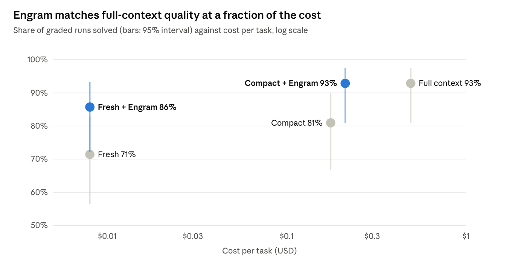
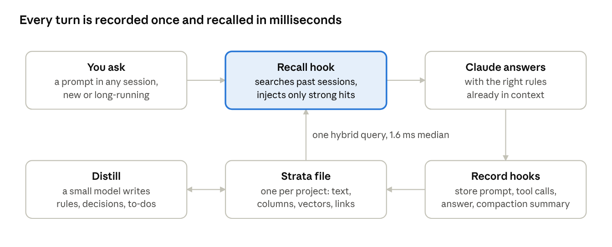
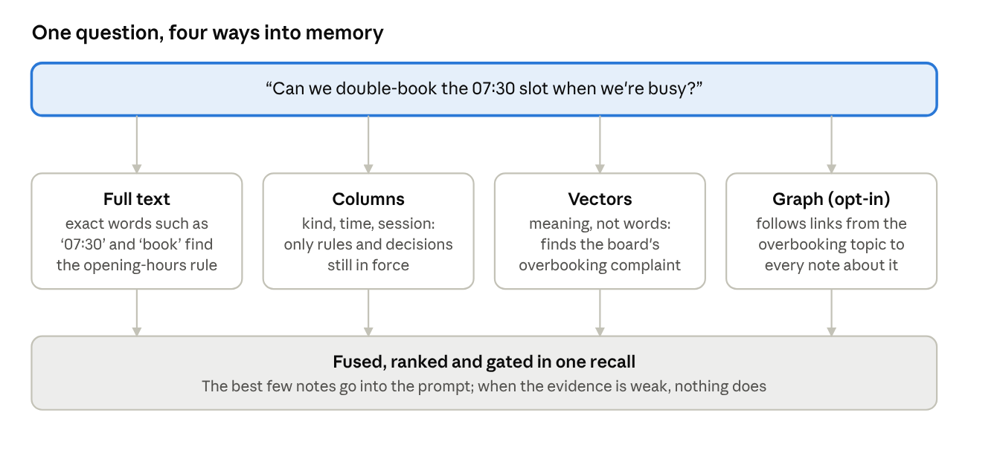
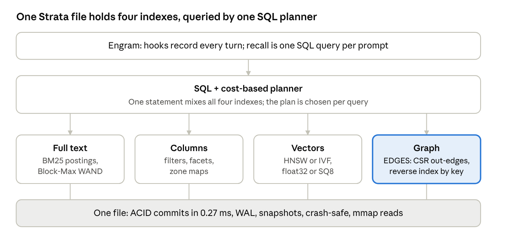
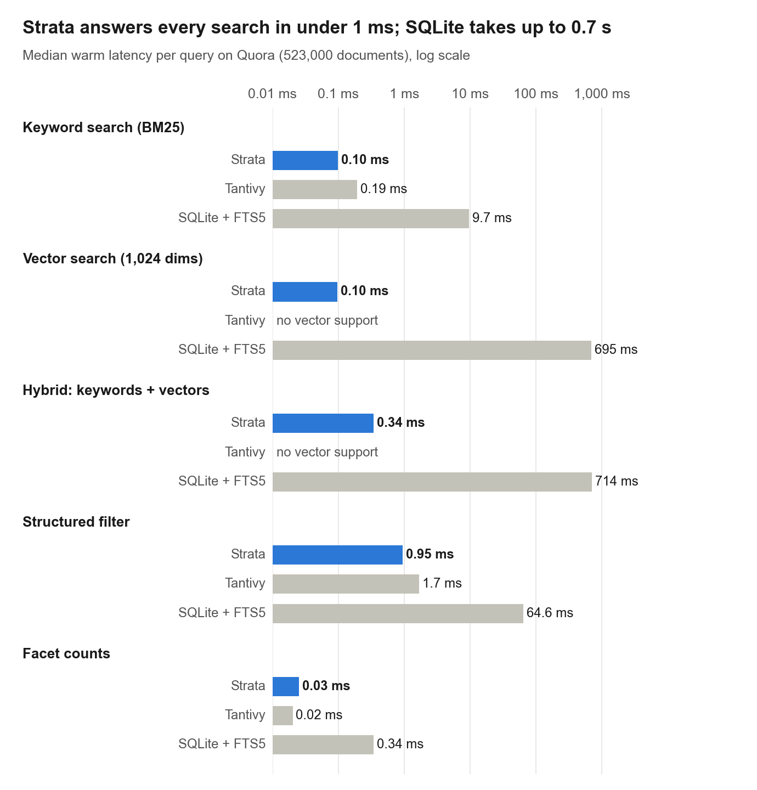
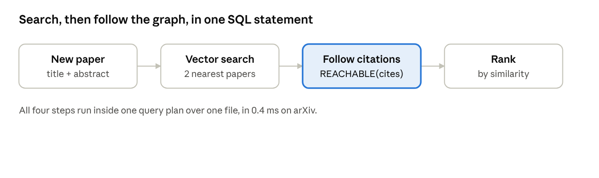
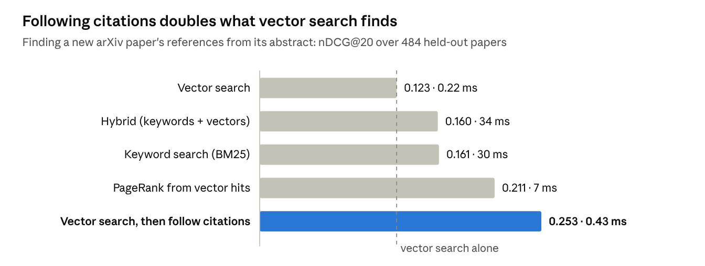
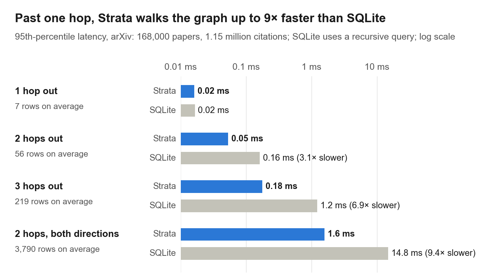

# Engram: Remember the Whole Project, Pay for a Fraction of It

October 13, 2026

**Start every day with a fresh session and lose nothing.** In a week-long coding project with about 20 rules said once in chat, Claude Code with Engram solved **86%** of follow-up tasks from a brand-new session, against **71%** without it, at the same **$0.008 per task**.

- **Quality:** Engram lifts the solve rate by 15 points in fresh sessions (71% → 86%) and by 12 points in long sessions that compact (81% → 93%).
- **Cost:** keeping the whole week in context reaches 93%, but at **$0.49 per task, about 60× the price** of a fresh session with Engram.
- **Speed:** with Engram the agent needed **28% fewer steps** per task (8.8 → 6.3) and read **23% fewer tokens**, because it stopped searching the repository for decisions that were never written into it.
- **Engine:** Engram stores memory in Strata, our single-file search database. It ran keyword search **110× faster than SQLite** and **2.7× faster than Tantivy** on 523,000 documents, ran vector search in 0.2 ms, and walked a citation graph up to 9× faster than SQLite.



<sub>Kestrel benchmark: 210 graded runs, 42 per setup (engram/results/long/kestrel)</sub>

*Compact + Engram matched full context on quality (39 of 42 runs each) at 43% of its cost per task.*

## The problem: your agent forgets what you told it

Real projects are built from things people say once. "Prices go up in April." "Reception is stuck on Python 3.9." "Never put patient names in an export." These rarely make it into the code until the day they matter.

Coding agents lose them in two ways. A **new session** starts with only the repository. A **long session compacts**: the history is summarized to make room, and small asides are the first to go. The brute-force fix is to keep everything in context, which works until the bill arrives.

## The test: a working week, then 14 new features

We had Claude Code build a booking library for a three-clinic physiotherapy practice over **7 working sessions (30 prompts)**. Along the way the owner mentioned about 20 rules in passing: opening hours, appointment lengths, the accountant's invoice format, a privacy rule, an SMS gateway limit, the Python version on reception PCs. Two of them changed later in the week: the cancellation window went from 24 to 48 hours, and prices rise on 1 April 2027.

Then we asked for **14 follow-up tasks**, each run 3 times in each of 5 setups, and graded every result with code, not opinion:

| Setup | How the week was kept | Engram |
| --- | --- | --- |
| Fresh | A new session each day and for each task | No |
| Fresh + Engram | A new session each day and for each task | Yes |
| Compact | One long session, compacted at the end of each day | No |
| Compact + Engram | One long session, compacted at the end of each day | Yes |
| Full context | One long session, never compacted | No |

Most tasks need several of those facts at once, so forgetting any one of them fails the task.

## Quality: Engram recovers what sessions and summaries drop

Engram raised the solve rate in both everyday workflows: **71% → 86%** with a fresh session each day, and **81% → 93%** with a long session that compacts. Compact + Engram tied keeping the entire week in context (93% each), with a slightly higher average grade (0.99 vs 0.97).

The gains come from the tasks that hinge on something said once in chat (runs solved out of 3):

| Task | What it needed | Fresh | Fresh + Engram | Compact | Compact + Engram | Full context |
| --- | --- | --- | --- | --- | --- | --- |
| Advise on `match` statements | Reception PCs run Python 3.9 | 0 | 3 | 0 | 3 | 3 |
| Price an appointment | April price rise, 20% card-holder discount | 0 | 3 | 3 | 3 | 3 |
| Find free slots | Opening hours, lengths, 15-min notes buffer | 0 | 1 | 3 | 3 | 3 |
| Advise on double-booking | It was tried and the regulator objected | 3 | 3 | 1 | 3 | 3 |

In the Python case, the agent without Engram advised against the upgrade but never gave the real reason, that reception PCs run Python 3.9, in 6 tries. With Engram it gave that reason every time. After compaction, asked whether to double-book 07:30, the agent without Engram remembered the board's complaint 1 time in 3; with Engram, 3 times in 3.

## Cost and speed: memory is cheaper than context

A fresh session with Engram is the **cheapest way to a correct answer: $0.009 per solved task**, against $0.530 when the whole week stays in context. Engram adds nothing measurable per task, and writing down the week's knowledge cost about **$0.09, once**.

| Setup | Solved | $ per task | $ per solved task | Whole week, history + 42 tasks | Steps per task | Input tokens per task |
| --- | --- | --- | --- | --- | --- | --- |
| Fresh | 71% | $0.008 | $0.012 | $0.77 | 8.8 | 288k |
| **Fresh + Engram** | **86%** | **$0.008** | **$0.009** | **$0.88** | **6.3** | **221k** |
| Compact | 81% | $0.176 | $0.217 | $10.43 | 6.4 | 248k |
| **Compact + Engram** | **93%** | $0.212 | $0.228 | $12.66 | 6.2 | 278k |
| Full context | 93% | $0.492 | $0.530 | $25.11 | 3.5 | 517k |

The week's totals include Engram's one-time cost of writing down what was said ($0.09 per setup). Compact + Engram reached the same quality as full context for half the week's bill.

On speed, the setups averaged 24 to 27 seconds per task (Compact averaged 42 s because of one 13-minute run). Engram's gain shows up as work avoided: 28% fewer steps than a fresh session without it, because the agent stops hunting through files for decisions that were only ever spoken.

## How it works

Engram is automatic long-term context for Claude Code, stored in **Strata**, an embedded single-file search database. Nothing depends on the model remembering to save.

- **Records everything:** hooks store every prompt, tool call, answer and compaction summary in one Strata file per project.
- **Writes down what matters:** after each turn, a small model notes the rules, decisions and planned work the turn stated, and updates or closes earlier ones.
- **Brings it back when it helps:** each prompt triggers a hybrid search (keywords plus vectors) over older history. The best records are injected only when the evidence is strong. The model can also search memory itself through MCP tools.

## How the agent gets faster with Engram and Strata

An agent without memory spends its time rediscovering things. It greps the repository for a rule that was only ever said in chat, re-reads files to rebuild context, or carries the whole history in every request. Engram replaces all of that with one lookup that takes milliseconds.



<sub>Engram's recall loop, from engram/src (hooks, recall, distill) and the kestrel runs' recall timings</sub>

The model works with Engram in two ways:

- **Automatically, before it reads the prompt.** A hook runs one recall query against the project's Strata file and puts the strongest matches into the prompt. The model never has to know what to search for. In the kestrel runs this was nearly all of Engram's work: the agent called a memory tool in only 4 of 84 Engram runs.
- **On demand, through tools.** When the model wants more, it can call `memory_search` (hybrid search), `memory_timeline` (what happened around a record), `memory_sql` (read-only SQL over the whole memory) and `memory_remember` (save a rule for later sessions).

Here is a real run from the benchmark. In a brand-new session the owner asked: *"For the next importer I'd like to use `match` statements. Any objection?"* Recall found a note from day 3 of the history and put it in the prompt. The agent answered with no searching and no tool calls:

> *"Yes, I'd object: `match` needs Python 3.10, and the reception PCs are stuck on 3.9 because of the practice-management software."*

That is where the savings in the benchmark come from. Compared with a fresh session without Engram, the agent took **28% fewer steps** and read **23% fewer tokens** per task, because the answer arrived with the question. Compared with keeping the whole history in context, it read **less than half the tokens** per task (221k against 517k) for the same or better quality.

### One question, four indexes

Every record Engram stores (a prompt, a tool call, an answer, a distilled rule) is one row in Strata, indexed four ways at once. Each index answers a different kind of question, and one query can use all four.



<sub>How one prompt reaches each of Strata's indexes; graph expansion is off by default (ENGRAM\_GRAPH=1)</sub>

**Full text (BM25): exact names, codes and error messages.** Words like a vendor name, an invoice prefix or an exception type have to match exactly, and meaning-based search blurs them.

```sql
-- "What was the limit on the SMS gateway?"
SELECT ts, text FROM memory
ORDER BY bm25(body, 'Bulkie batch limit') DESC LIMIT 5;
```

**Columns: who, what kind and when.** Structured fields narrow a search to the right records before anything is ranked: only decisions, only errors, only this week, only one file.

```sql
-- "What broke in the export code recently?"
SELECT ts, text FROM memory
WHERE kind = 'error' AND MATCH(files, 'export') AND ts >= :last_week
ORDER BY ts DESC LIMIT 5;

-- "What does memory hold?" (a facet count)
SELECT kind, COUNT(*) FROM memory GROUP BY kind ORDER BY 2 DESC;
```

**Vectors: the same idea in different words.** "Can we squeeze an extra patient in?" shares no words with "the board complained about overbooking", but the two mean nearly the same thing. Engram embeds each prompt and finds the nearest records in Strata's HNSW index.

```sql
-- the records closest in meaning to the prompt
SELECT ts, text FROM memory
WHERE kind IN ('decision', 'fact', 'preference')
ORDER BY similarity(emb, :prompt) DESC LIMIT 5;
```

Engram's automatic recall runs a keyword search and a vector search over the same filtered rows and fuses the two, so both exact terms and meaning count.

**Graph: everything connected to a topic.** Each distilled note links to the turn it came from, the topics and files it is about, and the older note it replaces. When the cancellation window changed from 24 to 48 hours, the new rule superseded the old one, and recall leaves superseded notes out.

```sql
-- every note about the cancellation fee, wherever it was said
SELECT ts, text FROM memory
WHERE REACHABLE(links, 'e:cancellation fee', hops => 1, dir => 'in');

-- or start from a search and follow the links from its best hits
SELECT ts, text FROM memory
WHERE REACHABLE(links, (SELECT id FROM memory ORDER BY similarity(emb, :prompt) DESC LIMIT 5), hops => 2, dir => 'both')
ORDER BY similarity(emb, :prompt) DESC LIMIT 20;
```

The model can run any of these itself through `memory_sql`. Graph-expanded recall is opt-in (`ENGRAM_GRAPH=1`) and was off in the kestrel runs.

Because all four indexes live in one Strata file, the planner combines them in a single statement. No search server runs alongside the agent, and no vector database has to be kept in sync with a text index.

## Under the hood: Strata, one file that beats specialist engines

Engram's speed comes from **Strata**, a search database we built for this job. Like SQLite, it is one file with ACID transactions and SQL. Unlike SQLite, every table is indexed three ways at once: full-text, structured columns and vectors. One SQL statement can mix all three. In the kestrel benchmark, Engram's recall step took a median of **1.6–1.7 ms** (2.7 ms at p95), so remembering adds no wait you can notice.



<sub>Strata architecture, from strata/DESIGN.md and strata/README.md</sub>

We measured Strata against two industry standards on four public BEIR collections, from 5,000 to 523,000 documents, running the same queries on the same machine. The baselines were **SQLite 3.53 with FTS5**, the world's most deployed embedded database, and **Tantivy 0.26**, the Rust engine in the style of Lucene that powers Quickwit. On Quora, the largest collection (523,000 documents), median warm latency per query was:



<sub>Strata evaluation, strata/results: Quora, 523,000 documents, one thread, warm cache; SQLite 3.53 + FTS5 and Tantivy 0.26</sub>

- **Faster without losing quality:** BM25 search was 1.8–4.6× faster than Tantivy and 45–213× faster than SQLite FTS5 across the four collections. Strata won 23 of 28 warm text and filter comparisons. Ranking quality matched both: nDCG@10 was within 0.02 of the baselines everywhere.
- **Vectors in milliseconds:** HNSW search took 0.09–0.20 ms with recall@10 of 0.99. SQLite has no built-in vector index, so it scans every vector, which takes 12 ms to 1 s.
- **One planner for mixed queries:** for vector search under a filter, Strata's cost-based planner was 1.5–5.3× faster than the best fixed strategy on the three larger collections.
- **Safe and compact:** commits are durable in 0.27 ms, every crash test recovered cleanly, and the file is about the size of SQLite's.

Where Strata is behind: loading is slower, because building the vector graph takes time (on Quora, 243 s against SQLite's 27 s). Tantivy counts facets 1.1–2.7× faster and is 1.8–2.9× faster on structured filters when the cache is cold. SQLite was tested without a vector extension such as sqlite-vec, so its vector numbers measure a scan, not a competing index. Dedicated vector stores such as FAISS or Qdrant were not part of the test. All runs used one thread on a 4-core cloud VM.

## Graphs: search that follows connections

In Strata, a row can link to other rows. A paper cites papers, a note is about a file, a new rule replaces an old one. The links live in the same file and the same transactions as the text and the vectors. So one SQL statement can search, follow links and rank, with no second database to keep in sync.



<sub>How a graph-assisted search runs in Strata</sub>

To test whether links make search better, we held out 1,000 recent arXiv papers and asked each method to find the papers each one cites, using only its title and abstract. Searching by meaning and then following the citations of the two nearest papers **found twice as many references as vector search alone**, in 0.4 ms per query. The improvement is statistically solid (p < 0.0001).



<sub>Strata graph evaluation, strata/results/graph/quality\_stats.json: 1,000 held-out ogbn-arxiv papers, 484 reported</sub>

Strata stores links compactly inside the file, at 27 bytes per citation on arXiv, and indexes them in both directions. Beyond one hop, that makes walking the graph much faster than SQLite's recursive queries:



<sub>Strata graph evaluation, strata/results/graph/latency\_arxiv.json: 200 random seeds, warm cache, one thread</sub>

- **More than reachability:** shortest paths and personalized PageRank are built in. PageRank over a million rows and 10 million links takes 5.8 ms. SQLite has no practical way to express either.
- **Links that never break:** links point at keys, not storage positions, so merges, updates and deletes never rewrite them. A link to a deleted row is skipped, like a foreign key without a constraint.
- **Part of every query:** a traversal can start from any subquery, such as a vector search, a keyword search or a filter. Its result then combines with BM25, filters and vectors in the same plan.

**In Engram,** every note links to the turn it came from, the files and topics it is about, and any older note it replaces. The agent can ask its memory for everything about one topic as a single graph query through Engram's SQL tool. Recall that expands along these links is an option (`ENGRAM_GRAPH=1`); the kestrel results above use the default recall, without it.

## Fine print

- **Regraded runs:** in 7 of 210 runs the grader first crashed instead of judging the code. After a grader fix, every one was regraded from its saved code. The 3 Compact export runs passed (they had renamed a field the grader expected), which moved Compact from 74% to 81%. The other 4 still fail on their merits: two Fresh pricing runs declined to write the function, one raised an error for card holders, and one Fresh + Engram reminder run crashed in its own code.
- **Sample size:** 42 runs per setup gives wide error bars. Fresh is 71% (95% CI 56–83%) and Fresh + Engram is 86% (72–93%); Compact is 81% (67–90%) and Compact + Engram and Full context are both 93% (81–98%). The direction is consistent across tasks, but these are not yet statistically separated.
- **Fair baseline:** every setup kept Claude Code's own built-in memory notes from the week. Memory, the repository and Engram's store were restored before every run, so no run could learn from another. No user plugins or extra tools were loaded.
- **One model:** all runs used the same small, fast Claude model. Costs are list prices as reported by Claude Code.
- **Hard by design:** one task, the booking-form check, was solved by no setup.
- **Reproduce it:** the scenario, graders and harness are in `engram/eval/ab/scenarios/kestrel` and `engram/scripts/long_session_ab.py` in the [codex-test-2](https://github.com/rkonow/codex-test-2) repository; all 210 graded runs, with each run's code changes, are in `engram/results/long/kestrel` there. Strata's evaluation is in `strata/report` and `strata/results` in the same repository.
