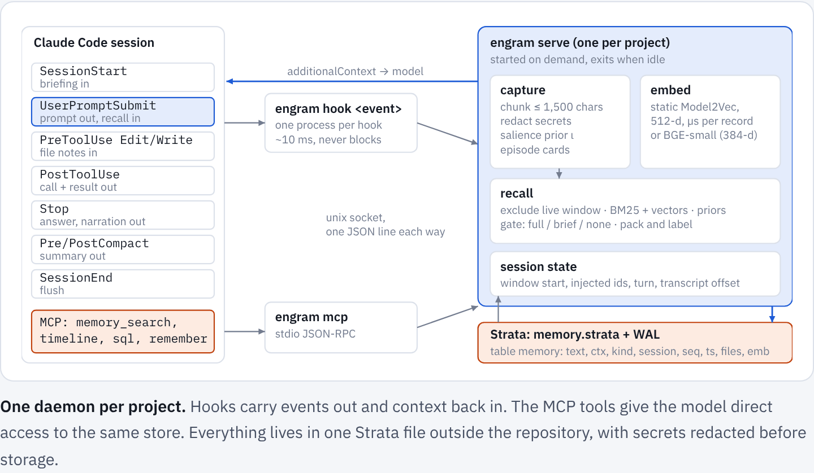
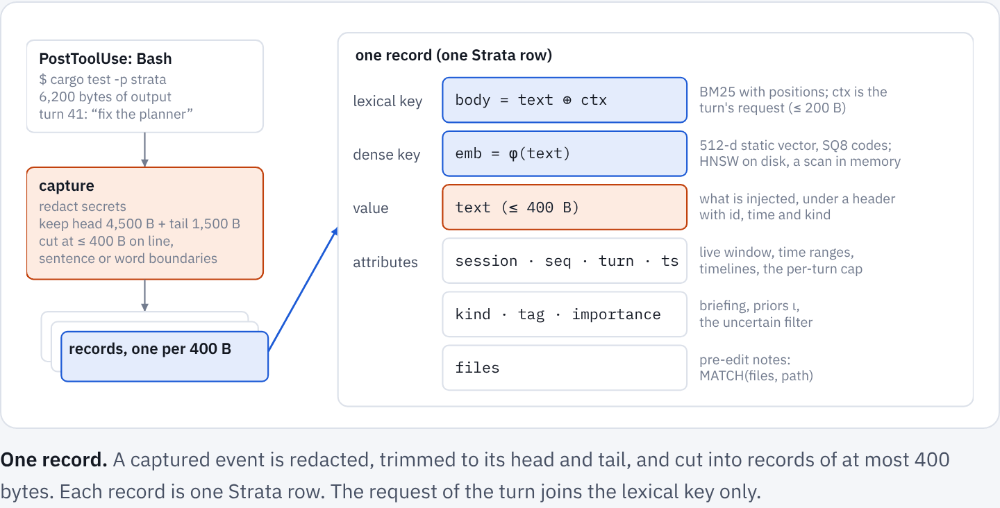
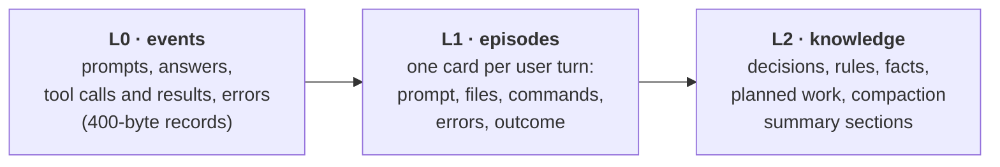
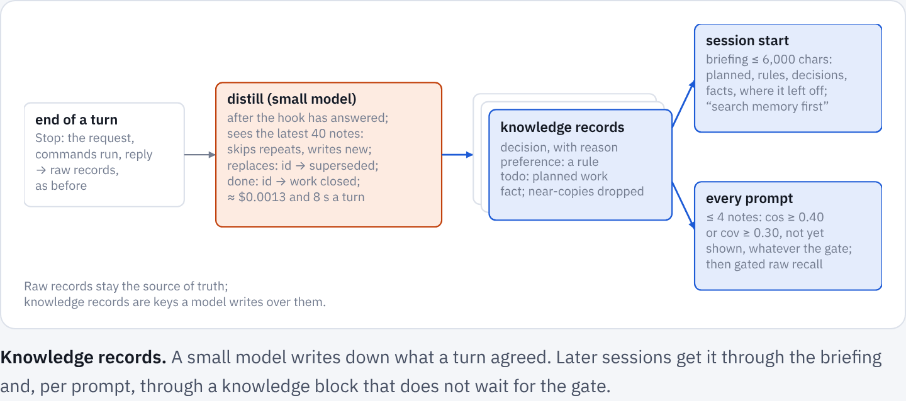
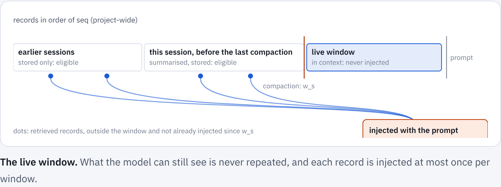
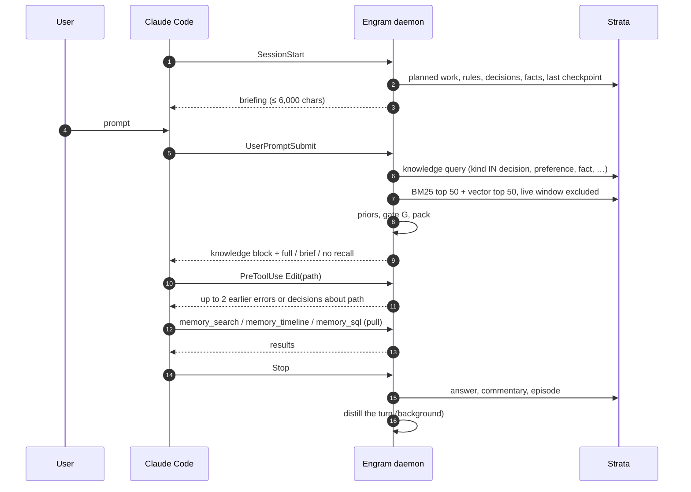
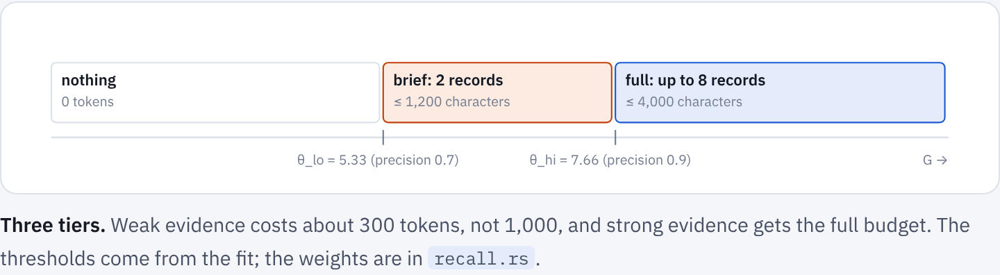
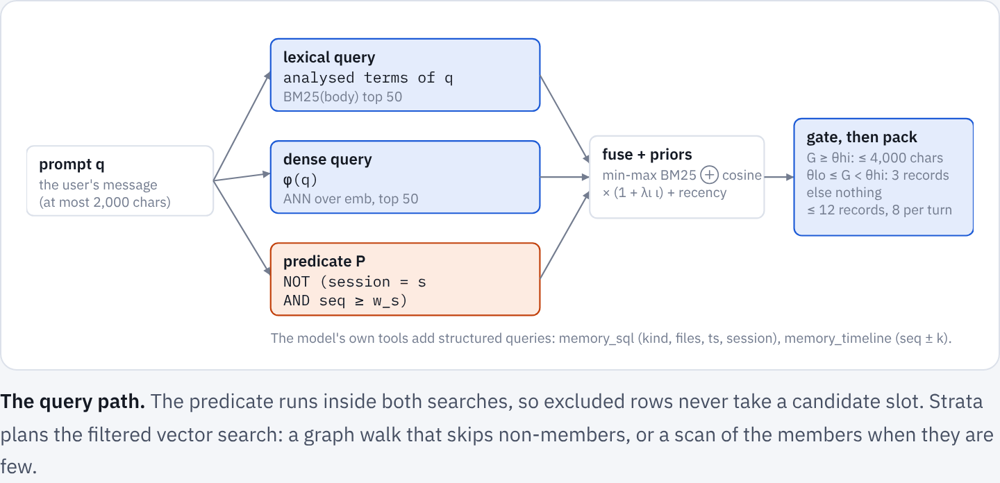

# Engram: how it works
{: .no_toc }

Engram gives a coding agent (Claude Code first) a memory that outlives its context window. It records every prompt, answer, tool call and compaction summary of a project into one Strata file, brings the relevant pieces back at the moments they matter without the model having to ask, and gives the model tools to search its own history when it decides to.
{: .fs-5 .fw-300 }

1. TOC
{:toc}

## The problem

A long session on a complex project outgrows any context window. Claude Code then compacts it into a summary of about 15,000 characters. Summaries keep the plan and lose the particulars:

- exact numbers, error messages and file paths;
- the reason an approach was rejected;
- a preference the user stated once, three hours earlier.

A new session starts with only `CLAUDE.md` and the auto-memory index. The session that built Strata ran for 32 hours and wrote 43.7 MB of transcript across two compactions; its summaries hold under 0.1% of that text.

Three requirements follow:

1. **Store without being asked.** Capture must not depend on the model remembering to save.
2. **Load without being asked, but only when it helps.** Injected context costs tokens and attention, and irrelevant context hurts accuracy. Injection must be gated, budgeted, and must skip what the model can already see.
3. **Let the model ask precisely.** When the model knows it needs history, it gets search, timeline and SQL tools over the same store.

## Architecture



Strata holds an exclusive lock on its file, and hooks are short-lived processes that run concurrently with the MCP server. So one daemon per project owns the database, and hooks and the MCP server are its clients over a Unix socket.

- **Lazy start.** The first client to find no socket spawns the daemon under a spawn lock; the daemon exits after 30 idle minutes. Its first hook takes 50–72 ms, because the 129 MB embedding table is memory-mapped rather than read.
- **Warm state.** The embedder, segment readers and the memtable stay in memory between hooks.
- **Cheap writes.** A write makes the next query rebuild the last memtable chunk's in-memory segment. Chunks hold 256 records and scan their vectors instead of building an HNSW graph, so a query right after a tool call costs what any query costs.
- **Never in the way.** A client that cannot reach the daemon within its deadline prints nothing and exits 0. A memory failure never blocks a prompt or a tool call.

The store lives outside the repository, in `${ENGRAM_HOME:-~/.local/share/engram}/<project-slug>/`, because transcripts can contain secrets. A redaction pass removes common key and token formats before anything is stored.

## The data model

One Strata table, `memory`. Each record is one key–value pair with attributes.

| field | type | meaning |
|---|---|---|
| `id` | KEYWORD, primary key | `<session-prefix>:<seq>` |
| `session` | KEYWORD | Claude Code session id |
| `kind` | KEYWORD | `prompt`, `answer`, `tool_call`, `tool_result`, `error`, `episode`, `summary`, `decision`, `preference`, `fact`, `todo`, `note` |
| `tag` | KEYWORD | tool name, summary section, `distilled`, `planned`, `superseded`, … |
| `turn`, `seq`, `ts` | INT | user turn, project-wide sequence number, Unix seconds |
| `importance` | FLOAT | salience prior in [0, 1] |
| `files` | TEXT | paths the record touches (path components are terms) |
| `text` | TEXT, stored | the value: one chunk of at most 400 bytes, injected as is |
| `ctx` | TEXT, stored | the turn's request (≤ 200 characters): part of the lexical key, never shown |
| `body` | TEXT, generated from `text` + `ctx` | the lexical key that `bm25` and `MATCH` search |
| `emb` | VECTOR(d), HNSW | the dense key: an embedding of `text` alone |
| `links` | EDGES | edges to the turn a record came from, the files it touches (`f:path`) and the entities it is about (`e:name`), which are records of kind `entity` |



Keys are small and precise. A 400-byte window matches a question better than a 1,500-byte chunk in which the answer is one fact among many, and a context budget holds about ten such windows instead of five snippets. The turn's request joins the lexical key, so that a terse tool result ("test result: ok") is found by the words of the task it served; it stays out of the vector, where it would pull every response towards its request. The study behind these choices is in [the results](results.md#what-a-record-should-be).

Records come in three levels:



The kind sets a salience prior ι: preference 1.0, decision 0.9, summary 0.8, prompt 0.7, error and episode 0.6, answer 0.5, tool call and result 0.3.

## When to store: always

Storage is cheap (a durable commit costs about 4 ms on a Mac, where it flushes the drive's write cache, and runs off the hook's path) and a missed record cannot be recovered later.

| hook | stored |
|---|---|
| `SessionStart` | session registered; live window opened |
| `UserPromptSubmit` | `prompt`, plus `preference` records for cue sentences ("always", "never", "from now on", …) |
| `PostToolUse` | `tool_call` and `tool_result` (or `error`), asynchronously |
| `Stop` | the answer, the commentary written between tool calls, the turn's `episode`, then distilled knowledge |
| `PreCompact` | commentary not yet captured |
| `PostCompact` | the summary, by section; the live window restarts here |
| `SessionEnd` | flush |

`engram ingest-transcript` back-fills old sessions from Claude Code's JSONL transcripts.

### Distilled knowledge

Raw records hold what was *said*; a later session needs what was *agreed*: a decision and its reason, a client's rule, the requirements of work announced for later. Much of it never reaches the code, and a request that depends on it rarely sounds like earlier work, so search alone misses it.



After each `Stop`, off the prompt's path, the daemon gives the turn (request, commands, reply) to a small model through `claude -p`, with the latest 40 knowledge records for context. The model returns JSON lines:

| item | stored as | tag |
|---|---|---|
| decision, with the reason | `decision` | `distilled` |
| rule, constraint, convention | `preference` | `distilled` |
| requirement of work planned but not done | `todo` | `planned` |
| fact about the project or its environment, failed approaches | `fact` | `distilled` |
| `replaces: id` | the old item is retagged | `superseded` |
| `done: id` | the planned item is retagged | `done` |

A new item whose analysed terms overlap an existing one by a Jaccard index J ≥ 0.6 is dropped. Distillation costs about **$0.0013 a turn** and 8 s with a small model, and never delays a prompt.

## When to load

Records still inside the model's context are never injected. For each session *s* the daemon keeps the window start w<sub>s</sub>, the sequence number at session start or at the last compaction, and every query excludes

$$
\{\, r : r.\text{session} = s \;\wedge\; r.\text{seq} \ge w_s \,\} \;\cup\; \text{injected}_s
$$

where injected<sub>s</sub> is the set of records already injected since w<sub>s</sub>.



There are three push points and one pull path:



1. **`SessionStart`: a briefing**, always, at most 6,000 characters: planned work with its requirements, rules, decisions, facts, open tasks, and where the previous session stopped. It opens with an instruction to search memory before a design decision. After a compaction it also recalls the records most relevant to the last two prompts.
2. **`UserPromptSubmit`: knowledge, then gated recall.** Up to four knowledge records not yet shown that match the prompt on their own text, bypassing the gate:

   $$
   \cos\bigl(\phi(q), \phi(r)\bigr) \ge 0.40 \;\lor\; \mathrm{cov}(q, r) \ge 0.30,
   \qquad \mathrm{cov}(q, r) = \frac{\sum_{t \in q \cap r} \mathrm{idf}(t)}{\sum_{t \in q} \mathrm{idf}(t)}
   $$

   Then the main search and a three-way gate: strong evidence injects the top records up to 4,000 characters; weak evidence injects three records up to 1,200, marked as a weak match; otherwise nothing.
3. **`PreToolUse` on `Edit`/`Write`: file notes.** Up to two older errors, decisions or rules anchored to that path, once per file per window.
4. **Pull: MCP tools.** `memory_search`, `memory_timeline` (the neighbourhood of a hit), `memory_sql` (read-only SQL over `memory`), `memory_remember` and `memory_forget`.

### Ranking

BM25 and vector search each return their top *n* = 50 under the exclusion filter. Scores are min-max normalised over the union *C*, a missing score counting as 0:

$$
\mathrm{rel}(r) = w\,\widehat{\mathrm{bm25}}(r) + (1 - w)\,\widehat{\cos}(r)
$$

Priors then break near-ties without overriding relevance, with ι the salience prior and τ a recency scale:

$$
S(r) = \mathrm{rel}(r)\,\bigl(1 + \lambda_\iota\,\iota(r)\bigr) + \lambda_t\, e^{-(\mathrm{seq}_{\max} - \mathrm{seq}(r))/\tau}
$$

Answers that admitted not knowing and repeats of the same question are excluded, because they would only replay a failure. Packing is greedy by *S*: at most twelve records, at most eight per user turn. Every injected line carries its provenance (kind, session, turn, relative time and id), and up to five further candidates follow as one line each for the model to open with `memory_timeline`.

### The gate

Min-max scores cannot gate, since the best candidate always scores 1. The gate uses absolute evidence about the best candidates: the highest cosine and term coverage among the top five, how far the best BM25 and cosine scores stand above the tenth, whether BM25 and vectors agree on the top record, and whether the prompt refers back ("earlier", "we decided", "last time", …):

$$
G = a\,\cos_{\max} + b\,\mathrm{cov}_{\max} + c\,\mathbb{1}_{\text{cue}} + d\,\mathbb{1}_{\text{agree}} + e\,(\cos_1 - \cos_{10}) + f\,\Bigl(1 - \frac{\mathrm{bm25}_{10}}{\mathrm{bm25}_1}\Bigr)
$$



The weights come from a logistic fit on LongMemEval-S (`engram/scripts/fit_gate.py`): positives are questions whose evidence the packed injection contains; negatives are questions asked against another conversation's store, abstentions and misses. θ<sub>hi</sub> holds precision 0.9 on the fit and θ<sub>lo</sub> precision 0.7. The gate is the weakest part of the design; [the results](results.md#the-gate) say why.



## Cost and latency targets

| path | target | measured |
|---|---|---|
| `PostToolUse`, `Stop` client | < 10 ms | queued; embedded and committed in the background |
| `UserPromptSubmit` | < 100 ms p99 at 1M records | 24.9 ms p50, 38.6 ms p99 as a hook process |
| `SessionStart` | < 150 ms (daemon up), < 1 s with spawn | 50–72 ms including daemon start |
| ingest | > 1,000 records/s | 48,000–52,000 records/s with the static embedder |

The default embedder is static (Model2Vec potion-retrieval-32M: token lookup and mean, 512 dimensions, microseconds per record). BGE-small (384 dimensions) is optional (`--features bert`) and costs about 50 ms per record on a CPU.

## Install and use

```sh
cd engram
cargo build --release
target/release/engram fetch-model
target/release/engram install --project /path/to/your/project   # --shared writes .claude/settings.json instead
```

```sh
engram search "why did the planner pick post-filtering"
engram sql "SELECT ts, text FROM memory WHERE kind = 'error' AND MATCH(files, 'exec') ORDER BY ts DESC LIMIT 5"
engram remember decision "Prices are integer cents"
engram ingest-transcript ~/.claude/projects/<project>/<session>.jsonl   # back-fill old sessions
engram distill                                                          # distill turns stored before distillation existed
engram stats | briefing | stop
```

| variable | effect |
|---|---|
| `ENGRAM_DISABLE=1` | turns the hooks off |
| `ENGRAM_HOME`, `ENGRAM_MODELS` | relocate the store and the models |
| `ENGRAM_DISTILL=0` | turns distillation off (or `"distill": {"enabled": false}` in the store's `config.json`) |
| `ENGRAM_DISTILL_MODEL` | the model the distiller uses |
| `ENGRAM_EMBEDDER` | `static` (default), `bert`, or `hash:<dim>` for a model-free hash embedder |

The full design, including the evaluation plan, is in [`engram/DESIGN.md`](https://github.com/rkonow/engram/blob/main/engram/DESIGN.md).
