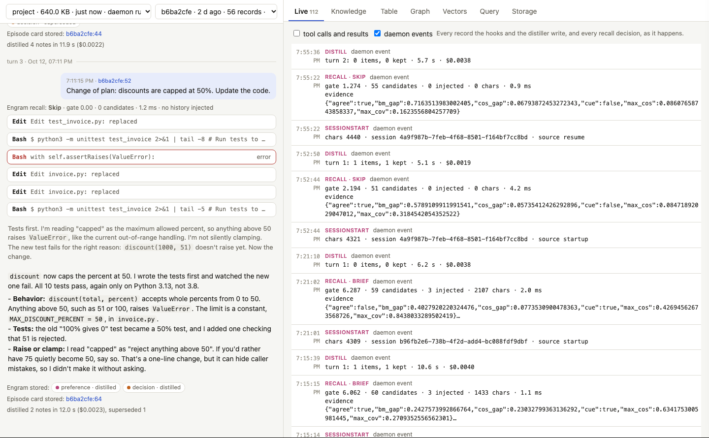
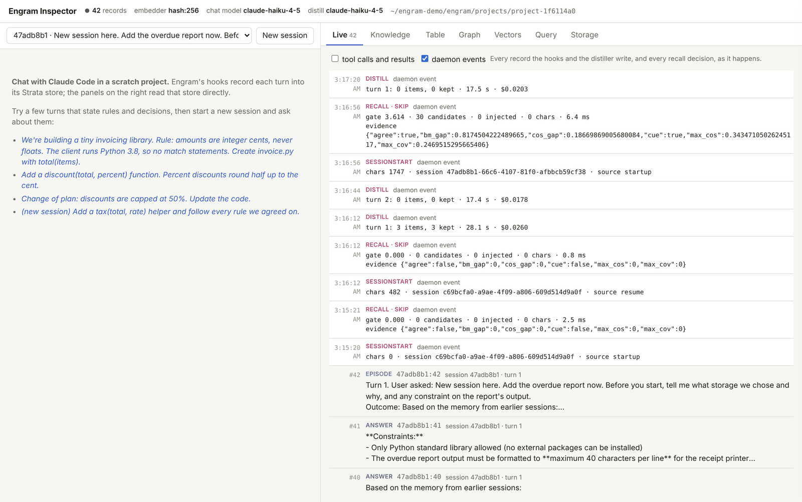
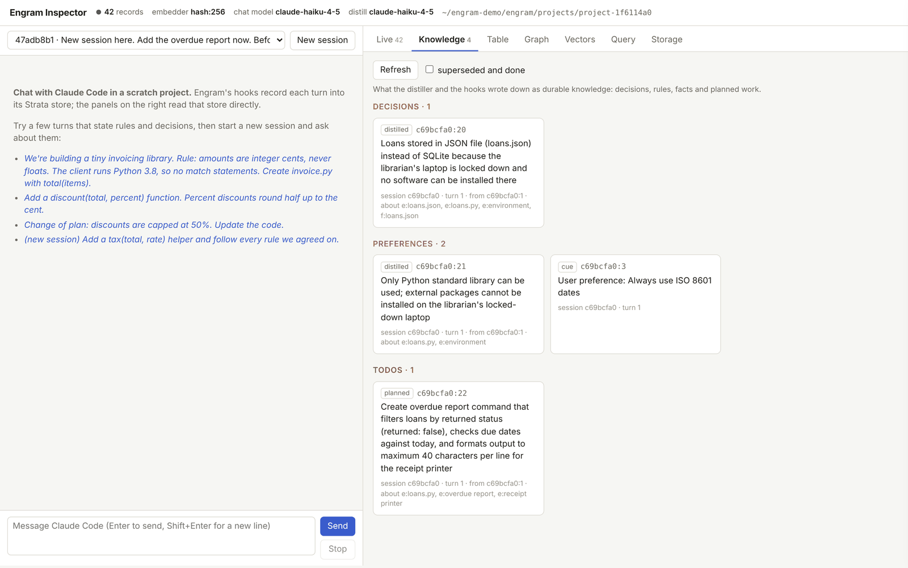
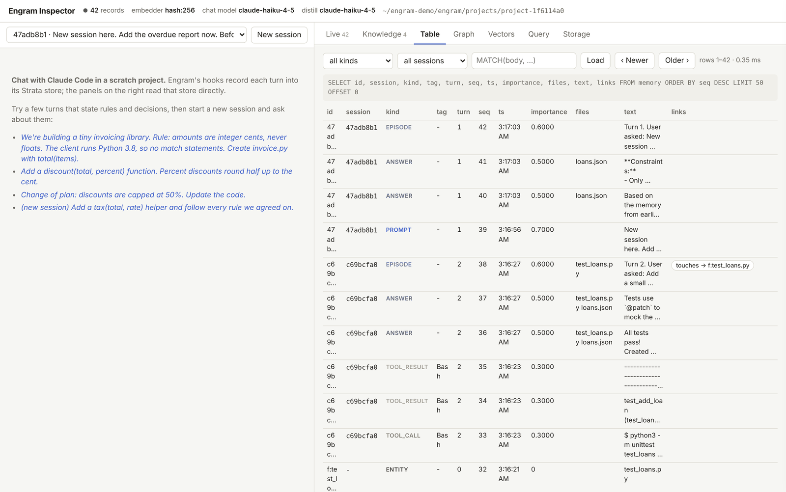
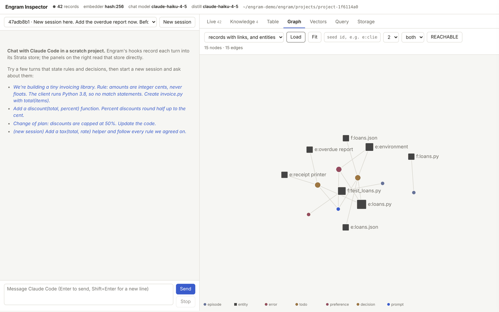
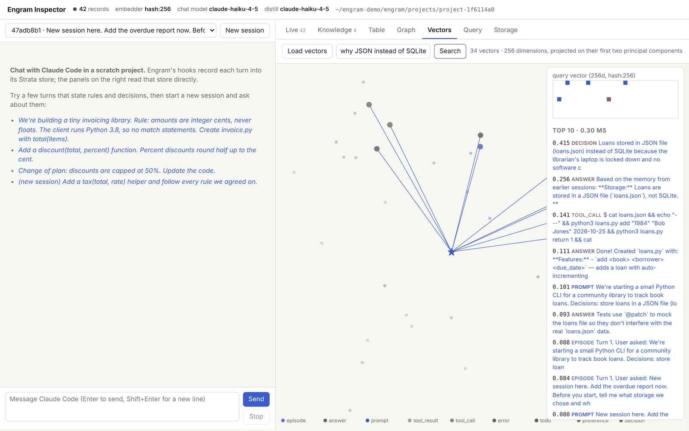
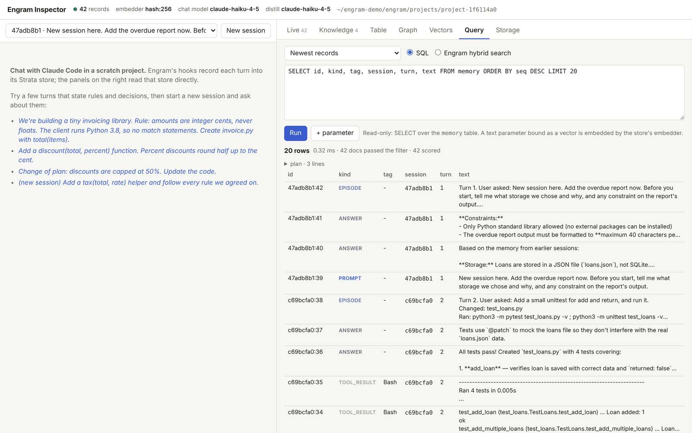
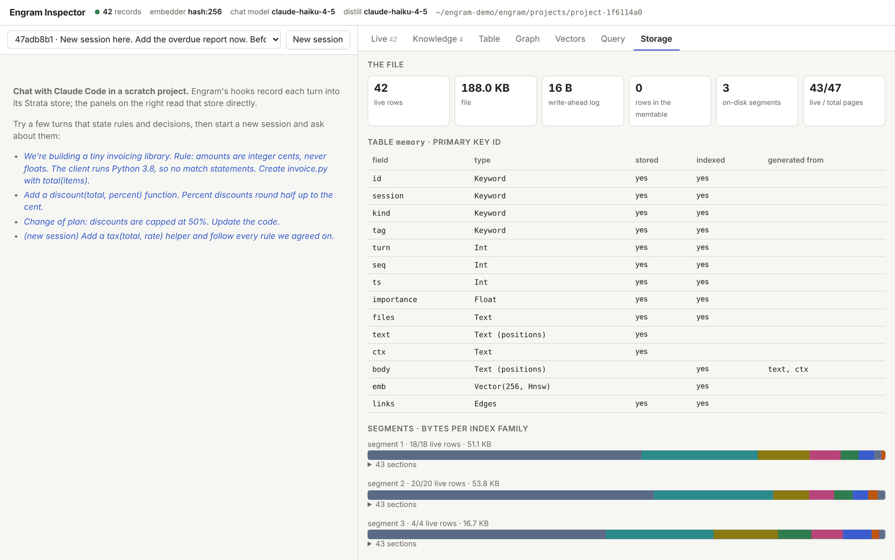

# The live inspector
{: .no_toc }

A local web app for watching Engram work: what the hooks store, what the distiller writes down and what recall injects, for your own sessions or for a chat in a scratch project. Every panel is a query against the project's Strata file, made through the same daemon the hooks talk to. Nothing is simulated: chat turns are real `claude -p` runs.
{: .fs-5 .fw-300 }

[Try it in your browser](../demo/inspector.html){: .btn .btn-primary } A static copy replays a recorded session. Its SQL runs in a JavaScript model of Strata over the recorded records and vectors.

The inspector runs in two ways: `engram ui` points it at the stores of your own sessions, and `demo/run.sh` runs it with a chat column against a scratch project.

1. TOC
{:toc}

## On your own stores: `engram ui`

```bash
engram ui                  # http://127.0.0.1:8765/?token=..., opened in your browser
```


Once Engram is [installed](setup.md), `engram ui` serves this page from the binary over every store under `~/.local/share/engram/projects` (or `--home DIR`). Pick a store (one per project directory) and a session. The left column then replays the session from its records, in place of the demo's chat:

- the prompts, the answers and the narration between tool calls;
- each tool call, with its stored result loaded when you open it, and errors in red;
- the briefing injected at session start and, for every prompt, the recall decision, its gate score and the records it injected (each one a link);
- the notes the distiller kept after each turn, with what they superseded or closed, and the turn's episode card.

A session that is still running grows as it goes, and the panels on the right work as described below, against the chosen store. Nothing is written: reads go through each project's daemon with the same read-only operations the demo allows, so the inspector can stay open while sessions write. The server listens on 127.0.0.1 and wants the random token in the URL it prints (kept in a cookie after the first load); on a remote machine, forward the port with `ssh -L 8765:127.0.0.1:8765`. The address keeps the view (`?store=…&session=…&tab=knowledge`).



## The demo: chat in a scratch project

```sh
cd engram
demo/run.sh --model <model> --distill-model <small model>     # opens http://127.0.0.1:8765
```

| option | effect |
|---|---|
| `--model` | the model for the chat (default: the `claude` CLI's) |
| `--distill-model` | the model Engram distills each turn with (default: `--model`) |
| `--embedder hash:256` | a model-free hash embedder, so nothing needs downloading |
| `--data DIR` | where the scratch project and its store live (default `~/engram-demo`) |
| `--budget USD` | maximum spend per chat turn (default 2.0) |

The server is standard-library Python (`engram/demo/server.py`) and the page is one HTML file (`engram/demo/index.html`). Chat turns run with `--setting-sources project,local`, so your own plugins and hooks stay out of the demo. The browser can only call the daemon's read-only operations.

## A walkthrough

The screenshots on this page come from one short session recorded for this documentation, with a small model for the chat and for distillation and the hash embedder. Two turns in a first session:

> We're starting a small Python CLI for a community library to track book loans. Decisions: store loans in a JSON file (loans.json), not SQLite, because the librarian's laptop is locked down and nothing can be installed. Always use ISO 8601 dates. Later we will need an overdue report that prints at most 40 characters per line, for the receipt printer. For now, create loans.py with `add` and `return` commands. Keep it short.

> Add a small unittest for add and return, and run it.

Then a **new Claude Code session**, whose context starts empty:

> Add the overdue report now. Before you start, tell me what storage we chose and why, and any constraint on the report's output.


The new session answered correctly: JSON in `loans.json` because nothing can be installed on the librarian's laptop, only the standard library, and at most 40 characters per line for the receipt printer. None of it was in the new session's context when it started. It came from the **briefing** Engram injected at `SessionStart` (1,741 characters), built from the knowledge the distiller wrote after the first turn. Recall for the prompt itself was skipped by the gate (G = 3.61 on 30 candidates), because the briefing had already delivered what mattered.

By the end, the three turns had become 42 records in three segments: prompts, tool calls and results, answers, episode cards, entities, and the distilled decision, rule and planned work.

## The panels

### Live



Every record the hooks and the distiller write, and every daemon decision as it happens: `SESSIONSTART` with the briefing size, `RECALL` with the gate score and its evidence features (`max_cos`, `max_cov`, `bm_gap`, `cos_gap`, `agree`, `cue`), and `DISTILL` with the items kept and the cost.

### Knowledge



The durable knowledge: decisions, preferences (rules), facts and planned work. Each item says where it came from (`distilled` by the model, or `cue` when a sentence like "Always use ISO 8601 dates" was picked up directly from the prompt), and links to the turn and entities it is about. Superseded and completed items can be shown too.

### Table



The `memory` table itself, paged, filterable by kind, session and a `MATCH` expression.

### Graph



Records are linked to the turn they came from, the files they touch (`f:loans.json`) and the entities they are about (`e:receipt printer`). These are Strata `EDGES` fields, so the panel can run `REACHABLE` traversals from any seed, as in the [graph queries](../strata/graphs.md).

### Vectors



Every record's vector, projected on its first two principal components. A text query is embedded with the store's embedder and its top ten neighbours are drawn and listed with their similarity. Here *why JSON instead of SQLite* finds the distilled decision first (0.415).

### Query



An SQL console over the store, read-only, with the executor's plan and timings. A text parameter bound as a vector is embedded by the store's embedder, so hybrid queries work as written. It can also run Engram's own hybrid search, the one recall uses.

```sql
SELECT id, kind, text FROM memory
WHERE kind IN ('decision', 'preference')
ORDER BY similarity(emb, :q) DESC LIMIT 5
```

### Storage



The table's schema and fields, its segments, the memtable, and the file's size by component.
