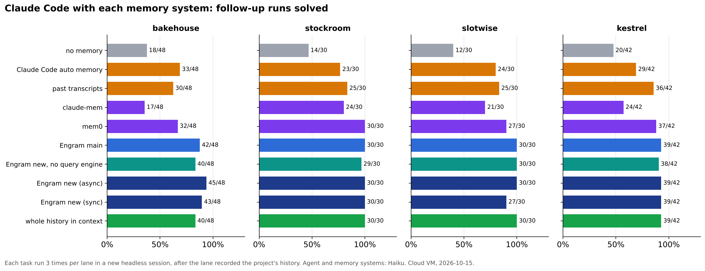
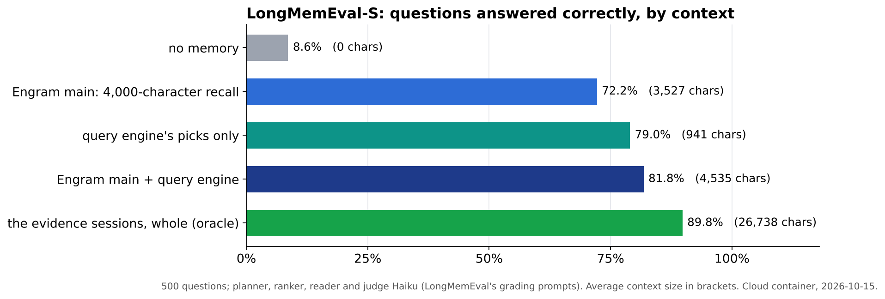
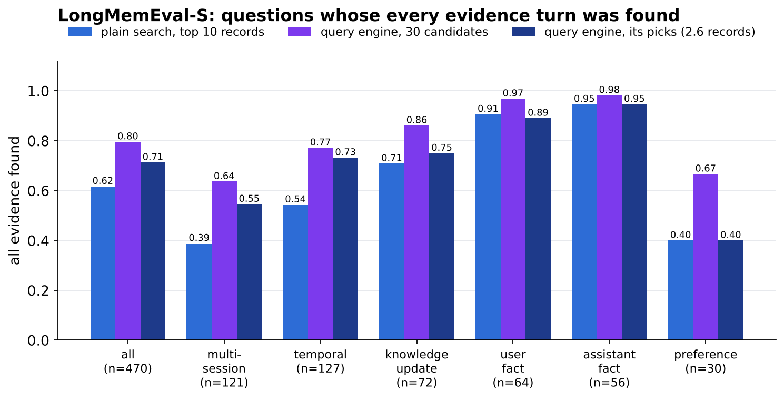

# Engram: results
{: .no_toc }

Engram works as a long-term memory for Claude Code. Every hook event is stored without the model's help. The details a compaction throws away come back when a prompt asks for them, and a new session starts out knowing what earlier sessions decided. Its weak point is the decision to inject: the gate keeps costs down but cannot reliably tell a related record from a relevant one. The query engine added in October 2026 lets a small model plan the searches and pick what matters, which raises LongMemEval answers from 72% to 81% and catches requirements a request implies without naming them.
{: .fs-5 .fw-300 }

1. TOC
{:toc}

## Summary

| requirement | met | missed |
|---|---|---|
| **Store without being asked** | Prompts, tool calls and results, errors, answers, commentary and compaction summaries are captured from hooks. A hook costs 14–26 ms, most of it starting the hook process; a durable append takes about 4.5 ms. The 26-hour session becomes 2,204 records, back-filled in 6 s (on the cloud VM). | The model's reasoning is redacted in transcripts, so the "why" survives only where it was written out. |
| **Load without being asked, only when it helps** | 13 of 15 lost details came back automatically after a compaction; 8 of 8 questions about the 26-hour history answered in live sessions, against 0 of 4 without Engram. | The gate's precision is modest: 59% against 42% for always injecting on LongMemEval, no gain on LoCoMo. |
| **Let the model ask precisely** | In a live session the model followed an injected record id with `memory_timeline` and quoted the exact command and output of a previous session. | Whether the model searches depends on the model and the prompt. |
| **Connect a request to what it implies** | The query engine plans several searches and a second call picks what matters: LongMemEval answers rise from 72.2% to **81.0%** with its picks added; on a task whose request names neither a school's nut-free rule nor the nuts in a product, it was the only Engram setting that left the product out (6 of 6 runs, against 0 of 3 on `main`). | It costs $0.003 and about 16 s a request with Haiku, so it runs in the background. Its ranker drops stated preferences (preference questions 83% → 73%). |
| **Do better than the alternatives** | Over 150 follow-up runs on four projects, Engram solved 91–96% (by version and mode), against 43% with no memory, 73% with Claude Code's own memory, 77% with grep over past transcripts, 57% with claude-mem and 84% with mem0, and about as many as with the whole history in context. | The October changes are not measurably better than `main` there (144 against 141 runs solved). |
| **Scale far beyond a context window** | At a million records (about 200 sessions of this repository's size) a recall query takes 5.7 ms at the median and the file holds 3.1 KB per record. | Finding one conversation's needle among generic filler gets harder: recall@10 0.80 at 10k records, 0.44 at 1M. |

## Claude Code with and without Engram

Everything else on this page measures what reaches the model. The direct test is Claude Code itself, with and without Engram, on work that depends on earlier sessions.

**Method.** A *history* of headless working sessions on a small Python project is recorded by Engram. Along the way the user states rules, decisions with their reasons, failed approaches, and requirements for work planned later; some end up in the code, others are only said. Then each *follow-up task* runs in a fresh headless session on a clone of the repository as the history left it, with Engram and without (no hooks, no memory tools). Both conditions have every normal tool, including files, shell and git history. A script grades each result with one check per fact, so a task is solved only when every remembered requirement holds. The same small, fast model runs everything.

**Held out.** Two projects were written by a separate agent that never saw Engram's code or design, *before* Engram's changes were tested on them: stock keeping for a hardware wholesaler (3 sessions, 13 turns) and appointment booking for a physiotherapy practice (3 sessions, 14 turns). Each has ten tasks: six need something said only in conversation, two need a convention that is in the repository, and two are controls. Engram was frozen first; each task ran five times per condition, 200 runs in all, and nothing was changed after.

| tasks | without Engram | with Engram |
|---|---|---|
| need a fact said only in conversation | 20 / 60 | **60 / 60** |
| need a convention in the repository | 20 / 20 | 20 / 20 |
| controls (need nothing earlier) | 20 / 20 | 20 / 20 |
| **all** | **60 / 100** | **100 / 100** |

A permutation test that shuffles the condition labels within each task 20,000 times never reaches the observed difference, so p < 1/20,001; Fisher's exact test on the pooled counts gives p ≈ 10−14.

Without Engram, the failed checks are exactly the facts that were only said: purchase suggestions that did not order up to three times the reorder point, a count sheet not in walking order by bin, `tomllib` recommended for a client machine that runs Python 3.8, a day plan that overran the 42-character receipt printer, a wrong cancellation fee, and a calendar feed that nobody knew had already been tried and abandoned.

The 6,000-character briefing did most of the work: it reached every Engram run. The model called the memory tools in 9 of 100 runs. Engram runs took fewer steps (6.3 against 7.5, and 7.0 against 9.0), read 5–6% fewer input tokens, and cost about the same ($0.007–0.009 a run).

**How it got there.** The first A/B, on a development project (Tally, an expense-splitting library), found almost no difference: 26 of 30 against 25 of 30 (p = 0.33). Replaying its prompts showed that decisions given with a reason never reached the briefing, and the gate scored the prompts that needed them just under its threshold. That led to distilled knowledge records and the per-prompt knowledge block ([how it works](index.md#distilled-knowledge)). On Tally they took Engram to 30 of 30 (p = 0.02), but Tally was used for development, which is why the verdict rests on the held-out projects.

**Limits.** Three small projects, one history each, one small model. The tasks were written alongside the histories and aimed at facts they state; real work rarely depends on earlier sessions this often, so the 40-point gain is a gain on such tasks, not on work in general.

{: .note }
A longer A/B on multi-day scenarios was run twice. The first run (`engram/results/long/*_v1_leaky`) is kept for the record only: Claude Code's own auto-memory, which lives outside the repository, was not reset between runs, so the runs within a lane were not independent. The rerun with the isolated harness (`engram/results/long/stockroom` and `slotwise`, 240 runs) does not show Engram recovering what compaction dropped. After a hand review of the regex-graded advice answers, stockroom was solved 26/30 with compaction alone, 27/30 with Engram, 30/30 with Engram and graph recall, and 30/30 with the full history; slotwise was 30/30 in every lane. Each compacted lane missed the one conversation-only fact its own last compaction summary dropped. In both Engram lanes the recall gate skipped those prompts and no run called a memory tool, so the differences between lanes come from their summaries. `stockroom/NOTE.md` has the review.

## Memory systems compared

The A/B above compares Engram with nothing. This one puts Claude Code next to the memory systems a user could pick instead, on four projects, and compares Engram's `main` with the October changes (notes kept current, request-aware recall, code anchors and the query engine).

**Method.** Each *lane* is one memory system. It records the project's history with that system on: each block of prompts is a new headless session, as separate working days are, and in one project a teammate's commits land between sessions without the agent being told. The lane's repository and whole home directory (which holds `~/.claude`, Claude Code's own memory, plugins and each system's data) are then frozen. Every follow-up task restores that state and starts a new session; a script grades the result, one check per fact. Each task runs three times per lane. Every `claude` process (and every hook, daemon and worker it starts) sees only `PATH`, its lane's `HOME` and the API address, so lanes cannot see each other or the machine's own setup. The agent and every memory system's own model calls use Haiku. The harness is [`engram/scripts/memory_bench.py`](https://github.com/rkonow/engram/blob/main/engram/scripts/memory_bench.py) and the competitors' setup is in [`engram/eval/competitors`](https://github.com/rkonow/engram/tree/main/engram/eval/competitors).

| lane | what the agent has |
|---|---|
| no memory | nothing: Claude Code's auto memory off, no plugins, no hooks |
| Claude Code auto memory | Claude Code's built-in memory, on as by default: the agent writes notes into `~/.claude/projects/…/memory/` and `MEMORY.md` is loaded into each session |
| past transcripts | the history's sessions as markdown files in a folder the agent is told it can grep |
| claude-mem | the [claude-mem](https://github.com/thedotmack/claude-mem) plugin (13.39.0): hooks, a model call per tool use and per turn that writes observations and summaries, SQLite and Chroma search, injected context and MCP search tools |
| mem0 | [mem0](https://github.com/mem0ai/mem0) (2.2.1) as MCP tools to add and search memories, with a system prompt asking the agent to use them; a model call extracts facts on each add |
| Engram main | Engram as on `main` |
| Engram new, no query engine | the October changes with the query engine off |
| Engram new (async) | the same with the query engine in its default mode, in the background |
| Engram new (sync) | the query engine before the model starts on each prompt |
| whole history in context | the history's one long session, forked for each task: an upper bound |

| lane | bakehouse | stockroom | slotwise | kestrel | all | needs an earlier session | $ per run, agent + memory |
|---|---|---|---|---|---|---|---|
| no memory | 18/48 | 14/30 | 12/30 | 20/42 | 64/150 (43%) | 25/111 | 0.005 + 0 |
| Claude Code auto memory | 33/48 | 23/30 | 24/30 | 29/42 | 109/150 (73%) | 70/111 | 0.006 + 0 |
| past transcripts | 30/48 | 25/30 | 25/30 | 36/42 | 116/150 (77%) | 77/111 | 0.006 + 0 |
| claude-mem | 17/48 | 24/30 | 21/30 | 24/42 | 86/150 (57%) | 47/111 | 0.007 + 0.008 |
| mem0 | 32/48 | 30/30 | 27/30 | 37/42 | 126/150 (84%) | 87/111 | 0.006 + 0.0003 |
| Engram main | 42/48 | 30/30 | 30/30 | 39/42 | 141/150 (94%) | 102/111 | 0.006 + 0 |
| Engram new, no query engine | 40/48 | 29/30 | 30/30 | 38/42 | 137/150 (91%) | 98/111 | 0.006 + 0 |
| Engram new (async, the default) | **45/48** | 30/30 | 30/30 | 39/42 | **144/150 (96%)** | **105/111** | 0.007 + 0.003 |
| Engram new (sync) | 43/48 | 30/30 | 27/30 | 39/42 | 139/150 (93%) | 100/111 | 0.006 + 0.003 |
| whole history in context | 40/48 | 30/30 | 30/30 | 39/42 | 139/150 (93%) | 100/111 | 0.016 + 0 |

*"Needs an earlier session" leaves out the controls and the tasks whose convention is in the repository. Bakehouse has 16 tasks, kestrel 14, the others 10, each run three times per lane: 1,500 runs. Every lane's history and runs are in `engram/results/memory_bench/<project>/`, the pooled tests in `pooled.md`.*

**Any memory helps, and Engram leads.** Every Engram lane solved more than any other system, and about as much as having the whole history in context, at two thirds of its cost per run or less. Against no memory, Engram's default solves 144 of 150 runs against 64 (p < 10−20). Of the others, mem0 comes closest (126/150; p = 0.009 against Engram `main`); it depends on the agent calling its tools, which it did 1.6 times a run, and it found none of bakehouse's requirements that a task implies without naming them (0 of 12). Claude Code's own memory and grep over past transcripts recover about two thirds of what was only said. claude-mem was the weakest: no better than nothing on bakehouse (17 against 18 of 48), not significantly better on kestrel (24 against 20 of 42), while its observer made the most model calls ($0.60 over the four histories, against $0.15 for Engram `main`).

**The October changes against `main`.** Pooled over the four projects, the default build solves 144 runs against `main`'s 141 (Fisher p = 0.6; permutation within tasks p = 0.10): not a measurable difference on its own. Where the two differ, the query engine is why. One bakehouse task asks to enter a school's order that includes Bakewell slices; the history said months earlier that the school is nut-free, and the catalog lists nuts in the slice. With the query engine (async or sync) all six runs left the slice out, and the agent said why; `main`, the same build with the query engine off, and Claude Code with the whole history in context solved 0, 0 and 1 of 3. This is the link by inference that plain recall misses: the request names neither nuts nor the rule. Without the query engine the new build is level with `main` (137 against 141, p = 0.5). Notes that replace older ones and code anchors did not show up in these grades: `main` already solved every revised-decision task on bakehouse, and its three tasks about code that changed under a note were solved by every lane, including the one with no memory, because the agent reads the code. The default build costs more: the query engine adds $0.003 a run in model calls, about half the agent's own cost, and $0.37 over the four histories against $0.15.

**Async beats sync.** Running the query engine before the model starts cost 10 seconds a run and solved fewer runs (139 against 144). On slotwise it lost all three runs of one task: it picked a note the distiller had written from the assistant's own unanswered questions ("these cancellation fee details are still undecided and must be settled before the fee is built"), and the agent asked instead of building. The distill prompt now leaves such questions out ([check](https://github.com/rkonow/engram/tree/main/engram/results/v2/distill_open_questions): 6 of 6 outputs carried one before, 0 of 6 after); the comparison ran on the build before that fix.

## This repository's own 26-hour session

The transcript of the session that built Strata and Engram is the most realistic test available: 26.5 hours, 43.6 MB, three projects, and two compactions whose summaries keep 14,202 and 17,998 characters. Replaying it through Engram's capture gives the records the hooks would have stored; questions are asked at the point just before Engram's own work began.

Three probe sets:

- **Recurring facts (40):** decisions and results that later work kept restating.
- **Lost details (18):** errors, failed commands and measurements that no later text repeats.
- **Lost details, vague (12):** the same details, asked the way someone would who no longer remembers the identifiers.

**After a compaction**, the summary held none of the lost details. Of the 15 the model no longer had, automatic injection brought back **13**, and one `memory_search` 14. Asked vaguely, injection recovered 8 of 10.

**In a new session**, which starts with nothing, the gated injection alone answered 83% of the lost-detail probes, 58% of their vague versions and 54% of the recurring facts; search raised these to 94%, 67% and 78%. After the record-structure changes below, the gated injection answers 50 of 67 probes unprompted (42 before), and the full injection 58.

## Live Claude Code runs

Claude Code itself, headless (`claude -p`, a small model), in a scratch repository after `engram install`:

- **Run A** states two decisions and writes code. The hooks stored 12 records, including a preference picked up from "always", the commentary, the answer and an episode card.
- **Runs B and C** are new sessions with every file tool disabled, asking for the two decisions. With Engram, the session answered from the briefing; without, it said it did not know.
- **Run D** asks for a detail the briefing does not carry. The model looked up the record id named in the injected context, called `memory_timeline` on it, and quoted the exact command and output from the earlier session.

The final live test back-fills the 26-hour transcript into a fresh project (1,835 records) and asks four questions, each in a new headless session with file, shell and web tools disabled, twice with Engram and once without. **With Engram all eight answers were right**; two came from automatic injection alone, and in the other six the injection pointed the model at the right records before it searched. **Without Engram it answered none of the four.**

Two earlier versions of this test failed in instructive ways. A prompt beginning "Without reading any files or running commands" made the model skip memory search too. And "I don't know" answers were stored and later recalled as evidence that the answer was unknown; Engram now tags such answers and never injects them.

## Retrieval on long-conversation benchmarks

Each benchmark conversation becomes its own store, with one record per turn chunk. A question succeeds when its annotated evidence turn comes back.

- **LongMemEval-S:** 500 questions, each over its own history of about 115,000 tokens; the 470 with evidence are scored.
- **LoCoMo:** 10 conversations of about 600 turns and 1,536 answerable questions.

On LongMemEval-S, hybrid search with priors puts the evidence in the top 10 for **90%** of questions, against 88% for BM25 or static vectors alone, and the default 4,000-character injection contains it for 87%. LoCoMo's short turns between two people favour exact words: BM25 alone reaches 0.651 at rank 5 and static vectors only 0.382, so the static hybrid (0.607) falls below BM25; BGE vectors reverse that (0.678 hybrid). By question type, hybrid search helps most on multi-session questions (recall@5 0.760 → 0.835 over BM25); preference questions are hardest, at 0.50.

### What a record should be

What a record should hold (its key, its value, its size, and whether a model should write it) was studied separately, by what reaches the model and by the answers a model gives from it.

- **Coding sessions want small keys.** In a new session a 4,000-character injection held the answer to 72% of 67 probe questions with 1,500-byte records and **85%** with 400-byte windows.
- **Context belongs in the lexical key only.** Adding the turn's request to the BM25 key helps short, elliptical turns (LoCoMo answer-in-context 74% → 83%); adding it to the vector hurts (MRR 0.664 → 0.603).
- **A session is the wrong unit** for a value: it routes well (R@10 0.985) but its best snippet holds the evidence for only 64% of questions, against 91% for turns.
- **Facts written by a model help aggregation.** A small model wrote 66,864 facts for 4,559 sessions at $0.0019 per session. Multi-session questions answered correctly rose from 40% to 60%.

**Does it change the answers?** A small model answered all 500 LongMemEval questions from each context, graded with LongMemEval's own prompts. Memory takes it from 7% (it can only decline) to **71–75%**; an oracle retriever reaches 92%. When the answer string was in the context, 92–94% of answers were right; when it was not, 0–4%. Reading the *whole* 170,000-token history answers 84% on a subset, against 72% for Engram's 4,000-character context, but costs $0.17 per question against $0.0007, about 240 times more.

## The query engine

The [query engine](index.md#query-understanding) has a small model turn a request into several typed searches, fuses what they return, and has a second call pick the records that matter. It was measured on all 500 LongMemEval-S questions, each against its own store, with Haiku as planner, ranker, reader and judge (LongMemEval's grading prompts), on the cloud VM.

| context given to the reader | correct | characters |
|---|---|---|
| none | 8.6% | 0 |
| Engram main: its 4,000-character recall | 72.2% | 3,527 |
| the query engine's picks alone | 76.8% | 879 |
| the picks, plus the ranker's short reading of them | 75.2% | 1,208 |
| Engram's recall plus the query engine's picks | **81.0%** | 4,470 |
| the evidence sessions, whole (oracle) | 89.8% | 26,738 |

Adding the picks to the recall fixed 60 answers and broke 16 (McNemar's exact test, p = 4 × 10−7). The picks alone beat the recall with a quarter of its characters (54 fixed, 31 broken, p = 0.017). The ranker's reading adds nothing over the picks themselves (p = 0.37). The gain is largest where an answer needs several turns:

| question type (n) | Engram main | + query engine | oracle |
|---|---|---|---|
| temporal reasoning (133) | 68.4% | **83.5%** | 94.0% |
| multi-session (133) | 56.4% | **65.4%** | 79.7% |
| single-session, assistant said it (56) | 75.0% | **89.3%** | 98.2% |
| single-session, user said it (70) | 85.7% | 91.4% | 95.7% |
| knowledge update (78) | 87.2% | 91.0% | 92.3% |
| preference (30) | **83.3%** | 73.3% | 80.0% |

Preference questions go the other way: the ranker leaves out the turns where a taste was stated, because they do not look like answers.

**Where the gain comes from.** The planner's searches add depth more than reach: its 27 candidates hold all of a question's evidence for 80% of the 470 questions with evidence, against 78% for plain hybrid search taken to the same depth and 62% for its top 10. What changes the answers is the ranker. It keeps 2.6 records (900 characters) that hold all the evidence for 71% of questions and some of it for 92%.

**LoCoMo.** On every fourth LoCoMo question (500, of which 388 have annotated evidence) the picks, 3.3 records and 800 characters, hold all the evidence for 69% of questions, against 57% for plain hybrid search's top 10 records and 68% for its top 27. The gain is in the questions that need more than one turn: multi-hop 13% → 28%, open-domain 15% → 27%, single-hop 73% → 83%, temporal 64% → 78% (top 10 → picks). LoCoMo was measured for evidence only; the reader study's scripts are written for LongMemEval.

**Cost and time.** Planner and ranker cost $0.003 per question together ($1.47 for 500) and took 16 s at the median, 21 s at p90, with eight questions at a time on the 4-core VM. That is why the engine runs in the background by default and its picks join the session at the next tool call.

**A stronger ranker for hard questions.** The planner called 49% of the questions hard. On every fifth question (100), sending those to `sonnet` instead of Haiku raised the picks holding all the evidence from 66% to 72%, but the answers hardly moved: 73% → 74% from the picks alone, 77% → 76% with the recall, at about five times the cost ($0.015 a question). Haiku stays the default; `hard_model` is there for users who want the stronger ranker.

## The gate

Compared with injecting the full budget on every prompt, the gate fitted on LongMemEval:

| | always inject | gate |
|---|---|---|
| prompts with an injection | 100% | 55% |
| characters per prompt | ~3,000 | ~930 |
| injections that contain evidence (precision) | 42% | 59% |
| questions whose evidence reaches the model | 87% | 67% |

After the move to 400-byte records and a refit, the gate brings evidence to 77% of LongMemEval questions and 65% of its injections hold evidence, for about 1,000 characters per prompt. On held-out LoCoMo it saves the same tokens but loses precision. Its features (similarity and term coverage) cannot tell "related" from "relevant" well; a cross-encoder reranker on the candidates that pass it is the next step.

## Scale and latency

A store is filled with LongMemEval turns: 94 needle questions whose evidence sessions are kept, and generic filler to reach each size, shuffled. Hooks run through the real `engram` binary and daemon, one prompt every 200 ms.

| records | recall query p50 / p99 | full hook p50 / p99 | append p99 | bytes per record | needles in top 10 |
|---|---|---|---|---|---|
| 10,000 | 1.3 / 3.3 ms | 14.4 / 17.2 ms | 6.2 ms | 3.1 KB | 0.80 |
| 100,000 | 1.7 / 5.0 ms | 15.6 / 19.8 ms | 5.6 ms | 3.1 KB | 0.65 |
| 1,000,000 | 5.7 / 16 ms | 26.1 / 42.7 ms | 8.0 ms | 3.1 KB | 0.44 |

*Source: `engram/results/scale/scale_static.json`, on the M2 MacBook Air. A million records is about 3.1 GB, mostly 512-dimension vectors. The static embedder processes 48,000–52,000 records a second. Records are cut at 400 characters, so the needles' evidence spans 8,762 records. A full hook is mostly process start (about 10 ms on macOS, against 3 ms on Linux), and an append is a durable commit, which on macOS flushes the drive's write cache (about 4.5 ms).*

Later work removed the biggest remaining cost, which was not the search at all. A write used to make the next query rebuild an HNSW graph over the last memtable chunk (12 ms); memtable segments now scan their vectors instead. A query right after a write fell from 18 to **6.4 ms** at a million records (p99 45 → 16 ms), and the prompt hook, with the knowledge query running beside the main search, takes **24.9 ms** at the median and 38.6 ms at p99.

**What the October changes cost.** `main` (787387d) and the changed build were compiled in separate checkouts on the same M2 MacBook Air and run one at a time on a quiet machine (1-minute load average under 3), with distillation and the query engine off, as in every timing here. One scale run per side:

| records | recall query p50 / p99, main → changed | full hook p50 / p99, main → changed | needles in top 10 |
|---|---|---|---|
| 10,000 | 1.23 / 2.5 → 1.27 / 3.2 ms | 14.9 / 17.5 → 15.0 / 18.4 ms | 0.80 → 0.80 |
| 100,000 | 1.65 / 4.6 → 1.64 / 5.1 ms | 15.8 / 19.6 → 16.5 / 20.4 ms | 0.65 → 0.65 |
| 1,000,000 | 5.69 / 17.8 → 5.66 / 15.8 ms | 25.2 / 40.1 → 26.0 / 44.6 ms | 0.44 → 0.44 |

At a million records the latency benchmark then ran three times per side, alternating. The prompt hook is 0.6–1.3 ms slower at the median in every pair (24.25–24.96 ms on `main`, 25.54–25.95 ms changed; +1.0 ms, 4%, on average); the cause was not isolated. Its p99 (38.9–41.0 against 40.0–45.6 ms), appends (p50 4.4–4.7 ms on both) and a query right after a write (within 0.2 ms) stay inside the run-to-run spread. The files are in `engram/results/v2/m2/`, with the machine's load before and after each run.

Quality is what degrades with size: the filler here is chat on every subject, while real project history is more homogeneous, so this is a stress test rather than a forecast. Strata's filters (session, time, file, kind) are what keep large stores precise, and `memory_sql` gives the model those filters directly.

## Reproducing the recorded numbers

Before anything changed, every committed benchmark that needs no session transcript was rerun on `main` (787387d) on the cloud VM; [`engram/results/v2/baseline/REPORT.md`](https://github.com/rkonow/engram/blob/main/engram/results/v2/baseline/REPORT.md) has every table. Retrieval, the gate and the record-structure study reproduced exactly or within 0.007 (the docs' own MacBook rerun matches to the last digit; the committed `_c400` files are slightly older than the code), and the scale benchmark's quality numbers were identical at all three sizes. The reader study reproduces within 0.006 when the same model judges, but `haiku` now resolves to a newer model than the recorded runs used, which answers better: 8.6% / 72.2% / 89.8% with no memory, Engram's context and the oracle, against 11.0% / 68.2% / 81.0% recorded. New numbers on this page are compared with these reruns, not with the recorded runs.

On the changed build, the retrieval benchmarks return the same ranking as `main` for every question of both datasets: the October changes leave the per-prompt recall as it was, and their effect shows only where notes, anchors and the query engine are used.

## Limitations

- **The benchmarks are chats, not coding sessions.** LongMemEval and LoCoMo test personal-assistant memory; the coding evidence is one long session, a handful of live runs and five small A/B projects.
- **The session probes were written after seeing the answers.** They favour distinctive terms, which is why the vague set exists.
- **The gate was fitted on chat data,** and its weights depend on the embedder.
- **The static embedder trades quality for speed.** BGE is better on paraphrases but costs about 50 ms per record.
- **Redaction is pattern-based.** It catches common key and token formats, not every secret.
- **One small model everywhere.** In the memory-system comparison the agent, every memory system's own calls, and the query engine are all Haiku; the reader and judge on LongMemEval are too. A stronger agent may need memory less, or use it better.
- **One of the four comparison projects was written alongside the changes.** Bakehouse was written to exercise what they target (revised decisions, code that changed under a note, requirements a task implies); stockroom, slotwise and kestrel are older. Results are reported per project for that reason.
- **The competitors ran close to their defaults, with two changes this container forced.** mem0 searches with vectors only (MiniLM), because its optional keyword search and lemmatiser could not be downloaded, and calls Haiku through the `claude` CLI; claude-mem's Stop hook was made synchronous, because Claude Code cancels asynchronous Stop hooks when a headless session exits. Neither was tuned.
- **Model-calling runs shared a 4-core VM.** Their wall times include load from the runs beside them, so only costs, steps and grades are compared across lanes.

## Next steps

- A cheaper ranker. The query engine's gain comes from its ranker, not its extra searches, so a local cross-encoder over the recall's own candidates might keep most of it without the 16-second model round trip.
- Keep stated preferences through the ranker: it drops the turns where a taste was stated, which costs 10 points on LongMemEval's preference questions.
- Two-speed embeddings: capture with the static model, re-embed with BGE when the machine is idle.
- Time-aware queries: turn "yesterday" or "before the refactor" into the time and sequence filters Strata already evaluates.
- Hooks over HTTP to a localhost daemon, saving the process start per event: about 10 ms on macOS, 3 ms on Linux.
- Shared project memory: one store per repository, synced between teammates' agents.

The long-form reports have every chart and table: [Engram](../reports/engram.html) and [record structure](../reports/structure.html).
