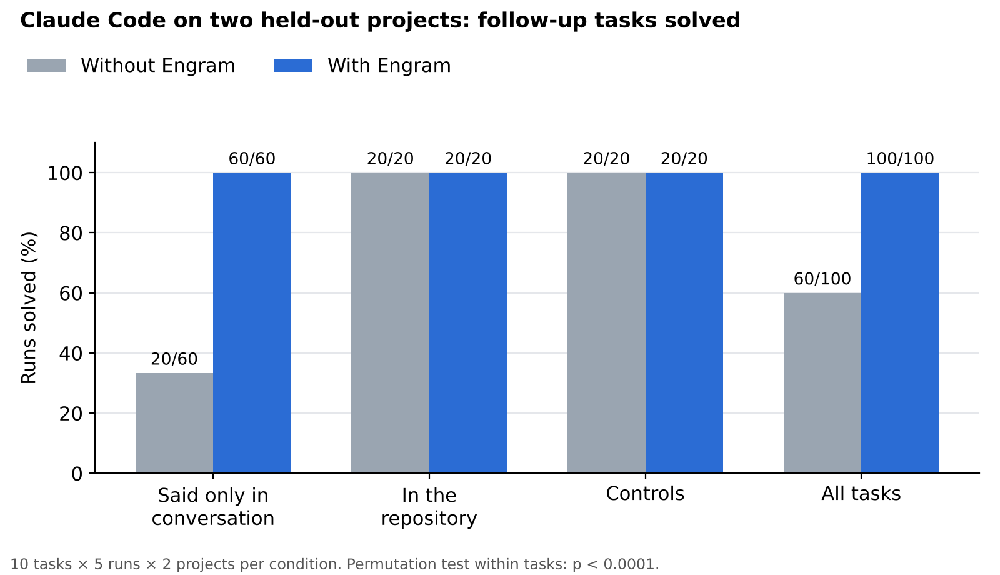
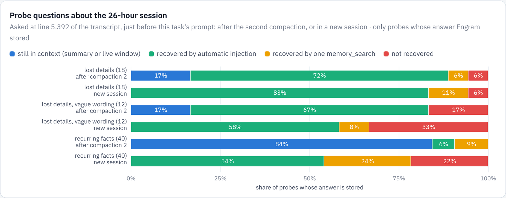
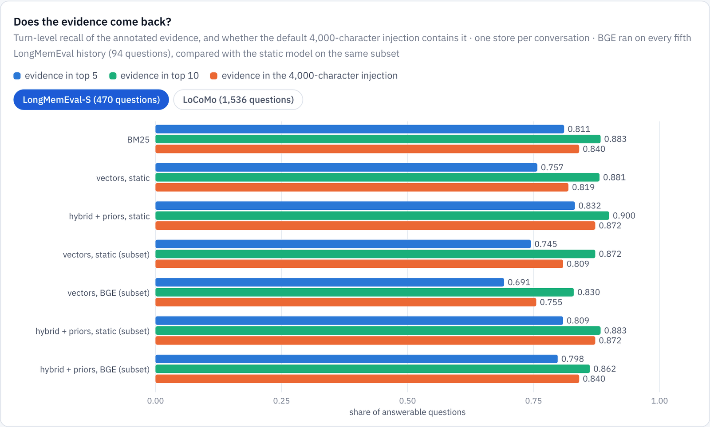
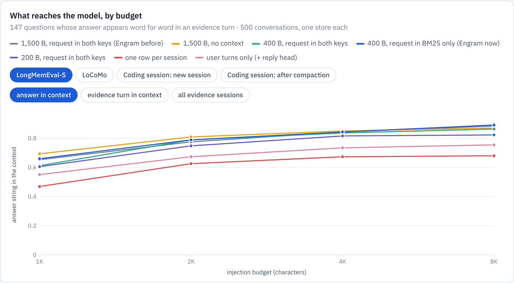
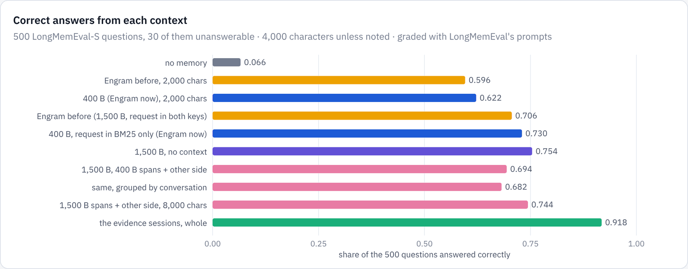

# Engram: results
{: .no_toc }

Engram works as a long-term memory for Claude Code. Every hook event is stored without the model's help. The details a compaction throws away come back when a prompt asks for them, and a new session starts out knowing what earlier sessions decided. Its weak point is the decision to inject: the gate keeps costs down but cannot reliably tell a related record from a relevant one.
{: .fs-5 .fw-300 }

1. TOC
{:toc}

## Summary

| requirement | met | missed |
|---|---|---|
| **Store without being asked** | Prompts, tool calls and results, errors, answers, commentary and compaction summaries are captured from hooks. A hook costs 14–26 ms, most of it starting the hook process; a durable append takes about 4.5 ms. The 26-hour session becomes 2,204 records, back-filled in 6 s (on the cloud VM). | The model's reasoning is redacted in transcripts, so the "why" survives only where it was written out. |
| **Load without being asked, only when it helps** | 13 of 15 lost details came back automatically after a compaction; 8 of 8 questions about the 26-hour history answered in live sessions, against 0 of 4 without Engram. | The gate's precision is modest: 59% against 42% for always injecting on LongMemEval, no gain on LoCoMo. |
| **Let the model ask precisely** | In a live session the model followed an injected record id with `memory_timeline` and quoted the exact command and output of a previous session. | Whether the model searches depends on the model and the prompt. |
| **Scale far beyond a context window** | At a million records (about 200 sessions of this repository's size) a recall query takes 5.7 ms at the median and the file holds 3.1 KB per record. | Finding one conversation's needle among generic filler gets harder: recall@10 0.80 at 10k records, 0.44 at 1M. |

## Claude Code with and without Engram

Everything else on this page measures what reaches the model. The direct test is Claude Code itself, with and without Engram, on work that depends on earlier sessions.

**Method.** A *history* of headless working sessions on a small Python project is recorded by Engram. Along the way the user states rules, decisions with their reasons, failed approaches, and requirements for work planned later; some end up in the code, others are only said. Then each *follow-up task* runs in a fresh headless session on a clone of the repository as the history left it, with Engram and without (no hooks, no memory tools). Both conditions have every normal tool, including files, shell and git history. A script grades each result with one check per fact, so a task is solved only when every remembered requirement holds. The same small, fast model runs everything.

**Held out.** Two projects were written by a separate agent that never saw Engram's code or design, *before* Engram's changes were tested on them: stock keeping for a hardware wholesaler (3 sessions, 13 turns) and appointment booking for a physiotherapy practice (3 sessions, 14 turns). Each has ten tasks: six need something said only in conversation, two need a convention that is in the repository, and two are controls. Engram was frozen first; each task ran five times per condition, 200 runs in all, and nothing was changed after.

| tasks | without Engram | with Engram |
|---|---|---|
| need a fact said only in conversation | 20 / 60 | **60 / 60** |
| need a convention in the repository | 20 / 20 | 20 / 20 |
| controls (need nothing earlier) | 20 / 20 | 20 / 20 |
| **all** | **60 / 100** | **100 / 100** |

A permutation test that shuffles the condition labels within each task 20,000 times never reaches the observed difference, so p < 1/20,001; Fisher's exact test on the pooled counts gives p ≈ 10−14.

Without Engram, the failed checks are exactly the facts that were only said: purchase suggestions that did not order up to three times the reorder point, a count sheet not in walking order by bin, `tomllib` recommended for a client machine that runs Python 3.8, a day plan that overran the 42-character receipt printer, a wrong cancellation fee, and a calendar feed that nobody knew had already been tried and abandoned.

The 6,000-character briefing did most of the work: it reached every Engram run. The model called the memory tools in 9 of 100 runs. Engram runs took fewer steps (6.3 against 7.5, and 7.0 against 9.0), read 5–6% fewer input tokens, and cost about the same ($0.007–0.009 a run).

**How it got there.** The first A/B, on a development project (Tally, an expense-splitting library), found almost no difference: 26 of 30 against 25 of 30 (p = 0.33). Replaying its prompts showed that decisions given with a reason never reached the briefing, and the gate scored the prompts that needed them just under its threshold. That led to distilled knowledge records and the per-prompt knowledge block ([how it works](index.md#distilled-knowledge)). On Tally they took Engram to 30 of 30 (p = 0.02), but Tally was used for development, which is why the verdict rests on the held-out projects.

**Limits.** Three small projects, one history each, one small model. The tasks were written alongside the histories and aimed at facts they state; real work rarely depends on earlier sessions this often, so the 40-point gain is a gain on such tasks, not on work in general.

{: .note }
A longer A/B on multi-day scenarios (`engram/results/long/*_v1_leaky`) is kept in the repository for the record only. Claude Code's own auto-memory, which lives outside the repository, was not reset between runs, so the runs within a lane were not independent. The harness now snapshots and restores it; that rerun has not been recorded yet.

## This repository's own 26-hour session

The transcript of the session that built Strata and Engram is the most realistic test available: 26.5 hours, 43.6 MB, three projects, and two compactions whose summaries keep 14,202 and 17,998 characters. Replaying it through Engram's capture gives the records the hooks would have stored; questions are asked at the point just before Engram's own work began.

Three probe sets:

- **Recurring facts (40):** decisions and results that later work kept restating.
- **Lost details (18):** errors, failed commands and measurements that no later text repeats.
- **Lost details, vague (12):** the same details, asked the way someone would who no longer remembers the identifiers.

**After a compaction**, the summary held none of the lost details. Of the 15 the model no longer had, automatic injection brought back **13**, and one `memory_search` 14. Asked vaguely, injection recovered 8 of 10.

**In a new session**, which starts with nothing, the gated injection alone answered 83% of the lost-detail probes, 58% of their vague versions and 54% of the recurring facts; search raised these to 94%, 67% and 78%. After the record-structure changes below, the gated injection answers 50 of 67 probes unprompted (42 before), and the full injection 58.

## Live Claude Code runs

Claude Code itself, headless (`claude -p`, a small model), in a scratch repository after `engram install`:

- **Run A** states two decisions and writes code. The hooks stored 12 records, including a preference picked up from "always", the commentary, the answer and an episode card.
- **Runs B and C** are new sessions with every file tool disabled, asking for the two decisions. With Engram, the session answered from the briefing; without, it said it did not know.
- **Run D** asks for a detail the briefing does not carry. The model looked up the record id named in the injected context, called `memory_timeline` on it, and quoted the exact command and output from the earlier session.

The final live test back-fills the 26-hour transcript into a fresh project (1,835 records) and asks four questions, each in a new headless session with file, shell and web tools disabled, twice with Engram and once without. **With Engram all eight answers were right**; two came from automatic injection alone, and in the other six the injection pointed the model at the right records before it searched. **Without Engram it answered none of the four.**

Two earlier versions of this test failed in instructive ways. A prompt beginning "Without reading any files or running commands" made the model skip memory search too. And "I don't know" answers were stored and later recalled as evidence that the answer was unknown; Engram now tags such answers and never injects them.

## Retrieval on long-conversation benchmarks

Each benchmark conversation becomes its own store, with one record per turn chunk. A question succeeds when its annotated evidence turn comes back.

- **LongMemEval-S:** 500 questions, each over its own history of about 115,000 tokens; the 470 with evidence are scored.
- **LoCoMo:** 10 conversations of about 600 turns and 1,536 answerable questions.

On LongMemEval-S, hybrid search with priors puts the evidence in the top 10 for **90%** of questions, against 88% for BM25 or static vectors alone, and the default 4,000-character injection contains it for 87%. LoCoMo's short turns between two people favour exact words: BM25 alone reaches 0.651 at rank 5 and static vectors only 0.382, so the static hybrid (0.607) falls below BM25; BGE vectors reverse that (0.678 hybrid). By question type, hybrid search helps most on multi-session questions (recall@5 0.760 → 0.835 over BM25); preference questions are hardest, at 0.50.

### What a record should be

What a record should hold (its key, its value, its size, and whether a model should write it) was studied separately, by what reaches the model and by the answers a model gives from it.

- **Coding sessions want small keys.** In a new session a 4,000-character injection held the answer to 72% of 67 probe questions with 1,500-byte records and **85%** with 400-byte windows.
- **Context belongs in the lexical key only.** Adding the turn's request to the BM25 key helps short, elliptical turns (LoCoMo answer-in-context 74% → 83%); adding it to the vector hurts (MRR 0.664 → 0.603).
- **A session is the wrong unit** for a value: it routes well (R@10 0.985) but its best snippet holds the evidence for only 64% of questions, against 91% for turns.
- **Facts written by a model help aggregation.** A small model wrote 66,864 facts for 4,559 sessions at $0.0019 per session. Multi-session questions answered correctly rose from 40% to 60%.

**Does it change the answers?** A small model answered all 500 LongMemEval questions from each context, graded with LongMemEval's own prompts. Memory takes it from 7% (it can only decline) to **71–75%**; an oracle retriever reaches 92%. When the answer string was in the context, 92–94% of answers were right; when it was not, 0–4%. Reading the *whole* 170,000-token history answers 84% on a subset, against 72% for Engram's 4,000-character context, but costs $0.17 per question against $0.0007, about 240 times more.

## The gate

Compared with injecting the full budget on every prompt, the gate fitted on LongMemEval:

| | always inject | gate |
|---|---|---|
| prompts with an injection | 100% | 55% |
| characters per prompt | ~3,000 | ~930 |
| injections that contain evidence (precision) | 42% | 59% |
| questions whose evidence reaches the model | 87% | 67% |

After the move to 400-byte records and a refit, the gate brings evidence to 77% of LongMemEval questions and 65% of its injections hold evidence, for about 1,000 characters per prompt. On held-out LoCoMo it saves the same tokens but loses precision. Its features (similarity and term coverage) cannot tell "related" from "relevant" well; a cross-encoder reranker on the candidates that pass it is the next step.

## Scale and latency

A store is filled with LongMemEval turns: 94 needle questions whose evidence sessions are kept, and generic filler to reach each size, shuffled. Hooks run through the real `engram` binary and daemon, one prompt every 200 ms.

| records | recall query p50 / p99 | full hook p50 / p99 | append p99 | bytes per record | needles in top 10 |
|---|---|---|---|---|---|
| 10,000 | 1.3 / 3.3 ms | 14.4 / 17.2 ms | 6.2 ms | 3.1 KB | 0.80 |
| 100,000 | 1.7 / 5.0 ms | 15.6 / 19.8 ms | 5.6 ms | 3.1 KB | 0.65 |
| 1,000,000 | 5.7 / 16 ms | 26.1 / 42.7 ms | 8.0 ms | 3.1 KB | 0.44 |

*Source: `engram/results/scale/scale_static.json`, on the M2 MacBook Air. A million records is about 3.1 GB, mostly 512-dimension vectors. The static embedder processes 48,000–52,000 records a second. Records are cut at 400 characters, so the needles' evidence spans 8,762 records. A full hook is mostly process start (about 10 ms on macOS, against 3 ms on Linux), and an append is a durable commit, which on macOS flushes the drive's write cache (about 4.5 ms).*

Later work removed the biggest remaining cost, which was not the search at all. A write used to make the next query rebuild an HNSW graph over the last memtable chunk (12 ms); memtable segments now scan their vectors instead. A query right after a write fell from 18 to **6.4 ms** at a million records (p99 45 → 16 ms), and the prompt hook, with the knowledge query running beside the main search, takes **24.9 ms** at the median and 38.6 ms at p99.

Quality is what degrades with size: the filler here is chat on every subject, while real project history is more homogeneous, so this is a stress test rather than a forecast. Strata's filters (session, time, file, kind) are what keep large stores precise, and `memory_sql` gives the model those filters directly.

## Limitations

- **The benchmarks are chats, not coding sessions.** LongMemEval and LoCoMo test personal-assistant memory; the coding evidence is one long session, a handful of live runs and three small A/B projects.
- **The session probes were written after seeing the answers.** They favour distinctive terms, which is why the vague set exists.
- **The gate was fitted on chat data,** and its weights depend on the embedder.
- **The static embedder trades quality for speed.** BGE is better on paraphrases but costs about 50 ms per record.
- **Redaction is pattern-based.** It catches common key and token formats, not every secret.

## Next steps

- A reranker behind the gate, scoring only the candidates of prompts that pass it.
- Two-speed embeddings: capture with the static model, re-embed with BGE when the machine is idle.
- Time-aware queries: turn "yesterday" or "before the refactor" into the time and sequence filters Strata already evaluates.
- Hooks over HTTP to a localhost daemon, saving the process start per event: about 10 ms on macOS, 3 ms on Linux.
- Shared project memory: one store per repository, synced between teammates' agents.

The long-form reports have every chart and table: [Engram](../reports/engram.html) and [record structure](../reports/structure.html).
