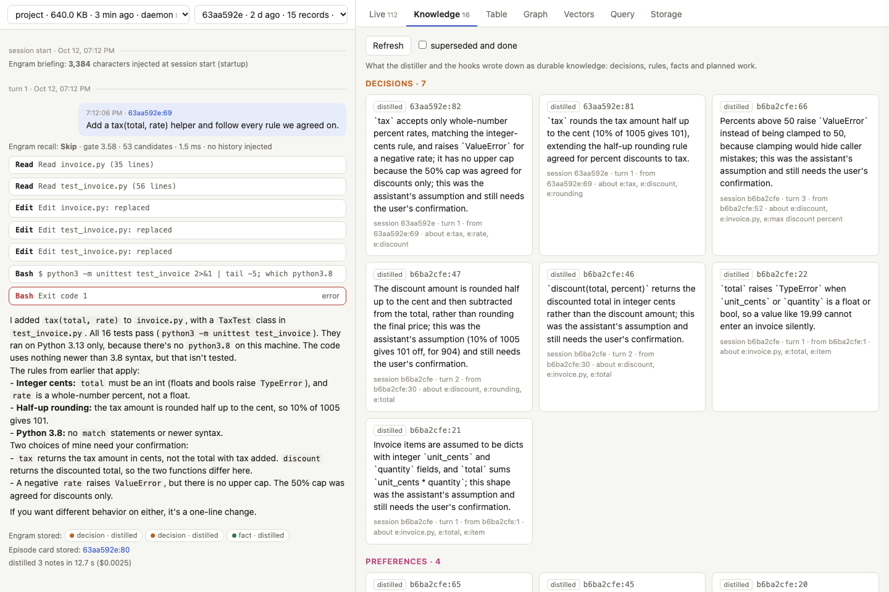

# Install Engram on your machine
{: .no_toc }

Engram runs next to your own Claude Code: hooks record each session into a local Strata file per project, and a small MCP server lets the model search that history. This page takes a fresh macOS or Linux machine to a working install in a few minutes, shows how to check it, and covers remote boxes, dev containers and upgrades.
{: .fs-5 .fw-300 }

1. TOC
{:toc}

## What you need

| | why | check |
|---|---|---|
| macOS or Linux (Windows through WSL 2) | the daemon talks to the hooks over a Unix socket | `uname -s` |
| Rust, stable | Engram is built from source | `cargo --version` (install from [rustup.rs](https://rustup.rs)) |
| a C compiler | the tokenizer's regex library is C | `cc --version` (`xcode-select --install` on macOS, `build-essential` on Debian/Ubuntu) |
| `curl` | downloads the 129 MB embedding model once | `curl --version` |
| [Claude Code](https://claude.com/claude-code) CLI, **logged in** | the hooks and the MCP server plug into it, and the distiller calls `claude -p` after each turn | `claude auth status` shows `"loggedIn": true` |

Python 3 is only needed for the scripted demo and the evaluation harnesses, not for Engram itself.

The CLI login matters more than it looks. The distiller runs `claude -p` in the background, so an expired CLI login breaks it even while interactive sessions (or the desktop app) keep working. Recording and recall still work in that state, but nothing new is written down. `engram doctor` checks for it.

## Install in one command

```bash
git clone https://github.com/rkonow/engram && cd engram && ./install.sh
```

`install.sh` does five things and can be run again at any time:

1. builds `engram` in release mode (a few minutes the first time);
2. copies it to `~/.local/bin/engram`, the path the hooks call;
3. stops any running Engram daemons, so they restart on the new binary;
4. downloads the embedding model (potion-retrieval-32M) unless it is already there;
5. runs `engram install --user --distill-model haiku` and then `engram doctor`.

| option | effect |
|---|---|
| `--project DIR` | install into one project's `.claude/settings.local.json` and `.mcp.json` instead of every session |
| `--distill-model NAME` | the model that writes down decisions and rules after each turn (default `haiku`; `--distill-model ""` uses the CLI's default model) |
| `--prefix DIR` | install the binary to `DIR/bin` (default `~/.local`) |
| `--no-wire` | build and install the binary only, and leave Claude Code's settings alone |

Sessions that were already open pick Engram up when they restart.

## Or let your agent do it

Tell Claude Code (or another coding agent) in any session:

> Clone https://github.com/rkonow/engram and set Engram up for my Claude Code by following its AGENTS.md.

[`AGENTS.md`](https://github.com/rkonow/engram/blob/main/AGENTS.md) tells the agent to check the prerequisites without installing anything unasked, to ask you whether to install for every session or one project, to run `install.sh` and `engram doctor`, and to report what failed. Two things stay with you: `claude auth login` if the CLI is logged out (it is interactive), and starting a new session afterwards, because the session that ran the install started before the hooks existed.

## Or step by step

```bash
git clone https://github.com/rkonow/engram && cd engram/engram
cargo build --release --bin engram
cargo install --path . --bin engram --root ~/.local       # a stable path for the hooks: ~/.local/bin/engram
engram fetch-model                                        # potion-retrieval-32M, 129 MB
engram install --user --distill-model haiku               # or: engram install --project /path/to/project
engram doctor
```

`engram install --user` merges nine hooks and a permission for the memory tools into `~/.claude/settings.json` (saving the previous file next to it as `settings.json.engram-<time>.bak`) and registers the MCP server at user scope with `claude mcp add-json`. A project with its own `engram install` keeps using that one; the user-level hooks step aside there, so nothing is recorded twice.

## Check it

```console
$ engram doctor
Engram 0.1.0 for /home/you/code/app
  ok    binary: /home/you/.local/bin/engram
  ok    Claude Code CLI: 2.1.299 (Claude Code)
  ok    user hooks: /home/you/.claude/settings.json (9 events, /home/you/.local/bin/engram)
  ok    MCP server: user scope in /home/you/.claude.json (/home/you/.local/bin/engram mcp)
  ok    embedding model: /home/you/.local/share/engram/models/potion-retrieval-32M
  ok    distillation: model haiku (from the user settings)
  ok    Claude Code login: logged in
  ok    daemon: a scratch store opened and answered in 368 ms; this project's store will be /home/you/.local/share/engram/projects/app-251a5186 once a session runs here
Engram is ready. Start `claude` in a project; `engram ui` shows what it stores.
```

`doctor` checks the current directory's project. Once a session has run there, the last line becomes the store itself (records, sessions, daemon round trip), and a `last distillation` line reports whether the most recent distillation worked. Every failed line says how to fix it, and the command exits non-zero when anything failed.

## Try it for real

A two-minute check that memory carries across sessions. In any project:

1. Start `claude` and state something only a conversation would know, for example: *"Rule from the client: all amounts are integer cents, never floats, because their ledger rejects fractional cents. The server runs Python 3.8, so no match statements."* Let it answer, then exit.
2. Start a **new** session in the same directory and ask: *"Write billing.py with total(items), following every rule the client gave us."*

The new session starts with Engram's briefing, which lists the rules the distiller wrote down after the first session, and the code should use integer cents and avoid `match`. Then look at what happened:

```bash
engram ui                                         # the inspector over every store on this machine
engram search "integer cents"                     # hybrid search from the shell
engram sql "SELECT kind, tag, text FROM memory WHERE kind IN ('decision', 'preference') ORDER BY seq DESC LIMIT 10"
```

## Explore your stores: `engram ui`

```bash
engram ui                      # opens the inspector at http://127.0.0.1:8765/?token=...
engram ui --no-open --port 9000
engram ui --home ~/engram-demo/engram     # stores kept elsewhere (here: the scripted demo's)
```



`engram ui` is the [live inspector](inspector.md) pointed at your own data. The left column picks a store (one per project directory, newest first) and a session, and replays that session from its records: prompts, answers, tool calls (open one to see its stored result), the briefing at session start, every recall decision with its gate score and the records it injected, and the notes the distiller kept, superseded or closed. A session that is still running grows as it goes. The right side has every panel of the inspector, scoped to the chosen store: the live feed of records and daemon events, knowledge, the table, the graph, the vectors, an SQL console and the storage layout.

It is built into the binary (no Python, no checkout needed) and only reads: each store is opened through its project's daemon, as the hooks do, so it is safe to keep open while sessions write. It listens on 127.0.0.1, and every request must carry the random token in the URL it prints, because stores hold transcripts. Links keep the store, session and tab in the address (`?store=…&session=…&tab=knowledge`), so a view can be reopened later.

It is also the quickest way to debug an install. A `DISTILL` event with an error in the live feed means the distiller cannot run `claude -p`; a `RECALL · SKIP` on every prompt with few candidates means the store is still small; no records at all for a session means its hooks did not run.

## Where everything lives

| what | where |
|---|---|
| binary | `~/.local/bin/engram` (from `install.sh` or `cargo install --root ~/.local`) |
| hooks | `~/.claude/settings.json` (user install) or the project's `.claude/settings.local.json` |
| MCP server | `~/.claude.json` at user scope, or the project's `.mcp.json` |
| stores | `~/.local/share/engram/projects/<folder>-<hash>/`, one per project directory: `memory.strata` and its WAL, `state.json`, `events.log` (recall and distill decisions), `daemon.log`, `project.txt` |
| embedding model | `~/.local/share/engram/models/potion-retrieval-32M/` |
| daemon socket | `engram.sock` in the store, or `$XDG_RUNTIME_DIR` / `/tmp/engram-<uid>/` when that path is too long |

Store directories are created readable by their owner only. Engram redacts common credential formats (cloud and API keys, tokens, private keys, `password = …`) before storing anything, but a store is still a transcript of your sessions: treat it like your shell history.

| variable | effect |
|---|---|
| `ENGRAM_DISABLE=1` | the hooks do nothing in this session |
| `ENGRAM_HOME` | where stores (and, by default, models) live; default `$XDG_DATA_HOME/engram` or `~/.local/share/engram` |
| `ENGRAM_MODELS` | where the embedding models live |
| `ENGRAM_DISTILL_MODEL` | the distiller's model (`install --distill-model` sets it in the settings' `env`) |
| `ENGRAM_DISTILL=0` | no distillation |
| `ENGRAM_EMBEDDER` | `static` (default), `bert`, or `hash:<dim>` for a model-free hash embedder |

## Other environments

### A remote machine over SSH

Install on the remote machine as above; the hooks run wherever `claude` runs. To browse its stores from your laptop, forward the port and open the URL `engram ui` prints:

```bash
ssh -L 8765:127.0.0.1:8765 you@devbox
engram ui --no-open        # on the devbox; open the printed URL in your laptop's browser
```

`engram ui` does not try to open a browser inside an SSH session.

### Dev containers and Codespaces

Run the installer when the container is created, for example in `.devcontainer/devcontainer.json`:

```json
{
  "postCreateCommand": "git clone https://github.com/rkonow/engram /tmp/engram && /tmp/engram/install.sh",
  "containerEnv": { "ENGRAM_HOME": "/workspaces/.engram" },
  "forwardPorts": [8765]
}
```

The image needs Rust and a C compiler (the `ghcr.io/devcontainers/features/rust` feature provides both), and Claude Code must be logged in inside the container. A container's home directory is usually thrown away on rebuild, so point `ENGRAM_HOME` at a mounted or persistent path (as above) if memory should survive rebuilds. Inside a container, start the inspector with `engram ui --no-open` and open the printed URL through the forwarded port.

### Windows

Use WSL 2 and run everything, including Claude Code, inside the Linux distribution. Native Windows is not supported: the daemon uses Unix sockets and `flock`.

### Claude Code on the web

Cloud sessions run in a fresh container each time, so an Engram store there starts empty and is lost when the container is reclaimed. A setup script can install Engram there to try it within one session, but memory across sessions needs a machine that keeps `~/.local/share/engram`.

## Upgrade and remove

```bash
cd engram && git pull && ./install.sh            # rebuilds, replaces the binary, restarts daemons
engram stop --all                                # restart daemons by hand (they start again on demand)
engram uninstall --user                          # or `engram uninstall` in a project; stores are kept
rm -rf ~/.local/share/engram/projects/<store>    # delete one project's memory
```

## Troubleshooting

| symptom | cause and fix |
|---|---|
| `doctor`: **Claude Code login** fails, or `DISTILL` events show *OAuth session expired* | the CLI's own login expired; run `claude auth login`. Recording and recall keep working meanwhile, but turns from that period are not distilled again later |
| no records for a session | the session started before Engram was installed (restart it), `ENGRAM_DISABLE=1` was set, or the project has its own install that points at a binary that moved (`engram doctor` in that directory says which) |
| the model has no `memory_*` tools | the MCP server is not registered or the session predates it: `claude mcp get engram`, then restart the session |
| `daemon did not answer in time` | read the store's `daemon.log`; a missing embedding model is the usual cause (`engram fetch-model`) |
| distillation costs | about $0.001 and 8 s per turn with a small model; `ENGRAM_DISTILL=0` turns it off |
| a project should not be recorded | add `"env": {"ENGRAM_DISABLE": "1"}` to that project's `.claude/settings.local.json`, or set `ENGRAM_DISABLE=1` in the shell you start `claude` from |
