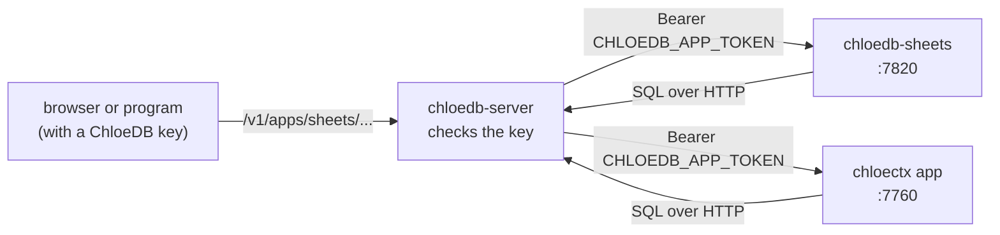

# Apps on a cluster

Some programs built on ChloeDB run beside chloedb-server and show in its command center under **Apps**: the [crawler](../chloedb/crawler.md), which turns a site into a table, [Sheets](../chloedb/sheets.md), spreadsheets whose cells are rows of ChloeDB, and [ChloeCtx](../chloectx/app.md), memory spaces that agents write to and ask for context. Each is a program of its own that talks to the server over HTTP and serves a small API and a view; the server lists it and forwards to it.

This page starts a server with Sheets and ChloeCtx beside it and uses both through the server, the way the command center does.

<!-- run: needs chloedb-server chloedb-sheets chloectx -->

You need `chloedb-server`, `chloedb-sheets` and `chloectx` on your `PATH`. <!-- since 0.3.2 --> From release 0.3.2, the installer puts the three there prebuilt, with nothing to compile:

```sh
# install
curl -fsSL https://chloetech-ai.github.io/chloedb/install.sh | sh -s -- --with sheets,ctx
```

Release 0.3.0 and earlier have no prebuilt Sheets or ChloeCtx. With those, or to build from source, build each in its directory of a checkout of the repository (`cargo build --release`; Rust and a C compiler, several minutes) and add their `target/release` directories to `PATH`.

## How an app attaches

The server learns of an app from `--app name=URL`, and sends each request under `/v1/apps/<name>/` on to it with a token of its own, `CHLOEDB_APP_TOKEN`, in place of the caller's key. Callers never reach an app directly: the server checks their key first (read scope to read, admin to change anything), and an app refuses requests that do not carry the token.



The apps keep everything in the server's tables, so a restart, or another copy of the app, finds it all there.

## Start a server and two apps

One token for the apps, a server that lists both, and the two apps pointed at the server:

```sh
export CHLOEDB_APP_TOKEN=$(python3 -c 'import secrets; print(secrets.token_hex(16))')

chloedb-server --db ./apps.chloedb --listen 127.0.0.1:7700 --grpc off --start-apps off \
  --app sheets=http://127.0.0.1:7820 --app chloectx=http://127.0.0.1:7760 > server.log 2>&1 &
until curl -sf http://127.0.0.1:7700/v1/health > /dev/null; do sleep 0.2; done

chloedb-sheets serve --server http://127.0.0.1:7700 --token "$CHLOEDB_APP_TOKEN" > sheets.log 2>&1 &
chloectx app --server http://127.0.0.1:7700 --token "$CHLOEDB_APP_TOKEN" --embedder hash:64 > chloectx.log 2>&1 &
```

`--start-apps off` keeps the server from starting the apps installed beside it on its own (it does by default, which is all a first run needs; this page starts them by hand to show how they attach). `--embedder hash:64` makes ChloeCtx's vectors from hashed words, which needs no download; leave it out to use its embedding model (`chloectx fetch-model` fetches it once). Without `--token` the server listens on loopback only and anything on this machine that reaches `127.0.0.1:7700` can change it; give it a token, and its clients keys, before it serves anyone else ([security](../chloedb/server.md#security)).

The server lists the apps once they answer, which is what the command center's **Apps** menu shows:

```sh
until curl -sf http://127.0.0.1:7700/v1/apps | python3 -c 'import json, sys; sys.exit(0 if all(a.get("up") for a in json.load(sys.stdin)["apps"]) else 1)'; do sleep 0.3; done
curl -s http://127.0.0.1:7700/v1/apps | python3 -c '
import json, sys
for app in json.load(sys.stdin)["apps"]:
    print(app["name"], "|", app["title"], "|", app["description"])'
```

```text output
sheets | Sheets | Spreadsheets kept in ChloeDB: formulas, charts and pivots, xlsx, CSV and SQLite in and out, and the cluster's tables as sheets
chloectx | ChloeCtx | Memory spaces any agent writes to and asks for context, by search alone; and Seen before: the cluster's firing alerts beside the past incidents they look like
```

Open `http://127.0.0.1:7700` in a browser to use them; the rest of this page drives them from a script.

## Sheets: a workbook with a formula and a query

A small client for the apps' APIs through the server:

```python file=apps.py
import json
import urllib.request

SERVER = "http://127.0.0.1:7700"


def call(app, path, body=None):
    """A request to an app, through the server."""
    req = urllib.request.Request(
        f"{SERVER}/v1/apps/{app}{path}",
        data=None if body is None else json.dumps(body).encode(),
        headers={"content-type": "application/json"},
        method="GET" if body is None else "POST",
    )
    with urllib.request.urlopen(req) as r:
        return json.load(r)
```

A workbook of sales by region with a total, saved as a table of the server, then a SQL query of that table written into the sheet:

```python
from apps import call

book = call("sheets", "/v1/books", {"name": "Sales"})["id"]
call("sheets", f"/v1/books/{book}/ops", {"ops": [
    {"op": "set_many", "sheet": 0, "row": 1, "col": 1, "values": [
        ["Region", "Sales"], ["North", "10"], ["South", "32.5"], ["East", "7"], ["Total", "=SUM(B2:B4)"]]},
]})
call("sheets", f"/v1/books/{book}/to-table", {"sheet": 0, "table": "regions", "key": "region"})
call("sheets", f"/v1/books/{book}/query", {
    "sheet": 0, "row": 8, "col": 1,
    "sql": "SELECT region, sales FROM regions WHERE sales > 8 AND sales < 40 ORDER BY sales DESC"})

# Each cell is [row, column, what it shows, ...].
shown = {(c[0], c[1]): c[2] for c in call("sheets", f"/v1/books/{book}/cells?sheet=0&r0=1&r1=10&c0=1&c1=2")["cells"]}
for row in range(1, 11):
    if (row, 1) in shown:
        print(row, shown[(row, 1)], shown.get((row, 2), ""), sep=" | ")
```

```text output
1 | Region | Sales
2 | North | 10
3 | South | 32.5
4 | East | 7
5 | Total | 49.5
8 | region | sales
9 | South | 32.5
10 | North | 10
```

The total is a formula, computed by IronCalc; the rows from row 8 are the query's answer, and **Refresh** in the view (or `POST /v1/books/<id>/refresh`) runs it again when the table changes. The workbook's cells are themselves rows of the server, so the server can search every workbook at once.

## ChloeCtx: a memory space and its context

A space is a table of the server, `ctx_<space>`, that agents write notes to and ask for context within a budget of tokens. A decision, then a newer one that replaces it:

```python
import datetime as dt
from apps import call

def ts(when):
    """A note's time, in Unix seconds (left out, it is now)."""
    return int(dt.datetime.fromisoformat(when).replace(tzinfo=dt.timezone.utc).timestamp())

call("chloectx", "/v1/spaces", {"name": "billing", "title": "Billing"})
old = call("chloectx", "/v1/spaces/billing/notes", {"kind": "decision", "ts": ts("2026-09-01T10:00"),
                                                    "text": "Refunds above 500 EUR need a team lead's approval."})
call("chloectx", "/v1/spaces/billing/notes", {
    "kind": "decision", "replaces": old["id"], "ts": ts("2026-10-15T09:00"),
    "text": "Refunds above 1000 EUR need the finance manager's approval; team leads approve up to 1000 EUR."})
call("chloectx", "/v1/spaces/billing/notes", {"kind": "fact", "ts": ts("2026-10-20T12:00"),
                                                "text": "Refunds are paid back to the original card within 5 working days."})

answer = call("chloectx", "/v1/spaces/billing/ask", {"question": "a customer wants a 700 EUR refund, who approves it?", "budget": 500})
print(answer["tokens"] <= 500)
print(answer["context"])
```

```text output
True
Notes from earlier conversations with the user, in their current versions, oldest first (date, kind, note; what it replaced in brackets). Rules that apply come first; a later note can change what an earlier one says:
- 2026-10-15 decision: Refunds above 1000 EUR need the finance manager's approval; team leads approve up to 1000 EUR. (changed 2026-10-15; was: Refunds above 500 EUR need a team lead's approval.)
- 2026-10-20 fact: Refunds are paid back to the original card within 5 working days.
```

The context holds the current decision and says what it replaced; the old one is left out. No model is called to answer: it is a BM25 and vector search under the space's rules ([how ChloeCtx searches](../chloectx/index.md)).

## The crawler

The crawler attaches the same way (`--app crawler=URL`), and `chloedb-crawl serve --local DIR` starts a cluster with it already listed. [Crawl a site into search](crawl-to-search.md) runs it end to end.

## On Kubernetes

A cluster the operator runs gets each app from a field of its `StrataCluster`: `spec.crawler`, `spec.sheets`, `spec.chloectx`, `spec.netops` ([network operations](../chloedb/netops.md)) and `spec.apps` (the app engine, a prototype). The operator runs them from the cluster's own image and lists them on its coordinators, with nothing to start by hand ([server on Kubernetes](../chloedb/server.md#on-kubernetes)).
