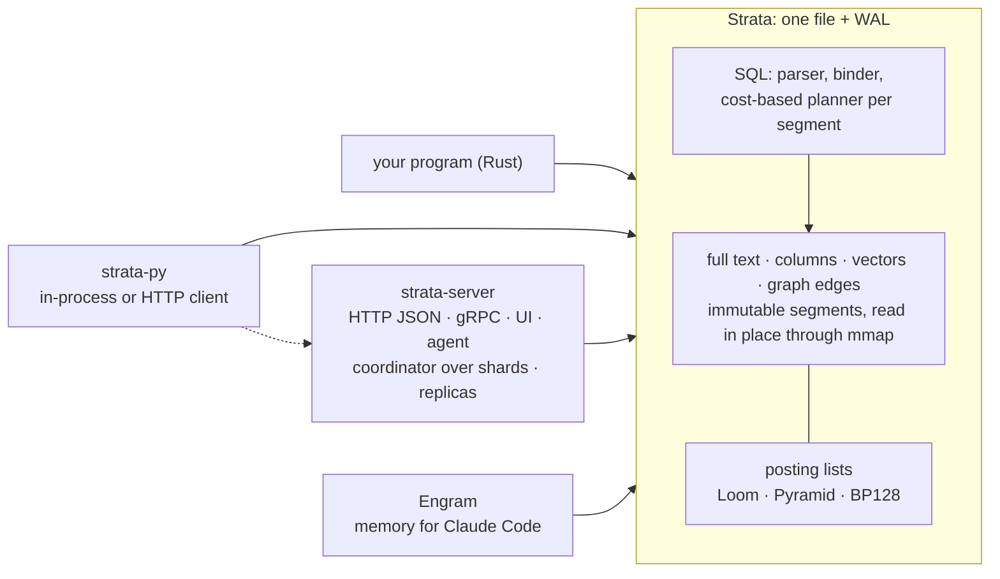
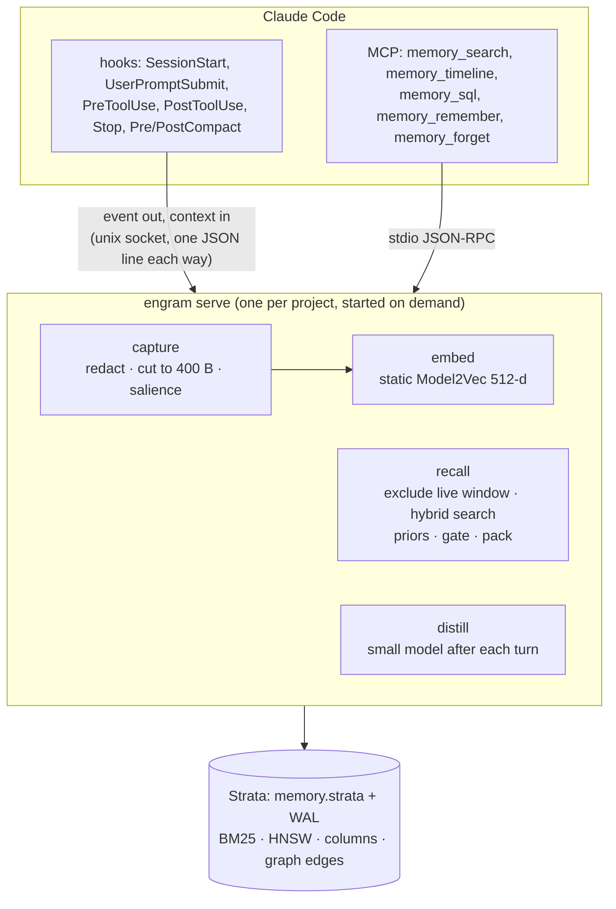

# Strata
{: .fs-9 }

An embedded search database with SQL: full text, structured columns, vectors and graph edges in one file, combined in one query by one planner.
{: .fs-6 .fw-300 }

[How Strata works](strata/index.md){: .btn .btn-primary .mr-2 } [Query language](strata/query-language.md){: .btn .mr-2 } [Server](strata/server.md){: .btn .mr-2 } [Python](strata/python.md){: .btn .mr-2 } [Source on GitHub](https://github.com/rkonow/strata){: .btn }

---

Strata is to search what SQLite is to relational data: a library that keeps a whole database in one file, needs no server or configuration, gives ACID transactions with snapshot isolation, and is queried with SQL. Every table is indexed three ways at once (posting lists for full text, a columnar forward index for structured fields, and vector indexes), rows can hold typed, weighted edges to other rows, and a cost-based planner chooses, per segment and from exact statistics, how to run each part of a statement. A database holds several tables, and queries join them.

This repository holds Strata, the pieces around it, and Engram, an application built on it.

| part | what it is | read more |
|---|---|---|
| **Strata** | The embedded, single-file database: ACID transactions, SQL, full text, structured columns, vectors and graph edges over the same rows, and a cost-based planner over all of it. SQLite databases import into it and it exports to SQLite. | [Design](strata/index.md) · [SQL](strata/query-language.md) · [Graphs](strata/graphs.md) · [SQLite](strata/sqlite.md) · [Results](strata/results.md) |
| **strata-server** | Strata over HTTP JSON and gRPC, with a query-builder UI and an agent that answers questions with SQL. Shards behind a coordinator answer like one database, and a primary ships its writes to replicas. | [Server](strata/server.md) |
| **strata-py** | Strata from Python: a database inside the process, the way `sqlite3` runs SQLite, or a client of strata-server with the same methods. | [Python](strata/python.md) |
| **Strata's posting lists** | A study of compressed posting lists and their intersection and union algorithms, which produced three new formats. Strata's text and keyword indexes use two of them. | [Posting lists](posting-lists.md) |
| **Engram**, built on Strata | Long-term memory for Claude Code. Hooks store every event of a session in a Strata file per project; a per-project daemon decides when to bring history back, and MCP tools let the model search it. | [How it works](engram/index.md) · [Install](engram/setup.md) · [Inspector](engram/inspector.md) · [Results](engram/results.md) · [Why Engram](why/) |

## One query

```sql
SELECT id, title, score() FROM docs
WHERE MATCH(body, 'vaccine AND (mrna OR "messenger rna") -animal')
  AND year BETWEEN 2019 AND 2021 AND category IN ('c01', 'c02')
ORDER BY 0.2 * minmax(bm25(body, :text)) + 0.8 * minmax(similarity(emb, :q)) DESC
LIMIT 10;
```

Boolean full text, structured filters and a weighted hybrid of BM25 and vector similarity, planned together over one file. Graph traversal joins the same statement:

```sql
SELECT id, hops() FROM papers
WHERE REACHABLE(cites, (SELECT id FROM papers ORDER BY similarity(emb, :q) DESC LIMIT 5), hops => 2, dir => 'both')
  AND year >= 2018
ORDER BY similarity(emb, :q) DESC LIMIT 20;
```

The [query language](strata/query-language.md) page is the reference: scores and rank fusion, typo-tolerant and synonym searches, aggregates, subqueries, `WITH` and joins, graphs, writes and `EXPLAIN`.

## How it fits together



A statement is parsed and bound into a predicate tree and a scorer; the planner picks, per segment and from exact statistics, how to evaluate each part (MaxScore or Block-Max WAND for text, range scans or postings for structured fields, an exact scan, IVF or HNSW with the filter inside for vectors); operators read zero-copy views of the segment's sections, and per-segment results are merged. [Strata's design](strata/index.md) covers the file format, transactions, every index and the planner.

## Headline results

<div class="table-wrapper" markdown="1">

| question | answer |
|---|---|
| Is Strata fast? | Warm BM25 **1.7–3.2×** faster than Tantivy, and 24 of 28 text and filter comparisons won; vector top-10 in **0.05–0.10 ms** at recall@10 0.99 on Quora. |
| Does the planner earn its keep? | On filtered vector search it is **1.8–6.1×** faster than the best fixed strategy, at recall@10 0.991–0.998. |
| Do graph edges help search? | Following the citations of the two nearest papers doubles nDCG@20 on arXiv (0.123 → 0.253). |
| What do the new posting lists buy? | Loom is the size of partitioned Elias-Fano with **2.4–3.0×** faster AND and 3.8–7.7× faster OR. |

</div>


## Engram: an application of Strata

A coding agent's context window is its whole working memory. When a long session fills it, Claude Code *compacts*: it replaces the history with a summary of about 15,000 characters. The plan survives; the particulars do not. Exact error messages, the reason an approach was dropped, and a rule the user stated once three hours earlier all go. A new session starts with almost nothing.

Engram keeps all of it in a Strata file per project and brings back what a prompt needs. Strata answers every question Engram asks with SQL: recall is two searches (BM25 and vectors) under a filter that excludes what the model can still see, the briefing is a handful of structured queries, and the model's `memory_sql` tool is Strata's SQL itself, read-only.

[How Engram works](engram/index.md){: .btn .btn-primary .mr-2 } [Install it](engram/setup.md){: .btn .mr-2 } [Why Engram](why/){: .btn }


*A fresh Claude Code session, asked what storage was chosen earlier and why, answers from the briefing Engram injected at session start. Right: the records the hooks wrote and the knowledge a small model distilled from the previous session. See [the live inspector](engram/inspector.md).*

[Try the inspector in your browser](demo/inspector.html){: .btn .btn-primary } It replays a recorded session, and every panel queries the recorded store with Strata's SQL, run by a JavaScript model of Strata.



<div class="table-wrapper" markdown="1">

| question | answer |
|---|---|
| Does Claude Code do better with Engram on work that depends on earlier sessions? | **100 of 100** held-out tasks solved with Engram against **60 of 100** without; all of the gap is on facts that were only said in conversation (60/60 vs 20/60), p < 0.0001. |
| After a compaction, do the lost details come back? | **13 of 15** automatically, 14 with one search. None were in the summary. |
| Can a new session answer questions about a 26-hour history? | **8 of 8** with Engram, **0 of 4** without. |
| How good is retrieval on a public benchmark? | LongMemEval-S: evidence in the top 10 for **90%** of questions; inside the default 4,000-character injection for 87%. |
| What does it cost per prompt? | **14–26 ms** for a full hook at 10k–1M records, most of it starting the hook process; a million records take 3.1 GB. |

</div>

For the short version, with the week-long Kestrel benchmark and its cost comparison, read [the Engram showcase](engram-showcase.md).

## Full reports

Each project also has a long-form report with interactive charts, formulas and every table. They are published alongside these pages:

- [Strata: the database and its evaluation](reports/strata.html)
- [Strata graphs](reports/graph.html)
- [Posting lists: formats and algorithms](reports/posting-lists.html) and [the three new designs](reports/posting-list-designs.html)
- [Engram: the memory system](reports/engram.html)
- [Engram: what a record should be](reports/structure.html)

## Where the numbers come from

Every figure on these pages comes from the experiments committed in this repository (`*/results/`). The timings were measured on a MacBook Air with an Apple M2 (8 cores, 24 GB), replacing earlier runs on a 4-core cloud VM; the runs that call a model are the original ones. [Reproducing the results](reproduce.md) compares the two machines and has the commands.

The repository was called `rkonow/engram`, and this site `rkonow.github.io/engram`, until October 2026.
