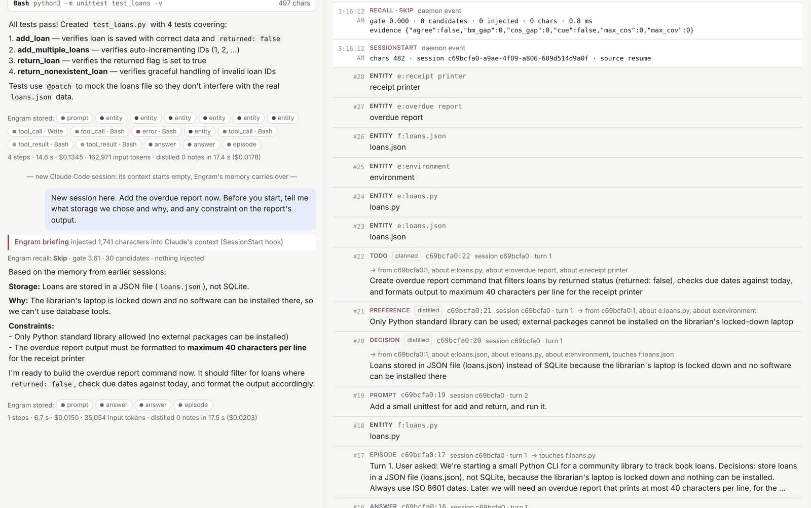
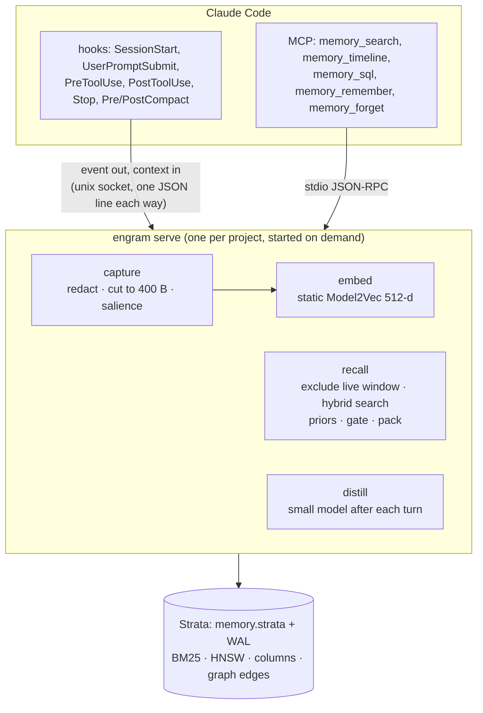
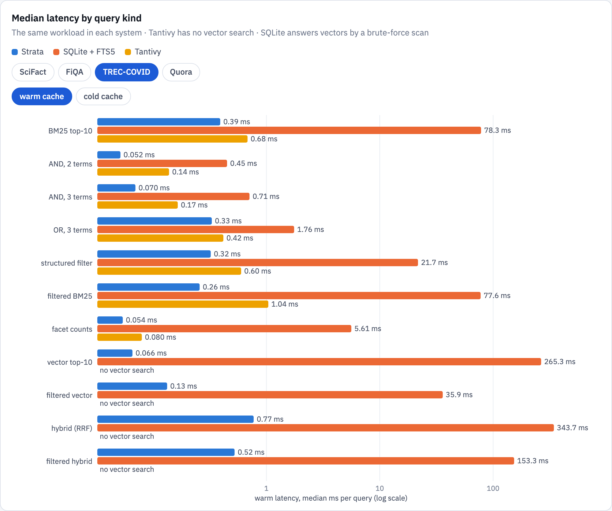

# Engram
{: .fs-9 }

Long-term memory for coding agents, built on Strata, an embedded search database with SQL.
{: .fs-6 .fw-300 }

[How Engram works](engram/index.md){: .btn .btn-primary .mr-2 } [Strata's query language](strata/query-language.md){: .btn .mr-2 } [Source on GitHub](https://github.com/rkonow/engram){: .btn }

---

A coding agent's context window is its whole working memory. When a long session fills it, Claude Code *compacts*: it replaces the history with a summary of about 15,000 characters. The plan survives; the particulars do not. Exact error messages, the reason an approach was dropped, and a rule the user stated once three hours earlier all go. A new session starts with almost nothing.

This repository holds two projects that together address that problem, Engram built on Strata, and Strata's own study of the posting lists underneath it.

| layer | what it is | read more |
|---|---|---|
| **Engram** | Automatic long-term context for Claude Code. Hooks store every event of a session; a per-project daemon decides when to bring history back, and MCP tools let the model search it. | [How it works](engram/index.md) · [Inspector](engram/inspector.md) · [Results](engram/results.md) |
| **Strata** | An embedded, single-file search database with ACID transactions and SQL. Every table is indexed as full text, structured columns and vectors at once, with graph edges between rows and a cost-based planner over all of it. | [Design](strata/index.md) · [SQL](strata/query-language.md) · [Graphs](strata/graphs.md) · [Results](strata/results.md) |
| **Strata's posting lists** | A study of compressed posting lists and their intersection and union algorithms, which produced three new formats. Strata's text and keyword indexes use two of them. | [Posting lists](posting-lists.md) |

For the short version, with the week-long Kestrel benchmark and its cost comparison, read [the Engram showcase](engram-showcase.md).

*A fresh Claude Code session, asked what storage was chosen earlier and why, answers from the briefing Engram injected at session start. Right: the records the hooks wrote and the knowledge a small model distilled from the previous session. See [the live inspector](engram/inspector.md).*

[Try the inspector in your browser](demo/inspector.html){: .btn .btn-primary } It replays a recorded session, and every panel queries the recorded store with Strata's SQL, run by a JavaScript model of Strata.

## The system

**Strata** answers every question Engram asks with SQL. Recall is two searches (BM25 and vectors) under a filter that excludes what the model can still see. The briefing is a handful of structured queries. The model's `memory_sql` tool is Strata's SQL itself, read-only.

## Headline results

| question | answer |
|---|---|
| Does Claude Code do better with Engram on work that depends on earlier sessions? | **100 of 100** held-out tasks solved with Engram against **60 of 100** without; all of the gap is on facts that were only said in conversation (60/60 vs 20/60), p < 0.0001. |
| After a compaction, do the lost details come back? | **13 of 15** automatically, 14 with one search. None were in the summary. |
| Can a new session answer questions about a 26-hour history? | **8 of 8** with Engram, **0 of 4** without. |
| How good is retrieval on a public benchmark? | LongMemEval-S: evidence in the top 10 for **90%** of questions; inside the default 4,000-character injection for 87%. |
| What does it cost per prompt? | **14–26 ms** for a full hook at 10k–1M records, most of it starting the hook process; a million records take 3.1 GB. |
| Is Strata fast? | Warm BM25 **1.8–4.6×** faster than Tantivy; vector top-10 in **0.09–0.20 ms**; the filtered-vector planner **1.5–5.3×** faster than the best fixed strategy. |
| Do graph edges help search? | Following the citations of the two nearest papers doubles nDCG@20 on arXiv (0.123 → 0.253). |

## Full reports

Each project also has a long-form report with interactive charts, formulas and every table. They are published alongside these pages:

- [Strata: the database and its evaluation](reports/strata.html)
- [Strata graphs](reports/graph.html)
- [Engram: the memory system](reports/engram.html)
- [Engram: what a record should be](reports/structure.html)
- [Posting lists: formats and algorithms](reports/posting-lists.html) and [the three new designs](reports/posting-list-designs.html)

## Where the numbers come from

Every figure on these pages comes from the experiments committed in this repository (`*/results/`). The timings were measured on a MacBook Air with an Apple M2 (8 cores, 24 GB), replacing earlier runs on a 4-core cloud VM; the runs that call a model are the original ones. [Reproducing the results](reproduce.md) compares the two machines and has the commands.
