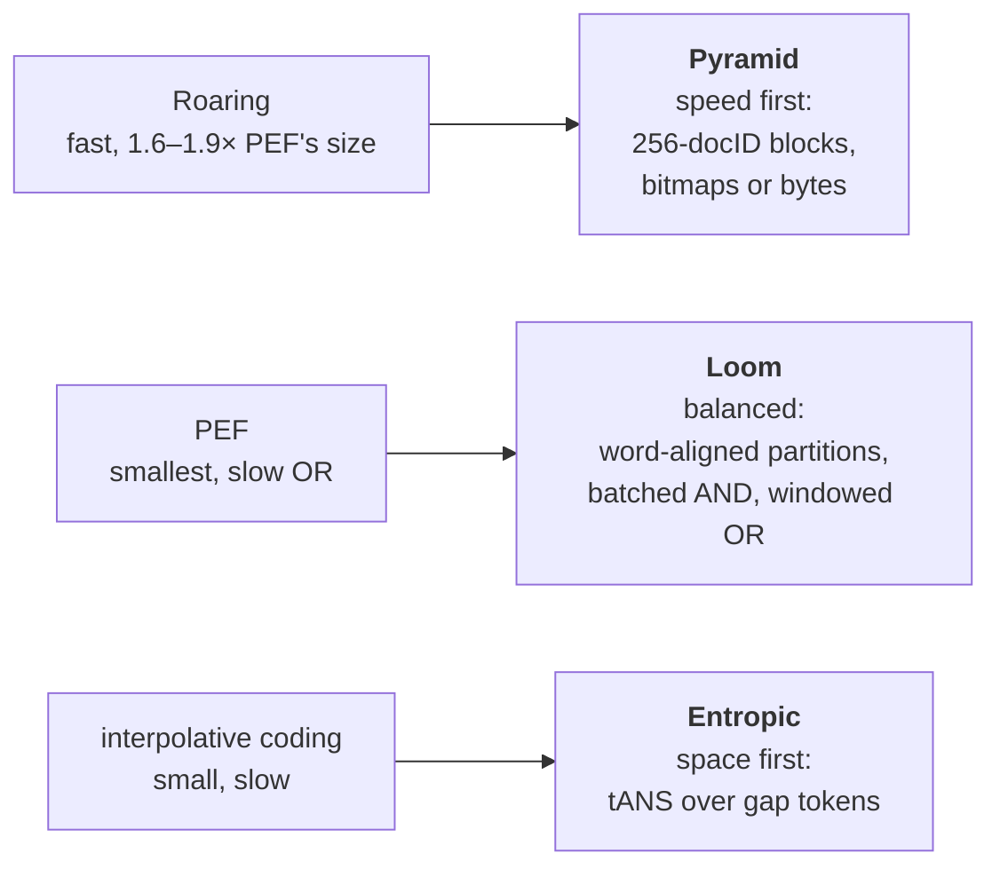
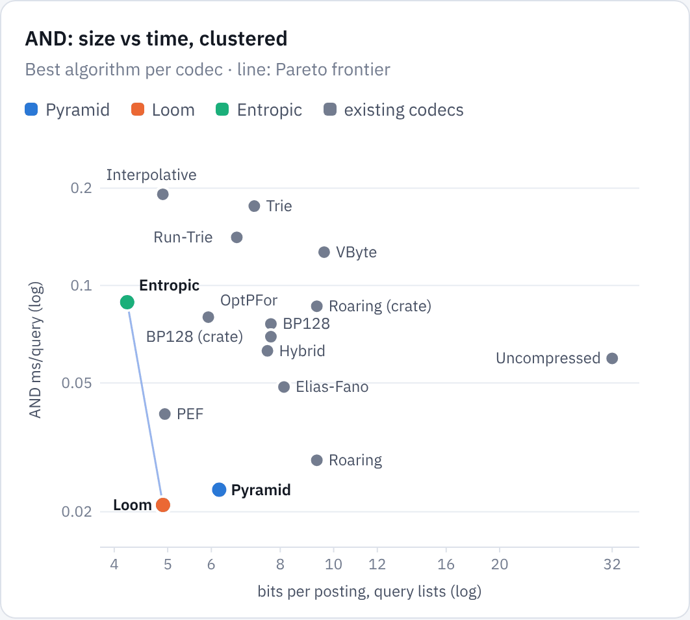
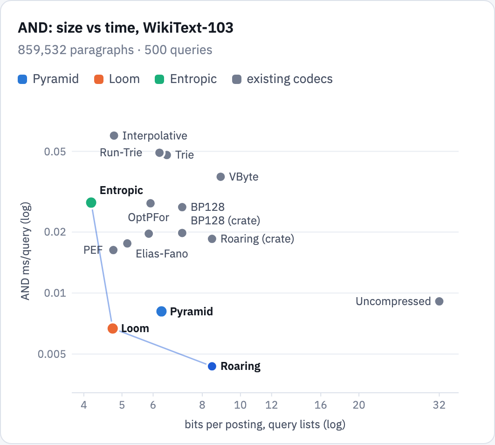
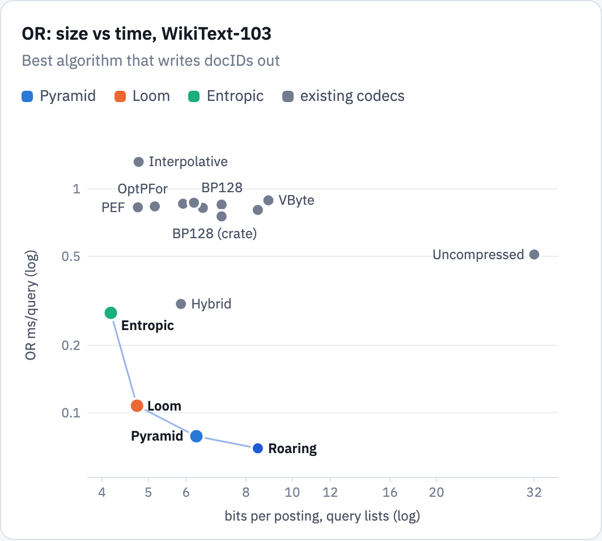
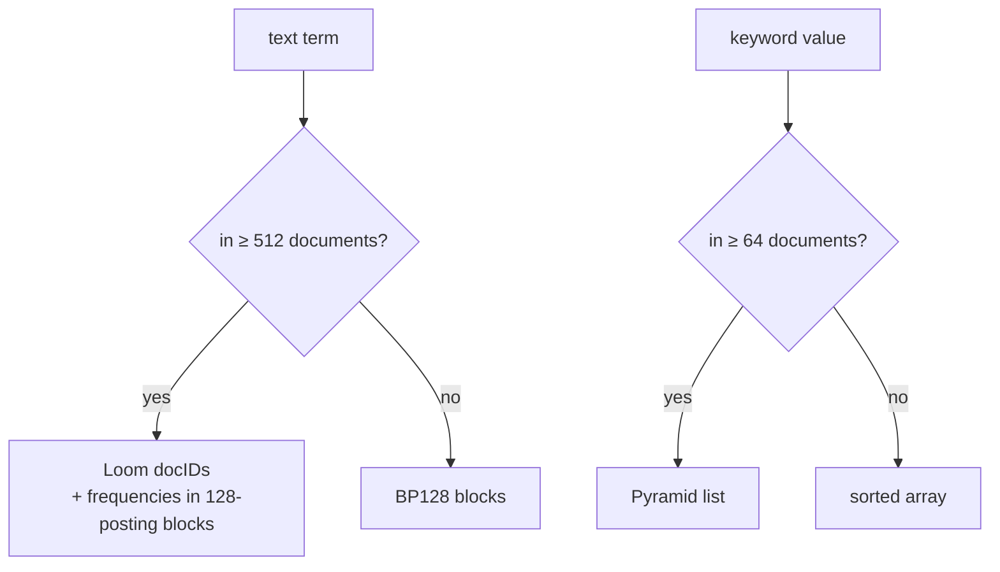

# Posting lists: formats and algorithms
{: .no_toc }

`posting_bench` is a study of compressed posting lists and the algorithms that intersect and unite them. It compares thirteen existing formats on synthetic and real collections, then three new designs built from what the comparison showed: **Pyramid**, **Loom** and **Entropic**. Loom has the size of partitioned Elias-Fano with 1.9–2.2× faster conjunctions and 4.9–8.9× faster unions. Strata's text index stores its long lists as Loom, and its keyword filters as Pyramid.
{: .fs-5 .fw-300 }

1. TOC
{:toc}

## The problem

An inverted index maps each term to the sorted list of documents that contain it. A boolean query is a set operation over those lists: `AND` intersects them, `OR` unites them. Lists are compressed, so the format decides both the index's size and how fast a query can skip through it. Conjunctions spend most of their time in one operation, `NextGEQ(x)`, which moves a cursor to the first docID ≥ *x*; unions spend it writing docIDs out.

Formats fall into three families:

- **Block codecs** (VByte, BP128, OptPFor, binary interpolative coding) encode d-gaps in blocks with a skip table.
- **Succinct codecs** (Elias-Fano, partitioned Elias-Fano, compact tries) answer `NextGEQ` with rank and select instead of decoding. Elias-Fano stores *n* docIDs below *u* in about

  $$
  n\Bigl(2 + \Bigl\lceil \log_2 \frac{u}{n} \Bigr\rceil\Bigr) \text{ bits},
  $$

  and partitioned Elias-Fano (PEF) cuts each list into partitions chosen by dynamic programming, each a run, a bitvector or an Elias-Fano sequence.
- **Bitmaps** (Roaring, a bitmap-and-BP128 hybrid) split the docID space into chunks of 216 and store each as an array, a bitmap or runs, so set operations become word operations.

## The testbed

Every format implements the same traits (build, size, decode; a cursor with `docid()`, `next()` and `next_geq(x)`; optionally native multi-list set operations), and every query result of every algorithm is checked against a reference before it is timed.

| family | codecs |
|---|---|
| baseline | uncompressed `u32` arrays; BP128 and Roaring from the `bitpacking` and `roaring` crates |
| block | VByte, BP128, OptPFor, binary interpolative |
| succinct | Elias-Fano, PEF, compact trie, run-trie |
| bitmap | Roaring (with SIMD kernels), hybrid bitmap + BP128 |
| new | Pyramid, Loom, Entropic |

Algorithms: for two sorted arrays, merge, branch-free merge, galloping, binary search, Baeza-Yates and SIMD block merges; for *k* arrays, SvS, Small Adaptive and Sequential; for *k* cursors, rarest-first leapfrog AND, round-robin AND, heap OR, min-scan OR and a bitset-window OR; for unions of arrays, heap, pairwise fold and bitmap.

**Collections.** A *clustered* synthetic collection that mimics a reordered index (topic regions, runs of consecutive docIDs) and a *uniform* one with random docID order, each 8M documents and 21M postings with Zipf list lengths; and **WikiText-103**, 859,532 paragraphs and 57M postings. Each has 500 queries of 2–4 co-occurring terms. Times are single-threaded, best algorithm per codec, with docIDs written out; sizes are bits per posting over the lists the queries use.

## What the existing formats showed

| codec | clustered bits | clustered AND ms | clustered OR ms | WikiText bits | WikiText AND ms | WikiText OR ms |
|---|---:|---:|---:|---:|---:|---:|
| Uncompressed | 32.00 | 0.061 | 1.86 | 32.00 | 0.022 | 0.561 |
| BP128 | 7.69 | 0.080 | 2.89 | 7.11 | 0.033 | 0.966 |
| OptPFor | 5.92 | 0.088 | 3.00 | 5.91 | 0.037 | 0.898 |
| Elias-Fano | 8.13 | 0.055 | 2.87 | 5.16 | 0.019 | 0.976 |
| PEF | 4.94 | 0.046 | 2.84 | 4.75 | 0.022 | 0.931 |
| Interpolative | 4.90 | 0.181 | 5.00 | 4.77 | 0.081 | 1.62 |
| Roaring | 9.32 | 0.030 | 0.57 | 8.47 | 0.007 | 0.086 |

*Source: `posting_bench/results/`; the full table, with every codec and the uniform collection, is in the [posting_bench README](https://github.com/rkonow/engram/blob/main/posting_bench/README.md).*

- **The skip structure matters more than the gap coder.** Conjunctions spend their time in `NextGEQ`. Elias-Fano's select-based jumps made Elias-Fano or PEF the fastest list codec for AND on every collection, matching or beating uncompressed arrays, though they decode 2.3–2.6× slower than BP128.
- **PEF is the balanced default:** the smallest or within 1% of it everywhere, at 1.5–3.1× Roaring's AND time.
- **Roaring is the speed choice,** especially for unions: the fastest AND on every collection and 4.5–10× faster OR than the best list codec, because ORing words beats merging docIDs one at a time. It costs 1.6–1.9× PEF's space.
- **SIMD only where sizes are similar.** Block-compare kernels are 4.4× faster than a scalar merge on equal-size lists, but galloping wins beyond about a 1:24 size ratio, and real conjunctions are skewed.
- **Reorder docIDs.** Clustering cut PEF, interpolative coding, Roaring and the tries by 32–50% and roughly halved conjunction time for list codecs.
- **Implementation quality changes the ranking.** Two Roaring implementations with byte-identical containers differ by 2.9× on AND and 7.5× on OR.

That left a gap: nothing was both as small as PEF and as fast as Roaring. Each new design aims at one corner of it.

## Three new designs

### Pyramid

*Speed first: make every membership test O(1) at every density, and every set operation local to a 256-docID block.*

Roaring's two costs on these workloads are the mid-density chunk (either a 16-bit-per-value array or an 8 KiB bitmap, with nothing in between) and the skewed probe into a large array chunk. Pyramid adds one level. Each 216 chunk is split into 256 blocks of 256 docIDs and stored as one of three kinds: *Small* (a sorted `u16` array of at most 48 values), *Tiered* (present and dense masks, a 256-bit bitmap per dense block, and the low bytes of the other values grouped by block) or *Flat* (all 256 block bitmaps). A block becomes a bitmap when that is no larger than its sparse form at about 9 bits per value:

$$
\text{dense}(B) \iff 256 \le 9\,\lvert B \rvert \iff \lvert B \rvert \ge 29
$$

A probe reads one mask bit, then either one bitmap bit or a handful of bytes. Conjunctions drive small chunks value by value and join larger ones block by block (dense blocks with a 4-word AND, sparse blocks with byte compares); unions accumulate dense groups in a 65,536-bit buffer that touches only present blocks.

### Loom

*Balanced: keep PEF's size, but line dense partitions up on machine words and replace posting-by-posting cursor merging with partition-native algorithms.*

Bit *i* of a bitvector partition with base *b* is docID 64⌊*b*/64⌋ + *i*, so the bitvectors of any two lists share the docID word grid and can be ANDed or ORed word by word. The partitioning dynamic program runs on a 16-posting grid (PEF uses 32) and divides bitvector cost by λ = 5/4:

$$
C(j) = \min_{\substack{i < j \\ j - i \le 4096}} \Bigl[ C(i) + 64 + \min\Bigl\{ \tfrac{1}{\lambda}\,\mathrm{BV}(i,j),\ \mathrm{EF}(i,j) + 12,\ \mathrm{RUN}(i,j) \Bigr\} \Bigr]
$$

The finer grid saves about 1%, and the bias spends it again on bitvectors, which probe in O(1) and OR word-wise, so the total stays at or just below PEF's size.

A conjunction decodes the shortest list in batches of 256 candidates, and every other list filters the batch in place, rarest first, stopping once it is empty. A bitvector partition filters with a branch-free bit test, a run with a range check, and an Elias-Fano partition by a mode chosen from ρ, its postings per candidate over the candidates' range:

$$
\text{mode}(\rho) =
\begin{cases}
\text{merge: decode the range, SIMD } 16{\times}16 \text{ block intersection} & \rho \le 12 \\
\text{far probes: an independent select per candidate} & \rho \ge 64 \\
\text{forward probes: 2–4 interleaved branch-free streams} & \text{otherwise}
\end{cases}
$$

A union walks the docID space in windows of 216, ORs bitvectors word-wise, fills runs, decodes Elias-Fano postings with SIMD and sets them as bits, then extracts the window.

### Entropic

*Space first: model the gap stream instead of bounding it.*

Each block of 128 postings codes its gaps as one of 64 tokens (gaps 0–3 exactly; larger gaps as their bit width plus the bit below the leading one, with the remaining bits raw). Token *t*i is coded with context-switching tANS in the context of *t*i−2, so the size of a list approaches the conditional entropy of its token stream:

$$
\lvert \mathrm{enc}(\mathcal{L}) \rvert \approx \sum_i -\log_2 p_{c(t_{i-2})}(t_i) + \sum_i \max(0, w_i - 2) + \lvert \text{model} \rvert + \lvert \text{skip} \rvert
$$

Conditioning on the token two back instead of one costs about 0.02 bits per posting but splits the stream into two independent chains, which two interleaved tANS lanes decode in parallel. Models are per list, shared and parametric, or a zero-cost geometric fit, whichever is smallest; an Elias-Fano skip table over block maxima keeps blocks skippable.

## Results

Same collections, query generator and harness as the first round, rerun together with the existing codecs:

| codec | clustered bits | clustered AND ms | clustered OR ms | uniform bits | WikiText bits | WikiText AND ms | WikiText OR ms |
|---|---:|---:|---:|---:|---:|---:|---:|
| PEF | 4.94 | 0.040 | 2.99 | 8.08 | 4.75 | 0.018 | 0.920 |
| Interpolative | 4.90 | 0.191 | 5.03 | 8.52 | 4.77 | 0.087 | 1.49 |
| Roaring | 9.32 | 0.029 | 0.538 | 13.70 | 8.47 | **0.007** | 0.083 |
| **Pyramid** | 6.20 | 0.023 | **0.308** | 10.47 | 6.30 | 0.010 | **0.068** |
| **Loom** | 4.90 | **0.021** | 0.509 | 8.01 | 4.74 | 0.010 | 0.104 |
| **Entropic** | **4.22** | 0.089 | 1.31 | **7.60** | **4.18** | 0.039 | 0.424 |

*Source: `posting_bench/results/designs/`.*

On 8 of the 10 size/time frontiers (AND and OR on five workloads), every point is a new design. Roaring keeps the fast end of AND on uniform and WikiText.

On the clustered collection the old codecs drop off both frontiers. Loom answers conjunctions faster than Roaring (0.021 against 0.029 ms) and unions slightly faster (0.509 against 0.538 ms) at 53% of its size, the result the first round said was out of reach for a list codec.

On WikiText-103 the lists are denser and queries more skewed (the shortest list has a median of 288 postings). Loom sits at PEF's size with 1.9× faster conjunctions and 8.9× faster unions; Pyramid has the fastest union at 26% less space than Roaring, and Roaring keeps the fastest conjunction.

### Verdict

| design | met | missed |
|---|---|---|
| **Pyramid** vs Roaring | 24–33% smaller; the fastest union on every workload (1.2–1.75× Roaring); faster conjunctions on clustered and selective queries | conjunctions on uniform (11% more time) and WikiText (38% more), where probes into mid-density sparse blocks cost more than Roaring's gallop through one array |
| **Loom** vs PEF | PEF's size with 1.9–2.2× faster conjunctions and 4.9–8.9× faster unions; on all ten frontiers; fastest conjunction for selective and five- or six-term queries | the stretch goal of beating Roaring everywhere: on uniform and WikiText it takes 9–37% more time on AND and 25–54% more on OR, while Roaring is 1.7–1.8× its size |
| **Entropic** vs interpolative and PEF | the smallest serialized index on every collection, 11–14% below interpolative coding and 6–15% below PEF, 2–4× faster than interpolative coding | not smaller in memory: decode tables add 1.3–22 MB at load time; conjunctions about 2× slower than PEF's; builds 13–19× slower |

**Which one to use.** Loom as the default: it replaces PEF outright and takes at most 1.37× Roaring's conjunction time at 53–58% of its size. Pyramid where unions dominate or memory is less tight, as in facets, filters or OR-heavy candidate generation. Entropic for cold or storage-bound tiers, once its decode tables are built on demand.

## In Strata

Strata's [text index](strata/index.md#full-text) keeps Loom for long lists, adding term frequencies addressed by posting rank and per-block maximum scores for top-k. On BEIR, against BP128 for every list, it is 2–4% smaller with 7.6–12× faster conjunctions ([Strata results](strata/results.md#posting-formats-and-top-k)). Keyword values use Pyramid, whose unions and count-only intersections serve `IN` filters and facet counts.

## Limitations

- **One machine.** A shared cloud VM with an Emerald Rapids Xeon (AVX-512, no VP2INTERSECT). Small timings vary by up to about 15% between runs, so differences under 10% are not significant.
- **AVX-512 kernels.** Pyramid and Loom have a scalar twin for every SIMD kernel, compiled when the target lacks the features, but only the AVX-512 builds were timed.
- **Tuned on these data.** Thresholds such as 29 values per dense block, Pyramid's bias toward Flat chunks and Loom's λ = 5/4 were chosen while profiling these collections.
- **Boolean, static, single-threaded.** No scoring or top-k inside the study, no updates, one core. Queries come from a generator of co-occurring terms rather than a real query log.

## Reports

- [Posting lists: formats and algorithms](reports/posting-lists.html), the first round with every codec and algorithm.
- [The three new designs](reports/posting-list-designs.html), with layouts, diagrams and every frontier.
- [Reproducing the results](reproduce.md#posting_bench) has the commands.
