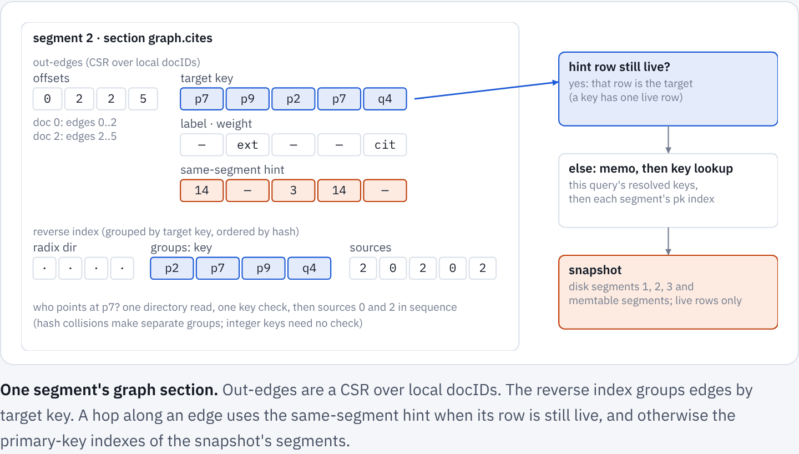
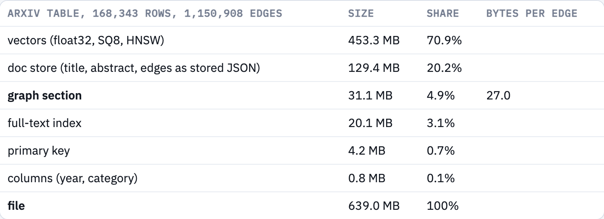
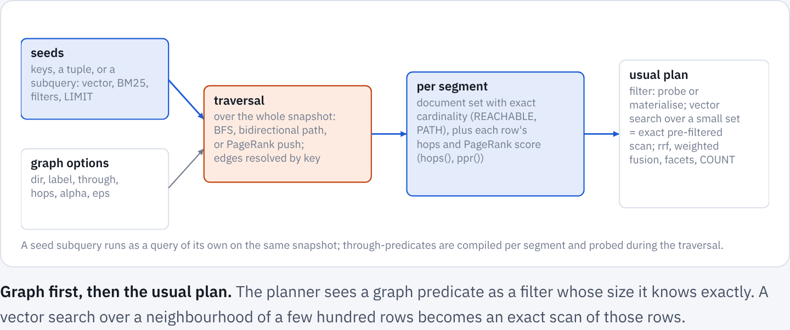
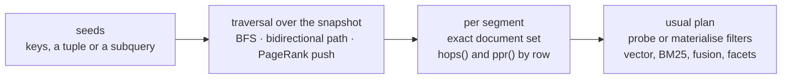
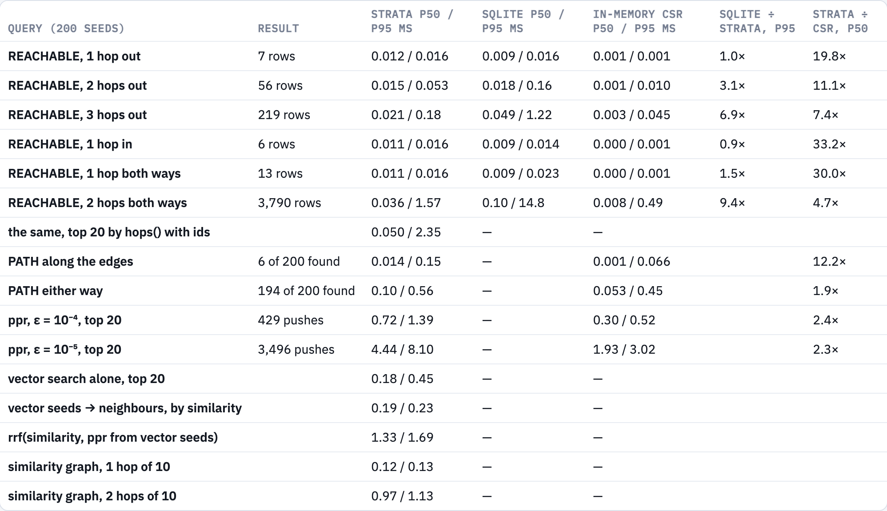
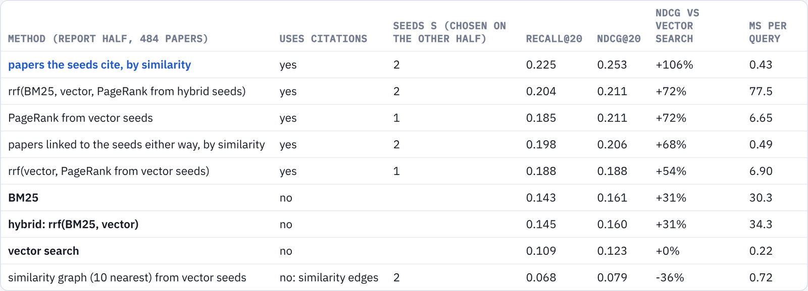
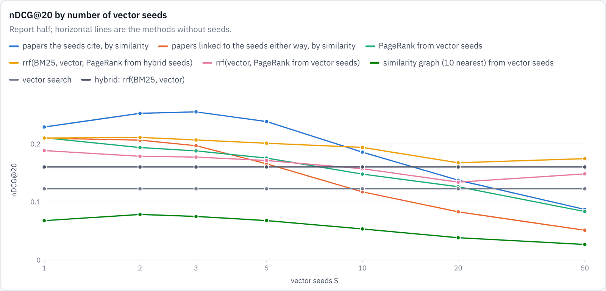

# Graphs in Strata
{: .no_toc }

Rows can link to other rows. A traversal, a shortest path or personalized PageRank runs in the same SQL statement as BM25, filters and vector search, and can start from any of them. On arXiv, the papers cited by a new paper's two nearest neighbours find twice as many of its references as vector search alone. A graph built from the vectors themselves does not help.
{: .fs-5 .fw-300 }

1. TOC
{:toc}

## Rows are nodes

Graph databases keep nodes and edges in stores of their own. Strata keeps its one table: a row is a node, and an `EDGES` field holds the row's outgoing edges as a JSON array of targets, each a primary key of the same table, optionally with a label and a positive weight.

```sql
-- id KEYWORD PRIMARY KEY, title TEXT, body TEXT, year INT, emb VECTOR(512), cites EDGES
INSERT ... ('p1', 'Attention is all you need', ..., 2017, [...],
            '["p7", ["extends", "p9"], ["refutes", "p11", 0.5]]')
```

Formally, a snapshot *S* holds rows *V* with keys κ : *V* → *K*, and edges

$$
E \subseteq V \times K \times L \times \mathbb{R}_{>0},
\qquad (u, k, \ell, w):\ \text{row } u \text{ points at key } k \text{ with label } \ell \text{ and weight } w
$$

An edge is resolved when a query follows it:

$$
\rho_S(k) = \text{the live row } v \in V \text{ with } \kappa(v) = k, \text{ if there is one}
$$

A key has at most one live row in a snapshot, so ρ<sub>S</sub> is a function. When it has none (the target was deleted, or never existed), the edge dangles and traversals skip it, as a foreign key without a constraint would.

Edges belong to their source row and point at keys, not storage positions. They are written, logged, updated, deleted, merged and snapshotted with the row, and nothing else in the engine had to change. A merge rewrites every docID and an update moves a row to a newer segment, but neither changes a key, so no edge is ever rewritten. The price is a lookup per hop, and most of the engineering below goes into making it cheap.

## Storing edges



Every segment, on disk or built from the memtable, gets one section per indexed `EDGES` field, read in place through `mmap`:

- **Out-edges.** A CSR over local docIDs: offsets, then per edge its source, its target key (an `i64`, or offsets and bytes for string keys), a label code and a weight. Labels and weights are stored only when some edge has one.
- **Reverse index.** Edges grouped by target key, the groups ordered by the key's 64-bit hash under the radix directory of the primary-key index, with each edge's source stored in group order. "Which rows point at key *k*" is one directory read and one key comparison per group, then a sequential read. Integer hashes are a bijection and need no comparison; colliding string keys form separate groups.
- **Same-segment hints.** Per edge, the docID its target had in this segment when the segment was built. Since ρ<sub>S</sub> has one answer, a hinted row that is still live is that answer, and the hop needs no lookup.

A hop from *u* along its edges therefore costs, per edge,

$$
c_{\text{out}} = p_{\text{hint}}\,c_{\text{live}} + (1 - p_{\text{hint}})\Bigl(p_{\text{memo}}\,c_{\text{memo}} + (1 - p_{\text{memo}}) \sum_{i \le j^*} c_{\text{probe},i}\Bigr)
$$

where *p*<sub>hint</sub> is the share of targets built into the same segment and still live, *p*<sub>memo</sub> the share already resolved earlier in the query, and *j*\* the segment where the key is found. A hop against the edges costs one reverse-index probe per segment for *u*'s key, then a liveness check per source. The section takes about

$$
b \approx \underbrace{8}_{\text{target}} + \underbrace{4}_{\text{source}} + \underbrace{4 + 4}_{\text{reverse}} + \underbrace{4}_{\text{hint}} + \frac{8\,\lvert V \rvert + 16\,\lvert K_E \rvert}{\lvert E \rvert}\ \text{bytes per edge}
$$

with *K*<sub>E</sub> the distinct targets. That comes to 27 bytes per edge on arXiv, where the graph is under 5% of the file:



## The SQL

Two predicates, a column and a score join the existing functions. Each takes seeds: a key, a parameter, a tuple of keys, or any subquery over the same table, so a vector search, a BM25 query or a facet filter can be the way into the graph.

```sql
-- papers within two citations of p1, either way, nearest first
SELECT id, title, hops() FROM papers
WHERE REACHABLE(cites, 'p1', hops => 2, dir => 'both') ORDER BY hops(), id LIMIT 20;

-- one shortest path, only through surveys
SELECT id, hops() FROM papers
WHERE PATH(cites, 'p1', 'p9', max_hops => 6, through => kind = 'survey') ORDER BY hops();

-- the way in is a vector search: the papers its two best hits cite, by similarity
SELECT id FROM papers
WHERE REACHABLE(cites, (SELECT id FROM papers ORDER BY similarity(emb, :q) DESC LIMIT 2))
ORDER BY similarity(emb, :q) DESC LIMIT 20;

-- personalized PageRank from hybrid hits, fused with both rankings
SELECT id FROM papers ORDER BY rrf(bm25(body, :t), similarity(emb, :q),
  ppr(cites, (SELECT id FROM papers ORDER BY rrf(bm25(body, :t), similarity(emb, :q)) DESC LIMIT 2), weighted => 1)) DESC LIMIT 20;
```

The functions and their options are listed in the [query language reference](query-language.md#graphs).

## Planning and traversal



A traversal does not respect segment boundaries, so graph computations run first, over the whole snapshot. Seeds are resolved (a seed subquery runs as a query of its own on the same snapshot), and the traversal runs. Its result becomes, per segment, a materialised document set with exact cardinality, plus each row's distance and PageRank score. The planner then sees a graph predicate as a filter whose size it knows exactly: a vector search over a neighbourhood of a few hundred rows becomes an exact scan of those rows.



The traversals:

- **Reachability:** breadth-first search, frontier by frontier, stopping at `max_nodes`.
- **Shortest paths:** bidirectional breadth-first search, always expanding the smaller frontier, forward along the edges or backward against them.
- **Personalized PageRank:** forward push (Andersen, Chung and Lang, 2006). The vector π solves

$$
\pi = \alpha\, e_S + (1 - \alpha)\, \pi W, \qquad W_{uv} = \frac{w_{uv}}{\sum_{x} w_{ux}}
$$

where *e*<sub>S</sub> is the restart distribution over the seeds. Every row has an estimate *p* and a residual *r*, with *r* = *e*<sub>S</sub> at the start, and pushing a row *u* does

$$
p(u) \mathrel{+}= \alpha\, r(u), \qquad r(v) \mathrel{+}= (1 - \alpha)\, r(u)\, W_{uv}\ \ \forall v, \qquad r(u) \leftarrow 0
$$

while some *r*(*u*) ≥ ε·deg(*u*). Each estimate is then within ε·deg(*u*) of π(*u*), and the work is bounded by 1/(αε) pushes whatever the graph's size. A row is queued only once its residual reaches ε, the least any threshold can be. Rows that merely received a little mass are never resolved, and resolving them had been most of the original cost.

## Speed

Two graphs, each queried from 200 random seeds on a warm cache, on one thread of an Apple M2 MacBook Air, through SQL (parsing and planning included; `COUNT(*)`, so that no rows are fetched):

- **arXiv:** 168,343 papers (ogbn-arxiv, less 1,000 held out) with 1,148,979 citations, in two segments.
- **Synthetic:** a power-law graph of 1,000,000 rows and 9,998,469 edges, in four segments. Row *i* links to 10 earlier rows, each the target of a random earlier edge with probability ½ and a uniform earlier row otherwise.

The baselines answer the same queries, and the benchmark checks that every count and path length agrees:

- **SQLite:** an edge table `(src, dst)` as a `WITHOUT ROWID` primary key, an index on `(dst, src)`, and recursive CTEs.
- **CSR:** the same traversal code on two in-memory arrays. This is the lower bound: no keys, no segments, no SQL.



*arXiv, 200 seeds per query. Source: `strata/results/graph/latency_arxiv.json`.*

On the million-row graph (`strata/results/graph/synthetic_1000000.json`; loaded in 2.7 s into a 307 MB file, 27 bytes per edge):

| query (200 seeds) | result | Strata p50 / p95 ms | SQLite p50 / p95 ms | CSR p50 / p95 ms |
|---|---|---|---|---|
| `REACHABLE`, 1 hop out | 10 rows | 0.017 / 0.022 | 0.012 / 0.013 | 0.001 / 0.001 |
| `REACHABLE`, 2 hops out | 108 rows | 0.032 / 0.045 | 0.061 / 0.066 | 0.004 / 0.005 |
| `REACHABLE`, 3 hops out | 890 rows | 0.098 / 0.153 | 0.597 / 0.680 | 0.030 / 0.037 |
| `REACHABLE`, 1 hop in | 8 rows | 0.014 / 0.019 | 0.010 / 0.017 | 0.001 / 0.001 |
| `REACHABLE`, 2 hops both ways | 1,586 rows | 0.104 / 0.468 | 0.471 / 3.26 | 0.019 / 0.110 |
| `PATH` either way | 200 of 200 found | 0.079 / 0.145 | — | 0.025 / 0.071 |
| `ppr`, ε = 10<sup>−4</sup> | 133 pushes | 3.49 / 4.13 | — | 0.66 / 0.80 |
| `ppr`, ε = 10<sup>−5</sup> | 1,020 pushes | 25.6 / 30.1 | — | 5.47 / 6.32 |

**Against SQLite**, one-hop queries cost about the same, roughly 10–15 µs, mostly parsing and planning on both sides. From two hops on, the gap opens, and the tail is where it shows most: two hops both ways on arXiv touch 3,790 rows on average and up to tens of thousands, and their p95 is 1.6 ms in Strata against 14.8 ms in SQLite. The recursive CTE re-expands rows reached at several depths and joins through a B-tree per row, where Strata reads a CSR slice. Shortest paths and PageRank have no practical CTE form.

**Against the CSR**, Strata pays two costs. About 10 µs of SQL per query dominates small traversals. Key resolution dominates large ones: PageRank takes 2.4 times the CSR's time on arXiv and 5.3 times on the million-row graph, because a target outside its own segment is a hash probe into each segment's primary-key index until found, a cache miss each. Three changes found by profiling on the Xeon VM that first ran these benchmarks cut PageRank on the million-row graph from 21.4 to 5.8 ms there (3.5 ms on the M2):

1. reverse groups by key, with the sources stored inline;
2. same-segment hints and a per-query memo;
3. queueing only rows that can pass the push threshold.

## Does the graph help search?

The rows here are nodes with text, vectors and edges at once. The question the engine cannot answer by itself is whether the edges add anything to a search that already has the text and the vectors, and whether edges made from the vectors (each row linked to its nearest rows) add anything.

**The task:** for a new paper, find the papers it cites from its title and abstract. This is citation recommendation, and the same shape as finding the records a new question depends on.

- 1,000 papers of OGB's test split (809 from 2019, 191 from 2020, each citing at least five papers) are held out of the table.
- Each held-out paper's title and abstract is the query. Its references in the table (15.3 on average) are the relevant rows.
- Vectors come from a static embedder (Model2Vec potion-retrieval-32M, 512 dimensions), the same one Engram uses.
- Each method returns 20 papers. Methods that start from vector seeds have one parameter, the number of seeds *S*, swept from 1 to 50. Papers with even ids choose *S* by nDCG@20 (516 queries) and papers with odd ids report it (484 queries), so no reported number was tuned on its own queries.
- Comparisons are paired over the same queries, with a 95% bootstrap interval and a two-sided sign-flip test.

$$
\mathrm{recall@}k = \frac{\lvert R_k \cap T \rvert}{\lvert T \rvert},
\qquad
\mathrm{nDCG@}k = \frac{\sum_{i \le k} \mathbb{1}[r_i \in T] / \log_2(i + 1)}{\sum_{i \le \min(k, \lvert T \rvert)} 1 / \log_2(i + 1)}
$$



*Source: `strata/results/graph/quality_stats.json`. Times are from the quality runs, on the build before the speed changes above; the graph methods are faster now.*

**The graph doubles what vector search finds.** The best method is also the simplest: take the two papers nearest the query, follow their citations, and rank what they cite by similarity to the query. It reaches nDCG@20 0.253 against 0.123 for vector search (+0.130, 95% interval 0.111–0.149, p < 0.0001), 0.161 for BM25 and 0.160 for hybrid search, in 0.4 ms. Papers on the same topic cite the same work, and the nearest papers' reference lists are a better candidate set than the nearest papers themselves.

PageRank from the same seeds reaches 0.211 at its best (from one seed), below the plain one-hop expansion: on this graph the papers two or three hops away dilute the direct citations. Fusing PageRank with the vector ranking lowers it to 0.188, because the vector ranking's own top results are mostly not references. Fusing BM25, vectors and PageRank from hybrid seeds also reaches 0.211, at the cost of BM25 over long queries (77 ms).



**Fewer seeds are better.** With more seeds, the citations of papers less similar to the query crowd out those of the nearest ones. In a first version of the experiment the seeds themselves stayed in the candidate set; ranked by similarity they took the top places, and from 20 seeds on the "graph" method returned exactly the vector search's results. Every graph method above removes the seeds with `NOT REACHABLE(cites, seeds, hops => 0, min_hops => 0)`.

**A graph made of vectors adds nothing.** A `VECTOR` field can be traversed as a graph, each row's 10 most similar rows being its neighbours. On this task it returns what vector search already found when the seeds are kept (recall@20 0.112 against 0.111 at 10 seeds, on all queries), and is worse when they are removed (nDCG@20 0.079). A similarity graph only re-expresses the vector space, while citations carry information the text does not. Rows with vectors are useful as the way into a graph of real relations, not as a replacement for one. The implicit similarity graph stays in Strata for exploratory queries, at 0.12 ms per hop of 10 neighbours.

## Limits and next steps

- **One quality task, one embedder.** With a stronger embedder, vector search would score above 0.123 and the relative gain over it would likely shrink. The gains over BM25 (+57%) and hybrid search (+58%) are the more robust numbers.
- **Cross-segment hops cost lookups**, two to five times the in-memory CSR on these graphs. A snapshot-wide resolved CSR, rebuilt when the segment set changes, would close the gap for read-mostly tables; merging into fewer segments narrows it today.
- **No patterns.** There is no multi-hop pattern matching with a predicate per step; `through` and labels cover one constraint per traversal. SQL/PGQ's `MATCH` would be the standard syntax for more.
- **Unweighted paths.** Weights are used by PageRank only.
- **Engram.** Its records have natural edges the store does not keep yet: a distilled note to the turn it came from, a superseded decision to its replacement, an error to the edit that fixed it. The arXiv result suggests the pattern to try (recall's best hits as seeds, then the records linked to them), but Engram's earlier study found that widening a hit to its neighbouring records gained little, so this needs its own measurement first.

The full report, with every table, is [Strata graphs](../reports/graph.html). [Reproducing the results](../reproduce.md#strata-graphs) has the commands.
