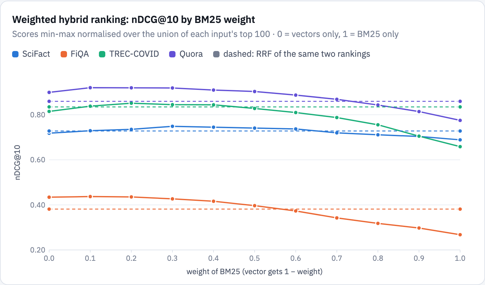
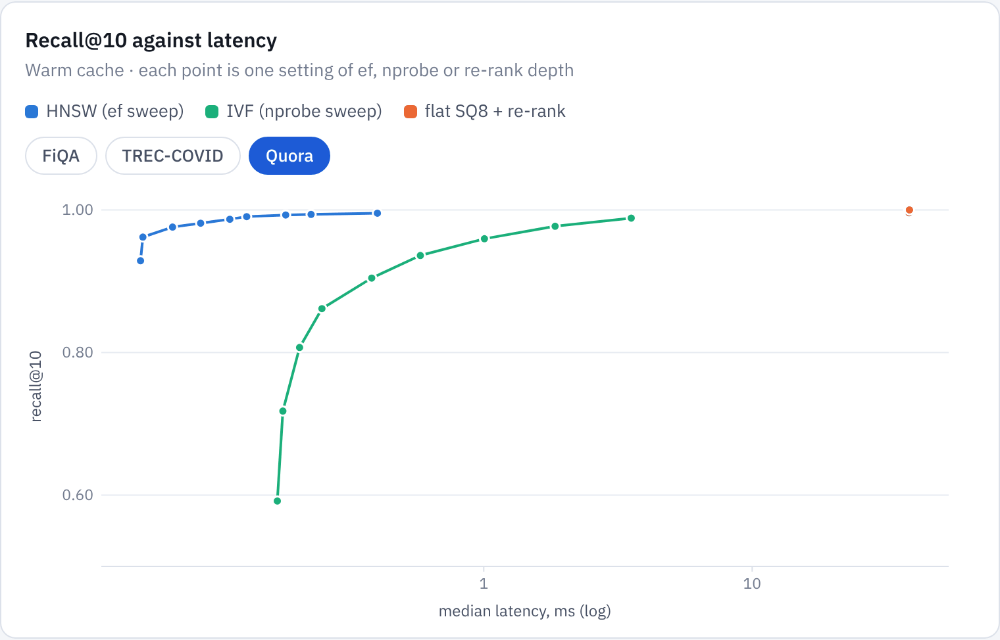
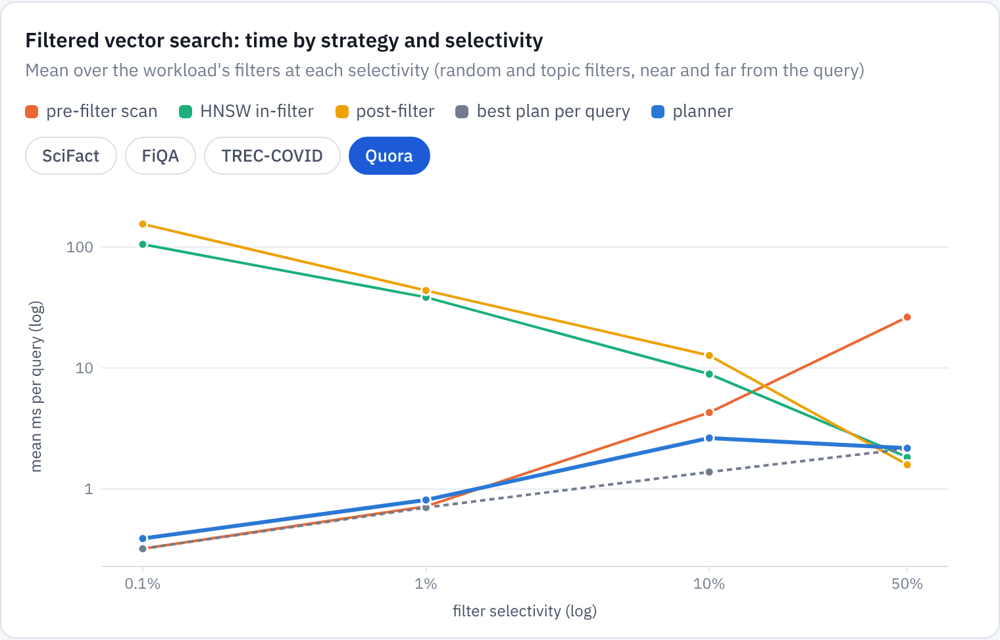
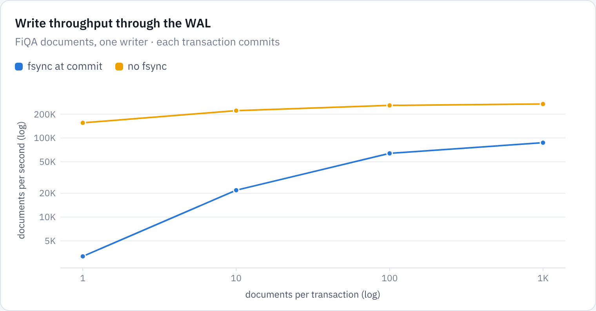

# Strata: results
{: .no_toc }

The design holds up. One file, with ACID commits and a SQL front end, serves full text, structured filters, vectors and their combinations. Warm, it is faster than both specialised baselines on most of the workload, and its ranking quality matches theirs. It pays for that in build time and in cold structured filters.
{: .fs-5 .fw-300 }

1. TOC
{:toc}

## Summary

| goal | met | missed |
|---|---|---|
| **One embedded file for three index families** | Every query of the workload, and ten compound statements, run as SQL against one file. Durable commits take 0.27 ms; every crash test recovered a committed prefix; snapshots cost 0.1–0.2 µs; the file is near SQLite's size. | SQL covers single-table `SELECT` only; writes go through the Rust API. Building the HNSW graph makes loads 1.5–9× slower than SQLite's (0.9–1.5× without it). |
| **Faster than the specialised engines** | Warm BM25 is 1.8–4.6× faster than Tantivy and conjunctions 3.6–6.7× faster; Strata wins 23 of 28 warm text and filter comparisons. Vector queries take 0.09–0.20 ms against SQLite's 12 ms to 1 s scans, and are 50–63× faster cold. | Tantivy counts facets 1.1–2.7× faster. Cold structured filters are 1.8–2.9× slower than Tantivy's. |
| **Hybrid ranking as one plan** | RRF and weighted fusion are single SQL expressions under the same filter as their inputs. Weighted fusion adds 0.02–0.03 nDCG@10 over vectors alone on three collections, at 0.4–1.5 ms. | The top-100 shortcut recovers 89–95% of the exact fused top 10. The best weight differs by collection (0.1–0.3), and nothing picks it automatically. |
| **A planner that adapts per query** | For filtered vector search, 1.5–5.3× faster than the best fixed strategy on the three larger collections, with recall@10 0.992–0.998. For filtered BM25 and filters alone, geometric-mean regret is 1.07–1.30. | It spends 1.3–1.6× an oracle's time. On SciFact, always pre-filtering takes 19% less time. |

## Setup

**Data.** Four BEIR collections with Cohere embed-english-v3 vectors (1,024 dimensions) for documents and queries, their relevance judgments, and synthetic structured fields: `year`, `category` and `rating` drawn at random, and `topic`, the k-means cluster of the same embeddings, which correlates with vector queries by construction.

| collection | documents | Strata file | build |
|---|---|---|---|
| SciFact | 5,183 | 33 MiB | 0.9 s |
| FiQA | 57,638 | 334 MiB | 17.4 s |
| TREC-COVID | 171,332 | 1,031 MiB | 63.6 s |
| Quora | 522,931 | 2,689 MiB | 242.5 s |

**Baselines.** SQLite with FTS5, B-tree indexes on the structured fields and vectors as blobs scanned by a scalar function (it has no vector index here), and Tantivy 0.26 (no vectors). All three systems answer the same workload of BM25, boolean, filter, facet, vector and hybrid queries, are measured after a full merge into one segment, and run queries on one thread. Warm numbers are medians over the queries of a kind, each run three times; cold numbers evict the database from the page cache before each query.

**Machine.** A 4-core cloud VM with an Emerald Rapids Xeon (AVX-512). Small timings vary by about 10–15% between runs.

## Build time and size

Strata builds every index of the table in one pass: text, structured, doc store, keys, float32 and 8-bit vectors, and an HNSW graph. That takes 0.9 s for SciFact and 242.5 s for Quora, against 0.6–27.2 s for SQLite and 0.7–18.2 s for Tantivy, neither of which builds a vector index. The graph is most of the difference: 13.5 s of FiQA's 17.4 s, 43 s of TREC-COVID's 63.6 s and 201 s of Quora's 242.5 s, on four threads. The rest of the load is 0.9–1.5× SQLite's time; with IVF instead of HNSW, TREC-COVID builds in 36.6 s and Quora in 91.2 s.

The Strata and SQLite files are close in size because both are dominated by float32 vectors, 4 KiB per document (83% of Strata's TREC-COVID file, 97% of Quora's). Without vectors, Strata's text index is the smallest of the three: with positions it takes 44.5 MiB on TREC-COVID against 60.0 MiB for Tantivy and 70.0 MiB for FTS5. A posting, with its docID and frequency, costs 12.2–12.7 bits.

## Query latency

*TREC-COVID, warm cache. The [full report](../reports/strata.html) has the chart for every collection, warm and cold.*

Warm, Strata is faster than Tantivy in 23 of the 28 text and filter comparisons:

- **BM25 top-10:** 1.8–4.6× faster than Tantivy, and 45–213× faster than FTS5, which scores every match.
- **Two-term conjunctions:** 3.6–6.7× faster than Tantivy.
- **Filtered BM25:** 3.5–4.6× faster than Tantivy.
- **Vector top-10:** 0.09–0.20 ms with HNSW. SQLite's scan takes 12 ms on SciFact and over a second on Quora.
- **Hybrid queries:** 0.36–1.3 ms, running BM25 and the vector index and fusing their top 100s.

| median warm ms | SciFact | FiQA | TREC-COVID | Quora |
|---|---|---|---|---|
| BM25 top-10: Strata | **0.083** | **0.313** | **0.613** | **0.160** |
| BM25 top-10: Tantivy | 0.380 | 0.720 | 1.13 | 0.429 |
| BM25 top-10: SQLite FTS5 | 3.77 | 20.0 | 130 | 17.8 |
| vector top-10: Strata (HNSW) | **0.093** | **0.150** | **0.165** | **0.196** |
| vector top-10: SQLite (scan) | 11.9 | 138 | 425 | 1,040 |
| hybrid (RRF): Strata | **0.358** | **0.816** | **1.33** | **0.702** |
| hybrid (RRF): SQLite | 15.6 | 171 | 556 | 1,120 |

*Source: `strata/results/strata/strata_<collection>.json` and `strata/results/baselines/{tantivy,sqlite}_<collection>.json`.*

The exceptions are facet counts, where Tantivy is 1.1–2.7× faster, and SciFact's three-term conjunctions, which take 12–124 µs in Tantivy. At that size the fixed cost of a SQL statement shows: a query that matches nothing takes Strata 7–10 µs to parse, bind, plan and run, about half of the facet gap on SciFact. The rest is that Strata materialises the match before reading category codes, while Tantivy's collector reads its column inside the intersection.

**Cold**, every system waits on page faults and the gaps narrow. Text queries are within 0.7–1.5× of Tantivy (faster on TREC-COVID, BM25 in 3.8 ms against 5.0 ms). Structured filters are 1.8–2.9× slower than Tantivy's columns, because a range touches histogram buckets, boundary blocks, zone maps and the key index, each on different pages. A cold vector query is 50–63× faster than SQLite's on the two large collections: HNSW touches about 1,000 pages where the scan reads all 239,000 or 592,000.

### Cold reads and page-cache hints

Cold latency depends on what the kernel reads around each page fault, and the right policy differs by section. With the kernel's default read-ahead everywhere, a cold HNSW query on TREC-COVID reads 20,262 pages and takes 83 ms, because each random hop pulls in up to 128 KiB. With no read-ahead anywhere, vector queries drop to about 1,000 pages and 40–44 ms, but BM25, facets and filters, which read postings and columns in order, become 1.9–3.6× slower. Strata's default advises random access only for the sections read at random (doc store, key index, dictionaries, float32 vectors, the graph and its codes), which keeps vector and hybrid queries at the random-access cost and BM25 at 0.7–1.1× its read-ahead time. Structured filters are the exception, 1.3–2.1× slower than with read-ahead everywhere: their key tie-breaks fault one page per key.

## Ranking quality

Strata's BM25 is within 0.017 nDCG@10 of both baselines on every collection, and no system is consistently ahead; the analysers differ (Snowball with stopwords dropped in Strata, Porter in FTS5, Snowball keeping stopwords in Tantivy). HNSW is within 0.005 of the exact scan on three collections; on the 300 Quora queries SQLite also ran, it scores 0.867 against 0.880 exact, with recall@10 0.991, and four queries that lost a relevant duplicate account for the whole difference.

| nDCG@10, BM25 | SciFact | FiQA | TREC-COVID | Quora |
|---|---|---|---|---|
| Strata | 0.689 | 0.252 | 0.658 | 0.756 |
| Tantivy | 0.687 | 0.251 | 0.667 | 0.758 |
| SQLite FTS5 | 0.684 | 0.254 | 0.641 | 0.760 |

All three systems drop NLTK's 153 English function words from BM25 queries, so the rankings are comparable. Keeping them (`stopwords => 0`) costs TREC-COVID 0.055 nDCG@10, whose queries are full questions, and gains Quora the same 0.055 (0.811 against 0.756): its questions are short, and "how", "why" or "can" carry much of their meaning.

## Hybrid ranking

Weighted fusion beats both of its inputs on three of the four collections. The best BM25 weight is small, 0.1–0.3: the score scales differ, and on these collections the embeddings are the stronger ranking. On TREC-COVID it reaches nDCG@10 0.851, against 0.817 for vectors alone, 0.835 for RRF and 0.658 for BM25; on Quora 0.920 against 0.899 and 0.859. On FiQA, where BM25 is weak, fusion only matches the vector ranking (0.437) and RRF falls below it (0.382), because RRF gives both rankings equal weight. Strata's RRF is within 0.006 of SQLite's RRF over the same two rankings.

The top-100 shortcut is cheap and close to exact. Against weighted ranking computed over every document, it recovers 89–95% of the exact top 10 with nDCG@10 within 0.01–0.03, at 0.4–1.5 ms per query, where the exact computation costs 1.8 ms on SciFact, 44 ms on FiQA and 211 ms on TREC-COVID.

## Posting formats and top-k

The text index stores long lists (at least 512 documents) as [Loom](../posting-lists.md#loom) and short ones as BP128 blocks. Against BP128 for every list, on the same index:

- **Boolean queries** are where Loom pays off: AND is 7.6–12× faster (8.9 against 68 µs on FiQA, 24 against 287 µs on TREC-COVID), and OR 1.5–2.3× faster, because Loom's cursors skip with sampled pointers instead of decoding whole blocks.
- **Size** is 2–4% smaller, at 11.7–12.7 bits per posting including frequencies.
- **Ranked top-10** is close across formats (within 0.9–1.3×). MaxScore beats Block-Max WAND by 1.9–2.6× on these queries.

## Vector indexes

On Quora (522,931 vectors, 1,024 dimensions), HNSW reaches recall@10 0.962 at 0.054 ms and 0.991 at 0.13 ms (ef 64, the default). IVF needs 0.58 ms for 0.936 (nprobe 32) and 1.8 ms for 0.977. The exact scan of 8-bit codes with float32 re-ranking reaches 1.000 in 38 ms. HNSW took 201 s to build with four threads, IVF 54 s.

The quantised dot product costs 12 ns per vector with AVX-512 VNNI (7.6 ns when four rows are scored at once), against 48 ns in float32. Scoring on the codes alone already ranks the exact top 10 correctly in all 100 sampled queries; float32 re-ranking only settles ties.

Cold, access patterns decide. With the kernel's default read-around, one HNSW query reads 32,290 pages (124 ms). Advising the graph and its codes `MADV_RANDOM` cuts that to 1,193 pages (54 ms), and prefetching each hop's neighbours to 15 ms. IVF reads its clusters sequentially, so it is fastest with read-ahead: 15 ms, or 8 ms with prefetching.

## Filtered vector search and the planner

Filtered vector search is where one fixed strategy cannot win:

- **Pre-filtered scan:** its cost grows with the number of matching documents.
- **HNSW with the filter inside:** cheap for permissive filters, very expensive for selective ones and for filters whose matches sit far from the query.
- **Post-filtering:** sensitive to both.

*Quora; the filters include random ones and topic filters drawn near to and far from the query.*

Across 300 filtered vector queries per collection, the planner is **2.1× faster** than the best fixed strategy on TREC-COVID (251 ms in total against 523 ms for always pre-filtering) and **5.3× faster** on Quora (451 ms against 2,375 ms), with recall@10 0.992–0.998. Always using the HNSW index would take 6–16 s. Against an oracle that knows the fastest plan per query with recall ≥ 0.9, the planner spends 1.3–1.6× more time in total.

Two refinements made that gap small:

1. **Selectivity near the query.** Planning on global selectivity alone, 100 TREC-COVID queries took 328 ms against an oracle's 48 ms; a 32-neighbour sample brought that to 61 ms. On Quora it still sent far-topic 10% filters into 60–100 ms graph walks where a 5 ms scan sufficed (1,076 ms in total). A second, 160-neighbour sample, taken when the first finds at most one match, brought Quora to 451 ms.
2. **Post-filtering costed with the smaller** of the global and local selectivity, since its candidate pool is sized from the global one.

On SciFact, with 5,183 documents, scanning a filter's members is never expensive, and planning, probing and the occasional index plan add 6–49 µs per query: always pre-filtering takes 19% less time there.

For BM25 with filters and for structured filters alone, geometric-mean regret is 1.07–1.30. Range filters choose between a zone-map scan and histogram bucket postings, and filtered BM25 chooses between driving scoring from the filter and probing it.

## Compound queries

Ten statements combine the workload's shapes: phrases with negation, prefixes, `OR` and `NOT` filters, both fusion methods, facets over a match, column ordering, and exact distance with a forced strategy. Each runs on every collection, and the same statement gets different plans as the data changes. The `OR` filter in the fourth query matches about 15% of documents everywhere: on SciFact the planner scans those 800 documents; on the larger collections it measures 11% near the query and post-filters the HNSW result. The RRF query's topic filter matches 11% of Quora globally but only 3.4% near the query, so the planner switches to an exact scan of its 58,767 members, at 5.4 ms.

## Transactions and storage

- **Commits.** A durable single-document commit is one WAL append and one `fsync`: 0.27 ms at the median, 3,190 commits a second. With 1,000 documents per transaction the WAL takes 87,000 documents a second; without `fsync`, 155,000–269,000 (a process crash still loses nothing, a power failure may lose recent commits).
- **Read your writes.** Committed documents are searchable at once. The first query after a write rebuilds the memtable's last 1,024-document chunk with every index of the evaluation table, which takes 31–39 ms; an unchunked memtable of 10,000 documents took 411 ms.
- **Open.** Cold, opening takes 3.3 ms for 10 segments, 13 ms for 100 and 123 ms for 994 (8 ms warm). Replaying 10,000 WAL documents takes 63 ms at open, plus 369 ms to index them at the first query.
- **Merges.** A tiered merge of eight 5,000-document segments, 10% deleted, rebuilds every index in 2.2 s, about 16,000 documents a second. After a delete-heavy workload the file is 1.22× its compacted size until `vacuum`.
- **Recovery.** A crash test kills a writer with `SIGKILL` at a random moment during inserts, deletes, commits and flushes, then reopens. Every restart recovered a committed prefix: 20 runs by default, and 60 and 80 in longer runs. A damaged meta slot falls back to the other one.

## Limitations

- **One machine.** A 4-core cloud VM. Cold numbers come from evicting the page cache on a virtual disk; a local NVMe drive or a spinning disk would shift them.
- **Synthetic structured fields.** `year`, `category` and `rating` are random and so independent of the text, which the planner assumes; `topic` correlates with vector queries by construction.
- **Baselines.** SQLite has no vector index here, so its vector numbers measure a scan, not a competing ANN index, and Tantivy has no vectors. A fuller comparison would add sqlite-vec and a dedicated vector store.
- **One segment.** All three systems are measured after a full merge. Queries over many segments are supported and tested, but not timed here.
- **Single-threaded queries**, by design for the comparison.

## Next steps

- **I/O planning:** let the planner choose page-cache hints per query, and keep read-ahead on the docID-to-key half of the key index, which would close the cold filter gap.
- **Correlation-aware estimates:** sample multi-predicate conjunctions the way the vector planner samples near the query.
- **Fusion without tuning:** fit the weighted-fusion weight per collection from score distributions, or learn it from clicks.
- **Writes in SQL** over the existing transaction API, then incremental HNSW merges so that merges stop rebuilding the graph.

The long-form report, with every table and an interactive chart for each collection, is [Strata: the database and its evaluation](../reports/strata.html). [Reproducing the results](../reproduce.md#strata) has the commands.
