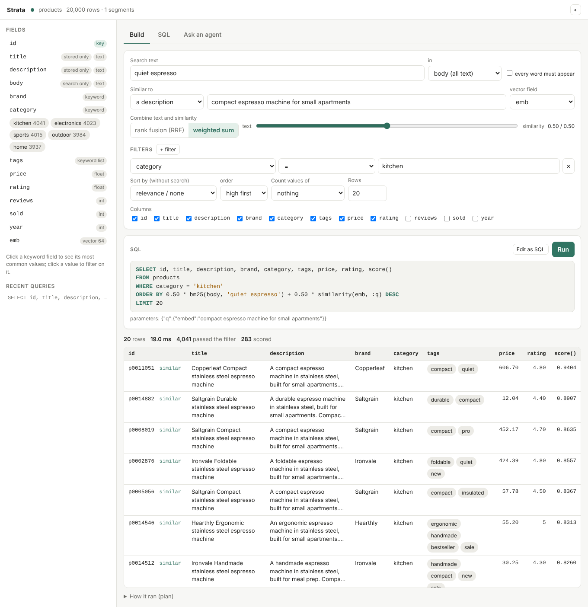
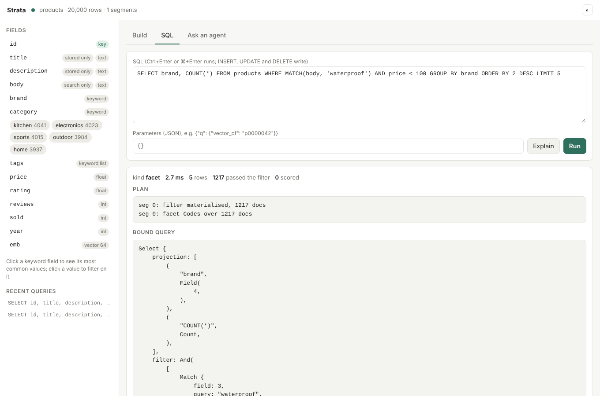

# strata-server
{: .no_toc }

`strata-server` serves a Strata database over HTTP JSON and gRPC, with a browser UI for building queries and an agent that answers questions by writing and running SQL. Run several of them as shards and one more as a coordinator, and the coordinator answers like one database.
{: .fs-5 .fw-300 }

1. TOC
{:toc}

## Run it

```sh
cd strata-server && cargo build --release
target/release/strata-server --demo 20000 --db products.strata   # a demo catalogue
# open http://127.0.0.1:7700
```

`--demo N` creates a product catalogue of *N* rows (titles, descriptions, brands, categories, tags, prices, ratings, sales and a 64-dimension vector) to try things on. Its `emb` field is declared as the `hash:64` model's embedding of the title and description ([below](#embedded-vector-fields)): hashed bags of words, not a learned model, so "similar" means "shares words".

| flag | default | effect |
|---|---|---|
| `--db PATH` | | the database to serve; created if missing, with `--schema` or `--demo` |
| `--schema FILE` | | the schema of a new database, as JSON (below) |
| `--directory` | off | create the new database as a directory of segment files instead of one file |
| `--wal-drop-damaged` | off | open a database whose write-ahead log was damaged after it was durable, dropping the transactions from the damage on (the log is copied to `<log>.damaged` first); without it the server refuses to start on one |
| `--verify-checksums` | off | check every segment against its checksum before serving (reads the whole database once); a damaged newest version is skipped for the one before it |
| `--shards URL,URL,…` | | run as a coordinator over these shard servers' gRPC addresses |
| `--listen ADDR` | `127.0.0.1:7700` | HTTP: the API, `/metrics` and the UI |
| `--grpc ADDR` | `127.0.0.1:7701` | gRPC (`off` to disable) |
| `--token T` | `$STRATA_TOKEN` | require `Authorization: Bearer T` on the API and on gRPC; needed to listen beyond loopback ([security](#security)) |
| `--no-token` | off | listen beyond loopback without a token anyway |
| `--allow-host NAME` | | also answer HTTP requests for this host name (repeatable) |
| `--tls-cert FILE`, `--tls-key FILE` | | serve HTTP and gRPC over TLS with this PEM certificate chain and key |
| `--shard-token T` | `$STRATA_SHARD_TOKEN`, else `--token` | a coordinator's token for its shards |
| `--shard-ca FILE` | | a CA certificate (PEM) a coordinator trusts for `https://` shards, besides the public roots |
| `--timeout-ms N` | 5000 | default query deadline |
| `--max-timeout-ms N` | 60000 | the longest deadline a request's `timeout_ms` may ask for |
| `--max-concurrent N` | 64 | queries running at once; more wait for a slot until their deadline |
| `--max-result-window N` | 10000 | the most rows a query may reach, OFFSET included ([limits](#limits)); 0: no limit |
| `--max-groups N` | 65536 | the most groups a GROUP BY may make ([limits](#limits)); 0: no limit |
| `--query-memory-mb N` | a third of the cgroup memory limit, or of RAM | memory the running queries may hold together ([limits](#limits)); 0: no limit |
| `--max-queued-writes N` | 1024 | write requests held at once; more are refused with 429 ([limits](#limits)); 0: no limit |
| `--max-body-mb N` | 256 | the largest body of a write or an import, and of a gRPC message; other requests take up to 16 MiB |
| `--model ID` | `claude-haiku-5-5` | the agent's default model |
| `--models DIR` | `$STRATA_MODELS`, else `~/.local/share/strata/models` | where the models of [embedded vector fields](#embedded-vector-fields) are |
| `--copy-from PATH` | | fill the new database (`--db` with `--schema`) with this database's rows, re-embedding the vector fields whose embedding changed |
| `--synonyms FILE` | | the synonym list for `synonyms => 1` searches ([format](query-language.md#typos-and-synonyms)): read at start if it exists, written by `PUT /v1/synonyms` |
| `--backup-dir DIR` | | where `POST /v1/admin/checkpoint` writes checkpoints ([backups](#backups)); created if missing |
| `--log FILTER` | `$STRATA_LOG`, else `info` | what to [log](#logs): a level (`error`, `warn`, `info`, `debug`, `trace`), or levels per module (`info,strata=debug`); `debug` logs every request |
| `--log-format F` | `$STRATA_LOG_FORMAT`, else `text` | log lines as `text` or `json` (one object per line) |
| `--slow-ms N` | 1000 | log queries and writes that take this many milliseconds or more, with their SQL (0: none) |

`strata-server import` and `strata-server fetch-model` are subcommands: [loading rows](#loading-rows) and [embedded vector fields](#embedded-vector-fields).

## Schemas

The server serves a database's first table, whose schema is set when the database is created (`--schema FILE`, `strata-server import --schema FILE`, the UI's schema designer, or `strata.Database.create` in [Python](python.md)). A database can hold more tables, which [`CREATE TABLE`](query-language.md#tables) adds in-process (`Db::sql` in Rust, `Database.sql` in Python); the server, its APIs and the coordinator do not serve those yet. A schema is JSON: the table's name, its key, and its fields by type, with options only where they differ from the defaults.

```json
{
  "table": "docs",
  "key": "id",
  "fields": [
    {"name": "id", "type": "keyword"},
    {"name": "title", "type": "text"},
    {"name": "body", "type": "text"},
    {"name": "tags", "type": "keyword", "multi": true},
    {"name": "published", "type": "int"},
    {"name": "emb", "type": "vector", "embed": {"from": ["title", "body"], "model": "potion-retrieval-32M"}},
    {"name": "splade", "type": "sparse"}
  ]
}
```

| type | holds | used by |
|---|---|---|
| `text` | words, searched by relevance | `MATCH`, `bm25()` |
| `keyword` | exact values: ids, categories, tags | `=`, `IN`, `GROUP BY` (facets) |
| `int`, `float` | numbers | ranges, sorting, sums, boosts |
| `bool` | true or false | conditions (`WHERE done`), `GROUP BY` |
| `timestamp` | a moment in UTC, to the microsecond, as ISO 8601 text (`"2026-10-01T12:30:00Z"`) | ranges, sorting, `MIN`/`MAX`, boosts by age |
| `vector` | a fixed number of floats | `similarity()`, `distance()` |
| `sparse` | learned term weights (SPLADE, BGE-M3), `{"term": weight}` | `similarity()` |
| `edges` | links to other rows by key, a JSON array | [graph queries](graphs.md) |

| option | types | default | what it does |
|---|---|---|---|
| `stored` | all | true; false for vectors and generated text | the value is kept and returned in results |
| `indexed` | all | true | the value can be searched and filtered on |
| `multi` | `keyword`, `int` | false | a list of values per row (stored, not the key) |
| `positions` | `text` | true | keep word positions, for phrase searches |
| `from` | `text` | | generated: the named fields' text joined, such as a `body` of title and description to search at once |
| `dim` | `vector` | the model's, for a known `embed` model | the number of dimensions |
| `index` | `vector` | `"hnsw"` (m 16, ef_construction 200) | `"flat"` (an exact scan), `{"hnsw": {"m": 32, "ef_construction": 400}}` or `{"ivf": {"nlist": 1024}}` |
| `codes` | `vector` | `"sq8"` (a byte a dimension) | `"binary"`: a bit a dimension, 1/32 of the vectors, rescored |
| `embed` | `vector` | | `{"from": [fields], "model": name}`: the vectors are that model's embedding of those fields ([below](#embedded-vector-fields)) |

`key` names the primary key, a `keyword` or `int` field; rows are upserted and deleted by it, and a table without one only takes inserts. `"references": "authors"` on a `keyword` or `int` field records that it holds keys of that table ([references](query-language.md#tables)); a new database's first table can reference only itself. An option a type does not know is an error, so a typo does not pass silently. `GET /v1/schema` returns the schema in this form as `short` (and in the long form Strata stores, as `schema`); `POST /v1/schema/check` validates one and returns both. The long form is accepted wherever a schema is read. The [query language](query-language.md#columns-and-types) page describes the types further.

## Loading rows

Rows come as JSON Lines (an object per line), a JSON array of objects, or CSV or TSV with a header row. Each column goes to the field of its name; columns the schema has no field for are skipped and reported. A row's values are what a write takes: `true` or `false` for a `bool` (or 1, 0, `"true"`, `"false"`), ISO 8601 text for a `timestamp`, a list for a `multi` field, an array of numbers for a vector, an object of weights for a `sparse` field. In CSV and TSV an empty cell is empty (null), a list is `a|b|c` or a JSON array, and vectors, sparse weights and edges are JSON. Vectors of [embedded fields](#embedded-vector-fields) that a row leaves out are computed from its other fields.

From the command line, into a database no server has open (an open database is locked):

```sh
strata-server import --db books.strata --schema books.json books.jsonl more.csv   # --schema only creates
```

Into an empty table the rows are bulk-loaded straight into segments, in one commit: a bad row is reported with its line or row number, and nothing is written. Into a table that has rows they are upserted, 10,000 rows a transaction. The format comes from each file's extension (`.jsonl`, `.ndjson`, `.json`, `.csv`, `.tsv`) or `--format`.

To a running server, `POST /v1/import` with the rows as the body and the format as `?format=` (or the content type):

```sh
curl -s -X POST 'localhost:7700/v1/import?format=csv' -H 'content-type: text/csv' --data-binary @more.csv
# {"written": 2, "skipped_fields": [], "took_ms": 3.1}
```

The content type must not be `text/plain`, a form or missing (a web page on another site can send those without asking; see [security](#security)): `text/csv`, `text/tab-separated-values`, `application/x-ndjson`, `application/json` or `application/octet-stream` all work. The server reads every row once before it writes any, so a bad row writes nothing, then reads them again 1,000 at a time and upserts each thousand through its writer while it reads the next (a coordinator routes them to the shards), so an import holds its body and two thousand rows, not every row. A request may be up to `--max-body-mb` (256 MiB). The UI's **Schema and import** tab uploads a file this way, and [Python](python.md) has `import_file` both in-process and as a client.

The server flushes the memtable into segments on a thread of its own: a write that fills it (10,000 rows and deletes not yet flushed) returns without waiting for the segments to build, and writes go on meanwhile. Once the memtable holds twice that, writes wait for the flush under way. Segments build their vector indexes on every core.

## Embedded vector fields

A `VECTOR` field can say what its vectors are: a model's embedding of other fields.

```json
{"name": "emb_title", "type": "vector", "embed": {"from": ["title"], "model": "potion-retrieval-32M"}},
{"name": "emb_both", "type": "vector", "embed": {"from": ["title", "description"], "model": "potion-retrieval-32M"}}
```

The sources are stored (or generated) `TEXT` or `KEYWORD` fields, and the text embedded is their non-empty values joined by newlines, as for a generated field. The declaration is kept in the database, returned by `/v1/schema` and shown by the UI ("emb_title ← title") and the agent. When the server starts it opens each field's model from `--models` and logs what each field is. With the model open:

- writes that leave the vector out get it computed: `/v1/write` documents and SQL `INSERT`, and an `UPDATE` that changes a source recomputes it, all before the write queues for the writer (on as many writes at once as there are cores), so the writer never waits for a model (with bge-small on 4 cores, an in-place `UPDATE` beside two clients inserting rows went from 4.7 to 500 a second, and four inserting clients from 10 to 23 rows a second: [results](https://github.com/rkonow/engram/tree/main/strata-server/results/sql-writes)); a vector a write supplies is kept as given;
- an `UPDATE` that changes a source recomputes the vector; merges do not (they keep the stored vectors);
- a parameter `{"embed": "some text", "field": "emb_title"}` is the text's vector by that field's model, so queries and rows are always embedded alike (`field` defaults to the first embedded field with a model); the UI's "Similar to: a description" uses the chosen vector field's model.

Several fields can embed different sources side by side, and a query picks one: `ORDER BY similarity(emb_title, :q)`, or both fused, `rrf(similarity(emb_title, :q), similarity(emb_both, :p))`. Each 512-dimension field costs about 0.5 KB a row as 8-bit codes, plus its HNSW graph.

A field may also name a model the server cannot run, such as `cohere/embed-english-v3.0` for vectors computed elsewhere: that documents what the vectors are, writes must supply them, and text cannot be searched against them (only rows, with `vector_of`). The BEIR collections of the evaluation declare their Cohere vectors this way.

| model | what it is | |
|---|---|---|
| `potion-retrieval-32M` | Model2Vec (a static token table, averaged), 512 dimensions; the model engram uses | tens of microseconds a row on one core |
| `potion-base-8M` | Model2Vec, 256 dimensions | smallest |
| `bge-small-en-v1.5` | BERT encoder, 384 dimensions | build with `--features bert`; milliseconds a row |
| `snowflake-arctic-embed-m-v1.5` | BERT encoder, 768 dimensions | build with `--features bert`; slower, better |
| `hash:N` | hashed bag of words, *N* dimensions | no files; tests and the demo |

On a Mac, build with `--features accelerate` instead of `bert`: the BERT models' matrix products then run in Apple's Accelerate framework.

`strata-server fetch-model NAME` downloads one of these (or any Hugging Face repository `owner/name` with `config.json`, `tokenizer.json` and `model.safetensors`) into the models directory.

**Changing your mind.** Vectors are stored, so changing a field's sources or model means re-embedding. Create a database with the new schema and fill it from the old one:

```sh
strata-server --db products-v2.strata --schema v2.json --copy-from products.strata
```

Rows are copied field by field by name; a vector field is copied when the old one has the same dimensions, sources and model, and embedded anew otherwise; fields the new schema drops are left out. `Db::load_from` does the same from Rust.

**Which fields to embed.** Embed the text that carries what people search for, usually title and description; keep brand, price, category and dates out of the vector and filter on them instead. Measured on four BEIR collections with titles (nDCG@10; Apple M2, 2026-10-27; [all tables, recall and times](https://github.com/rkonow/engram/tree/main/strata/results/embed-fields)):

| collection | model | title | text | title + text | title + text with BM25 |
|---|---|---|---|---|---|
| SciFact | Model2Vec potion-retrieval-32M | 0.487 | 0.613 | **0.633** | 0.697 |
| SciFact | BGE-small v1.5 | 0.598 | 0.697 | **0.713** | 0.724 |
| SciFact | Arctic Embed M v1.5 | 0.576 | 0.704 | **0.716** | 0.729 |
| NFCorpus | Model2Vec potion-retrieval-32M | 0.283 | 0.295 | **0.308** | 0.340 |
| NFCorpus | BGE-small v1.5 | 0.318 | **0.349** | 0.344 | 0.365 |
| NFCorpus | Arctic Embed M v1.5 | 0.321 | 0.361 | **0.363** | 0.370 |
| SciDocs | Model2Vec potion-retrieval-32M | 0.128 | 0.120 | **0.137** | 0.159 |
| SciDocs | BGE-small v1.5 | 0.195 | 0.198 | **0.205** | 0.195 |
| TREC-COVID | Model2Vec potion-retrieval-32M | **0.504** | 0.482 | 0.446 | 0.654 |

Title + text is the best single vector, or within 0.005 of it, everywhere but TREC-COVID with Model2Vec, where short COVID questions match its on-topic titles better than a static model's average over long abstracts. Fusing the vector with BM25 (`rrf(bm25(body, :t), similarity(emb, :q))`) beats the best single vector in 8 of the 9 runs; the exception is SciDocs with BGE-small, where BM25 (0.157) is far behind the vector and fusion pulls it from 0.205 to 0.195. So start with one vector of title + description searched together with BM25, check the fusion against the vector alone on your own queries, and when titles are informative and descriptions long, above all with a static model, add a title-only field and compare the two. On the M2's CPU, Model2Vec loaded and embedded 12,000 to 22,000 texts a second and the BERT models 8 to 27 (build with `--features accelerate` on a Mac).

`strata-embed-eval` (in `strata/`) runs this comparison: it loads a BEIR collection into fields embedding its titles, its texts and both, by one model, and reports nDCG@10 and recall@100 for each, with BM25, hybrid and the collection's Cohere vectors as references.

```sh
cd strata && STRATA_DATA=~/data/beir cargo run --release --bin strata-embed-eval -- --dataset scifact --model potion-retrieval-32M
```

## HTTP API

Every request and answer is JSON. Every answer carries the request's id in an `x-request-id` header: the one the client sent, if it is 1 to 64 letters, digits, `-`, `_`, `.` or `:`, or a new one. The [logs](#logs) name it, and a coordinator passes it on to its shards (as gRPC metadata of the same name), so one id finds a request in every server it reached. Parameters bind `:name` placeholders: a number, a string, an array for a vector, an object of term weights for a `SPARSE` field, `{"vector_of": "key", "field": "emb"}` for a stored row's vector (more like this), or `{"embed": "text", "field": "emb"}` for the text's vector by an [embedded field](#embedded-vector-fields)'s model.

| route | body | answer |
|---|---|---|
| `POST /v1/query` | `{sql, params?, timeout_ms?}` | `{columns, rows, keys, scores, stats, took_ms}` |
| `POST /v1/sql` | `{sql, params?, timeout_ms?}` | rows for a `SELECT`; `{written}` for `INSERT`, `UPDATE`, `DELETE` |
| `POST /v1/write` | `{ops: [...], idempotency_key?}` | `{written}` |
| `POST /v1/import?format=F` | rows as JSON Lines, JSON, CSV or TSV ([loading rows](#loading-rows)) | `{written, skipped_fields, took_ms}` |
| `POST /v1/schema/check` | a schema, in either form | `{schema, short}`, or the error |
| `POST /v1/explain` | `{sql, params?}` | the bound query and its plan lines |
| `POST /v1/term_stats` | `{sql, params?, timeout_ms?}` | BM25 statistics and a snapshot lease for the query round that follows (it lasts for the deadline and a second), for a coordinator |
| `POST /v1/snapshot` | | a snapshot lease for 60 s: `{snapshot, txn, ttl_s}` (at most 10,000 are held at once; more get 429) |
| `POST /v1/agent` | `{question, model?, effort?, api_key?, max_steps?}` | an answer and the queries it ran |
| `POST /v1/admin/checkpoint` | `{name, layout?, link_from?}` | writes a checkpoint named `name` in `--backup-dir` ([backups](#backups)): `{checkpoint: {txn, tables, segments, segments_linked, live_docs, bytes_written, seconds}}` |
| `POST /v1/admin/check` | | checks every byte against its checksums (writes wait meanwhile): `{ok: true}`, or the damage |
| `POST /v1/admin/vacuum` | | returns free pages to the file system: `{bytes_freed}` |
| `GET /v1/synonyms`, `PUT /v1/synonyms` | `{text}` for `PUT` | the synonym list: `{text, rules, file}` |
| `GET /v1/schema` | | `{schema, short, primary_key, embeddings}` |
| `GET /v1/health` | | `{status, docs, segments, ...}`, with 503 when the status is `down` or `failing` ([health](#health)) |
| `GET /livez`, `/readyz` | | `{status}`, with 503 when the server must be restarted ([health](#health)) |
| `GET /v1/stats`, `/v1/config` | | JSON |
| `GET /metrics` | | Prometheus text |
| `GET /` | | the UI |

```sh
curl -s localhost:7700/v1/query -H 'content-type: application/json' -d '{
  "sql": "SELECT id, title, price, score() FROM products WHERE category = :c ORDER BY 0.5 * bm25(body, :t) + 0.5 * similarity(emb, :v) DESC LIMIT 5",
  "params": {"c": "kitchen", "t": "quiet espresso", "v": {"vector_of": "p0011051"}}
}'
```

`/v1/write` takes a batch of operations, applied in one transaction:

```json
{"ops": [
  {"op": "insert", "doc": {"id": "p1", "title": "red mug", "price": 12.5, "tags": ["kitchen", "gift"]}},
  {"op": "upsert", "doc": {"id": "p2", "title": "blue mug"}},
  {"op": "upsert_if_newer", "doc": {"id": "p3", "title": "green mug", "version": 7}, "version": "version"},
  {"op": "set", "key": "p1", "field": "price", "value": 11.0},
  {"op": "add", "key": "p1", "field": "sold", "value": 1},
  {"op": "delete", "key": "p9"}
]}
```

A compound query (`WITH`, a subquery, a join, `SELECT DISTINCT`) runs as several single-table queries on one snapshot; on a coordinator, each step goes to the shards. Its plan lists the steps. A coordinator has no synonym list of its own: start each shard with `--synonyms FILE`.

`set` and `add` change a numeric field in place, without rewriting the row; `upsert_if_newer` writes the row only if its version field is higher than the stored row's, so a feed replayed out of order keeps the newest. Operations see the ones before them in the batch: an `add` after an `upsert` of the same key adds to the upserted value. An `add` to an `INT` field takes an integer and fails on overflow (exact over the whole 64-bit range); one to a `FLOAT` field must stay finite; a missing value counts as 0.

An answer of 200 means the batch is durable, and an error that nothing of it was written, so a client can retry on an error. When an answer is lost (a timeout, a dropped connection, a coordinator whose other replica failed), send the retry with the same `idempotency_key` (or an `Idempotency-Key` header), 1 to 256 characters: a server that already applied that batch answers with its first `written` instead of applying it again, so an `add` counts once and an `insert` does not fail as a duplicate of itself. The same key with other operations is refused (422), and while the first attempt still runs a retry gets 409. A server remembers keys for an hour, the latest 100,000, in memory, so a restart forgets them. A coordinator passes the key to each shard as `key/shard`. Over gRPC, `WriteRequest.idempotency_key` does the same.

With `--token`, every route except `/`, `/v1/health`, `/livez` and `/readyz` needs `Authorization: Bearer <token>`; the UI asks for the token.

### Backups

Copying the database's files while the server runs is not a backup: a commit reuses pages an older version freed, and the directory layout deletes files a version stops naming, so a copy (`cp`, rsync, a disk snapshot, Time Machine) can pair one version's manifest with another's pages. A checkpoint is the safe copy. `POST /v1/admin/checkpoint` flushes the memtable, pins the version that holds every committed write and copies it into `--backup-dir/<name>` while queries and writes go on (they wait only for the flush). The checkpoint is itself a database, checked against its checksums before it gets its name: restore by stopping the server and serving the checkpoint (`--db`), or by moving it into place.

```sh
strata-server --db shop.strata --backup-dir /backups
curl -s localhost:7700/v1/admin/checkpoint -H 'content-type: application/json' -d '{"name": "shop-2026-10-28.strata"}'
# Directory checkpoints; the second hard-links the segments it shares with the first:
curl -s localhost:7700/v1/admin/checkpoint -H 'content-type: application/json' -d '{"name": "shop-2026-10-28", "layout": "dir"}'
curl -s localhost:7700/v1/admin/checkpoint -H 'content-type: application/json' \
  -d '{"name": "shop-2026-10-29", "layout": "dir", "link_from": "shop-2026-10-28"}'
```

The answer, `{"checkpoint": {...}}`, counts what was copied: `txn`, `tables`, `segments`, `segments_linked`, `live_docs`, `bytes_written` and `seconds`.

`layout` is `file` (default: one file) or `dir` (a directory of segment files, as `--directory` creates). Segments are immutable and keep their ids in a checkpoint, and its manifest and delete sets are named by the commit it holds, so two directory checkpoints' files share a name only when they hold the same bytes. That makes them incremental off-site backups: sync each one into the same place, `CURRENT` last so that the place always names a complete version, and only the files new since the last sync travel:

```sh
aws s3 sync --size-only --exclude CURRENT /backups/shop-2026-10-29 s3://bucket/shop/
aws s3 cp /backups/shop-2026-10-29/CURRENT s3://bucket/shop/CURRENT
```

A database opened from a copy of that place deletes the files its version does not name. A database restored from a checkpoint numbers its next commits as the original did after that checkpoint, so sync its own checkpoints into a new place. A name is letters, digits, `.`, `_` and `-`; an existing name is not overwritten. A coordinator has no database of its own: ask each shard server. The `strata` shell does the same offline with `.checkpoint DEST [file|dir] [EARLIER]`, `.check` and `.vacuum`.

Not yet: point-in-time recovery between checkpoints, which needs the write-ahead log archived instead of truncated at each flush.

## Security

- **A token, or loopback only.** `--token` (or `$STRATA_TOKEN`) guards the HTTP API and every gRPC call, compared in constant time. Without one the server listens only on loopback addresses: an address reachable from elsewhere (`0.0.0.0`, a LAN address) is refused at start unless `--no-token` says to serve it open. The token is not printed in the log; open the UI and give it there (or once as `/?token=…`, which the page then drops from its address).
- **Browsers on other sites.** A server on your laptop is reachable by every web page you visit, through your browser. It answers only to the host names `localhost`, `127.0.0.1` and `::1` when it listens on loopback (add names with `--allow-host`), so a page that points its own name at 127.0.0.1 (DNS rebinding) gets 403. A request that can change something and carries an `Origin` other than the server's own gets 403, and `/v1/import` refuses the content types a page may send without asking first (`text/plain`, forms, none). The UI and the clients here send their own origin or no origin, and proper content types.
- **TLS.** `--tls-cert FILE --tls-key FILE` (PEM) serve both HTTP and gRPC over TLS. A coordinator reaches `https://` shards over TLS, trusting the public roots and `--shard-ca FILE`, and sends `--shard-token` (by default its own `--token`) with every call.
- **What is not there yet**: scoped keys (read, write, admin), mutual TLS, and an audit log.

## gRPC

`proto/strata.proto` defines the service: `Query`, `TermStats`, `Write`, `Schema` and `Health`, mirroring the HTTP routes. Values are typed (`int`, `float`, `str`, `vector`, `list`); statistics, plans and fusion parts travel as JSON bytes, since they are Strata's own serde types. The server compiles the proto at build time with a pure-Rust compiler, so building needs no `protoc`.

## Sharding: one coordinator, many shards

```sh
strata-server --demo 20000 --demo-shard 0/2 --db a.strata --listen 127.0.0.1:7710 --grpc 127.0.0.1:7711
strata-server --demo 20000 --demo-shard 1/2 --db b.strata --listen 127.0.0.1:7720 --grpc 127.0.0.1:7721
strata-server --shards http://127.0.0.1:7711,http://127.0.0.1:7721 --listen 127.0.0.1:7700 --grpc off
```

With a token, give it to the shards and the coordinator alike (`STRATA_TOKEN=…` for all three), or give the coordinator its shards' token with `--shard-token`. On other machines, serve the shards with `--tls-cert` and `--tls-key` and list them as `https://`.

A coordinator holds no data. For a query, it

1. asks every shard for the BM25 statistics of the query's terms and a snapshot lease, which lasts until the query's deadline and a second (skipped when nothing in the query needs collection statistics: vectors, sparse fields, columns),
2. sends every shard the query with the summed statistics and its lease, in shard mode, so that each shard scores exactly as the whole collection would and returns what a merge needs (for fusions and products, each input's raw scores over its candidates),
3. merges the answers with `strata::cluster::merge`: top *k*, fusion, products and facet counts.

A sharded collection therefore ranks like one database: the tests run every query kind against three shards and one whole database and compare keys and scores. Writes are routed by primary key (a hash of the key picks the shard); `UPDATE` and `DELETE` go to every shard. A coordinator refuses, for now, `UPDATE` and `DELETE` with a `LIMIT` (each shard would apply its own) and `INSERT ... ON CONFLICT DO NOTHING` or `DO UPDATE` (`INSERT OR REPLACE` works). Shards can also be built offline: `Db::write_segment` writes a segment file anywhere, and `attach_segments` adds built segments to a running database in one commit.

## Deadlines, admission and metrics

Every query runs under a deadline (`timeout_ms` up to `--max-timeout-ms`, or the server's default) and gets its share of the cores: a query arriving when *r* are running searches its segments on about *cores / r* threads, its own and threads it borrows from one pool the whole server shares, as many as the cores (`strata_query_pool_threads`). A query starts no threads of its own, and when the pool is busy it goes on with the threads it has instead of waiting for more. At most `--max-concurrent` run at once; the rest wait for a slot, and one still waiting at its deadline is refused with 429 (`ResourceExhausted` over gRPC) and counted in `strata_rejected_total`. A query still running at its deadline stops and returns an error. So does a query whose caller stopped waiting (a client that hung up, a coordinator's hedge that lost), and it holds its slot and counts as running until it has stopped. A query checks between segments and, inside a segment, every 1,024 rows it groups, orders by a column or lists, every 1,024 rows a graph walk expands (16 when each hop is a vector search), and every 1,024 rows a join hashes or compares, so it stops within milliseconds even in one large segment.

A coordinator does not retry a query that a replica refused with 429 on that replica's sibling, which would only take on both loads: the query fails, or a partial answer leaves the shard out. Hedges (asking another replica when one has not answered after `--hedge-ms`) are budgeted at 5% of the calls to shards, with up to 10 saved for a burst, so that a slow cluster is not sent twice its load.

### Limits

A query may reach at most `--max-result-window` rows (10,000), as Elasticsearch's `max_result_window`: one whose LIMIT plus OFFSET is larger fails with 400, and so does one without a LIMIT that matches more rows. A ranked query without a LIMIT returns its best 100. Counts and groups are not rows, but a GROUP BY may make at most `--max-groups` groups (65,536, as Elasticsearch's `search.max_buckets`) and fails with 400 at the next one, before its LIMIT is applied. A compound query's steps may hold up to 1,000,000 rows each, as before; its answer is held to the window. A coordinator checks LIMIT and OFFSET before it asks its shards, and a shard lets a coordinator's step reach 1,000,001 rows.

The running queries share a memory budget, `--query-memory-mb` (a third of the cgroup memory limit, or of RAM; merges have their own, a quarter). As Elasticsearch's request circuit breaker, a query counts what it builds up against it as it goes: its groups and `COUNT(DISTINCT)` values, the rows it orders or lists before its LIMIT, the rows it returns with their stored text, the nodes and neighbour lists of a graph walk, and a compound query's steps, join tables and joined rows. A query that would go past the budget stops and is refused with 429 (`ResourceExhausted` over gRPC, which a coordinator passes on), and it gives back what it held, as every query does when it ends. `strata_query_memory_bytes` shows what the running queries hold and `strata_query_memory_trips_total` how many were refused. The counts are estimates of the structures a query grows, not of every allocation; index data is mapped from the file and not counted. An `ORDER BY` with a LIMIT keeps about twice LIMIT plus OFFSET rows as it goes, not every match.

Write requests are held in one queue, from embedding (a server embeds on as many writes at once as it has cores) through waiting for the writer to being applied. With `--max-queued-writes` (1,024) in it, a write or a SQL `INSERT`, `UPDATE` or `DELETE` is refused with 429 before any work, and counted in `strata_write_errors_total{status="429"}`; `strata_write_queue_requests` shows how many it holds. A body larger than its route allows is refused with 413: `--max-body-mb` (256 MiB) for `/v1/write` and `/v1/import`, 16 MiB for every other route.

### Health

`GET /v1/health` reports `status`:

- `ok`.
- `degraded`: on a database, its flushes fail (a full disk), and `error` says why. Writes still commit, to the write-ahead log, until the memtable holds twice its limit; then they are refused until a flush succeeds. On a coordinator, a replica does not answer, or is not `ok`, but every shard has one that answers.
- `failing`: the database cannot write until the server restarts. A write failed partway (a full disk, an I/O error) and the database refuses writes until it is reopened, or the writer thread stopped. Reads still work; merges stop.
- `down`: a coordinator has a shard with no replica answering.

It answers 503 for `down` and `failing`. `/livez` and `/readyz` answer 503 only for `failing`, so that an orchestrator restarts the server (the [Kubernetes manifests](https://github.com/rkonow/engram/tree/main/strata-server/deploy) use them as probes). Neither asks a coordinator's shards, so one slow shard cannot take every coordinator out of service at once; `/v1/health` shows the shards. The writer thread survives a panic while applying a write: the requests in that batch get 500, the panic is counted in `strata_writer_panics_total`, and the next batch goes on.

`GET /metrics` serves, in Prometheus text format, with `# HELP` and `# TYPE` lines for every family and durations in seconds:

| metric | labels | what |
|---|---|---|
| `strata_build_info` | `version`, `simd` | always 1: the server's version and the SIMD kernels it runs |
| `process_start_time_seconds`, `process_cpu_seconds_total` | | when the process started, and the CPU time it used |
| `process_resident_memory_bytes`, `process_open_fds` | | memory in RAM (mapped database pages included) and open file descriptors (Linux) |
| `strata_http_requests_total`, `strata_http_request_duration_seconds` | `route`, `status` | HTTP requests by route pattern (`other` for none) and status, and their duration by route |
| `strata_grpc_requests_total`, `strata_grpc_request_duration_seconds` | `method`, `code` | gRPC calls by method and status code, and their duration by method |
| `strata_queries_total` | `kind`, `outcome` | queries by kind (`bm25`, `vector`, `sparse`, `hybrid`, `boosted`, `decay`, `graph`, `column`, `facet`, `aggregate`, `count`, `filter`, `compound`, `invalid`) and outcome (`ok`, `partial`, `error`, `timeout`, `rejected` for no slot or no memory) |
| `strata_query_duration_seconds` | `kind` | time to answer a query, waiting for a slot included |
| `strata_query_admission_wait_seconds` | | time a query waited for a slot (`--max-concurrent`) |
| `strata_queries_running` | | queries running now |
| `strata_rejected_total` | | queries refused because no slot came free before their deadline |
| `strata_query_memory_bytes`, `strata_query_memory_limit_bytes` | | memory the running queries hold, as counted, and their budget (`--query-memory-mb`; absent with no limit) |
| `strata_query_memory_trips_total` | | queries refused because the budget was spent |
| `strata_query_pool_threads`, `strata_query_pool_queued` | | threads in the pool queries borrow from to search segments in parallel, and the threads queries asked for that none was free to give yet |
| `strata_writes_total`, `strata_written_docs_total` | | write requests that succeeded, and rows they wrote |
| `strata_write_errors_total` | `status` | write requests that failed, by HTTP status |
| `strata_write_duration_seconds` | | time from a write request to its commit, embedding and waiting for the writer included |
| `strata_write_queue_requests`, `strata_write_batches_total` | | write requests held ([limits](#limits)): embedding, waiting for the writer or being applied; and the groups the writer applied in one transaction each |
| `strata_idempotent_replays_total` | | writes answered from their idempotency key instead of being applied again |
| `strata_slow_requests_total` | `what` | queries and writes the slow log wrote down |
| `strata_embedded_texts_total`, `strata_embed_duration_seconds` | `for` | texts the server's models embedded for writes and for query parameters, and how long each took |
| `strata_agent_runs_total` | | questions the agent was asked |
| `strata_docs`, `strata_segments`, `strata_deleted_docs`, `strata_memtable_docs` | | a database's rows, segments, deleted rows merges have not dropped yet, and rows not yet flushed |
| `strata_file_bytes`, `strata_free_bytes`, `strata_wal_bytes` | | its size on disk, the free space in its file, and its write-ahead log |
| `strata_snapshot_leases` | | snapshot leases held |
| `strata_failing`, `strata_flush_failing` | | 1 when the database is `failing`, or its flushes fail ([health](#health)) |
| `strata_writer_panics_total` | | write batches whose application panicked |
| `strata_merges_running`, `strata_merge_memory_bytes` | | merges running now and their estimated memory ([merges](#merges)) |
| `strata_merges_total`, `strata_merges_limited_total` | | merges finished, and merges cut (or put off) to fit the memory budget or an interrupted merge's |
| `strata_merges_interrupted`, `strata_merge_failing` | | groups of segments whose merge a crash interrupted; 1 while merges fail |
| `strata_shard_calls_total` | `shard`, `outcome` | a coordinator's calls to each shard (replicas, retries and hedges together) by outcome: `ok`, `error`, `timeout` |
| `strata_shard_retries_total`, `strata_shard_hedges_total` | | calls a coordinator asked of another replica after one failed, or after the first had not answered within `--hedge-ms` |
| `strata_replicas_avoided` | | replicas a coordinator asks last for now, after they failed or were outrun |

A coordinator's `/metrics` does not ask its shards: each shard serves its own, and the coordinator shows how its calls to them went. `strata_query_ms` (milliseconds) became `strata_query_duration_seconds`.

### Logs

The server logs to stderr, as text or, with `--log-format json`, one JSON object per line (`timestamp`, `level`, `target`, `message`, the event's fields, and `span` with the request's `id`, method and route). Every line written while serving a request names its id. At the default level, `info`, it logs what it opened and where it listens, a query or write that took `--slow-ms` or more (`slow query`, with its kind, outcome, rows and SQL, cut to 2,000 bytes; `slow write`, with the rows written and the SQL of an `INSERT`, `UPDATE` or `DELETE`; parameters are not logged), a request that failed on the server's side (status 500 and up, at most ten lines a second, with how many were held back), a merge or background flush that failed, and a database that stopped accepting writes. `debug` adds a line for every request answered (`answered`, with its status and duration), and the engine's flushes and merges. The libraries the server is built on log only warnings unless the filter names them (`--log info,h2=debug`).

### Merges

A local database merges its segments on merger threads as writes add them ([how merges work](index.md#merges)). `--merge-threads` sets how many merges may run at once (default: half the cores, 1 to 4), `--merge-memory-mb` the memory they may use together (default: a quarter of the cgroup memory limit, or of RAM), and `--merge-write-mb-per-sec` how fast they may write (default: no limit). `GET /v1/stats` shows them under `merges`, and the server logs a merge that fails. A server killed for running out of memory during a merge restarts into smaller merges of the same segments.

## The UI

`GET /` serves a single page with six tabs.



- **Build** writes SQL from a form: search text (ranked, or only matching rows, with typo tolerance and synonyms), "similar to" a stored row or a description, rank fusion or a weighted sum with a slider, conditions, a boost by closeness (`decay`), a facet, the columns and the row count. Conditions nest in groups of *all of* (`AND`), *any of* (`OR`) and *none of* (`NOT`), and a condition can be "is among the *field* of the rows where …", an `IN (SELECT ...)` subquery. **Join related rows** pairs each row with the rows it links to, the rows linking to it (for each `EDGES` field) or the rows sharing a value, with conditions and columns for the related rows; **Summarize** groups by any fields of either side and computes counts, distinct counts, sums, averages, minimums and maximums, with `HAVING` and an order. The SQL updates as you type; "Edit as SQL" takes it to the editor. Clicking a keyword field in the sidebar shows its most common values, and clicking a value adds a condition. Each result row has a "similar" link that searches for rows like it, and a "links" link that opens its neighbourhood in the Graph tab. A search that finds nothing offers to search again allowing typos, or with synonyms.
- **Graph** (for a table with an `EDGES` or `VECTOR` field) starts from keys, the top rows of a search or the rows matching a condition, follows links (out, in or both ways, optionally one label) or similarity (each row's *k* nearest), and finds the rows within some hops, the shortest path to other rows, or the rows ranked by personalized PageRank, with conditions on the rows found. The answer is a table and a picture: rings by hop distance, a path left to right, or PageRank as node size. Clicking a node shows its row, expands its links or starts a new walk from it.
- **SQL** is an editor with parameters, results and the plan the executor recorded, segment by segment, with example queries one click away.
- **Ask an agent** takes a question in plain language.
- **Schema and import** uploads a JSON Lines, JSON, CSV or TSV file (or pasted rows) into the table, showing the upload's progress and the columns it skipped. It shows the table's schema in the short form, and designs new ones: fields by type with their options, vector fields embedding chosen text fields by a named model, a first draft guessed from a file's first rows (numbers, lists, vectors, short values as keywords and longer ones as text, a unique `id`-like column as the key), JSON that edits both ways, a check against the server, a download, and the commands that create and fill a database with it.
- **Query language** is a guide to the SQL with examples written against the table's own fields and words from its rows: boolean, phrase, prefix, typo and synonym searches, conditions, aggregates and `HAVING`, subqueries and `WITH`, joins, graph queries, hybrid ranking and boosts, and what is not supported. "Try it" runs an example in the SQL tab. It also edits the server's synonym list.



## The agent

`POST /v1/agent`, and the UI's third tab, give a Claude model one tool, `run_sql`, which runs a read-only `SELECT` on the table. The model sees the schema and a description of Strata's SQL (it runs facet queries to learn a field's values), then searches, filters, ranks, counts and facets until it can answer, for at most `max_steps` model calls (8 by default, 20 at most). The answer lists every query it ran, with its row count and time, so you can check its work or open a query in the editor. Writes are refused.

The model is a setting: `--model` sets the server's default (`claude-haiku-5-5`), and a request or the UI can name any other model id and an effort level. The API key comes from `ANTHROPIC_API_KEY` on the server, or from the request (`api_key`, never stored by the server; the UI keeps it in the browser only if you tick "remember").
